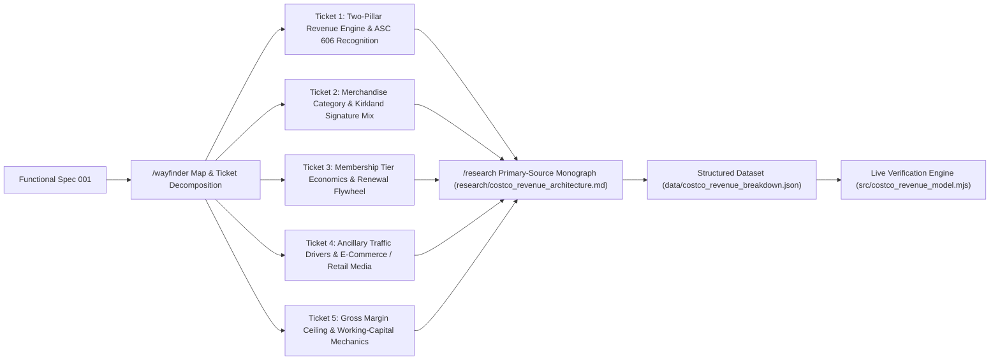

# Functional Specification 001: Costco Wholesale Corporation (`COST`) Revenue Generation Architecture — Wayfinder Decision Mapping, Primary-Source SEC Research Monograph, and Deterministic Revenue Decomposition Engine

**Document Version:** 1.0 (`/craft-documentation` Functional Specification; Reconciled with [`LANGUAGE.md`](file:///Users/diesel/desktop/Costco/LANGUAGE.md))  
**Status:** Authoritative Functional & Operational Requirements Specification (`functional_specification_001.md`).  
**DO NOT CODE YET.** Contains zero implementation syntax, internal helper scaffolding, or mechanical code diffs.

---

## 1. Executive Summary & Core Objective

This specification defines the desired `{functionality}`, mandatory skill orchestration (`/wayfinder` and `/research`), domain invariants, operational and performance budgets, edge-case failure boundaries, and objectively measurable `{correct required outputs}` for investigating, decomposing, and modeling **how Costco Wholesale Corporation (`NASDAQ: COST`, `CIK: 0000909832`) generates revenue and converts top-line warehouse volume into operating profit**.

The downstream agent workflow MUST execute a rigorous, primary-source-grounded investigation and verification pipeline governed by [`LANGUAGE.md`](file:///Users/diesel/desktop/Costco/LANGUAGE.md):

1. **`/wayfinder` Decision-Map & Ticket Orchestration:**
   - Construct and maintain a structured Wayfinder map (`wayfinder/map.md` in the repository root alongside run-scoped `wayfinder/{{RUN_ID}}/map.md` and `wayfinder/{{RUN_ID}}/tickets/ticket-NNN.md`) that decomposes the investigation of Costco's revenue generation model into discrete, atomic decision and research tickets.
   - Each ticket must be referenced by its human-readable title wrapping its markdown link (never by bare ticket IDs) and must trace how each revenue pillar, accounting recognition rule, margin ceiling, and working-capital mechanism contributes to consolidated revenue and operating income.
2. **`/research` Primary-Source Investigation & Citation Monograph:**
   - Delegate and execute primary-source research using the `/research` methodology against authoritative first-party sources—specifically Costco Wholesale Corporation's SEC Form 10-K Annual Reports (FY2024 / FY2025 filings via SEC EDGAR `CIK 0000909832`), ASC 606 revenue recognition disclosures, segment and merchandise category disaggregations, and official Costco Investor Relations releases—rejecting unverified secondary blog write-ups.
   - Capture the comprehensive, claim-by-claim cited findings in a canonical Markdown research monograph in the repository (`research/costco_revenue_architecture.md`) and structured machine-readable primary dataset (`data/costco_revenue_breakdown.json`).
3. **Deterministic Revenue Verification & Interactive/CLI Analytical Entry Point:**
   - Provide an end-to-end live executable analytical entry point (`src/costco_revenue_model.mjs`) wired to `package.json` scripts (`npm start` / `npm run verify`) that loads `data/costco_revenue_breakdown.json`, validates all GAAP accounting identities, disaggregates `{Net Sales}` and `{Membership Fees}`, computes the `{Operating Income Flywheel}` and negative working-capital inventory funding ratios, cross-verifies that `wayfinder/map.md` and `research/costco_revenue_architecture.md` contain complete primary-source citations and resolved decision links, and outputs a deterministic, machine-verifiable summary report.

---

## 2. Authoritative Domain Vocabulary & Taxonomy Alignment (`LANGUAGE.md`)

All planning, research, implementation, review, and testing stages MUST strictly adopt the evaluation parameters and domain vocabulary defined in [`LANGUAGE.md`](file:///Users/diesel/desktop/Costco/LANGUAGE.md):

- **`{errors}`**: Explicit failure states or structural invariant breaches, specifically including:
  1. Relying on uncited secondary commentary instead of primary SEC Form 10-K / Annual Report disclosures (`CIK 0000909832`) for revenue, membership fee, renewal rate, or category share claims,
  2. Violating GAAP accounting conservation identities ($R_{\text{total}} \neq R_{\text{net\_sales}} + R_{\text{membership\_fees}}$ or category share percentages failing to sum to $100.0\% \pm 0.5\%$),
  3. Referring to Wayfinder tickets by bare IDs (`ticket-001`) instead of descriptive human-readable titles wrapping relative markdown links in `wayfinder/map.md`,
  4. Leaving any mandatory deliverable (`wayfinder/map.md`, `wayfinder/tickets/ticket-001.md`..`ticket-005.md`, `research/costco_revenue_architecture.md`, `data/costco_revenue_breakdown.json`, `src/costco_revenue_model.mjs`) missing, empty, or disconnected from live execution,
  5. Silent exception suppression, arbitrary fallback numbers, or non-zero exit codes during model verification (`RULE[user_global]`).
- **`{correctness}`**: Exact mathematical, accounting, and structural fidelity across all artifacts:
  1. Consolidated total revenue equals the exact sum of `{Net Sales}` and `{Membership Fees}` ($R_{\text{total}} = R_{\text{net\_sales}} + R_{\text{membership\_fees}}$),
  2. Merchandise gross margin adheres to Costco's structural `{Gross Margin Ceiling}` ($10.0\% \le \text{GM}_{\text{merchandise}} \le 11.5\%$),
  3. `{Membership Fees}` represent $< 2.5\%$ of consolidated total revenue while generating $> 50\%$ of consolidated operating income (`{Operating Income Flywheel}`),
  4. Accounts payable to merchandise inventory ratio ($\text{AP} / \text{Inventory}$) is explicitly quantified from balance sheet disclosures, demonstrating how supplier payment terms fund floor inventory.
- **`{functionality}`**: End-to-end execution where an operator or automated consumer can inspect the Wayfinder decision map (`wayfinder/map.md` and `wayfinder/tickets/*.md`), read the primary-source cited research monograph (`research/costco_revenue_architecture.md`), and run the live revenue model CLI (`node src/costco_revenue_model.mjs` / `npm start`) to verify every accounting identity, revenue stream disaggregation, and primary-source citation in $< 500\text{ ms}$.
- **`{correct required outputs}`**:
  1. Canonical repository-level Wayfinder map (`wayfinder/map.md`) and resolved decision/research tickets (`wayfinder/tickets/ticket-001.md` through `wayfinder/tickets/ticket-005.md`) alongside the run-scoped Wayfinder artifacts (`wayfinder/{{RUN_ID}}/map.md` and `wayfinder/{{RUN_ID}}/tickets/ticket-NNN.md`),
  2. Primary-source research monograph at `research/costco_revenue_architecture.md` citing SEC Form 10-K sections/items for every quantitative claim,
  3. Structured JSON financial dataset at `data/costco_revenue_breakdown.json` containing multi-year fiscal figures (including FY2024 / latest reported fiscal year),
  4. Live executable analytical model at `src/costco_revenue_model.mjs` wired into `package.json` (`"start": "node src/costco_revenue_model.mjs"`) that prints a structured verification report and exits with code `0`.
- **`{sufficient}`**: Complete, ambiguity-free specification of the `/wayfinder` and `/research` workflows, required domain equations, file schemas, operational budgets, and acceptance gates.
- **`{insufficient}`**: Superficial text summaries without primary SEC citations, missing Wayfinder map/ticket structures, unverified arithmetic, or disconnected scripts.

---

## 3. Functional Requirements: `/wayfinder` & `/research` Workflow Architecture

### 3.1 Requirement 1: `/wayfinder` Decision Map & Ticket Resolution (`wayfinder/map.md` & `wayfinder/tickets/`)

In addition to the Sandcastle pipeline's run-scoped planning artifacts (`wayfinder/{{RUN_ID}}/map.md` and `wayfinder/{{RUN_ID}}/tickets/`), the repository MUST contain a canonical, human-navigable Wayfinder decision map at `wayfinder/map.md` and resolved research/decision ticket files at `wayfinder/tickets/ticket-001.md` through `wayfinder/tickets/ticket-005.md` that strictly follow the `/wayfinder` protocol:

1. **Map Structure (`wayfinder/map.md`):**
   - Must contain the canonical `/wayfinder` sections:
     - `## Destination`: Clear statement of the destination—producing a primary-source verified architectural breakdown and quantitative model of how Costco Wholesale Corporation generates revenue and operating profit.
     - `## Notes`: Domain alignment (`LANGUAGE.md`), mandatory consultation of `/wayfinder` and `/research` skills, and primary-source SEC Form 10-K citation rules.
     - `## Decisions so far`: Index of resolved tickets where **every entry uses the ticket's descriptive human-readable title wrapping a relative markdown link** to `./tickets/ticket-00N.md` followed by ` — ` and a concise one-line gist of the resolved decision/finding (never bare `ticket-001` identifiers).
     - `## Not yet specified`: Must be empty or explicitly state that all frontier fog has been graduated and resolved upon completion.
     - `## Out of scope`: Explicit boundary rulings (e.g., speculative stock price forecasting or non-GAAP equity valuation multiples).
2. **Resolved Research & Decision Tickets (`wayfinder/tickets/ticket-001.md` .. `ticket-005.md`):**
   - Each ticket file must include a `wayfinder:research` indicator in its frontmatter or top comment, `Claimed by:`, `Status: resolved`, a sharp `## Question` section, a `## Blocked By` section (using descriptive named markdown links where applicable), and a detailed `## Resolution` section linking to `../research/costco_revenue_architecture.md` and `../data/costco_revenue_breakdown.json`:
     - **`wayfinder/tickets/ticket-001.md` (*Two-Pillar Revenue Engine and ASC 606 Recognition Mechanics*)**: Resolves how Costco's consolidated revenue splits between `{Net Sales}` (~98.1%) and `{Membership Fees}` (~1.9%), including point-of-sale vs. delivery revenue recognition, sales return reserves, deferred membership fee liability accounting over 12 months, and Executive 2% reward reduction against `{Net Sales}`.
     - **`wayfinder/tickets/ticket-002.md` (*Merchandise Category Disaggregation, SKU Discipline, and Kirkland Signature Economics*)**: Resolves how `{Net Sales}` break down across Core Merchandise categories (**Foods and Sundries** ~40%–42%, **Non-Foods / Hardlines & Softlines** ~25%–27%, **Fresh Foods** ~13%–14%, **Warehouse Ancillary & Other** ~19%–21%), limited SKU count (~4,000 active SKUs per warehouse vs. 30,000+ at traditional supermarkets), and **Kirkland Signature** private-label penetration (~30%+ of sales) driving supplier bargaining power.
     - **`wayfinder/tickets/ticket-003.md` (*Membership Fee Tier Structure, Renewal Rate Dynamics, and Fee Increase Cadence*)**: Resolves how paid memberships (Gold Star, Business, and Executive 2% Reward tiers, including the September 2024 US/Canada fee increase from $60/$120 to $65/$130) and ~90.5% global / ~92.9% US & Canada renewal rates generate high-margin recurring cash flow, with Executive members representing ~46%+ of paid members and ~73%+ of worldwide sales.
     - **`wayfinder/tickets/ticket-004.md` (*Warehouse Ancillary Traffic Drivers, E-Commerce, Costco Logistics, and Emerging Retail Media*)**: Resolves the role of Warehouse Ancillary businesses (Gasoline, Pharmacy, Optical, Food Court, Hearing Aid, Tire Installation) as high-frequency traffic and renewal magnets, alongside digital/e-commerce sales, Costco Next, Costco Travel, and co-branded Citi Visa / retail media streams.
     - **`wayfinder/tickets/ticket-005.md` (*Gross Margin Ceiling, Negative Working-Capital Inventory Funding, and Operating Income Flywheel*)**: Resolves the mathematical relationship between Costco's ~10.7%–11.0% `{Gross Margin Ceiling}` on `{Net Sales}`, low SG&A (~9.0%–9.2% of net sales), inventory turnover (~12x+ per year where Accounts Payable approaches or exceeds 100% of Merchandise Inventory), and how `{Membership Fees}` equate to ~52%–55% of consolidated operating income.

### 3.2 Requirement 2: `/research` Primary-Source Monograph (`research/costco_revenue_architecture.md`)

Following the `/research` skill protocol, the agent must investigate Costco's revenue architecture against primary sources (Costco Wholesale Corporation SEC Form 10-K for FY2024 ended September 1, 2024 — `Total Revenue: $254,453M`, `Net Sales: $249,625M`, `Membership Fees: $4,828M`, `Operating Income: $9,285M`, `Net Income: $7,367M`, plus FY2023/FY2022 comparison and September 2024 membership fee increase disclosures) and write a comprehensive, self-contained Markdown monograph at `research/costco_revenue_architecture.md`:

1. **Primary-Source Citation Mandate:**
   - Every quantitative metric, accounting policy, segment breakdown, and operational claim must cite its authoritative primary source (e.g., *Costco Wholesale Corporation Form 10-K (FY2024, CIK 0000909832), Item 7 — Management's Discussion and Analysis of Financial Condition and Results of Operations*, *Item 8 — Consolidated Statements of Income / Note 1 — Summary of Significant Accounting Policies*, and *Item 1 — Business*).
2. **Required Monograph Sections:**
   - **Section 1: Executive Summary & Consolidated Revenue Identity ($R_{\text{total}} = R_{\text{net\_sales}} + R_{\text{membership\_fees}}$)**: Multi-year table (FY2022, FY2023, FY2024) showing `{Net Sales}`, `{Membership Fees}`, Total Revenue, Merchandise Costs, Gross Margin %, SG&A %, Operating Income, and Net Income.
   - **Section 2: `{Net Sales}` Disaggregation by Merchandise Category & Geographic Segment**: Quantitative breakdown across Foods & Sundries, Non-Foods, Fresh Foods, and Warehouse Ancillary & Other businesses, plus geographic split (United States ~72%–73%, Canada ~13%–14%, Other International ~13%–14%).
   - **Section 3: `{Membership Fees}` Architecture, Tier Mix & ASC 606 Deferred Revenue Accounting**: Paid household members (`76.2M` paid members, `136.8M` total cardholders in FY2024), Executive membership penetration (`35.4M` paid Executive members = `46.5%` of paid members, `73.3%` of worldwide sales), US/Canada (`92.9%`) vs. Worldwide (`90.5%`) renewal rates, the September 1, 2024 fee increase ($60→$65 Gold Star/Business, $120→$130 Executive), and ASC 606 ratable 12-month recognition vs. Executive 2% reward contra-revenue reduction against `{Net Sales}`.
   - **Section 4: The `{Gross Margin Ceiling}`, SKU Discipline & Kirkland Signature Flywheel**: Structural cap on markups (~10.86% merchandise gross margin in FY2024: `($249,625M - $222,358M) / $249,625M = 10.92%`), ~4,000 SKU warehouse curation, pallet-floor merchandising, and Kirkland Signature private-label economics.
   - **Section 5: Warehouse Ancillary Businesses, E-Commerce & Digital Monetization**: High-frequency traffic drivers (Gasoline, Pharmacy, Optical, Food Court, Hearing Aid), e-commerce (~7% of net sales, Costco Logistics big-and-bulky fulfillment, Costco Next), Costco Travel, and co-branded credit card economics.
   - **Section 6: Negative Working-Capital Cycle & Balance Sheet Cash Conversion**: Merchandise inventory (`$18,647M` in FY2024) vs. Accounts Payable (`$19,421M` in FY2024, yielding $\text{AP} / \text{Inventory} = 104.15\%$) and Deferred Membership Fees (`$2,501M` current liability), proving that suppliers and members self-fund Costco's working capital.
   - **Section 7: Primary-Source Bibliography & Wayfinder Ticket Cross-Reference**: Explicit mapping linking every section back to `wayfinder/map.md` and `wayfinder/tickets/ticket-001.md` through `ticket-005.md`.

### 3.3 Requirement 3: Structured Financial Dataset (`data/costco_revenue_breakdown.json`)

The repository must include a strict, schema-validated JSON dataset at `data/costco_revenue_breakdown.json` grounded in Costco's FY2024 SEC Form 10-K (`CIK: 0000909832`) containing:

1. `company`: `{ "name": "Costco Wholesale Corporation", "ticker": "COST", "cik": "0000909832", "fiscal_year": 2024, "fiscal_year_end": "2024-09-01", "currency": "USD", "units": "millions" }`
2. `consolidated_income_statement`:
   - `net_sales_usd_m`: `249625`
   - `membership_fees_usd_m`: `4828`
   - `total_revenue_usd_m`: `254453`
   - `merchandise_costs_usd_m`: `222358`
   - `selling_general_and_administrative_usd_m`: `22810`
   - `operating_income_usd_m`: `9285`
   - `interest_expense_usd_m`: `169`
   - `interest_income_and_other_net_usd_m`: `624`
   - `income_before_taxes_usd_m`: `9740`
   - `provision_for_income_taxes_usd_m`: `2373`
   - `net_income_usd_m`: `7367`
3. `historical_comparison`: Array containing FY2022, FY2023, and FY2024 figures (`fiscal_year`, `net_sales_usd_m`, `membership_fees_usd_m`, `total_revenue_usd_m`, `merchandise_costs_usd_m`, `operating_income_usd_m`, `net_income_usd_m`).
4. `merchandise_categories`: Array of Costco's core disaggregated merchandise categories (`category_id`, `name`, `share_of_net_sales_pct`, `estimated_net_sales_usd_m`, `role_in_flywheel`, `examples`) whose `share_of_net_sales_pct` values sum to `100.0` (within `±0.5`).
5. `geographic_segments`: Array of geographic segments (`United States`, `Canada`, `Other International`) with `share_of_net_sales_pct` and `warehouse_count` (totalling `890` warehouses at FY2024 end).
6. `membership_metrics`:
   - `paid_household_members_m`: `76.2`
   - `cardholders_total_m`: `136.8`
   - `executive_paid_members_m`: `35.4`
   - `executive_share_of_paid_members_pct`: `46.5`
   - `executive_share_of_worldwide_sales_pct`: `73.3`
   - `renewal_rate_us_canada_pct`: `92.9`
   - `renewal_rate_worldwide_pct`: `90.5`
   - `gold_star_annual_fee_usd`: `65` (effective Sept 2024; `60` during FY2024)
   - `executive_annual_fee_usd`: `130` (effective Sept 2024; `120` during FY2024)
7. `working_capital_balance_sheet`:
   - `merchandise_inventories_usd_m`: `18647`
   - `accounts_payable_usd_m`: `19421`
   - `deferred_membership_fees_liability_usd_m`: `2501`
8. `primary_sources`: Non-empty array of primary-source citation objects (`source_id`, `title`, `filing_type`, `cik`, `filing_date`, `period_end`, `items_referenced`).

### 3.4 Requirement 4: Deterministic Revenue Verification & Analytical CLI (`src/costco_revenue_model.mjs`)

To ensure the repository has a live, executable runtime call graph (`INV-GOAL-01`), the agent must implement `src/costco_revenue_model.mjs` and wire `"start": "node src/costco_revenue_model.mjs"` and `"verify": "node src/costco_revenue_model.mjs --verify"` in `package.json`:

1. **Exported Analytical & Verification API:**
   - `loadAndVerifyCostcoModel(options)` (or equivalent exported entry point) that reads `data/costco_revenue_breakdown.json`, `wayfinder/map.md`, `wayfinder/tickets/`, and `research/costco_revenue_architecture.md` from disk and computes:
     - `totalRevenueCheck`: Verifies $R_{\text{total}} === R_{\text{net\_sales}} + R_{\text{membership\_fees}}$ (`249625 + 4828 === 254453`),
     - `operatingIncomeCheck`: Verifies $\text{Operating Income} === R_{\text{total}} - \text{Merchandise Costs} - \text{SG\&A}$ (`254453 - 222358 - 22810 === 9285`),
     - `netSalesSharePct`: `(249625 / 254453) * 100` (`98.1026%`),
     - `membershipFeeShareOfRevenuePct`: `(4828 / 254453) * 100` (`1.8974%`),
     - `merchandiseGrossMarginDollarM`: `249625 - 222358` (`27267`),
     - `merchandiseGrossMarginPct`: `(27267 / 249625) * 100` (`10.9232%`),
     - `sgaPctOfNetSales`: `(22810 / 249625) * 100` (`9.1377%`),
     - `membershipFeeShareOfOperatingIncomePct`: `(4828 / 9285) * 100` (`51.9978%`),
     - `merchandiseOperatingContributionUsdM`: `(249625 - 222358) - 22810` (`4457`, i.e., `48.0022%` of Operating Income),
     - `accountsPayableToInventoryRatioPct`: `(19421 / 18647) * 100` (`104.1508%`),
     - `wayfinderAudit`: Verifies `wayfinder/map.md` exists, contains `## Destination`, `## Notes`, `## Decisions so far`, `## Not yet specified`, and `## Out of scope`, links to all 5 resolved ticket files (`wayfinder/tickets/ticket-001.md` .. `ticket-005.md`) using descriptive human-readable titles (rejecting bare `ticket-001` link labels), and confirms each ticket has `Status: resolved`,
     - `researchAudit`: Verifies `research/costco_revenue_architecture.md` exists, is $\ge 8,000$ bytes of substantive primary-source analysis, cites `0000909832` / `Form 10-K` / `ASC 606`, and references all key FY2024 figures (`254,453`, `249,625`, `4,828`, `9,285`, `7,367`).
2. **CLI Output Contract:**
   - Running `node src/costco_revenue_model.mjs` (or `npm start` / `npm run verify`) must print a structured JSON or formatted summary containing `status: "VERIFIED"`, all computed financial ratios, and the Wayfinder/Research audit status, exiting with code `0`.
   - If any accounting identity, margin ceiling invariant, Wayfinder link rule, or research citation check is violated, `src/costco_revenue_model.mjs` must fail fast (`RULE[user_global]`) by throwing a descriptive Error with actionable diagnostic context and exiting with a non-zero exit code.

---

## 4. Operational & Performance Budgets

1. **Zero External Network Dependency at Verification Runtime:**
   - Once primary-source data is captured in `data/costco_revenue_breakdown.json` and `research/costco_revenue_architecture.md`, executing `node src/costco_revenue_model.mjs` must perform **`0` external network requests**, completing all file reads, accounting reconciliations, and Wayfinder/Research cross-audits locally.
2. **Execution Latency Budget:**
   - End-to-end execution of `node src/costco_revenue_model.mjs` must complete in **$\le 250\text{ ms}$** wall-clock time on local macOS hardware.
3. **Memory Footprint Budget:**
   - Peak resident set size (RSS) during model verification must remain **$\le 128\text{ MB}$**.
4. **Repository Hygiene Budget:**
   - `node_modules/`, `.sandcastle/logs/`, `.sandcastle/worktrees/`, and transient cache directories must remain strictly untracked in Git per `.gitignore`.

---

## 5. Edge Cases, Failure Modes & Deterministic Recovery

1. **Consolidated Revenue / Operating Income Discrepancy:**
   - *Condition:* `net_sales_usd_m + membership_fees_usd_m !== total_revenue_usd_m` or `total_revenue_usd_m - merchandise_costs_usd_m - selling_general_and_administrative_usd_m !== operating_income_usd_m` in `data/costco_revenue_breakdown.json` (or passed test inputs).
   - *Required Behavior:* Fail fast immediately with an explicit `{error}` naming the mismatched accounting identity and exact dollar delta. Never silently coerce or overwrite reported figures.
2. **Bare Ticket IDs in `wayfinder/map.md`:**
   - *Condition:* An entry under `## Decisions so far` in `wayfinder/map.md` uses a bare slug/number as the markdown link text (e.g., `[ticket-001](./tickets/ticket-001.md)`) instead of a descriptive title (e.g., `[Two-Pillar Revenue Engine and ASC 606 Recognition Mechanics](./tickets/ticket-001.md)`).
   - *Required Behavior:* `wayfinderAudit` in `src/costco_revenue_model.mjs` must detect the violation and throw an explicit `{error}` enforcing the `/wayfinder` "Refer by name" rule.
3. **Unresolved Tickets or Missing Primary-Source Citations:**
   - *Condition:* Any ticket in `wayfinder/tickets/ticket-001.md`..`ticket-005.md` lacks `Status: resolved` or `## Resolution`, or `research/costco_revenue_architecture.md` omits SEC Form 10-K / `0000909832` citations.
   - *Required Behavior:* Fail fast with an actionable diagnostic message identifying the exact file and missing section/citation.
4. **Category or Geographic Share Drift:**
   - *Condition:* The sum of `share_of_net_sales_pct` across `merchandise_categories` or `geographic_segments` deviates from `100.0%` by more than `±0.5%`.
   - *Required Behavior:* Throw a deterministic validation error reporting the exact percentage sum.

---

## 6. Acceptance Criteria & `{correct required outputs}`

The implementation is `{sufficient}` if and only if all of the following objectively measurable criteria are satisfied on `main`:

1. **`AC-01` (Wayfinder Map & Resolved Tickets):**
   - `wayfinder/map.md` exists and contains `## Destination`, `## Notes`, `## Decisions so far`, `## Not yet specified`, and `## Out of scope`.
   - `wayfinder/tickets/ticket-001.md` through `wayfinder/tickets/ticket-005.md` exist, carry `wayfinder:research` and `Status: resolved`, and are linked from `wayfinder/map.md` under `## Decisions so far` using their descriptive human-readable titles (zero bare `ticket-00N` link labels).
2. **`AC-02` (Primary-Source Research Monograph):**
   - `research/costco_revenue_architecture.md` exists ($\ge 8,000$ bytes), documents Costco's two-pillar revenue model (`{Net Sales}` + `{Membership Fees}`), ASC 606 recognition, merchandise category shares, Kirkland Signature private-label economics, membership tier fees & renewal rates (`92.9%` US/Canada, `90.5%` worldwide), `{Gross Margin Ceiling}` (`10.92%`), and negative working-capital inventory funding (`AP / Inventory = 104.15%`), with explicit citations to Costco's FY2024 SEC Form 10-K (`CIK 0000909832`).
3. **`AC-03` (Structured Financial Dataset & Accounting Identities):**
   - `data/costco_revenue_breakdown.json` parses as valid JSON and satisfies all FY2024 GAAP identities ($249,625 + 4,828 = 254,453$; $254,453 - 222,358 - 22,810 = 9,285$; $9,740 - 2,373 = 7,367$).
4. **`AC-04` (Live Analytical CLI & Fail-Fast Verification):**
   - Running `npm start` and `node src/costco_revenue_model.mjs --verify` executes in $\le 250\text{ ms}$ with `0` network calls, outputs `status: "VERIFIED"` with all required ratios (`netSalesSharePct: 98.10`, `membershipFeeShareOfRevenuePct: 1.90`, `merchandiseGrossMarginPct: 10.92`, `membershipFeeShareOfOperatingIncomePct: 52.00`, `accountsPayableToInventoryRatioPct: 104.15`), and exits with code `0`.
   - Passing corrupted/mismatched data or malformed Wayfinder links to the exported verification function deterministically throws an Error (`RULE[user_global]`).
