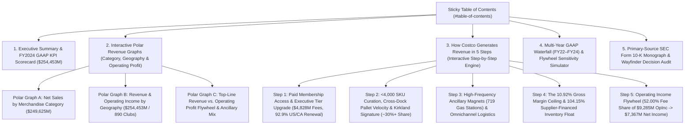

# Functional Specification 002: Costco Wholesale Corporation (`COST`) Corporate Executive Revenue Architecture — Table of Contents, Step-by-Step Revenue Walkthrough, and Interactive Polar Graph Suite

**Document Version:** 1.0 (`/craft-documentation` Functional Specification; Reconciled with [`LANGUAGE.md`](file:///Users/diesel/Desktop/Costco/LANGUAGE.md) and [`wayfinder/map.md`](file:///Users/diesel/Desktop/Costco/wayfinder/map.md))  
**Status:** Authoritative Functional & Operational Requirements Specification (`functional_specification_002.md`).  
**DO NOT CODE YET.** Contains zero implementation syntax, internal helper scaffolding, or mechanical code diffs.

---

## 1. Executive Summary & Core Objective

This specification defines the desired `{functionality}`, mandatory skill alignment (`/wayfinder`, `/research`, `/craft-documentation`, `/pre-factory`), domain invariants, operational and performance budgets, edge-case failure boundaries, and objectively measurable `{correct required outputs}` for redesigning the interactive web experience (`index.html`) in the Costco repository from a retro Dreamcore aesthetic into an **institutional Corporate Business & Investor Relations aesthetic**.

The redesigned interactive corporate report MUST clearly and rigorously explain **how Costco Wholesale Corporation (`NASDAQ: COST`, `CIK: 0000909832`) generates `$254,453M` in consolidated revenue and converts high-velocity warehouse volume (`{Net Sales}` of `$249,625M`) plus recurring club subscriptions (`{Membership Fees}` of `$4,828M`) into `$9,285M` of operating income and `$7,367M` of net income**, featuring:

1. **Corporate Business Aesthetic Overhaul:**
   - Complete removal of all Dreamcore / Y2K liminal visual and audio elements (six-winged Seraphic Watcher eye, VHS scanlines, 35mm film grain overlay, stuck-in-1999 camcorder HUD, Web Audio tape hum synth, and Dreamcore image plates).
   - Replacement with an authoritative Corporate Financial / Executive Briefing design system built on crisp white and slate surfaces (`#FFFFFF`, `#F8FAFC`, `#F1F5F9`), high-contrast slate typography (`#0F172A`, `#334155`, `#64748B`), tabular numeric alignment, and Costco Wholesale's institutional corporate brand palette (`#E31837` Costco Crimson and `#005DAA` Costco Executive Navy).
2. **Interactive Table of Contents (`TOC`) & Executive Navigation:**
   - A prominent, persistent **Table of Contents** (`#table-of-contents`) with section numbers, anchor navigation links, active scroll-spy tracking, and quick-jump controls covering every section and step of the report.
3. **Interactive Polar Graph Suite (Showcasing Where Costco Generates Revenue):**
   - Multiple interactive polar graphs (Nightingale Rose / Coxcomb polar area charts and radial multi-ring polar charts) that visually and quantitatively showcase where Costco generates its revenue and operating profit across:
     - **Polar Graph 1 — `{Net Sales}` by Merchandise Category (`$249,625M` Note 11 Disaggregation):** Foods and Sundries (`$101,463M` / `40.65%`), Non-Foods (`$63,973M` / `25.63%`), Warehouse Ancillary and Other Businesses (`$49,969M` / `20.02%`), and Fresh Foods (`$34,220M` / `13.71%`), with interactive multi-year switching (`FY2022`, `FY2023`, `FY2024`), polar scale mode toggling (`Area-Proportional √r` vs. `Radius-Proportional r` vs. `Share-Weighted Sector Angle`), and sector selection drill-downs.
     - **Polar Graph 2 — Consolidated Revenue & Operating Profit by Geographic Segment (`$254,453M` / `890` Warehouses):** United States (`$184,143M` / `72.37%` revenue, `$6,217M` operating income, `614` warehouses), Other International (`$35,436M` / `13.93%` revenue, `$1,420M` operating income, `168` warehouses), and Canada (`$34,874M` / `13.71%` revenue, `$1,648M` operating income, `108` warehouses).
     - **Polar Graph 3 — Revenue vs. `{Operating Income Flywheel}` Polar Comparison & Ancillary Sub-Drivers:** Comparative polar visualization contrasting top-line revenue share (`98.10%` `{Net Sales}` vs. `1.90%` `{Membership Fees}`) against operating income contribution (`48.00%` Net Merchandise Contribution [`$4,457M`] vs. `52.00%` `{Membership Fees}` [`$4,828M`]), plus polar decomposition of Costco's high-frequency ancillary & digital revenue drivers (`~$30.0B` Gasoline across `719` stations, `~$17.5B` E-Commerce, Pharmacy, Optical, Food Court, and Costco Travel).
4. **Structured 5-Step Sequential Revenue Generation Walkthrough:**
   - A dedicated, step-by-step corporate breakdown (**Step 1 through Step 5**) with interactive step progression, step-specific KPI cards, accounting formulas, primary-source SEC Form 10-K citations, and linked Wayfinder ticket cross-references explaining how Costco generates and compounds revenue from membership entry to net profit.
5. **End-to-End Verification Integration (`src/costco_revenue_model.mjs`):**
   - The deterministic CLI verification engine (`npm start` and `npm run verify`) must verify the financial dataset, Wayfinder map and resolved tickets (`ticket-001.md` through `ticket-006.md`), primary-source research monograph (`research/costco_revenue_architecture.md`), and the structural integrity of the corporate `index.html` deliverable (confirming presence of the Table of Contents, 5-step walkthrough, polar graphs, and complete absence of deprecated Dreamcore markers).

---

## 2. Authoritative Domain Vocabulary & Taxonomy Alignment (`LANGUAGE.md`)

All planning, scanning, implementation, review, and verification stages MUST strictly adopt the evaluation parameters and domain vocabulary defined in [`LANGUAGE.md`](file:///Users/diesel/Desktop/Costco/LANGUAGE.md):

- **`{errors}`**: Explicit failure states or structural invariant breaches, specifically including:
  1. Retaining any legacy Dreamcore / Y2K aesthetic artifacts (`dreamcore`, `seraphic`, `vhs-scanlines`, `film-grain-overlay`, `meadow_portal.jpg`, `poolroom_sanctuary.jpg`, `sky_staircase.jpg`, `tape hum`, `stuck-clock`) in `index.html`,
  2. Omitting the interactive **Table of Contents** (`#table-of-contents`), omitting any of the **5 sequential revenue steps**, or omitting the **interactive Polar Graphs** showcasing where Costco generates revenue,
  3. Violating GAAP accounting conservation identities ($R_{\text{total}} \neq R_{\text{net\_sales}} + R_{\text{membership\_fees}}$ or category/segment share percentages failing to sum to $100.0\% \pm 0.5\%$),
  4. Referring to Wayfinder tickets by bare IDs (`ticket-001`) instead of descriptive human-readable titles wrapping relative markdown links in `wayfinder/map.md`,
  5. Browser runtime console errors, uncaught page exceptions, broken anchor links in the Table of Contents, or non-zero exit codes from `node src/costco_revenue_model.mjs --verify` (`RULE[user_global]`).
- **`{correctness}`**: Exact mathematical, accounting, geometric, and structural fidelity across all artifacts:
  1. Polar graph sector angles ($\theta_i$) and radial magnitudes ($r_i$) accurately map to primary-source SEC Form 10-K figures (`$101,463M` Foods & Sundries [`40.65%`], `$63,973M` Non-Foods [`25.63%`], `$49,969M` Warehouse Ancillary [`20.02%`], `$34,220M` Fresh Foods [`13.71%`]; `$184,143M` U.S. [`72.37%`], `$35,436M` Other International [`13.93%`], `$34,874M` Canada [`13.71%`]),
  2. Consolidated total revenue equals the exact sum of `{Net Sales}` (`$249,625M`) and `{Membership Fees}` (`$4,828M`) = `$254,453M`,
  3. Merchandise gross margin adheres to Costco's structural `{Gross Margin Ceiling}` (`10.92%` in FY2024: `$27,267M / $249,625M`),
  4. `{Membership Fees}` represent `1.90%` of consolidated total revenue while generating `52.00%` (`$4,828M / $9,285M`) of consolidated operating income (`{Operating Income Flywheel}`), reinforced by `104.15%` Accounts Payable to Merchandise Inventory coverage (`$19,421M / $18,647M`).
- **`{functionality}`**: End-to-end execution where an executive, analyst, or automated browser harness can load `index.html`, navigate every section via the Table of Contents, interact with the Polar Graphs (filtering fiscal years `FY2022`–`FY2024`, toggling polar scaling modes, and inspecting individual revenue sectors), step through the 5-step revenue generation process, stress-test the `{Operating Income Flywheel}` sensitivity sliders, inspect the 6 resolved Wayfinder decision tickets, and run `npm run verify` in $\le 250\text{ ms}$ with zero network calls.
- **`{correct required outputs}`**:
  1. Redesigned corporate `index.html` containing a sticky Table of Contents, Executive KPI Ribbon, Interactive Polar Graph Suite, 5-Step Revenue Generation Walkthrough, Multi-Year GAAP Waterfall & Flywheel Sensitivity Simulator, and Wayfinder/SEC 10-K Citation Explorer,
  2. Updated `wayfinder/map.md` and `wayfinder/tickets/ticket-001.md` through `wayfinder/tickets/ticket-006.md` (with `ticket-006.md` resolving the corporate redesign, Table of Contents, 5-step narrative, and polar graph architecture),
  3. Updated `src/costco_revenue_model.mjs` and `README.md` reflecting and verifying the corporate executive architecture and all 6 Wayfinder tickets,
  4. Run-scoped planning and scanner deliverables produced by `.sandcastle/plan-scanners.mts` (`.sandcastle/plan-and-scanners.mts`).

---

## 3. Functional Requirements: Corporate Aesthetic, Table of Contents, Polar Graphs & 5-Step Revenue Walkthrough

### 3.1 Requirement 1: Corporate Business Visual Design & Layout System (`index.html`)

1. **Institutional Brand Identity & Typography:**
   - Primary Background: Crisp corporate light mode (`#F8FAFC` page canvas, `#FFFFFF` elevated card surfaces, `#F1F5F9` subtle data well backgrounds, `#E2E8F0` structural 1px hairlines).
   - Brand Accents: Costco Wholesale Crimson (`#E31837`) for primary step badges, active indicators, and membership highlights; Costco Executive Navy (`#005DAA`) for primary headers, polar chart structural strokes, and analytical controls; Emerald (`#059669`), Amber (`#D97706`), Teal (`#0D9488`), and Indigo (`#4F46E5`) for distinct polar graph category differentiation.
   - Typography: Clean corporate sans-serif (`Inter`, `-apple-system`, `BlinkMacSystemFont`, `"Segoe UI"`, `Roboto`, sans-serif) for headings and narrative prose; `font-variant-numeric: tabular-nums` and crisp monospace (`"JetBrains Mono"`, `"SFMono-Regular"`, `Menlo`, monospace) for all financial tables, dollar figures, basis points, and GAAP equations.
2. **Corporate Top Header Bar:**
   - Displays company identification (`COSTCO WHOLESALE CORPORATION · NASDAQ: COST · CIK: 0000909832`), filing basis (`FY2024 SEC Form 10-K · 52 Weeks Ended September 1, 2024`), verification badge (`STATUS: VERIFIED · 0 NETWORK CALLS`), and quick-jump buttons to the Table of Contents, Polar Graphs, 5-Step Walkthrough, and GAAP Model.

### 3.2 Requirement 2: Sticky Table of Contents (`#table-of-contents`)

1. **Structural & Interactive Requirements:**
   - A dedicated, clearly labeled **Table of Contents** (`id="table-of-contents"`, `aria-label="Table of Contents"`) must be rendered in a sticky left-hand sidebar on desktop viewports (collapsing cleanly into an accessible top index card on mobile/tablet viewports).
   - Must contain structured, numbered links to all major sections and all 5 individual steps of the revenue walkthrough:
     - `01. Executive Summary & GAAP Scorecard` (`#section-executive-summary`)
     - `02. Polar Revenue Disaggregation Suite` (`#section-polar-graphs`)
       - `2.1 Merchandise Category Polar Rose ($249.6B)`
       - `2.2 Geographic Segment Polar Chart (890 Warehouses)`
       - `2.3 Revenue vs. Operating Profit Polar Asymmetry`
     - `03. How Costco Generates Revenue in 5 Steps` (`#section-five-steps`)
       - `Step 1: Paid Membership & Executive Tier Architecture` (`#step-1`)
       - `Step 2: <4,000 SKU Curation & Kirkland Signature Scale` (`#step-2`)
       - `Step 3: Ancillary Traffic Magnets & Digital Logistics` (`#step-3`)
       - `Step 4: 10.92% Gross Margin Ceiling & 104.15% AP Float` (`#step-4`)
       - `Step 5: Operating Income Flywheel & Net Profit Conversion` (`#step-5`)
     - `04. Multi-Year GAAP Waterfall & Sensitivity Simulator` (`#section-gaap-model`)
     - `05. Primary-Source SEC 10-K & Wayfinder Decision Audit` (`#section-wayfinder-audit`)
   - **Active Scroll-Spy & Click Navigation:** Clicking any Table of Contents link smoothly scrolls to and focuses the target section or step, updating the active TOC indicator state (`aria-current="location"` / `.is-active`).

### 3.3 Requirement 3: Interactive Polar Graph Suite (`#section-polar-graphs`)

To visually showcase where Costco generates revenue and how that revenue translates into operating profit, `index.html` MUST include an interactive, zero-dependency SVG/Canvas **Polar Graph Suite** with concentric radial grid rings, angular degree/category axes, interactive hover/click tooltips, legend tables, and live controls:

1. **Primary Merchandise Category Polar Graph (`#polar-chart-categories` — Note 11 Disaggregated `{Net Sales}`):**
   - Renders a multi-sector **Nightingale Rose / Coxcomb Polar Chart** of Costco's 4 core merchandise categories across `FY2024` (`$249,625M`), `FY2023` (`$237,710M`), and `FY2022` (`$222,730M`):
     - **Foods and Sundries:** `$101,463M` (`40.65%` of FY2024 `{Net Sales}`; FY23: `$96,175M`; FY22: `$85,629M`) — Dry grocery, sundries, cooler, freezer, deli, liquor, candy, tobacco.
     - **Non-Foods:** `$63,973M` (`25.63%` of FY2024 `{Net Sales}`; FY23: `$60,865M`; FY22: `$61,100M`) — Major appliances, electronics, health & beauty aids, hardware, tires, apparel, furniture, housewares, jewelry.
     - **Warehouse Ancillary & Other:** `$49,969M` (`20.02%` of FY2024 `{Net Sales}`; FY23: `$48,693M`; FY22: `$46,474M`) — `719` Gasoline stations (`~12%` of net sales / `~$30.0B`), pharmacy, optical, food court, hearing aids, tire installation, Costco Travel.
     - **Fresh Foods:** `$34,220M` (`13.71%` of FY2024 `{Net Sales}`; FY23: `$31,977M`; FY22: `$29,527M`) — Meat, produce, service deli, bakery.
   - **Interactive Controls:**
     - **Fiscal Year Selector (`FY2024`, `FY2023`, `FY2022`, plus `Multi-Year Overlay`):** Dynamically updates polar sector radii, dollar labels, and YoY growth rates.
     - **Polar Geometry Mode Selector:** Allows switching between **Coxcomb Equal-Angle (`90°` sectors, radius scaled by revenue)** and **Variable-Angle Polar Area (sector angle $\theta_i$ proportional to share, radius scaled by YoY growth / velocity)**.
     - **Interactive Drill-Down Panel:** Clicking or hovering any polar sector highlights the sector and populates a detailed corporate breakdown card showing sub-departments, FY2022–FY2024 trend, SKU strategy, and role in the `{Operating Income Flywheel}`.
2. **Geographic Segment & Warehouse Footprint Polar Graph (`#polar-chart-geography` — Note 11 Geographic Segments):**
   - Renders a polar chart comparing **United States** (`$184,143M` / `72.37%` revenue, `$6,217M` operating income, `614` warehouses, `91.1M` sq ft), **Other International** (`$35,436M` / `13.93%` revenue, `$1,420M` operating income, `168` warehouses across 12 countries, `24.3M` sq ft), and **Canada** (`$34,874M` / `13.71%` revenue, `$1,648M` operating income, `108` warehouses, `15.5M` sq ft).
   - Supports toggling the polar radial metric between **Consolidated Revenue (`$M`)**, **Operating Income (`$M` & Operating Margin % — showcasing Canada's `4.73%` vs. U.S. `3.38%` vs. Other Intl `4.01%`)**, and **Warehouse Count & Revenue per Warehouse (`$285.9M/club` average)**.
3. **Revenue Pillar vs. Operating Income Contribution & Ancillary Sub-Drivers Polar Graph (`#polar-chart-flywheel`):**
   - Visualizes the core structural asymmetry of Costco's business model on polar coordinates:
     - **Outer / Left Polar Comparison:** Top-Line Revenue (`98.10%` `{Net Sales}` [`$249,625M`] vs. `1.90%` `{Membership Fees}` [`$4,828M`]) contrasted directly against Operating Profit Contribution (`48.00%` Net Merchandise Operating Contribution [`$4,457M`] vs. `52.00%` `{Membership Fees}` [`$4,828M`] of `$9,285M` consolidated operating income).
     - **Ancillary & Omnichannel Sub-Driver Polar Rose:** Plots the major traffic and digital sub-engines (`~$30.0B` Gasoline across `719` stations, `~$20.0B` Pharmacy/Optical/Food Court/Hearing/Tire, `~$17.5B` E-Commerce [`~7%` of net sales, `+16%` comp growth], and `~$5.0B` other digitally originated/travel channels).

### 3.4 Requirement 4: "How Costco Generates Revenue in 5 Steps" Sequential Walkthrough (`#section-five-steps`)

The page must present a clear, pedagogical **5-Step Corporate Walkthrough** (`#step-1` through `#step-5`) with both a full vertical narrative view (linked from the Table of Contents) and an interactive **Step Focus / Stepper Controller** (`Step 1` → `Step 2` → `Step 3` → `Step 4` → `Step 5`) that highlights how each stage feeds the next:

1. **Step 1: Gatekeeper Subscription — Paid Membership Tiers & `92.9%` Renewal Lock-In (`$4,828M` `{Membership Fees}`)**
   - **Core Mechanism:** Customers must pay an annual membership fee before shopping (`$65/yr` Gold Star & Business, `$130/yr` Executive effective Sept 1, 2024; `$60/$120` during FY2024).
   - **Key Verified Metrics:** `76.2M` total paid members (`63.7M` Gold Star + `12.5M` Business), `60.6M` household cards = `136.8M` total cardholders; `35.4M` paid Executive members (`46.5%` of paid base) generating **`73.3%` of worldwide `{Net Sales}`**; `92.9%` U.S./Canada and `90.5%` worldwide renewal rates; `$2,501M` `Deferred membership fees` liability amortized ratably over 12 months under `ASC 606`; `$2,804M` Executive 2% reward recognized as a direct contra-revenue reduction against `{Net Sales}` (never SG&A); `+$370M` projected two-year fee increase lift (`FY2025–FY2026`).
2. **Step 2: Concentrated Purchasing Scale — `<4,000` Warehouse SKUs & Kirkland Signature (`$249,625M` `{Net Sales}`)**
   - **Core Mechanism:** Rather than stocking `30,000+` items like traditional supermarkets, Costco curates fewer than `4,000` active warehouse SKUs across `890` clubs (`130.9M` sq ft), channeling `>$62M` of annual volume into each average SKU.
   - **Key Verified Metrics:** Note 11 category disaggregation (`$101,463M` Foods & Sundries [`40.65%`], `$63,973M` Non-Foods [`25.63%`], `$49,969M` Warehouse Ancillary [`20.02%`], `$34,220M` Fresh Foods [`13.71%`]); `~30%+` Kirkland Signature private-label penetration (priced below national brands while earning higher gross margin bps, contributing to a `+36 bps` core merchandise margin expansion in FY2024); cross-docked pallet floor merchandising (`31.9M` sq ft depot network) that minimizes handling labor and shrinkage.
3. **Step 3: High-Frequency Trip Magnets — `719` Gas Stations, Ancillary Services & Omnichannel Logistics (`$49,969M` Ancillary + `~7%` E-Commerce)**
   - **Core Mechanism:** Loss-leader and ultra-low-margin ancillary departments pull members onto warehouse properties weekly, while digital and big-and-bulky fulfillment capture incremental wallet share without crowding warehouse aisles.
   - **Key Verified Metrics:** `719` member-only gas stations generating `~12%` of consolidated `{Net Sales}` (`~$30B`, `+1%` gallon volume in FY2024); Pharmacy (`+3%` YoY ancillary dollar growth leader), Optical, Hearing Aids, Tire Installation, and the iconic `$1.50` Hot Dog & Soda Food Court; E-Commerce (`~7%` of net sales / `~$17.5B`, `+16%` comparable sales growth across `9,000–10,000` online SKUs); Digitally Originated Sales (`~9%` of net sales / `~$22.5B`); Costco Logistics, Costco Next, Costco Travel, and Citibank co-branded Visa card royalties & February reward certificates.
4. **Step 4: Disciplined Pricing & Negative Working Capital — The `10.92%` `{Gross Margin Ceiling}` & `104.15%` Supplier Float**
   - **Core Mechanism:** Costco contractually and culturally caps merchandise markups so that `{Net Sales}` (`$249,625M`) minus `Merchandise costs` (`$222,358M`) yields a **`10.92%` `{Gross Margin Ceiling}`** (`$27,267M`), passing every additional basis point of supplier volume rebates (`Note 1`) back to members in lower shelf prices.
   - **Key Verified Metrics:** Lean `9.14%` SG&A (`$22,810M`, inclusive of warehouse preopening costs per Note 1); rapid `12.60x` average inventory turnover (`~28.97` Days Inventory Outstanding vs. `~31.88` Days Payable Outstanding); `$19,421M` in `Accounts payable` divided by `$18,647M` in `Merchandise inventories` = **`104.15%` supplier inventory coverage**, meaning trade vendors finance `100%` of Costco's floor inventory plus `+$774M` in excess cash float.
5. **Step 5: The `{Operating Income Flywheel}` — Converting `$4,828M` of Fees into `52.00%` of Consolidated Operating Profit (`$9,285M` → `$7,367M` Net Income)**
   - **Core Mechanism:** Because the `10.92%` merchandise gross margin (`$27,267M`) more than covers the `9.14%` SG&A (`$22,810M`), warehouse retail operations generate `$4,457M` (`48.00%`) of net merchandise operating contribution, allowing `100%` of `{Membership Fees}` (`$4,828M`, or **`52.00%`** of consolidated operating income) to drop straight into operating profit.
   - **Key Verified Metrics:** `$4,457M` Merchandise Operating Contribution (`1.79%` of `{Net Sales}`) + `$4,828M` `{Membership Fees}` = **`$9,285M` Consolidated Operating Income** (`3.65%` operating margin); minus `$169M` Interest Expense plus `$624M` Interest Income & Other, Net (driven by interest earned on cash balances) = **`$9,740M` Income Before Taxes**; minus `$2,373M` Income Tax Provision (`24.36%` effective tax rate) = **`$7,367M` Consolidated Net Income** (`$16.56` diluted EPS).

### 3.5 Requirement 5: Interactive Multi-Year GAAP Waterfall, Sensitivity Simulator & Wayfinder Audit Explorer (`#section-gaap-model` & `#section-wayfinder-audit`)

1. **Multi-Year GAAP Conservation Table (`FY2022`, `FY2023`, `FY2024`):**
   - Interactive year switcher displaying exact line-item reconciliation from `{Net Sales}` and `{Membership Fees}` through `Total Revenue`, `Merchandise Costs`, `Gross Margin ($ & %)`, `SG&A ($ & %)`, `Net Merchandise Operating Contribution`, `Operating Income`, `Net Interest & Other`, `Provision for Income Taxes`, and `Net Income`.
2. **Interactive `{Operating Income Flywheel}` Sensitivity Simulator:**
   - Sliders for **Merchandise Gross Margin % (`9.50%`–`14.00%`)**, **SG&A % of Net Sales (`8.50%`–`10.50%`)**, and **Membership Fee Lift (`+$0M`–`+$370M`)** with real-time recomputation of Merchandise Gross Margin ($), SG&A ($), Merchandise Operating Contribution ($ & %), Membership Fee Share of Operating Income (%), Total Operating Income ($), and an explicit governance alert when simulated gross margin exceeds the `11.50%` `{Gross Margin Ceiling}`.
3. **Primary-Source SEC Form 10-K & Wayfinder Decision Ticket Explorer:**
   - Interactive inspector displaying all **6 resolved Wayfinder decision tickets** (`ticket-001.md` through `ticket-006.md`), their `## Question`, `## Blocked By` lineage, and `## Resolution` summaries alongside direct links to [`research/costco_revenue_architecture.md`](file:///Users/diesel/Desktop/Costco/research/costco_revenue_architecture.md), [`data/costco_revenue_breakdown.json`](file:///Users/diesel/Desktop/Costco/data/costco_revenue_breakdown.json), and [`wayfinder/map.md`](file:///Users/diesel/Desktop/Costco/wayfinder/map.md).

---

## 4. Operational & Performance Budgets

1. **Zero External Network Dependency at Verification & Page Runtime:**
   - `node src/costco_revenue_model.mjs --verify` and `index.html` must require **`0` external network requests** to render all polar graphs, financial tables, step walkthroughs, and simulations (all data and SVG/Canvas polar rendering must be self-contained).
2. **Execution Latency Budget:**
   - `node src/costco_revenue_model.mjs --verify` must complete in **$\le 250\text{ ms}$** wall-clock time.
   - Interactive polar graph re-rendering (switching fiscal years or polar geometry modes) must execute in **$\le 16\text{ ms}$** (single 60fps frame).
3. **Memory Footprint Budget:**
   - CLI verification RSS must remain **$\le 128\text{ MB}$**.

---

## 5. Edge Cases, Failure Modes & Deterministic Recovery

1. **Residual Dreamcore / Liminal Aesthetic Artifacts:**
   - *Condition:* `index.html` contains deprecated Dreamcore selectors, text, or asset references (`#seraphic-watcher-btn`, `vhs-scanlines`, `film-grain-overlay`, `meadow_portal.jpg`, `poolroom_sanctuary.jpg`, `sky_staircase.jpg`, `dreamcore`).
   - *Required Behavior:* Verification must fail fast with an explicit `{error}` identifying the residual non-corporate marker.
2. **Missing Table of Contents, 5-Step Walkthrough, or Polar Graphs:**
   - *Condition:* `index.html` omits `#table-of-contents`, any of `#step-1`..`#step-5`, or the interactive polar graph containers (`#polar-chart-categories`, `#polar-chart-geography`, `#polar-chart-flywheel`).
   - *Required Behavior:* Fail fast with an actionable diagnostic error naming the missing structural element.
3. **Wayfinder Ticket Count & Link Integrity (`ticket-001.md` .. `ticket-006.md`):**
   - *Condition:* `wayfinder/map.md` omits any of the resolved tickets or uses a bare ticket ID (`[ticket-006]`) instead of a descriptive human-readable title.
   - *Required Behavior:* `verifyWayfinderArtifacts` in `src/costco_revenue_model.mjs` must throw a deterministic Error enforcing the `/wayfinder` "Refer by name" invariant.

---

## 6. Acceptance Criteria & `{correct required outputs}`

The implementation is `{sufficient}` if and only if all of the following objectively measurable criteria are satisfied on `main`:

1. **`AC-01` (Wayfinder Map & Resolved Tickets `ticket-001.md`..`ticket-006.md`):**
   - `wayfinder/map.md` and `wayfinder/tickets/ticket-001.md` through `wayfinder/tickets/ticket-006.md` exist, carry `wayfinder:research` and `Status: resolved`, and are linked from `wayfinder/map.md` under `## Decisions so far` using descriptive human-readable titles.
2. **`AC-02` (Corporate Business Aesthetic & Sticky Table of Contents in `index.html`):**
   - `index.html` uses an institutional corporate design palette (`#FFFFFF`, `#F8FAFC`, `#0F172A`, `#E31837`, `#005DAA`) with zero Dreamcore visual/audio remnants and renders an interactive sticky **Table of Contents** (`#table-of-contents`) linking to all sections and all 5 revenue steps.
3. **`AC-03` (Interactive Polar Graphs Showcasing Revenue Sources):**
   - `index.html` renders interactive SVG/Canvas **Polar Graphs** (`#polar-chart-categories`, `#polar-chart-geography`, `#polar-chart-flywheel`) accurately plotting Costco's Note 11 merchandise categories (`$101,463M` Foods & Sundries, `$63,973M` Non-Foods, `$49,969M` Warehouse Ancillary, `$34,220M` Fresh Foods), geographic segments (`$184,143M` U.S., `$35,436M` Other International, `$34,874M` Canada), and operating profit contribution (`52.00%` `{Membership Fees}` vs. `48.00%` Merchandise Contribution) with interactive year/mode toggles and drill-down inspection.
4. **`AC-04` (5-Step Revenue Generation Walkthrough & Interactive GAAP Simulator):**
   - `index.html` presents a structured 5-step walkthrough (`#step-1` through `#step-5`) with an interactive stepper controller, multi-year GAAP waterfall table (`FY2022`–`FY2024`), and live `{Operating Income Flywheel}` sensitivity sliders.
5. **`AC-05` (Sandcastle `plan-scanners.mts` Execution & Live Verification):**
   - `.sandcastle/plan-scanners.mts` (copied from `/Users/diesel/Desktop/POLYMARKET/.sandcastle/plan-and-scanners.mts`) executes against `functional_specification_002.md` via `handoff/authored.txt`.
   - `npm run verify` executes in $\le 250\text{ ms}$ with `0` network calls, outputs `status: "VERIFIED"`, and headless Chromium verification confirms `0` console errors and `0` page errors.
