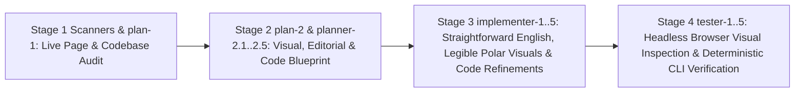

# Functional Specification 004: Costco Wholesale Corporation (`COST`) Live-Page Self-Audit, Straightforward English Editorial Refinement, High-Legibility Visual Geometry, and Autonomous Multi-Stage Blackboard Code Hardening

**Document Version:** 1.0 (`/craft-documentation` Functional Specification; Reconciled with [`LANGUAGE.md`](file:///Users/diesel/desktop/costco/LANGUAGE.md), [`functional_specification_003.md`](file:///Users/diesel/desktop/costco/functional_specification_003.md), [`wayfinder/map.md`](file:///Users/diesel/desktop/costco/wayfinder/map.md), [`data/costco_revenue_breakdown.json`](file:///Users/diesel/desktop/costco/data/costco_revenue_breakdown.json), [`index.html`](file:///Users/diesel/desktop/costco/index.html), and [`src/costco_revenue_model.mjs`](file:///Users/diesel/desktop/costco/src/costco_revenue_model.mjs))  
**Status:** Authoritative Functional & Operational Requirements Specification (`functional_specification_004.md`) — Seed Specification for [`.sandcastle/multi-stage-blackboard-pipeline.mts`](file:///Users/diesel/desktop/costco/.sandcastle/multi-stage-blackboard-pipeline.mts).  
**DO NOT CODE YET.** Contains zero implementation syntax, internal helper scaffolding, or mechanical code diffs.

---

## 1. Executive Summary & Core Objective

This specification defines the desired `{functionality}`, domain taxonomy alignment ([`LANGUAGE.md`](file:///Users/diesel/desktop/costco/LANGUAGE.md)), straightforward English editorial standards, visual legibility and geometric presentation requirements, autonomous live-page self-audit directives for Blackboard pipeline agents, operational budgets, edge-case failure boundaries, and objectively measurable `{correct required outputs}` for refining the Costco Wholesale Corporation interactive corporate report ([`index.html`](file:///Users/diesel/desktop/costco/index.html)), its structured primary-source dataset ([`data/costco_revenue_breakdown.json`](file:///Users/diesel/desktop/costco/data/costco_revenue_breakdown.json)), and its deterministic verification engine ([`src/costco_revenue_model.mjs`](file:///Users/diesel/desktop/costco/src/costco_revenue_model.mjs)).

While [`functional_specification_003.md`](file:///Users/diesel/desktop/costco/functional_specification_003.md) eliminated raw curly-brace taxonomy tokens (`{Net Sales}`, `{Membership Fees}`, `{Gross Margin Ceiling}`, `{Operating Income Flywheel}`) and reconciled baseline FY2022–FY2024 Note 11 and Item 2 figures, empirical inspection of [`index.html`](file:///Users/diesel/desktop/costco/index.html), [`data/costco_revenue_breakdown.json`](file:///Users/diesel/desktop/costco/data/costco_revenue_breakdown.json), and [`src/costco_revenue_model.mjs`](file:///Users/diesel/desktop/costco/src/costco_revenue_model.mjs) reveals three core areas requiring a comprehensive refinement pass by the multi-stage Blackboard agent pipeline:

1. **Straightforward English Descriptions Across All Page Features & Dataset Narratives:**
   - Visible reader-facing copy in [`index.html`](file:///Users/diesel/desktop/costco/index.html) and descriptive role strings in [`data/costco_revenue_breakdown.json`](file:///Users/diesel/desktop/costco/data/costco_revenue_breakdown.json) still contain raw algebraic/symbolic shorthand (`R_total ($254,453M)`, `OpInc ($9,285M) = Merch Contrib`, `Area √r (Coxcomb)`, `Share Angle θ_i`), internal file/code paths exposed in reader-facing UI cards and tables (`(Wayfinder: ticket-001.md, ticket-003.md)`, `ticket-001.md · Revenue Recognition`, `wayfinderAudit.valid === true`), and dense corporate/consulting phrasing (`Institutional Executive Briefing`, `Negative Working-Capital Float`, `Contra-Revenue`, `Treasure-hunt discretionary basket builder`, `renewal magnet`).
   - Every visible heading, executive summary paragraph, KPI card label/subnote, chart control button, polar caption, 5-step walkthrough explanation, GAAP table description, sensitivity simulator banner, and audit summary MUST be refined into clear, plain, **straightforward English** that any business reader can understand immediately without sacrificing exact GAAP and SEC Form 10-K factual accuracy.
2. **High-Legibility Visuals, Uncrowded Polar Chart Geometry & Responsive Readability:**
   - In [`index.html`](file:///Users/diesel/desktop/costco/index.html), several visual elements suffer from small, low-contrast, or crowded typography: polar SVG center-hub subtitles (`9px`), radial scale labels (`9.5px`), and sector labels (`11px`); `Share Angle θ_i` mode on `#polar-chart-categories` where uneven sector angles (`40.65%`, `25.63%`, `20.02%`, `13.71%`) place radial callout labels near the top/bottom spokes where they can crowd or collide with ring scale markers; `Dual-Ring` mode on `#polar-chart-flywheel` where inner-ring labels (`52.0% Fees OpInc`, `48.0% Merch OpInc`) rely on white text with heavy dark stroke outlines over colored sectors; and right-hand detail tables inside `.polar-details-column` compressed to `11.5px` font with `7px 6px` cell padding alongside a `400px` left SVG column.
   - All visual components—especially the three interactive polar charts (`#polar-chart-categories`, `#polar-chart-geography`, `#polar-chart-flywheel`), their SVG labels, ring scales, legends, drill-down cards, and companion tables—must be refined for crisp, effortless legibility across desktop (`1440px`) and mobile (`390px`) viewports.
3. **Mandatory Autonomous Live-Page & Codebase Self-Audit by the Blackboard Agents:**
   - Rather than only executing a static checklist, the agents in [`.sandcastle/multi-stage-blackboard-pipeline.mts`](file:///Users/diesel/desktop/costco/.sandcastle/multi-stage-blackboard-pipeline.mts) (`scanners` + `plan-1` in Stage 1, `plan-2` + `planner-2.1..2.5` in Stage 2, `implementer` + `implementer-1..5` in Stage 3, and `tester` + `tester-1..5` in Stage 4) MUST actively inspect and review [`index.html`](file:///Users/diesel/desktop/costco/index.html), [`src/costco_revenue_model.mjs`](file:///Users/diesel/desktop/costco/src/costco_revenue_model.mjs), and [`data/costco_revenue_breakdown.json`](file:///Users/diesel/desktop/costco/data/costco_revenue_breakdown.json) in a live headless browser and via DOM/CSS/JS analysis to identify, publish on the Blackboard (`blackboard post-finding`), and refine additional code, layout, state-synchronization, accessibility (ARIA tablist/tab keyboard roving focus, table-row keyboard activation, contrast ratios), and verification aspects on their own initiative.

---

## 2. Authoritative Domain Vocabulary & Taxonomy Alignment (`LANGUAGE.md`)

All discovery, planning, implementation, visual review, and verification stages MUST strictly adopt the evaluation parameters and domain vocabulary defined in [`LANGUAGE.md`](file:///Users/diesel/desktop/costco/LANGUAGE.md):

- **`{errors}`**: Explicit failure states or structural invariant breaches, specifically including:
  1. Leaking raw specification braces (`{Net Sales}`, `{Membership Fees}`, `{Gross Margin Ceiling}`, `{Operating Income Flywheel}`), `//` pseudo-code dividers, raw variable names (`R_total`, `θ_i`, `wayfinderAudit.valid === true`), or promotional metaphors (`treasure-hunt discretionary basket builder`, `renewal magnet`) into reader-facing copy,
  2. Illegible, overlapping, clipped, or low-contrast SVG text, micro-sized fonts (`< 10.5px` in SVG callouts or `< 12.5px` in data tables), or broken responsive layouts at `1440px` desktop or `390px` mobile widths,
  3. Any discrepancy between reported figures in [`index.html`](file:///Users/diesel/desktop/costco/index.html) and the audited FY2022–FY2024 SEC Form 10-K dataset in [`data/costco_revenue_breakdown.json`](file:///Users/diesel/desktop/costco/data/costco_revenue_breakdown.json),
  4. Retaining any legacy Dreamcore markers or breaking any required corporate DOM IDs (`#table-of-contents`, `#section-executive-summary`, `#section-polar-graphs`, `#polar-chart-categories`, `#polar-chart-geography`, `#polar-chart-flywheel`, `#section-five-steps`, `#step-1`..`#step-5`, `#section-gaap-model`, `#section-wayfinder-audit`),
  5. Browser runtime console errors, uncaught page exceptions, broken internal anchor links, inaccessible interactive controls, or non-zero exit codes from `npm run verify` (`RULE[user_global]`).
- **`{correctness}`**: Exact mathematical, accounting, geometric, accessibility, and editorial fidelity across all repository deliverables:
  1. Consolidated total revenue equals the exact sum of `{Net Sales}` (`$249,625M`, `98.10%`) and `{Membership Fees}` (`$4,828M`, `1.90%`) = `$254,453M` in FY2024 (`$222,730M + $4,224M = $226,954M` in FY2022; `$237,710M + $4,580M = $242,290M` in FY2023),
  2. Note 11 disaggregated `{Net Sales}` across FY2022–FY2024 match [`data/costco_revenue_breakdown.json`](file:///Users/diesel/desktop/costco/data/costco_revenue_breakdown.json):
     - **Foods and Sundries:** FY2022 `$85,629M` (`38.45%`), FY2023 `$96,175M` (`40.46%`), FY2024 `$101,463M` (`40.65%`, `+5.50%` YoY),
     - **Non-Foods:** FY2022 `$61,100M` (`27.43%`), FY2023 `$60,865M` (`25.60%`), FY2024 `$63,973M` (`25.63%`, `+5.11%` YoY),
     - **Warehouse Ancillary and Other Businesses:** FY2022 `$46,474M` (`20.87%`), FY2023 `$48,693M` (`20.48%`), FY2024 `$49,969M` (`20.02%`, `+2.62%` YoY),
     - **Fresh Foods:** FY2022 `$29,527M` (`13.26%`), FY2023 `$31,977M` (`13.45%`), FY2024 `$34,220M` (`13.71%`, `+7.01%` YoY),
  3. Note 11 and Item 2 geographic segment metrics match [`data/costco_revenue_breakdown.json`](file:///Users/diesel/desktop/costco/data/costco_revenue_breakdown.json):
     - **United States:** `$184,143M` revenue (`72.37%`), `$6,217M` operating income (`3.38%` margin), `614` warehouses (`499` owned, `115` leased, `91.1M` sq ft, `219,000` employees),
     - **Other International:** `$35,436M` revenue (`13.93%`), `$1,420M` operating income (`4.01%` margin), `168` warehouses (`113` owned, `55` leased across 12 countries, `24.3M` sq ft, `61,000` employees),
     - **Canada:** `$34,874M` revenue (`13.71%`), `$1,648M` operating income (`4.73%` margin), `108` warehouses (`91` owned, `17` leased, `15.5M` sq ft, `53,000` employees),
     - **Consolidated Total:** `$254,453M` revenue, `$9,285M` operating income (`3.65%` margin), `890` warehouses (`703` owned land and building, `187` leased—including `134` land-only leases where Costco owns the building = `837` owned buildings; `130.9M` sq ft warehouse space, `31.9M` sq ft depot space, `333,000` employees),
  4. Merchandise gross margin adheres to Costco's `{Gross Margin Ceiling}` (`10.92%` or `$27,267M` in FY2024 vs. `9.14%` or `$22,810M` SG&A), leaving `$4,457M` (`48.00%`) in net merchandise operating profit so that `$4,828M` (`52.00%`) in `{Membership Fees}` drives `$9,285M` in operating income and `$7,367M` in net income, supported by `12.60x` inventory turnover and `104.15%` accounts payable (`$19,421M`) to inventory (`$18,647M`) coverage.
- **`{functionality}`**: End-to-end user experience where a reader can open [`index.html`](file:///Users/diesel/desktop/costco/index.html) on desktop (`1440px`) or mobile (`390px`), read every section and chart explanation in clear, straightforward English, inspect high-contrast, non-overlapping, immediately legible polar charts and companion tables across all interactive modes, navigate every control and table row by mouse or keyboard, and verify all invariants via `npm run verify` in $\le 250\text{ ms}$ with `0` external network requests.
- **`{correct required outputs}`**:
  1. Refined [`index.html`](file:///Users/diesel/desktop/costco/index.html) with straightforward English descriptions, high-legibility polar charts and tables, and agent-discovered UI/code improvements,
  2. Refined [`data/costco_revenue_breakdown.json`](file:///Users/diesel/desktop/costco/data/costco_revenue_breakdown.json) with straightforward English `role_in_flywheel` descriptions (eliminating promotional idioms while preserving all schema keys and numbers),
  3. Reconciled [`wayfinder/map.md`](file:///Users/diesel/desktop/costco/wayfinder/map.md) and [`wayfinder/tickets/ticket-006.md`](file:///Users/diesel/desktop/costco/wayfinder/tickets/ticket-006.md),
  4. Hardened [`src/costco_revenue_model.mjs`](file:///Users/diesel/desktop/costco/src/costco_revenue_model.mjs) and [`README.md`](file:///Users/diesel/desktop/costco/README.md) enforcing the editorial, visual-legibility, accessibility, and data invariants.

---

## 3. Functional Requirements: Straightforward English, Visual Legibility & Autonomous Agent Self-Audit

### 3.1 Requirement 1: Straightforward English Overhaul Across All Website Features & Dataset Descriptions

1. **Plain, Direct English in All Headings, Equations, Buttons, and Narratives (`index.html`):**
   - Replace algebraic variable shorthand and cryptic abbreviations in visible banners, buttons, and table headers with clear English:
     - In `#section-executive-summary` (`.executive-equation-banner`), replace `R_total ($254,453M)` and `OpInc ($9,285M) = Merch Contrib ($4,457M | 48.00%)` with plain-English accounting equations: e.g., `Total Revenue ($254,453M) = Net Sales ($249,625M) + Membership Fees ($4,828M)` and `Operating Income ($9,285M) = Net Merchandise Profit ($4,457M, or 48.00%) + Membership Fees ($4,828M, or 52.00%)`.
     - In `#polar-chart-categories` mode toggle buttons, replace math-notation button labels (`Area √r (Coxcomb)`, `Linear Radius r`, `Share Angle θ_i`) with clear, human-readable labels (`By Area (Square-Root Scale)`, `By Radius (Linear Scale)`, `By Revenue Share (Angle)`), and explain in the chart subtitle and caption what each view shows in plain English.
     - In `#section-executive-summary` KPI cards and `#section-five-steps` step cards, replace consulting/jargon labels such as `Negative Working-Capital Float` with clear financial English such as `Supplier-Financed Inventory (104.15% AP to Inventory)`, and explain terms like `contra-revenue` plainly (`deducted directly from Net Sales rather than recorded as an operating expense`).
     - In `#section-wayfinder-audit` and `#section-five-steps`, keep the required `ticket-001.md`..`ticket-006.md` references clean and readable while replacing raw code assertions in the deliverables table (such as `wayfinderAudit.valid === true`) with plain English status descriptions (`Verified: 6 resolved research tickets and canonical decision map`).
2. **Straightforward English in `data/costco_revenue_breakdown.json`:**
   - Rewrite the `role_in_flywheel` strings inside `merchandise_categories` in [`data/costco_revenue_breakdown.json`](file:///Users/diesel/desktop/costco/data/costco_revenue_breakdown.json) to eliminate promotional clichés (`Treasure-hunt discretionary basket builder`, `renewal magnet`, `perishable weekly trip driver and rapid inventory-turn engine`) in favor of straightforward technical English describing each category's revenue share, FY2024 dollar volume, and operational role.

### 3.2 Requirement 2: Visual Legibility, Uncrowded Polar Chart Geometry & Table Readability (`index.html`)

1. **Larger, High-Contrast, Non-Overlapping SVG Polar Typography & Callouts:**
   - Increase SVG typography legibility across `#svg-polar-categories`, `#svg-polar-geography`, and `#svg-polar-flywheel`:
     - Sector title callouts (`.polar-sector-label`) must render at a clear, legible size (`>= 11.5px`–`12.5px`, weight `700`, high-contrast `#0F172A` fill) with a clean white halo (`paint-order: stroke fill; stroke: #FFFFFF; stroke-width: 3px`) so text remains 100% legible even if a callout crosses a grid ring or spoke.
     - Sector value sub-labels (`.polar-axis-label`) and concentric ring scale labels must render at `>= 10.5px`–`11px` with a crisp white halo so scale markers (`$25B`, `$50B`, `$75B`, `$101.5B`, etc.) never clash visually with sector fills or spokes.
     - Center hub titles (`.polar-center-title`) and subtitles (`.polar-center-sub`) must be sized (`>= 12px` title, `>= 10px` subtitle) inside an appropriately sized white center hub (`r >= 40px`) so the hub readout is immediately readable at a glance.
   - **Collision-Free Label Positioning Across All Polar Modes:**
     - In `#polar-chart-categories` under `By Revenue Share (Angle)` (`data-cat-mode="angle"`), ensure radial sector labels and ring scale labels (`25%`, `50%`, `75%`, `100% Share`) are positioned with sufficient angular/radial offset so sector labels never collide with top-axis ring scale labels or with each other.
     - In `#polar-chart-flywheel` under `Dual-Ring` mode (`data-fly-mode="asymmetry"`), ensure both the outer-ring callouts (`Net Sales 98.10% ($249,625M)` and `Membership Fees 1.90% ($4,828M)`) and the inner-ring callouts (`48.00% Merch Profit ($4,457M)` and `52.00% Fee Profit ($4,828M)`) use clean badge/pill backgrounds or leader callouts rather than raw text floating over dark sector boundaries, and include an explicit HTML visual legend below or beside each polar chart.
2. **Balanced Two-Column Polar Layout & Readable Companion Tables:**
   - Refine `.polar-grid-layout` and `.polar-details-column .corp-table` so the companion data tables and drill-down cards have comfortable, legible typography (`>= 12.5px` table font size, `8px 10px` cell padding, clear column alignment, and visible active-row indicators) without horizontal cramping on desktop (`1440px`) or overflow on mobile (`390px`).
3. ** Triggering `planner-2.5`, `implementer-5`, and `tester-5` in the Blackboard Pipeline:**
   - Because visual legibility, SVG polar chart geometry, typography contrast, and interactive UI polish are core deliverables of this specification, `plan-2` MUST dispatch `planner-2.5` (and downstream Stages 3 and 4 MUST run `implementer-5` and `tester-5`) to visually render, screenshot, inspect, and refine the live webpage across desktop and mobile viewports.

### 3.3 Requirement 3: Autonomous Live-Page & Codebase Review by the Blackboard Agents

1. **Mandatory Self-Directed Code & UI Review Across All Pipeline Stages:**
   - During Stage 1 (`codebase-mapper`, `api-schema-mapper`, `mcp-provisioner`, `library-installer`, `function-mapper`, and `plan-1`), Stage 2 (`plan-2` and `planner-2.1..2.5`), Stage 3 (`implementer` and `implementer-1..5`), and Stage 4 (`tester` and `tester-1..5`), agents MUST inspect the live code and rendered DOM of [`index.html`](file:///Users/diesel/desktop/costco/index.html) and [`src/costco_revenue_model.mjs`](file:///Users/diesel/desktop/costco/src/costco_revenue_model.mjs) to proactively identify and refine additional aspects of code quality, user experience, accessibility, and interactive behavior beyond the baseline items listed above.
   - Specifically, agents must audit and refine:
     - **Interactive Table Row & Tab Keyboard Accessibility:** Interactive table rows (`[data-cat-row]` and `[data-geo-row]`) in [`index.html`](file:///Users/diesel/desktop/costco/index.html) currently only bind `click` events without `tabindex="0"`, `role="button"`, or `Enter`/`Space` keyboard handlers; and `.stepper-pills` (`role="tablist"`) and `.ticket-tabs-bar` (`role="tablist"`) lack `ArrowLeft`/`ArrowRight` keyboard navigation and proper `role="tab"` / `aria-selected` semantics on ticket tabs. Agents must make all interactive rows, tabs, and polar sectors keyboard-accessible and synchronized.
     - **Bidirectional State Synchronization:** Selecting a merchandise category or geographic segment (via polar sector click/keyboard or table row click/keyboard) or toggling fiscal years (`FY2024`, `FY2023`, `FY2022`) must keep the SVG polar chart, the active table column/row highlight, the drill-down card, and the chart caption in 100% deterministic sync.
     - **Print & Reduced-Motion Resilience:** Ensure [`index.html`](file:///Users/diesel/desktop/costco/index.html) includes clean `@media (prefers-reduced-motion: reduce)` and `@media print` rules so animations/transitions respect user accessibility preferences and the corporate report prints cleanly without truncated sticky sidebars.
     - **Additional Agent-Discovered Refinements:** Any further layout, CSS token consistency, DOM performance, or verification improvements discovered by the agents during their live review of [`index.html`](file:///Users/diesel/desktop/costco/index.html) and [`src/costco_revenue_model.mjs`](file:///Users/diesel/desktop/costco/src/costco_revenue_model.mjs) must be posted to the Blackboard (`blackboard post-finding`) and incorporated into the implementation and verification suite.

### 3.4 Requirement 4: Deterministic Verification Hardening (`src/costco_revenue_model.mjs`)

1. **Preserve Existing Public Contracts While Expanding Audit Coverage:**
   - [`src/costco_revenue_model.mjs`](file:///Users/diesel/desktop/costco/src/costco_revenue_model.mjs) must preserve all existing CLI flags (`--verify`, `--root`, `--data`, `--map`, `--tickets`, `--research`, `--html`), exported function signatures (`verifyFinancialDataset`, `verifyWayfinderArtifacts`, `verifyResearchMonograph`, `verifyCorporateWebReport`, `verifyIndexHtml`, `loadAndVerifyCostcoModel`), and return schema fields.
2. **Enforce Straightforward English, Visual Legibility & Accessibility Invariants:**
   - `verifyCorporateWebReport` and `verifyFinancialDataset` in [`src/costco_revenue_model.mjs`](file:///Users/diesel/desktop/costco/src/costco_revenue_model.mjs) must additionally verify that:
     - Zero prohibited promotional jargon phrases (`treasure-hunt discretionary basket builder`, `renewal magnet`) or raw code assertions (`wayfinderAudit.valid === true`, `R_total`, `θ_i`) appear in [`index.html`](file:///Users/diesel/desktop/costco/index.html) or [`data/costco_revenue_breakdown.json`](file:///Users/diesel/desktop/costco/data/costco_revenue_breakdown.json),
     - SVG text legibility rules (halo stroke / minimum font-size rules for `.polar-sector-label`, `.polar-axis-label`, `.polar-center-title`, `.polar-center-sub`) and `@media (prefers-reduced-motion: reduce)` are present in [`index.html`](file:///Users/diesel/desktop/costco/index.html),
     - Interactive keyboard accessibility attributes and handlers (`Enter`/`Space` and arrow-key support across polar sectors, interactive table rows, stepper tabs, and ticket tabs) are present in [`index.html`](file:///Users/diesel/desktop/costco/index.html).

---

## 4. Operational & Performance Budgets

Grounded in live empirical baseline measurements of the workspace (`node src/costco_revenue_model.mjs --verify` measured at **`15.61 ms`** elapsed wall-clock time and **`46.20 MB`** RSS with **`0`** network calls):

1. **Zero External Network Dependency at Verification & Browser Runtime:**
   - `node src/costco_revenue_model.mjs --verify` and [`index.html`](file:///Users/diesel/desktop/costco/index.html) MUST execute with **`0` external network requests** (all styles, fonts, data, and SVG polar graphics must be 100% self-contained).
2. **Execution Latency Budget:**
   - `node src/costco_revenue_model.mjs --verify` MUST complete in **$\le 250\text{ ms}$** wall-clock time.
   - Interactive UI state transitions in [`index.html`](file:///Users/diesel/desktop/costco/index.html) (toggling polar chart years/modes, selecting sectors or table rows, stepping through Steps 1–5, switching GAAP table years, and moving sensitivity sliders) MUST complete in **$\le 16\text{ ms}$** (single 60fps frame).
3. **Memory Footprint Budget:**
   - CLI verification RSS MUST remain **$\le 128\text{ MB}$**.

---

## 5. Edge Cases, Failure Modes & Deterministic Recovery

1. **Leakage of Algebraic Shorthand, Raw Code Assertions, or Marketing Idioms:**
   - *Condition:* [`index.html`](file:///Users/diesel/desktop/costco/index.html) or [`data/costco_revenue_breakdown.json`](file:///Users/diesel/desktop/costco/data/costco_revenue_breakdown.json) contains raw `{...}` tokens, `//` dividers, `R_total`, `θ_i`, `wayfinderAudit.valid === true`, or promotional phrases like `treasure-hunt discretionary basket builder`.
   - *Required Behavior:* `loadAndVerifyCostcoModel` in [`src/costco_revenue_model.mjs`](file:///Users/diesel/desktop/costco/src/costco_revenue_model.mjs) must fail fast with an explicit `{error}` identifying the unrefined token or phrase.
2. **Crowded, Clipped, or Low-Contrast Polar SVG Callouts:**
   - *Condition:* Switching polar chart modes (`By Area`, `By Radius`, `By Revenue Share`, `3-Year Overlay`, `Dual-Ring`, `Ancillary Rose`) or resizing the viewport to `390px` causes SVG labels to overlap radial scale markers, clip at the `viewBox` boundary, or lose contrast against sector fills.
   - *Required Behavior:* Padded SVG `viewBox` geometry, halo-stroked text rules, angular label separation, and HTML legends must keep every label unclipped and legible across all modes at `1440px` and `390px`.
3. **Keyboard-Inaccessible Interactive Controls or Unsynchronized State:**
   - *Condition:* Interactive table rows (`[data-cat-row]`, `[data-geo-row]`), polar sectors, or tab bars cannot be operated via keyboard (`Tab`, `Enter`, `Space`, `ArrowLeft`/`ArrowRight`), or selecting a category/year fails to update both the chart and companion table/drill-down card.
   - *Required Behavior:* Deterministic event wiring and `verifyCorporateWebReport` checks must enforce keyboard accessibility and full state synchronization.

---

## 6. Acceptance Criteria & `{correct required outputs}`

The implementation is `{sufficient}` if and only if all of the following objectively measurable criteria are satisfied on `main`:

1. **`AC-01` (Straightforward English Across Website & Dataset):**
   - [`index.html`](file:///Users/diesel/desktop/costco/index.html) and [`data/costco_revenue_breakdown.json`](file:///Users/diesel/desktop/costco/data/costco_revenue_breakdown.json) present all headings, KPI cards, chart controls, polar captions, 5-step walkthroughs, simulator alerts, audit summaries, and category descriptions in clear, direct, straightforward English—with zero raw `{...}` braces, zero `//` dividers, zero `R_total`/`θ_i`/`wayfinderAudit.valid === true` code leaks, and zero promotional clichés.
2. **`AC-02` (High-Legibility Polar Graphs, Legends & Companion Tables):**
   - All three interactive polar charts (`#polar-chart-categories`, `#polar-chart-geography`, `#polar-chart-flywheel`) render with high-contrast halo-stroked labels (`>= 11.5px` sector labels, `>= 10.5px` axis/scale labels, `>= 12px` hub titles), zero label collisions across all scaling/overlay modes, clear visual legends, and readable companion tables (`>= 12.5px` font size) across `1440px` desktop and `390px` mobile viewports.
3. **`AC-03` (Autonomous Agent Live-Page Review & Accessibility Hardening):**
   - The Blackboard pipeline agents review [`index.html`](file:///Users/diesel/desktop/costco/index.html) and [`src/costco_revenue_model.mjs`](file:///Users/diesel/desktop/costco/src/costco_revenue_model.mjs) in a live headless browser and static/runtime audit, remediating keyboard accessibility across polar sectors, interactive table rows (`[data-cat-row]`, `[data-geo-row]`), stepper tabs, and Wayfinder ticket tabs, adding `@media (prefers-reduced-motion: reduce)` and `@media print` support, and verifying zero console/page errors.
4. **`AC-04` (100% Primary-Source SEC Form 10-K Data Reconciliation):**
   - Every multi-year GAAP income statement figure, Note 11 category figure (`$85,629M` / `$96,175M` / `$101,463M` Foods & Sundries; `$61,100M` / `$60,865M` / `$63,973M` Non-Foods; `$46,474M` / `$48,693M` / `$49,969M` Warehouse Ancillary; `$29,527M` / `$31,977M` / `$34,220M` Fresh Foods), and Item 2 warehouse ownership count (`703` owned / `187` leased across `890` clubs) remains 100% reconciled with [`data/costco_revenue_breakdown.json`](file:///Users/diesel/desktop/costco/data/costco_revenue_breakdown.json).
5. **`AC-05` (Wayfinder Governance & Deterministic CLI Verification):**
   - [`wayfinder/map.md`](file:///Users/diesel/desktop/costco/wayfinder/map.md) and [`wayfinder/tickets/ticket-001.md`](file:///Users/diesel/desktop/costco/wayfinder/tickets/ticket-001.md) through [`wayfinder/tickets/ticket-006.md`](file:///Users/diesel/desktop/costco/wayfinder/tickets/ticket-006.md) remain valid and resolved, and `npm run verify` (`node src/costco_revenue_model.mjs --verify`) completes in $\le 250\text{ ms}$ with `0` external network calls and `status: "VERIFIED"`.
