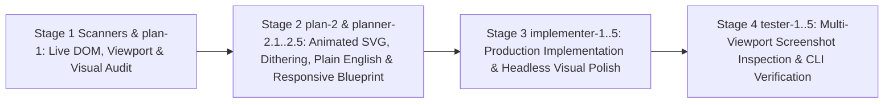

# Functional Specification 005: Costco Wholesale Corporation (`COST`) Corporate Animated SVG Elements, High-Density Halftone/Bayer Dithered Visual Effects, Simplified Straightforward English Explanations, Legible Graphs & Notes, and Screen-Size-Agnostic Responsive Architecture

**Document Version:** 1.0 (`/craft-documentation` Functional Specification; Reconciled with [`LANGUAGE.md`](file:///Users/diesel/desktop/costco/LANGUAGE.md), [`functional_specification_004.md`](file:///Users/diesel/desktop/costco/functional_specification_004.md), [`wayfinder/map.md`](file:///Users/diesel/desktop/costco/wayfinder/map.md), [`data/costco_revenue_breakdown.json`](file:///Users/diesel/desktop/costco/data/costco_revenue_breakdown.json), [`index.html`](file:///Users/diesel/desktop/costco/index.html), and [`src/costco_revenue_model.mjs`](file:///Users/diesel/desktop/costco/src/costco_revenue_model.mjs))  
**Status:** Authoritative Functional & Operational Requirements Specification (`functional_specification_005.md`) — Seed Specification for [`.sandcastle/multi-stage-blackboard-pipeline-performance.ts`](file:///Users/diesel/desktop/costco/.sandcastle/multi-stage-blackboard-pipeline-performance.ts).  
**DO NOT CODE YET.** Contains zero implementation syntax, internal helper scaffolding, or mechanical code diffs.

---

## 1. Executive Summary & Core Objective

This specification defines the desired `{functionality}`, domain taxonomy alignment ([`LANGUAGE.md`](file:///Users/diesel/desktop/costco/LANGUAGE.md)), corporate animated SVG visual architecture, high-density ordered/halftone dithered effects, simplified straightforward English explanations, high-legibility graphs and notes, screen-size-agnostic responsive behavior across all viewports, operational budgets, edge-case failure boundaries, and objectively measurable `{correct required outputs}` for refining the Costco Wholesale Corporation interactive corporate webpage ([`index.html`](file:///Users/diesel/desktop/costco/index.html)), its structured primary-source dataset ([`data/costco_revenue_breakdown.json`](file:///Users/diesel/desktop/costco/data/costco_revenue_breakdown.json)), and its deterministic verification engine ([`src/costco_revenue_model.mjs`](file:///Users/diesel/desktop/costco/src/costco_revenue_model.mjs)).

The Blackboard pipeline agents (`scanners` + `plan-1` in Stage 1, `plan-2` + `planner-2.1..2.5` in Stage 2, `implementer` + `implementer-1..5` in Stage 3, and `tester` + `tester-1..5` in Stage 4) MUST transform [`index.html`](file:///Users/diesel/desktop/costco/index.html) across five core pillars while preserving 100% primary-source SEC Form 10-K data accuracy and zero external runtime network requests:

1. **Corporate Animated SVG Elements:**
   - Enhance the corporate webpage ([`index.html`](file:///Users/diesel/desktop/costco/index.html)) with purposeful, calm, institutional **corporate animated SVG elements** across the Executive Summary header/hero, the three interactive Polar Coordinate Graphs (`#polar-chart-categories`, `#polar-chart-geography`, `#polar-chart-flywheel`), the 5-Step Revenue Flywheel walkthrough (`#step-1` through `#step-5`), and the Operating Income Flywheel diagram.
   - Animated SVG elements must convey Costco's physical and financial flow—such as animated flow-path connectors, gentle radar/polar sweep indicators, animated annular sector transitions, pulsing corporate telemetry nodes, and an animated SVG Operating Income Flywheel schematic showing how `$249,625M` in Net Sales (`98.10%` of revenue) and `$4,828M` in Membership Fees (`1.90%` of revenue) combine into `$9,285M` of Operating Income (`48.00%` merchandise profit + `52.00%` membership fee profit) and `$7,367M` of Net Income.
   - All SVG animations must run smoothly within the `<= 16 ms` (60fps) frame budget and automatically pause or settle into static high-contrast states when `@media (prefers-reduced-motion: reduce)` is active or when the user toggles an accessible animation pause/play control.
2. **Highly Dithered Corporate Print & Halftone Visual Effects:**
   - Introduce crisp, intentional, **highly dithered visual effects** tailored to an institutional annual-report / financial-engraving aesthetic (using Costco Crimson `#E31837`, Costco Executive Navy `#005DAA`, and Slate Ink `#0F172A` on clean light surfaces `#F8FAFC` / `#FFFFFF`—never reverting to prohibited Dreamcore/VHS/liminal markers).
   - Apply high-density ordered Bayer matrix dithering, SVG `<pattern>` halftone stipple matrices, SVG `<filter>` dither/stipple shaders, and dithered gradient accents to section headers, KPI scorecard accent bands, polar chart sector textures/halos, step-card visual illustrations, and callout badges—while guaranteeing that dither patterns **never** obscure, overlap, or degrade the contrast ratio ($\ge 4.5:1$ normal text, $\ge 7:1$ primary data figures) of any text, number, graph axis, or note.
3. **Simplified, Straightforward English Explanations Across Every Section, Graph, Table & Dataset:**
   - Eliminate all remaining algebraic shorthand (`R_total ($254,453M)`, `OpInc ($9,285M) = Merch Contrib`, `Area √r (Coxcomb)`, `Linear Radius r`, `Share Angle θ_i`), internal code assertions exposed in reader-facing UI (`wayfinderAudit.valid === true`), and dense consulting jargon (`Negative Working-Capital Float`, `Treasure-hunt discretionary basket builder`, `renewal magnet`, `perishable weekly trip driver and rapid inventory-turn engine`) across [`index.html`](file:///Users/diesel/desktop/costco/index.html) and [`data/costco_revenue_breakdown.json`](file:///Users/diesel/desktop/costco/data/costco_revenue_breakdown.json).
   - Provide **simplified, straightforward English explanations** for every concept, chart, control button, step card, GAAP table line item, simulator slider, and footnote so that any reader—from a first-time visitor to a financial analyst—can immediately understand in plain English *what* each number means, *how* Costco makes money, and *how to read* each polar graph and table.
4. **High-Legibility Graphs, Callout Notes, Annotations & Companion Tables:**
   - Upgrade all three polar graphs (`#svg-polar-categories`, `#svg-polar-geography`, `#svg-polar-flywheel`), their center-hub readouts, radial ring scale markers, sector callout labels, visual legends, explanatory notes, drill-down cards, and companion tables so that every label and note is immediately legible, unclipped, high-contrast, and collision-free across all interactive modes (`By Area`, `By Radius`, `By Revenue Share`, `3-Year Overlay`, `Dual-Ring`, and `Ancillary Rose`).
5. **100% Screen-Size-Agnostic Responsive Architecture:**
   - Ensure the entire webpage—including its sticky Table of Contents, corporate header, KPI cards, animated SVG diagrams, dithered visual banners, polar SVG viewports, companion tables, 5-step cards, sensitivity simulator, and notes—is **completely screen-size agnostic**.
   - Using fluid typography (`clamp()`), fluid spacing, responsive CSS Grid/Flexbox layouts, intrinsic SVG `viewBox` scaling, and zero-clipping responsive table/card containers, the page must render with zero horizontal page overflow (`document.documentElement.scrollWidth <= window.innerWidth`), zero overlapping text, and effortless readability across **all viewport dimensions**: compact mobile (`320px`, `375px`, `390px`), tablet (`768px`, `1024px`), standard desktop (`1280px`, `1440px`), and ultra-wide/4K displays (`1920px`, `2560px+`).

---

## 2. Authoritative Domain Vocabulary & Taxonomy Alignment (`LANGUAGE.md`)

All discovery, planning, implementation, visual inspection, and verification stages MUST strictly adopt the evaluation parameters and domain vocabulary defined in [`LANGUAGE.md`](file:///Users/diesel/desktop/costco/LANGUAGE.md):

- **`{errors}`**: Explicit failure states or structural invariant breaches, specifically including:
  1. Leaking raw specification braces (`{Net Sales}`, `{Membership Fees}`, `{Gross Margin Ceiling}`, `{Operating Income Flywheel}`), `//` pseudo-code dividers, raw variable names (`R_total`, `θ_i`, `wayfinderAudit.valid === true`), or promotional metaphors (`treasure-hunt discretionary basket builder`, `renewal magnet`) into reader-facing copy,
  2. Illegible, overlapping, clipped, or low-contrast SVG text, micro-sized fonts, dither patterns that obscure text legibility, or horizontal viewport overflow / broken layouts at any screen width (`320px`, `390px`, `768px`, `1024px`, `1440px`, `1920px`, `2560px`),
  3. Any discrepancy between reported figures in [`index.html`](file:///Users/diesel/desktop/costco/index.html) and the audited FY2022–FY2024 SEC Form 10-K dataset in [`data/costco_revenue_breakdown.json`](file:///Users/diesel/desktop/costco/data/costco_revenue_breakdown.json),
  4. Introducing any prohibited Dreamcore markers (`dreamcore`, `seraphic`, `vhs-scanlines`, `film-grain-overlay`, `meadow_portal.jpg`, `poolroom_sanctuary.jpg`, `sky_staircase.jpg`, `tape hum`, `stuck-clock`, `dream-sky-canvas`) or breaking any required corporate DOM IDs (`#table-of-contents`, `#section-executive-summary`, `#section-polar-graphs`, `#polar-chart-categories`, `#polar-chart-geography`, `#polar-chart-flywheel`, `#section-five-steps`, `#step-1`..`#step-5`, `#section-gaap-model`, `#section-wayfinder-audit`),
  5. Browser runtime console errors, uncaught page exceptions, broken internal anchor links, inaccessible interactive controls, or non-zero exit codes from `npm run verify` (`RULE[user_global]`).
- **`{correctness}`**: Exact mathematical, accounting, geometric, visual, accessibility, and editorial fidelity across all repository deliverables:
  1. Consolidated total revenue equals the exact sum of `{Net Sales}` (`$249,625M`, `98.10%`) and `{Membership Fees}` (`$4,828M`, `1.90%`) = `$254,453M` in FY2024 (`$222,730M + $4,224M = $226,954M` in FY2022; `$237,710M + $4,580M = $242,290M` in FY2023),
  2. Note 11 disaggregated `{Net Sales}` across FY2022–FY2024 match [`data/costco_revenue_breakdown.json`](file:///Users/diesel/desktop/costco/data/costco_revenue_breakdown.json):
     - **Foods and Sundries:** FY2022 `$85,629M` (`38.45%`), FY2023 `$96,175M` (`40.46%`), FY2024 `$101,463M` (`40.65%`, `+5.50%` YoY),
     - **Non-Foods:** FY2022 `$61,100M` (`27.43%`), FY2023 `$60,865M` (`25.60%`), FY2024 `$63,973M` (`25.63%`, `+5.11%` YoY),
     - **Warehouse Ancillary and Other Businesses:** FY2022 `$46,474M` (`20.87%`), FY2023 `$48,693M` (`20.48%`), FY2024 `$49,969M` (`20.02%`, `+2.62%` YoY),
     - **Fresh Foods:** FY2022 `$29,527M` (`13.26%`), FY2023 `$31,977M` (`13.45%`), FY2024 `$34,220M` (`13.71%`, `+7.01%` YoY),
  3. Note 11 and Item 2 geographic segment metrics match [`data/costco_revenue_breakdown.json`](file:///Users/diesel/desktop/costco/data/costco_revenue_breakdown.json):
     - **United States:** `$184,143M` revenue (`72.37%`), `$6,217M` operating income (`3.38%` margin), `614` warehouses (`499` owned, `115` leased, `91.1M` sq ft, `219,000` employees),
     - **Other International:** `$35,436M` revenue (`13.93%`), `$1,420M` operating income (`4.01%` margin), `168` warehouses (`113` owned, `55` leased across 12 countries, `24.3M` sq ft, `61,000` employees),
     - **Canada:** `$34,874M` revenue (`13.71%`), `$1,648M` operating income (`4.73%` margin), `108` warehouses (`91` owned, `17` leased, `15.5M` sq ft, `53,000` employees),
     - **Consolidated Total:** `$254,453M` revenue, `$9,285M` operating income (`3.65%` margin), `890` warehouses (`703` owned land and building, `187` leased—including `134` land-only leases where Costco owns the building = `837` owned buildings; `130.9M` sq ft warehouse space, `31.9M` sq ft depot space, `333,000` employees),
  4. Merchandise gross margin adheres to Costco's `{Gross Margin Ceiling}` (`10.92%` or `$27,267M` in FY2024 vs. `9.14%` or `$22,810M` SG&A), leaving `$4,457M` (`48.00%`) in net merchandise operating profit so that `$4,828M` (`52.00%`) in `{Membership Fees}` drives `$9,285M` in operating income and `$7,367M` in net income, supported by `12.60x` inventory turnover and `104.15%` accounts payable (`$19,421M`) to inventory (`$18,647M`) coverage.
- **`{functionality}`**: End-to-end user experience where a reader can open [`index.html`](file:///Users/diesel/desktop/costco/index.html) on any screen size (`320px` through `2560px+`), experience refined corporate animated SVG diagrams and crisp halftone/Bayer dithered visual accents, read simplified straightforward English explanations and reader's notes for every metric and graph, inspect high-legibility polar charts and tables across all interactive modes, navigate every control by mouse, touch, or keyboard, and verify all invariants via `npm run verify` in $\le 250\text{ ms}$ with `0` external network requests.
- **`{correct required outputs}`**:
  1. Refined [`index.html`](file:///Users/diesel/desktop/costco/index.html) featuring corporate animated SVG elements, highly dithered corporate visual effects, simplified straightforward English explanations, legible graphs and explanatory notes, and a screen-size-agnostic responsive layout,
  2. Refined [`data/costco_revenue_breakdown.json`](file:///Users/diesel/desktop/costco/data/costco_revenue_breakdown.json) with simplified, straightforward English `role_in_flywheel` descriptions (eliminating promotional clichés while preserving all schema keys and numbers),
  3. Reconciled [`wayfinder/map.md`](file:///Users/diesel/desktop/costco/wayfinder/map.md) and [`wayfinder/tickets/ticket-006.md`](file:///Users/diesel/desktop/costco/wayfinder/tickets/ticket-006.md),
  4. Hardened [`src/costco_revenue_model.mjs`](file:///Users/diesel/desktop/costco/src/costco_revenue_model.mjs) and [`README.md`](file:///Users/diesel/desktop/costco/README.md) enforcing the animated SVG, dithering, straightforward English, legibility, screen-size-agnostic, and primary-source data invariants.

---

## 3. Functional Requirements

### 3.1 Requirement 1: Corporate Animated SVG Elements

1. **Animated Corporate Revenue Flywheel & Flow Schematic (`#section-executive-summary` & `#section-five-steps`):**
   - Include a dedicated, responsive **Corporate Animated SVG Revenue & Profit Flywheel Diagram** (e.g., `#svg-corporate-flywheel-hero` or step-level animated SVG schematics) that visually animates how Costco's business model works end-to-end:
     - **Node 1 (Paid Membership Base):** `76.2M` Paid Members (`136.8M` Cardholders, `92.9%` U.S./Canada Renewal) paying `$4,828M` in annual Membership Fees (`1.90%` of Total Revenue),
     - **Node 2 (High-Velocity Warehouse & Ancillary Sales):** `< 4,000` active SKUs across `890` clubs (`719` gas stations + e-commerce) generating `$249,625M` in Net Sales (`98.10%` of Total Revenue),
     - **Node 3 (10.92% Gross Margin Cap & 104.15% Supplier-Financed Inventory):** `$27,267M` Gross Margin (`10.92%`) minus `$22,810M` SG&A (`9.14%`) = `$4,457M` Net Merchandise Profit (`48.00%` of Operating Income), backed by `$19,421M` Accounts Payable funding `104.15%` of `$18,647M` Inventory,
     - **Node 4 (Consolidated Operating & Net Income):** `$4,457M` Merchandise Profit (`48.00%`) + `$4,828M` Membership Fees (`52.00%`) = `$9,285M` Operating Income $\rightarrow$ `$7,367M` Net Income (`$16.56` Diluted EPS).
   - Use crisp animated SVG stroke paths (`stroke-dashoffset` flow pulses, directional animated chevrons/particles, subtle node status rings, and synchronized step highlighting when the user steps through `#step-1`..`#step-5`).
2. **Animated SVG Polar Coordinate Graphs (`#svg-polar-categories`, `#svg-polar-geography`, `#svg-polar-flywheel`):**
   - Enhance all three interactive SVG polar charts with corporate animated SVG treatments:
     - Smooth animated radial/angular sector transitions, animated active-sector selection rings or radar sweep indicators, and animated leader-line callout badges when switching fiscal years (`FY2024`, `FY2023`, `FY2022`, `3-Year Overlay`) or scaling modes.
     - Animated SVG micro-icons or mini-schematics inside the 5-Step cards (`#step-1`..`#step-5`) illustrating each step's physical mechanism (membership card verification, pallet cross-docking, gas pump & e-commerce logistics, balance-sheet payable-to-inventory gauge, and operating profit split).
3. **Motion Control & Reduced-Motion Compliance:**
   - Provide an accessible motion toggle or respect `@media (prefers-reduced-motion: reduce)` so all continuous SVG animations (`<animate>`, `<animateTransform>`, or CSS `@keyframes` on SVG elements) cleanly pause or settle into crisp static frames when reduced motion is requested.

### 3.2 Requirement 2: Highly Dithered Corporate Visual Effects

1. **Ordered Bayer Matrix & Halftone Stipple Dithering System:**
   - Implement a cohesive, self-contained **Corporate Halftone & Ordered Bayer Dithering** visual layer in [`index.html`](file:///Users/diesel/desktop/costco/index.html) using inline SVG `<defs>` patterns (`<pattern>`), SVG `<filter>` primitives, CSS `background-image` data-URI Bayer/halftone matrices, or deterministic `<canvas>`/`<svg>` dithered art plates—with **zero external network requests**.
   - Apply highly dithered effects across:
     - **Section Header & Hero Accent Bands:** High-density Bayer/halftone dithered gradient strips and editorial engraving backgrounds in corporate navy (`#005DAA`), crimson (`#E31837`), and slate (`#0F172A` / `#CBD5E1`).
     - **Polar Chart Sector & Ring Dither Accents:** Optional or dual-layered SVG `<pattern>` halftone/stipple dither fills or dithered outer halo rings on the polar coordinate charts and step illustrations that give the charts a tactile, precision-printed corporate annual-report aesthetic while keeping sector colors (`#005DAA`, `#E31837`, `#059669`, `#0F172A`, `#D97706`, `#4F46E5`) unmistakably distinct.
     - **KPI Card & Step Card Dithered Corner/HeaderPlates:** Crisp dithered halftone textures in card headers, badges, and divider rules.
2. **Strict Anti-Obscuration & Contrast Rule for Dithering:**
   - Dithered effects MUST NEVER sit directly behind body copy or data table numerals at high opacity. Every text element, number, polar callout label, and note must sit on a clean, high-contrast surface (`#FFFFFF` or `#F8FAFC` card/pill backing or `3px`–`4px` white SVG text halo) maintaining WCAG AA/AAA legibility ($\ge 4.5:1$ contrast).
   - Never use any prohibited Dreamcore/VHS/liminal keywords (`dreamcore`, `seraphic`, `vhs-scanlines`, `film-grain-overlay`, `meadow_portal.jpg`, `poolroom_sanctuary.jpg`, `sky_staircase.jpg`, `tape hum`, `stuck-clock`, `dream-sky-canvas`).

### 3.3 Requirement 3: Simplified, Straightforward English Explanations & Legible Notes

1. **Plain, Direct English Explanations in Every Section (`index.html` & `data/costco_revenue_breakdown.json`):**
   - **Plain-English "How It Works" Callout Notes:** Each of the 5 report sections and each of the 3 polar charts MUST include a prominent, easy-to-read **"In Plain English" / "How to Read This Chart" Note Box** (`.plain-english-note` / `.chart-reading-note`) written in clear, everyday English:
     - Explain **why Costco caps markups at ~11%** (`Gross Margin Ceiling`): instead of marking up items by 25%–40% like regular grocery or department stores, Costco keeps markups near 10.92% so members save enough on groceries, gas, and household goods to gladly renew their membership every year (`92.9%` in the U.S. and Canada).
     - Explain **how supplier-financed inventory works** (`104.15% Accounts Payable to Inventory`): Costco sells its warehouse inventory so quickly (`12.60 times per year`, or roughly every `29 days`) that it collects cash from members at the register before its `~32-day` supplier invoices come due—meaning suppliers effectively fund `104.15%` of Costco's `$18,647M` inventory (`$19,421M` in accounts payable, leaving `+$774M` of extra cash float).
     - Explain **how 1.90% of revenue becomes 52.00% of operating profit** (`Operating Income Flywheel`): because the `10.92%` markup on `$249,625M` of merchandise sales (`$27,267M` gross margin) pays for all `$22,810M` of warehouse and overhead expenses (`9.14%` SG&A) with `$4,457M` left over (`48.00%` of operating profit), the `$4,828M` collected in annual membership fees flows straight to operating profit (`52.00%` of Costco's `$9,285M` operating income).
     - Explain **contra-revenue** in one clear sentence: the `2%` annual cash-back reward earned by Executive members (`$2,804M` in FY2024) is subtracted directly from reported Net Sales rather than counted as an operating expense.
   - **Eliminate Remaining Algebraic & Code Shorthand in Visible UI:**
     - Replace `R_total ($254,453M)` and `OpInc ($9,285M) = Merch Contrib` in `.executive-equation-banner` with plain-English equations (`Total Revenue ($254,453M) = Net Sales ($249,625M) + Membership Fees ($4,828M)` and `Operating Income ($9,285M) = Net Merchandise Profit ($4,457M, or 48.00%) + Membership Fees ($4,828M, or 52.00%)`).
     - Replace math-notation button labels (`Area √r (Coxcomb)`, `Linear Radius r`, `Share Angle θ_i`) with plain-English button labels (`By Area (Square-Root Scale)`, `By Radius (Linear Scale)`, `By Revenue Share (Angle)`).
     - Replace `wayfinderAudit.valid === true` in the Section 05 deliverables table with plain English (`Verified: 6 resolved research tickets and canonical decision map`).
     - Rewrite `role_in_flywheel` in [`data/costco_revenue_breakdown.json`](file:///Users/diesel/desktop/costco/data/costco_revenue_breakdown.json) into straightforward English with zero promotional clichés (`treasure-hunt discretionary basket builder`, `renewal magnet`, `perishable weekly trip driver and rapid inventory-turn engine`).

### 3.4 Requirement 4: High-Legibility Graphs, Labels, Legends & Notes

1. **Crisp, Uncrowded Polar Graph Geometry & Callouts (`#polar-chart-categories`, `#polar-chart-geography`, `#polar-chart-flywheel`):**
   - **Generous SVG Coordinate Padding & Typography:**
     - Use an amply padded SVG `viewBox` (such as `viewBox="-75 -40 550 480"` or `viewBox="-55 -28 510 456"` with adjusted label radii) so outer sector labels and dollar/share sub-labels never clip or touch the SVG border in any mode.
     - Sector title labels (`.polar-sector-label`) must be $\ge 12\text{px}$ (`font-weight: 700`, `#0F172A`) with a crisp white stroke halo (`paint-order: stroke fill; stroke: #FFFFFF; stroke-width: 3.5px; stroke-linejoin: round`).
     - Sector metric sub-labels and radial ring scale labels (`.polar-axis-label`) must be $\ge 10.5\text{px}$–$11\text{px}$ (`font-weight: 600`) with a white halo so grid rings and spokes never interfere with numeral legibility.
     - Center hub titles (`.polar-center-title`, $\ge 12.5\text{px}$) and subtitles (`.polar-center-sub`, $\ge 10\text{px}$) must sit inside a clear white center hub (`r >= 40px`).
   - **Zero Label Collisions in All Modes:**
     - In `#polar-chart-categories` under `By Revenue Share (Angle)` (`data-cat-mode="angle"`), offset radial ring scale markers (e.g., placing ring scale pills along a non-colliding angle or horizontal axis) so sector labels never overlap ring scale markers.
     - In `#polar-chart-flywheel` under `Dual-Ring` mode (`data-fly-mode="asymmetry"`), render inner-ring and outer-ring labels with clean high-contrast pill badges or leader callouts and include a clear HTML visual legend and explanatory note below each chart.
2. **Readable Companion Tables & Footnote Callouts:**
   - Upgrade `.polar-details-column .corp-table` and all financial tables to a comfortable font size ($\ge 12.5\text{px}$–$13\text{px}$) with clear cell padding (`8px 10px`), distinct active-row highlighting, and clear explanatory footnotes below each table.

### 3.5 Requirement 5: 100% Screen-Size-Agnostic Responsive Architecture & Accessibility

1. **Screen-Size-Agnostic Layout Across All Viewports (`320px` to `2560px+`):**
   - **Fluid Sizing & Zero Horizontal Page Overflow:**
     - Use fluid typography (`clamp()`), fluid container padding, and flexible CSS Grid definitions (`minmax(0, 1fr)`) so that at every viewport width—`320px` (compact phone), `390px` (standard mobile), `768px` (tablet portrait), `1024px` (tablet landscape / small laptop), `1440px` (desktop), and `1920px`–`2560px` (widescreen)—`document.documentElement.scrollWidth <= window.innerWidth` holds with zero horizontal page scrollbars.
   - **Adaptive Navigation & Table of Contents:**
     - On desktop/widescreen (`> 1080px`), `#table-of-contents` operates as a sticky left-hand sidebar alongside the main report column.
     - On tablet and mobile (`<= 1080px`), `#table-of-contents` adapts into a clean, collapsible or compact full-width navigation card at the top of the report so it never squeezes main content width or traps vertical scroll.
   - **Responsive Polar Graph & Table Pairing:**
     - On wide viewports, `.polar-grid-layout` pairs the interactive SVG polar stage with its drill-down card and companion table in a balanced two-column grid (`minmax(320px, 440px) minmax(0, 1fr)`).
     - On intermediate and narrow viewports (`<= 1120px`), `.polar-grid-layout` stacks cleanly into a single full-width column where the SVG scales fluidly (`width: 100%; height: auto; max-height: 420px`) and companion tables scroll smoothly inside `.corp-table-wrap` (`overflow-x: auto; -webkit-overflow-scrolling: touch`) without stretching the page.
2. **Full Keyboard Accessibility & State Synchronization:**
   - Make all interactive table rows (`[data-cat-row]`, `[data-geo-row]`), SVG polar sectors (`[data-cat-sector]`, `[data-geo-sector]`, `[data-fly-sector]`), 5-step tabs (`[data-step-btn]`), and Wayfinder ticket tabs (`[data-ticket-tab]`) 100% keyboard-accessible (`tabindex="0"`, `Enter`/`Space` activation, and `ArrowLeft`/`ArrowRight` roving tab navigation) with full bidirectional visual synchronization.
3. **Mandatory Dispatch of `planner-2.5`, `implementer-5`, and `tester-5`:**
   - `plan-2` MUST dispatch `planner-2.5` (triggering `implementer-5` in Stage 3 and `tester-5` in Stage 4) to design, implement, render, screenshot, and visually verify the corporate animated SVG elements, high-density dithering effects, legible graphs/notes, and screen-size-agnostic responsiveness across mobile (`390px`), tablet (`768px`), and desktop (`1440px`) viewports.

### 3.6 Requirement 6: Deterministic Verification Hardening (`src/costco_revenue_model.mjs`)

1. **Preserve Existing Public Contracts While Enforcing New Visual & Editorial Invariants:**
   - [`src/costco_revenue_model.mjs`](file:///Users/diesel/desktop/costco/src/costco_revenue_model.mjs) must preserve all existing CLI flags (`--verify`, `--root`, `--data`, `--map`, `--tickets`, `--research`, `--html`), exported function signatures (`verifyFinancialDataset`, `verifyWayfinderArtifacts`, `verifyResearchMonograph`, `verifyCorporateWebReport`, `verifyIndexHtml`, `loadAndVerifyCostcoModel`), and return schema fields.
2. **Verify Corporate Animated SVG, Dithering, Straightforward English, Legibility & Responsive Rules:**
   - `verifyCorporateWebReport` and `verifyFinancialDataset` in [`src/costco_revenue_model.mjs`](file:///Users/diesel/desktop/costco/src/costco_revenue_model.mjs) must verify that:
     - Corporate animated SVG elements (animated flywheel/flow schematic and SVG animation/transition hooks with `@media (prefers-reduced-motion: reduce)` resilience) are present in [`index.html`](file:///Users/diesel/desktop/costco/index.html),
     - Corporate halftone/Bayer dithered visual definitions (SVG `<pattern>` / dithering CSS classes) are present in [`index.html`](file:///Users/diesel/desktop/costco/index.html) while zero prohibited Dreamcore markers exist,
     - Zero prohibited promotional clichés (`treasure-hunt discretionary basket builder`, `renewal magnet`) or raw code/math leaks (`wayfinderAudit.valid === true`, `R_total`, `θ_i`) appear in [`index.html`](file:///Users/diesel/desktop/costco/index.html) or [`data/costco_revenue_breakdown.json`](file:///Users/diesel/desktop/costco/data/costco_revenue_breakdown.json),
     - Plain-English explanatory note containers and high-legibility SVG halo/typography rules are present in [`index.html`](file:///Users/diesel/desktop/costco/index.html),
     - Screen-size-agnostic responsive rules (`clamp(`, `@media`, `minmax(0, 1fr)`) and keyboard accessibility handlers (`Enter`/`Space` on table rows and polar sectors) are present in [`index.html`](file:///Users/diesel/desktop/costco/index.html).

---

## 4. Operational & Performance Budgets

Grounded in live empirical baseline measurements of the workspace (`node src/costco_revenue_model.mjs --verify` measured at **`13.19 ms`** elapsed wall-clock time and **`46.70 MB`** RSS with **`0`** network calls):

1. **Zero External Network Dependency at Verification & Browser Runtime:**
   - `node src/costco_revenue_model.mjs --verify` and [`index.html`](file:///Users/diesel/desktop/costco/index.html) MUST execute with **`0` external network requests** (all styles, fonts, data, dither patterns, and animated SVG graphics must be 100% self-contained).
2. **Execution Latency & Frame-Rate Budget:**
   - `node src/costco_revenue_model.mjs --verify` MUST complete in **$\le 250\text{ ms}$** wall-clock time.
   - Interactive UI state transitions and SVG animations in [`index.html`](file:///Users/diesel/desktop/costco/index.html) MUST maintain **$\le 16\text{ ms}$** frame times (60fps) without layout thrashing.
3. **Memory Footprint Budget:**
   - CLI verification RSS MUST remain **$\le 128\text{ MB}$**.

---

## 5. Edge Cases, Failure Modes & Deterministic Recovery

1. **Dither Pattern Obscuring Text or Graph Labels:**
   - *Condition:* A dithered halftone background or SVG pattern sits behind text or polar sector labels without a solid pill or white halo backing, reducing contrast below `4.5:1`.
   - *Required Behavior:* All text, table cells, and SVG callout labels must enforce solid or halo-stroked high-contrast backing so dithering remains purely decorative/structural and never degrades text readability.
2. **Viewport Overflow on Small (`320px` / `390px`) or Ultra-Wide (`1920px+`) Screens:**
   - *Condition:* Fixed pixel widths on SVG stages, equation banners, control button groups, or tables cause horizontal page overflow (`scrollWidth > innerWidth`) on mobile phones or awkward stretching on wide monitors.
   - *Required Behavior:* Fluid CSS grid/flex wrapping, `max-width` constraints, intrinsic SVG `viewBox` scaling, and scrollable table wrappers (`.corp-table-wrap`) must keep `document.documentElement.scrollWidth <= window.innerWidth` at every viewport width.
3. **Leakage of Algebraic Shorthand, Raw Code Assertions, or Marketing Idioms:**
   - *Condition:* [`index.html`](file:///Users/diesel/desktop/costco/index.html) or [`data/costco_revenue_breakdown.json`](file:///Users/diesel/desktop/costco/data/costco_revenue_breakdown.json) contains raw `{...}` tokens, `//` dividers, `R_total`, `θ_i`, `wayfinderAudit.valid === true`, or promotional phrases like `treasure-hunt discretionary basket builder`.
   - *Required Behavior:* `loadAndVerifyCostcoModel` in [`src/costco_revenue_model.mjs`](file:///Users/diesel/desktop/costco/src/costco_revenue_model.mjs) must fail fast with an explicit `{error}` identifying the unrefined token or phrase.

---

## 6. Acceptance Criteria & `{correct required outputs}`

The implementation is `{sufficient}` if and only if all of the following objectively measurable criteria are satisfied on `main`:

1. **`AC-01` (Corporate Animated SVG Elements & Reduced-Motion Support):**
   - [`index.html`](file:///Users/diesel/desktop/costco/index.html) features purposeful corporate animated SVG elements—including an animated SVG Revenue & Operating Profit Flywheel schematic, animated polar chart sector/sweep indicators, and step-level animated SVG illustrations—with full `@media (prefers-reduced-motion: reduce)` and pause/play support.
2. **`AC-02` (High-Density Halftone / Ordered Bayer Dithered Corporate Effects):**
   - [`index.html`](file:///Users/diesel/desktop/costco/index.html) integrates crisp, self-contained halftone/Bayer dithered visual treatments across section headers, KPI scorecards, polar chart accents, and step cards in Costco's corporate palette (`#E31837`, `#005DAA`, `#0F172A`) without obscuring any text or reintroducing any Dreamcore markers.
3. **`AC-03` (Simplified Straightforward English Explanations & Notes):**
   - [`index.html`](file:///Users/diesel/desktop/costco/index.html) and [`data/costco_revenue_breakdown.json`](file:///Users/diesel/desktop/costco/data/costco_revenue_breakdown.json) explain every financial concept, chart mode, step, and table in simplified, straightforward English—including dedicated plain-English "How to Read This" / "Key Takeaway" note boxes—with zero `R_total`/`θ_i`/`wayfinderAudit.valid === true` leaks and zero promotional clichés.
4. **`AC-04` (High-Legibility Graphs, Callout Labels, Legends & Companion Tables):**
   - All three interactive polar graphs (`#polar-chart-categories`, `#polar-chart-geography`, `#polar-chart-flywheel`) render with high-contrast halo-stroked labels (`>= 12px` sector titles, `>= 10.5px` scale/value labels, `>= 12px` hub titles), zero label collisions across all modes, explicit HTML visual legends, and legible companion tables (`>= 12.5px` font size).
5. **`AC-05` (Screen-Size-Agnostic Responsive Architecture & Live Multi-Viewport Verification):**
   - [`index.html`](file:///Users/diesel/desktop/costco/index.html) renders cleanly with zero horizontal page overflow (`scrollWidth <= innerWidth`), zero clipped SVG labels, and full keyboard/pointer accessibility across `320px`, `390px`, `768px`, `1024px`, `1440px`, and `1920px+` viewports, verified in a live headless browser and by `npm run verify` completing in $\le 250\text{ ms}$ with `0` external network calls and `status: "VERIFIED"`.
