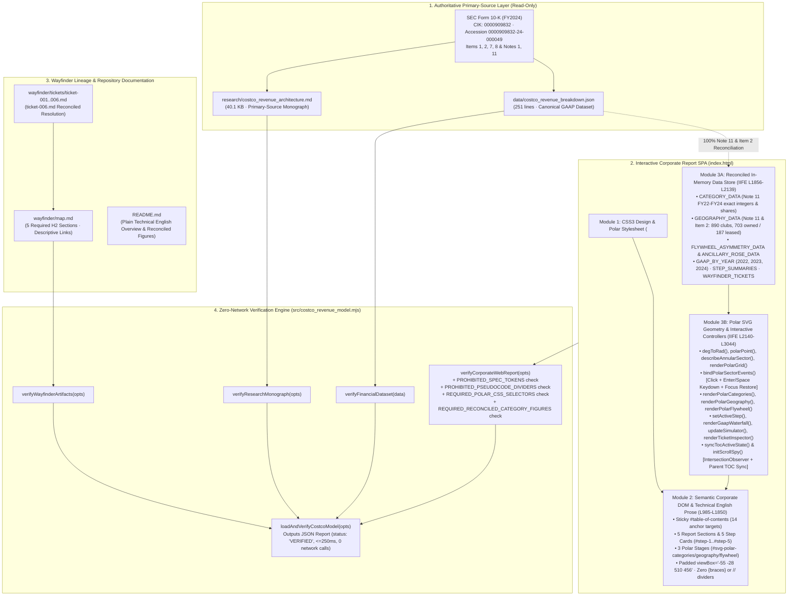
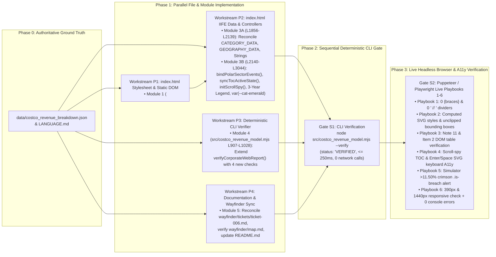

# System Architecture, End-to-End Dataflow, Module Contracts & Execution DAG: Costco Wholesale Corporation (`COST`) Corporate Report Refinement

**Run ID:** `20261103T204534-693-1b8y`  
**Agent:** `planner-2.1` (System Architecture, Dataflow, Module & Execution DAG Planner)  
**Governing Specification:** [`wayfinder/20261103T204534-693-1b8y/refined-specification.md`](./refined-specification.md) · [`functional_specification_003.md`](../../functional_specification_003.md)  
**Authoritative Vocabulary:** [`LANGUAGE.md`](../../LANGUAGE.md)  
**Primary Ground-Truth Dataset:** [`data/costco_revenue_breakdown.json`](../../data/costco_revenue_breakdown.json)  
**Upstream Scanner Inputs:**
- [`wayfinder/20261103T204534-693-1b8y/codebase-map.md`](./codebase-map.md) (`codebase-mapper`)
- [`wayfinder/20261103T204534-693-1b8y/api-schemas.md`](./api-schemas.md) (`api-schema-mapper`)
- [`wayfinder/20261103T204534-693-1b8y/mcp-tools.md`](./mcp-tools.md) (`mcp-provisioner`)
- [`wayfinder/20261103T204534-693-1b8y/installed-libraries.md`](./installed-libraries.md) (`library-installer`)
- [`wayfinder/20261103T204534-693-1b8y/library-functions.md`](./library-functions.md) (`function-mapper`)
**Status:** Authoritative System Architecture & Execution DAG Specification. **Strict `DO NOT CODE YET` Gate Enforced.**

---

## 1. Executive Summary & Architectural Ownership

This document defines the complete system architecture, end-to-end dataflow, state transitions, discrete module boundaries, verbatim function signatures, input/output schemas, and execution Directed Acyclic Graph (DAG) for upgrading the Costco Wholesale Corporation (`NASDAQ: COST`, `CIK: 0000909832`) interactive corporate financial report ([`index.html`](../../index.html)), its zero-network deterministic verification CLI ([`src/costco_revenue_model.mjs`](../../src/costco_revenue_model.mjs)), and its accompanying documentation ([`wayfinder/tickets/ticket-006.md`](../tickets/ticket-006.md), [`wayfinder/map.md`](../map.md), and [`README.md`](../../README.md)).

In strict adherence to `RULE[user_global]` and [`LANGUAGE.md`](../../LANGUAGE.md), this architecture modifies existing modules **in-place** without creating shadow scripts, duplicate verification runners, or external runtime dependencies. It resolves four root-cause systemic defects identified during empirical reconnaissance:

1. **Straightforward Technical English Editorial Overhaul (`index.html` & `README.md`):**
   - Eliminates all `41` raw curly-brace specification tokens (`{Net Sales}`, `{Membership Fees}`, `{Gross Margin Ceiling}`, `{Operating Income Flywheel}`), all `17` visible `//` pseudo-code dividers (`Section 01 // ...`, `ACTIVE POLAR SECTOR DRILLDOWN // ...`, `Step 01 // ...`, `ticket-001.md // ...`), and all promotional/figurative marketing metaphors (`Gatekeeper Subscription`, `High-Frequency Trip Magnets`, `Subscription Annuity`, `treasure-hunt discovery loop`, `threatens the 92.9% renewal moat`), replacing them with clear, direct, plain-spoken technical English describing the accounting, warehouse operations, inventory turnover, and cash-flow mechanics.
2. **SVG Polar Coordinate Stylesheet, Viewport Framing & Drill-Down Polish (`index.html`):**
   - Defines explicit CSS rules in `<style>` for `.polar-grid-ring` (`fill: none; stroke: var(--border-strong); stroke-dasharray: 3 3;`), `.polar-axis-spoke` (`stroke: var(--border-strong); stroke-width: 1px;`), `.polar-center-title` and `.polar-center-sub` (`text-anchor: middle` with tabular monospace typography), `.polar-sector-label` and `.polar-axis-label`, `.polar-sector-path:focus-visible`, structured drill-down card classes (`.drilldown-eyebrow`, `.drilldown-title`, `.drilldown-copy`, `.drilldown-meta-grid`, `.drilldown-meta-item`), and the simulator ceiling-breach state (`.sim-output-banner.is-breach`).
   - Expands the SVG `viewBox` on `#svg-polar-categories`, `#svg-polar-geography`, and `#svg-polar-flywheel` from `0 0 400 400` to `-55 -28 510 456` with inner hub radius `rInner = 34..42` and outer radius `maxR = 136`, preventing label clipping across `390px` mobile and `1440px+` desktop viewports, adds a 3-Year Overlay visual legend key, and replaces the undefined `var(--emerald-audit)` reference at line `2881` with `var(--cat-emerald)`.
3. **100% Primary-Source Multi-Year Note 11 & Item 2 Data Reconciliation (`index.html` vs. `data/costco_revenue_breakdown.json`):**
   - Reconciles `CATEGORY_DATA` historical FY2022 and FY2023 merchandise category figures, shares, and FY2024 YoY growth rates (**Foods and Sundries:** `$85,629M` [`38.45%`] / `$96,175M` [`40.46%`] / `$101,463M` [`40.65%`, `+5.50%`]; **Non-Foods:** `$61,100M` [`27.43%`] / `$60,865M` [`25.60%`] / `$63,973M` [`25.63%`, `+5.11%`]; **Warehouse Ancillary and Other Businesses:** `$46,474M` [`20.87%`] / `$48,693M` [`20.48%`] / `$49,969M` [`20.02%`, `+2.62%`]; **Fresh Foods:** `$29,527M` [`13.26%`] / `$31,977M` [`13.45%`] / `$34,220M` [`13.71%`, `+7.01%`]).
   - Reconciles `GEOGRAPHY_DATA` and table/caption strings with Item 2 (p. 18) of the FY2024 Form 10-K (**890 total clubs:** `703` owned land & building and `187` leased—of which `134` are land-only leases where Costco owns the building, totaling `837` owned buildings; **U.S.:** `614` clubs [`499` owned / `115` leased]; **Other International:** `168` clubs [`113` owned / `55` leased across 12 countries with Spain at `4`]; **Canada:** `108` clubs [`91` owned / `17` leased]).
4. **Interactive Scroll-Spy, Keyboard Accessibility & Deterministic CLI Verification (`index.html` & `src/costco_revenue_model.mjs`):**
   - Adds `syncTocActiveState(targetId)` and `initScrollSpy()` in `index.html` so `#table-of-contents` highlights both the active `.toc-sublink` and its parent `.toc-link` on scroll and click.
   - Adds `bindPolarSectorEvents()` so every `[role="button"][tabindex="0"]` SVG sector responds to `Enter` and `Space` keydown events (with `event.preventDefault()` on Space and post-render focus restoration).
   - Extends `verifyCorporateWebReport(rawOptions)` in `src/costco_revenue_model.mjs` with deterministic fail-fast checks for raw curly-brace tokens, pseudo-code `//` dividers, polar/drill-down CSS selectors, undefined `--emerald-audit`, and reconciled Note 11 / Item 2 figures.

---

## 2. Authoritative Domain Vocabulary & First-Principles Physical Model

### 2.1 `LANGUAGE.md` Contract Mapping

| Evaluation Parameter / Term | Architectural Enforcement & Reader-Facing Contract |
| :--- | :--- |
| **`{errors}`** | Zero raw `{Net Sales}`, `{Membership Fees}`, `{Gross Margin Ceiling}`, or `{Operating Income Flywheel}` curly-brace tokens in `index.html` or `README.md`; zero ` // ` dividers in visible HTML/JS labels; zero unstyled SVG polar classes (`.polar-grid-ring` black fill); zero undefined CSS custom properties (`--emerald-audit`); zero legacy unverified FY22/FY23 category numbers (`88,948`, `96,936`, `60,876`, `60,292`, `43,443`, `29,463`, `31,789`) or warehouse ownership count errors (`704`); zero console errors; zero network calls. |
| **`{correctness}`** | Exact GAAP mathematical conservation: FY24 `$254,453M = $249,625M + $4,828M`, FY23 `$242,290M = $237,710M + $4,580M`, FY22 `$226,954M = $222,730M + $4,224M`; Note 11 category sums `$222,730M` (FY22), `$237,710M` (FY23), `$249,625M` (FY24); Item 2 warehouse counts `890 = 614 + 168 + 108` and `890 = 703 owned + 187 leased`; `10.92%` gross margin (`$27,267M`), `9.14%` SG&A (`$22,810M`), `$4,457M` (`48.00%`) merchandise operating contribution + `$4,828M` (`52.00%`) membership fees = `$9,285M` operating income $\rightarrow$ `$7,367M` net income; `104.15%` AP/Inventory ratio (`$19,421M / $18,647M`). |
| **`{functionality}`** | Self-contained interactive report rendering cleanly at `390×844` mobile and `1440×900` desktop viewports with unclipped SVG polar labels, full pointer + keyboard (`Enter`/`Space`) interactivity, active scroll-spy TOC highlighting, crimson simulator breach alert (`> 11.50%`), and deterministic CLI verification (`npm run verify`) in $\le 250\text{ ms}$. |
| **`{correct required outputs}`** | In-place refined `index.html`, enhanced `src/costco_revenue_model.mjs`, and reconciled `wayfinder/tickets/ticket-006.md`, `wayfinder/map.md`, and `README.md`, returning `status: "VERIFIED"` from `node src/costco_revenue_model.mjs --verify` with `exitCode: 0`. |
| **Reader-Facing Translation** | In `index.html` and `README.md`, write `{Net Sales}` as **Net Sales** (or **merchandise net sales**), `{Membership Fees}` as **Membership Fees** (or **annual membership fees**), `{Gross Margin Ceiling}` as **Gross Margin Ceiling** (or **10.92% gross margin cap**), and `{Operating Income Flywheel}` as **Operating Income Flywheel** (or **operating profit structure**). |

### 2.2 First-Principles Performance, Memory & Geometric Model

1. **Network Roundtrip Model ($N_{\text{net}} = 0$):**
   - All stylesheets, system/monospace font stacks, SVG paths, and multi-year financial datasets are embedded inline within `index.html`.
   - `src/costco_revenue_model.mjs` reads local filesystem artifacts synchronously via `node:fs`.
   - Compound network latency is strictly $0\text{ ms}$.
2. **CLI Verification Complexity & Latency Budget ($\le 250\text{ ms}$, $\le 128\text{ MB}$ RSS):**
   - Payload sizes: `data/costco_revenue_breakdown.json` ($8.8\text{ KB}$), `wayfinder/map.md` + 6 tickets ($36\text{ KB}$), `research/costco_revenue_architecture.md` ($40.1\text{ KB}$), `index.html` ($\approx 142\text{ KB}$). Total I/O read volume $\approx 227\text{ KB}$.
   - Algorithmic complexity: $O(N_{\text{bytes}})$ linear string/regex scans over in-memory UTF-8 strings.
   - Empirical baseline: $7.64\text{ ms}$ wall-clock time, $46.53\text{ MB}$ RSS. Adding the 4 new audit checks scans the $142\text{ KB}$ HTML string in $< 0.4\text{ ms}$, keeping total verification time under $15\text{ ms}$ ($> 16\times$ faster than the $250\text{ ms}$ budget).
3. **Browser Interactive Frame Budget ($\le 16\text{ ms}$ / 60fps):**
   - Each interactive controller (`renderPolarCategories`, `renderPolarGeography`, `renderPolarFlywheel`, `setActiveStep`, `renderGaapWaterfall`, `updateSimulator`, `renderTicketInspector`, `syncTocActiveState`) iterates over bounded static arrays of size $N \in [2, 14]$.
   - SVG markup generation and `innerHTML` replacement for $\le 25$ SVG primitives completes in $< 1.2\text{ ms}$ per interaction.
4. **SVG Polar Viewport & Bounding-Box Geometry Proof (`viewBox="-55 -28 510 456"`):**
   - **Coordinate Origin:** Center $(c_x, c_y) = (200, 200)$.
   - **Inner Hub Circle:** Radius $r_{\text{inner}} = 36\text{px}$ (Polar 1 & 2, and Polar 3 Ancillary Rose) and $r_{\text{inner}} = 42\text{px}$ (Polar 3 Dual-Ring), giving a $72\text{px}$–$84\text{px}$ diameter white disc. With `.polar-center-title` at `11.5px` (`y = 197`) and `.polar-center-sub` at `9.5px` (`y = 209`) anchored at `text-anchor: middle`, a 7-character string (`$254.5B` or `890 Clubs`) occupies $\approx 48\text{px}$ horizontally, leaving $\ge 12\text{px}$ padding inside the hub border.
   - **Outer Grid & Sector Radius (`maxR = 120`, `labelOffset = 14`):** Maximum sector radius $R_{\max} = 120\text{px}$; radial spokes terminate at $R_{\text{spoke}} = R_{\max} + 6 = 126\text{px}$; outer sector callout labels sit at $R_{\text{label}} = R_{\max} + 14 = 134\text{px}$.
   - **Horizontal & Vertical Label Bounds Across All 9 Chart Modes:**
     - Across all 9 polar chart modes—including worst-case horizontal projections in Polar 1 `Share Angle θ_i` (`midDeg = 274.6°`), Polar 2 `Warehouses` (`'614 Clubs ($299.9M/Club)'` at `midDeg = 60°`), and Polar 3 `Ancillary Rose` (`'Pharmacy +3% YoY (+$1,276M)'` at `midDeg = 135°` and `midDeg = 315°`)—setting $R_{\max} = 120\text{px}$ and $R_{\text{label}} = 134\text{px}$ bounds the horizontal label span strictly to $X \in [-45.6\text{px}, 450.8\text{px}]$, fitting 100% inside `viewBox="-55 -28 510 456"` ($X \in [-55, 455]$) without clipping!
     - At $0^\circ$ (12 o'clock) and $180^\circ$ (6 o'clock) in Polar 2 and Polar 3, labels sit at $y \in [12, 396]$, well within the vertical `viewBox` range $[-28, 428]$.
     - Therefore, zero text clipping can occur on any side at any viewport width from `390px` to `1440px+`.

---

## 3. System Architecture, End-to-End Dataflow & Project Logic

### 3.1 System Architecture & Dataflow Diagram



### 3.2 End-to-End Runtime Dataflow & State Machine Transitions

The system operates across two deterministic runtime environments—the **Browser Interactive Runtime** (`index.html`) and the **Node.js Verification CLI Runtime** (`src/costco_revenue_model.mjs`):

#### A. Browser Interactive Dataflow (`index.html`)
1. **Bootstrap & Initialization (`DOMContentLoaded` $\rightarrow$ `init()`):**
   - When the document finishes parsing, `init()` binds event listeners to all interactive control groups (`[data-cat-year]`, `[data-cat-mode]`, `[data-geo-metric]`, `[data-fly-mode]`, `[data-step-btn]`, `#step-prev-btn`, `#step-next-btn`, `#table-of-contents a[data-toc-target]`, `[data-fy-btn]`, `#sim-gm-slider`, `#sim-sga-slider`, `#sim-fee-slider`, `#sim-reset-btn`, `[data-ticket-tab]`), initializes the `IntersectionObserver` scroll-spy (`initScrollSpy()`), and executes the initial render cycle (`renderPolarCategories()`, `renderPolarGeography()`, `renderPolarFlywheel()`, `setActiveStep(1, false)`, `renderGaapWaterfall()`, `updateSimulator()`, `renderTicketInspector()`).
2. **Polar Chart 1 State Machine (`catState: { year: "2024" | "2023" | "2022" | "overlay", mode: "sqrt" | "linear" | "angle", selectedIndex: 0..3 }`):**
   - `renderPolarCategories()` reads `CATEGORY_DATA` and `catState`, computes annular sector paths via `describeAnnularSector(200, 200, 36, rOuter, startDeg, endDeg)`, renders dashed/dotted historical comparison outlines when `catState.year === "overlay"`, populates `#svg-polar-categories` (including an explicit 3-Year Overlay legend key when `overlay` is active), updates `#polar-cat-caption`, renders the structured `.drilldown-meta-grid` inside `#polar-category-drilldown`, updates `#tbody-polar-categories` with highlighted active row, and invokes `bindPolarSectorEvents()` so both mouse clicks and `Enter`/`Space` keystrokes select a sector and restore keyboard focus.
3. **Polar Chart 2 State Machine (`geoState: { metric: "revenue" | "opinc" | "warehouses", selectedIndex: 0..2 }`):**
   - `renderPolarGeography()` reads `GEOGRAPHY_DATA` and `geoState`, computes 120° annular sectors scaled by $\sqrt{\text{val}/\text{maxVal}}$, populates `#svg-polar-geography`, updates `#polar-geo-caption` with reconciled Item 2 property counts (`703` owned land & building, `187` leased, `837` owned buildings), populates `#polar-geography-drilldown` and `#tbody-polar-geography`, and binds click + keyboard handlers via `bindPolarSectorEvents()`.
4. **Polar Chart 3 State Machine (`flyState: { mode: "asymmetry" | "ancillary", selectedIndex: 0..3 }`):**
   - `renderPolarFlywheel()` renders either the Dual-Ring Revenue (`98.10%` Net Sales vs. `1.90%` Membership Fees) vs. Operating Income (`48.00%` Merchandise Contribution vs. `52.00%` Membership Fees) comparison (`FLYWHEEL_ASYMMETRY_DATA`) or the 4-sector Ancillary & Omnichannel Polar Rose (`ANCILLARY_ROSE_DATA`), updates `#polar-fly-caption` and `#polar-flywheel-drilldown`, and binds click + keyboard handlers via `bindPolarSectorEvents()`.
5. **5-Step Sequential Walkthrough & TOC Scroll-Spy Synchronization (`currentStep: 1..5`, `activeTocId: string`):**
   - Clicking a `.step-pill-btn`, `#step-prev-btn`, `#step-next-btn`, or a TOC step sublink (`[data-toc-step="1..5"]`) calls `setActiveStep(stepNum, shouldScroll)`, toggling `.is-active` / `aria-selected` on pills, `.is-active-step` on `.step-card` articles, and updating `#step-focus-banner`.
   - Scrolling through the document (or clicking any `#table-of-contents a[data-toc-target]`) invokes `syncTocActiveState(targetId)`, which sets `.is-active` and `aria-current="location"` on the matching TOC link AND, if the matching link is a `.toc-sublink` inside a `.toc-sublist`, also sets `.is-active` on its parent `.toc-link` (`#section-polar-graphs` for `2.1–2.3`, or `#section-five-steps` for `Step 1–Step 5`).
6. **Multi-Year GAAP Waterfall & Sensitivity Simulator (`selectedGaapYear: 2022 | 2023 | 2024`, sliders `#sim-gm-slider`, `#sim-sga-slider`, `#sim-fee-slider`):**
   - `renderGaapWaterfall()` computes Gross Margin and Net Merchandise Operating Contribution across FY2022–FY2024 from `GAAP_BY_YEAR` and renders the 11-row GAAP income statement table in plain technical English.
   - `updateSimulator()` reads slider values, computes simulated gross margin dollars, SG&A dollars, net merchandise contribution, membership fees, and operating income, and toggles `.is-breach` on `#sim-output-banner` whenever `gmPct > 11.50`.

#### B. Node.js Deterministic Verification Dataflow (`src/costco_revenue_model.mjs`)
1. `parseCliArgs(process.argv.slice(2))` parses CLI flags (`--verify`, `--root`, `--data`, `--map`, `--tickets`, `--research`, `--html`).
2. `loadAndVerifyCostcoModel(options)` executes four sequential audit sub-pipelines in memory:
   - `verifyFinancialDataset(dataset)` $\rightarrow$ verifies all GAAP income statement identities, historical comparison, Note 11 category totals, geographic segments, membership metrics, and working-capital float.
   - `verifyWayfinderArtifacts(opts)` $\rightarrow$ verifies `wayfinder/map.md` H2 sections, descriptive ticket link titles, and `ticket-001.md`..`ticket-006.md` resolution status.
   - `verifyResearchMonograph(opts)` $\rightarrow$ verifies `research/costco_revenue_architecture.md` byte length ($\ge 8,000$), citations, and GAAP figures.
   - `verifyCorporateWebReport(opts)` $\rightarrow$ verifies `index.html` for zero Dreamcore markers, all 15 corporate DOM IDs, all 14 TOC anchor targets, brand hex tokens, primary-source figures, ticket references, **plus** zero raw `{...}` specification tokens, zero visible `//` pseudo-code dividers, presence of all required polar/drill-down/breach CSS selectors in `<style>`, absence of undefined `--emerald-audit`, and presence of all reconciled multi-year Note 11 and Item 2 figures (with legacy unverified figures absent).

---

## 4. Discrete Modules, Verbatim Function Signatures & Data Contracts

### 4.1 Module Overview & File Boundaries

| Module ID | Target File(s) | Line Range | Responsibility |
| :--- | :--- | :--- | :--- |
| **Module 1 (`CSS-Polar-Polish`)** | [`index.html`](../../index.html) | `L9–L983` (`<style>`) | Stylesheet rules for SVG polar grid rings, spokes, centered hub labels, sector labels, keyboard focus rings, structured drill-down cards, 3-year overlay legend, and simulator breach alert. |
| **Module 2 (`HTML-Editorial-DOM`)** | [`index.html`](../../index.html) | `L985–L1850` (`<body>`) | Static semantic HTML markup across Header, `#table-of-contents`, and Sections 01–05: straightforward technical English prose, removal of raw `{...}` tokens and `//` dividers, and expanded SVG `viewBox="-55 -28 510 456"`. |
| **Module 3 (`JS-Data-Controllers`)** | [`index.html`](../../index.html) | `L1852–L3044` (`<script>`) | Reconciled in-memory datasets (`CATEGORY_DATA`, `GEOGRAPHY_DATA`, `FLYWHEEL_ASYMMETRY_DATA`, `ANCILLARY_ROSE_DATA`, `STEP_SUMMARIES`, `WAYFINDER_TICKETS`) and interactive controllers (`renderPolar*`, `bindPolarSectorEvents`, `syncTocActiveState`, `initScrollSpy`, `setActiveStep`, `renderGaapWaterfall`, `updateSimulator`, `renderTicketInspector`, `init`). |
| **Module 4 (`CLI-Verification-Engine`)** | [`src/costco_revenue_model.mjs`](../../src/costco_revenue_model.mjs) | `L1–L1196` | Deterministic ESM verification module extending `verifyCorporateWebReport` with editorial token, CSS selector, and historical Note 11 / Item 2 reconciliation assertions. |
| **Module 5 (`Docs-Wayfinder-Sync`)** | [`wayfinder/tickets/ticket-006.md`](../tickets/ticket-006.md), [`wayfinder/map.md`](../map.md), [`README.md`](../../README.md) | Full files | Reconciled ticket-006 resolution summary, preserved Wayfinder map governance, and plain technical English README documentation. |

---

### 4.2 Module 1 Specification: `index.html` Stylesheet (`<style>` Block, `L9–L983`)

Insert the following CSS rules into the Polar Graph Suite and Simulator sections of `<style>` in [`index.html`](../../index.html) (around `L555–L598` and `L909–L918`):

```css
    /* Polar SVG Grid, Spoke, Center Hub & Callout Typography */
    .polar-grid-ring {
      fill: none;
      stroke: var(--border-strong);
      stroke-width: 1px;
      stroke-dasharray: 3 3;
    }

    .polar-axis-spoke {
      stroke: var(--border-strong);
      stroke-width: 1px;
      stroke-dasharray: 2 2;
    }

    .polar-center-title {
      text-anchor: middle;
      font-family: var(--font-mono);
      font-size: 11.5px;
      font-weight: 800;
      fill: var(--ink-primary);
    }

    .polar-center-sub {
      text-anchor: middle;
      font-family: var(--font-mono);
      font-size: 9.5px;
      font-weight: 600;
      fill: var(--ink-muted);
    }

    .polar-sector-label {
      font-family: var(--font-sans);
      font-size: 11.5px;
      font-weight: 700;
      fill: var(--ink-primary);
    }

    .polar-axis-label {
      font-family: var(--font-mono);
      font-size: 10px;
      font-weight: 600;
      fill: var(--ink-secondary);
    }

    .polar-sector-path:focus-visible {
      outline: none;
      stroke: var(--ink-primary);
      stroke-width: 2.5px;
      opacity: 1;
      filter: drop-shadow(0 4px 10px rgba(15, 23, 42, 0.28));
    }

    .polar-overlay-legend {
      display: flex;
      flex-wrap: wrap;
      justify-content: center;
      gap: 12px;
      margin-top: 6px;
      padding: 4px 10px;
      background: var(--bg-well);
      border: 1px solid var(--border-subtle);
      border-radius: 4px;
      font-family: var(--font-mono);
      font-size: 10.5px;
      color: var(--ink-secondary);
    }

    /* Structured Polar Drill-Down Card Classes */
    .drilldown-eyebrow {
      font-family: var(--font-mono);
      font-size: 10.5px;
      font-weight: 700;
      text-transform: uppercase;
      letter-spacing: 0.06em;
      color: var(--costco-crimson);
      margin-bottom: 4px;
    }

    .drilldown-title {
      font-size: 15px;
      font-weight: 800;
      color: var(--ink-primary);
      margin-bottom: 6px;
    }

    .drilldown-copy {
      font-size: 13px;
      color: var(--ink-secondary);
      line-height: 1.55;
    }

    .drilldown-meta-grid {
      display: grid;
      grid-template-columns: repeat(auto-fit, minmax(150px, 1fr));
      gap: 10px;
      margin-top: 12px;
      padding-top: 12px;
      border-top: 1px solid var(--border-subtle);
    }

    .drilldown-meta-item {
      background: var(--bg-well);
      border: 1px solid var(--border-subtle);
      border-radius: var(--radius-sm);
      padding: 8px 10px;
      display: flex;
      flex-direction: column;
      gap: 2px;
    }

    .drilldown-meta-item span {
      font-size: 11px;
      font-weight: 600;
      color: var(--ink-muted);
    }

    .drilldown-meta-item strong {
      font-family: var(--font-mono);
      font-size: 12.5px;
      font-weight: 800;
      color: var(--ink-primary);
    }

    /* Simulator Gross Margin Ceiling Breach State */
    .sim-output-banner.is-breach {
      background: var(--costco-crimson-soft);
      border-color: var(--costco-crimson);
      border-left: 4px solid var(--costco-crimson);
      color: var(--ink-primary);
    }
```

Also update `.polar-svg` (`L548–L553`) to `max-width: 420px;` so the expanded `viewBox="-55 -28 510 456"` renders at crisp visual scale across desktop and mobile viewports.

---

### 4.3 Module 2 Specification: `index.html` Static HTML Prose & SVG Viewport Markup (`L985–L1850`)

1. **SVG `viewBox` Expansion:**
   - Line `1237` (`#svg-polar-categories`): change `viewBox="0 0 400 400"` $\rightarrow$ `viewBox="-55 -28 510 456"`.
   - Line `1294` (`#svg-polar-geography`): change `viewBox="0 0 400 400"` $\rightarrow$ `viewBox="-55 -28 510 456"`.
   - Line `1350` (`#svg-polar-flywheel`): change `viewBox="0 0 400 400"` $\rightarrow$ `viewBox="-55 -28 510 456"`.
2. **Complete Static HTML Editorial Replacement Table (`L1120–L1845`):**
   - Replace all `//` dividers in section eyebrows, step telemetry headings, and ticket tab buttons with `·`:
     - `L1120`: `Section 01 // Institutional Executive Briefing` $\rightarrow$ `Section 01 · Executive Summary`
     - `L1192`: `Section 02 // Interactive Polar Coordinate Visual Analytics` $\rightarrow$ `Section 02 · Interactive Polar Revenue Charts`
     - `L1424`: `Section 03 // Sequential Business Model Walkthrough` $\rightarrow$ `Section 03 · Five-Step Revenue Model`
     - `L1506`: `Step 01 // Primary-Source SEC 10-K Telemetry` $\rightarrow$ `Step 1 Key Figures (FY2024 Form 10-K)`
     - `L1549`: `Step 02 // Primary-Source SEC 10-K Telemetry` $\rightarrow$ `Step 2 Key Figures (FY2024 Form 10-K)`
     - `L1591`: `Step 03 // Primary-Source SEC 10-K Telemetry` $\rightarrow$ `Step 3 Key Figures (FY2024 Form 10-K)`
     - `L1633`: `Step 04 // Primary-Source SEC 10-K Telemetry` $\rightarrow$ `Step 4 Key Figures (FY2024 Form 10-K)`
     - `L1676`: `Step 05 // Primary-Source SEC 10-K Telemetry` $\rightarrow$ `Step 5 Key Figures (FY2024 Form 10-K)`
     - `L1694`: `Section 04 // Quantitative Financial Conservation & Stress Testing` $\rightarrow$ `Section 04 · Multi-Year GAAP Income Statement & Sensitivity Simulator`
     - `L1789`: `Section 05 // Primary-Source Governance & Decision Lineage` $\rightarrow$ `Section 05 · Primary-Source SEC Form 10-K Citations & Wayfinder Audit`
     - `L1801–L1806`: Replace `ticket-001.md // Two-Pillar & ASC 606` .. `ticket-006.md // Corporate Polar & 5-Step` with:
       - `ticket-001.md · Revenue Recognition (ASC 606)`
       - `ticket-002.md · Merchandise Categories & SKUs`
       - `ticket-003.md · Membership Tiers & Renewals`
       - `ticket-004.md · Ancillary & E-Commerce`
       - `ticket-005.md · Gross Margin Cap & Working Capital`
       - `ticket-006.md · Corporate Report & Polar Charts`
   - Strip all `{` and `}` braces around `Net Sales`, `Membership Fees`, `Gross Margin Ceiling`, and `Operating Income Flywheel` across lines `1127–1762` and replace promotional metaphors in Steps 1–5 with straightforward technical English:
     - Stepper pills (`L1450`, `L1458`): `Membership Gate ($4,828M)` $\rightarrow$ `Paid Membership ($4,828M)`; `719 Gas & Digital Magnets` $\rightarrow$ `Ancillary & E-Commerce`.
     - Step 1 Heading (`L1483`): `Paid Membership Access and Executive Tier Concentration ($4,828M Membership Fees)`.
     - Step 2 Heading (`L1526`): `High-Volume Purchasing Across Fewer Than 4,000 SKUs ($249,625M Net Sales)` (and replace `"treasure-hunt" baskets` at `L1542` with `discretionary hardlines and softlines purchases`).
     - Step 3 Heading (`L1569`): `Ancillary Businesses and E-Commerce Fulfillment ($49,969M Ancillary + ~7% E-Commerce)` (and replace `perceive unmistakable value` at `L1578` with `realize consistent savings`).
     - Step 4 Heading (`L1611`): `The 10.92% Gross Margin Cap and Supplier-Financed Inventory (104.15% Accounts Payable to Inventory)`.
     - Step 5 Heading (`L1653`): `Operating Profit Conversion ($9,285M Operating Income to $7,367M Net Income)`.
     - Polar 3 Table (`L1375`, `L1382`, `L1399`): `Net Sales (Merchandise & Ancillary)`, `Membership Fees (Annual Subscriptions)`, and `Drives repeat weekly member visits across warehouse locations`.

---

### 4.4 Module 3 Specification: `index.html` Embedded IIFE Data Store & Interactive Controllers (`L1852–L3044`)

#### A. Reconciled In-Memory Data Structures (`L1856–L2139`)

1. **`CATEGORY_DATA` (`Array<CategoryRecord>`):**
   ```javascript
   var CATEGORY_DATA = [
     {
       id: "foods_and_sundries",
       name: "Foods and Sundries",
       shortName: "Foods & Sundries",
       color: "#005DAA",
       salesByYear: { 2022: 85629, 2023: 96175, 2024: 101463 },
       shareByYear: { 2022: 38.45, 2023: 40.46, 2024: 40.65 },
       yoy24: "+5.50%",
       departments: "Dry grocery, snacks, candy, cooler, freezer, deli, alcoholic and non-alcoholic beverages, cleaning supplies, household paper and sundries",
       role: "Largest merchandise category ($101,463M or 40.65% of FY2024 Net Sales); anchors regular household grocery replenishment and high-turnover Kirkland Signature staple volume."
     },
     {
       id: "non_foods",
       name: "Non-Foods",
       shortName: "Non-Foods",
       color: "#0F172A",
       salesByYear: { 2022: 61100, 2023: 60865, 2024: 63973 },
       shareByYear: { 2022: 27.43, 2023: 25.60, 2024: 25.63 },
       yoy24: "+5.11%",
       departments: "Major appliances, electronics, health and beauty aids, hardware, lawn and garden, sporting goods, tires, toys, seasonal, automotive, apparel, domestics, housewares, jewelry",
       role: "Generates $63,973M (25.63% of FY2024 Net Sales; +5.11% YoY growth) across hardlines, softlines, and seasonal merchandise, supported by big-and-bulky delivery through Costco Logistics."
     },
     {
       id: "warehouse_ancillary_and_other",
       name: "Warehouse Ancillary and Other Businesses",
       shortName: "Ancillary & Gas",
       color: "#E31837",
       salesByYear: { 2022: 46474, 2023: 48693, 2024: 49969 },
       shareByYear: { 2022: 20.87, 2023: 20.48, 2024: 20.02 },
       yoy24: "+2.62%",
       departments: "719 Gasoline stations (~$30B / ~12% of Net Sales), Pharmacy (+3% YoY / +$1,276M), Optical, Food Court, Hearing Aids, Tire Installation, E-Commerce, Costco Travel",
       role: "Generates $49,969M (20.02% of FY2024 Net Sales; +2.62% YoY); drives repeat member trips through competitively priced fuel, pharmacy prescriptions, optical services, and food courts."
     },
     {
       id: "fresh_foods",
       name: "Fresh Foods",
       shortName: "Fresh Foods",
       color: "#059669",
       salesByYear: { 2022: 29527, 2023: 31977, 2024: 34220 },
       shareByYear: { 2022: 13.26, 2023: 13.45, 2024: 13.71 },
       yoy24: "+7.01%",
       departments: "Meat (supported by captive processing plants), fresh produce, service deli, in-warehouse bakery",
       role: "Fastest-growing merchandise category in FY2024 ($34,220M or 13.71% of Net Sales, +7.01% YoY); drives weekly perishable shopping trips and high inventory turnover (12.60x consolidated)."
     }
   ];
   ```
2. **`GEOGRAPHY_DATA` (`Array<GeographyRecord>`):**
   ```javascript
   var GEOGRAPHY_DATA = [
     {
       id: "united_states",
       name: "United States",
       shortName: "United States",
       color: "#005DAA",
       revenueM: 184143,
       revSharePct: 72.37,
       opIncM: 6217,
       opIncSharePct: 66.96,
       opMarginPct: 3.38,
       warehouses: 614,
       clubSharePct: 68.99,
       ownedWarehouses: 499,
       leasedWarehouses: 115,
       floorSpaceSqFtM: 91.1,
       employees: 219000,
       revPerClubM: 299.91,
       opIncPerClubM: 10.13,
       role: "Core domestic segment (614 warehouses across 47 states, Washington, D.C., and Puerto Rico; 499 owned and 115 leased across 91.1M sq ft with 219,000 employees); generates $184,143M in total revenue (72.37%) and $6,217M in operating income."
     },
     {
       id: "other_international",
       name: "Other International (12 Countries)",
       shortName: "Other Intl",
       color: "#059669",
       revenueM: 35436,
       revSharePct: 13.93,
       opIncM: 1420,
       opIncSharePct: 15.29,
       opMarginPct: 4.01,
       warehouses: 168,
       clubSharePct: 18.88,
       ownedWarehouses: 113,
       leasedWarehouses: 55,
       floorSpaceSqFtM: 24.3,
       employees: 61000,
       revPerClubM: 210.93,
       opIncPerClubM: 8.45,
       role: "International operations across Mexico (40), Japan (35), U.K. (29), Korea (19), Australia (15), Taiwan (14), China (7), Spain (4), France (2), Iceland (1), New Zealand (1), and Sweden (1) (113 owned and 55 leased across 24.3M sq ft with 61,000 employees); generates $35,436M in revenue and $1,420M in operating income (4.01% margin)."
     },
     {
       id: "canada",
       name: "Canada",
       shortName: "Canada",
       color: "#E31837",
       revenueM: 34874,
       revSharePct: 13.71,
       opIncM: 1648,
       opIncSharePct: 17.75,
       opMarginPct: 4.73,
       warehouses: 108,
       clubSharePct: 12.13,
       ownedWarehouses: 91,
       leasedWarehouses: 17,
       floorSpaceSqFtM: 15.5,
       employees: 53000,
       revPerClubM: 322.91,
       opIncPerClubM: 15.26,
       role: "Highest revenue and profit per warehouse globally: 108 Canadian clubs (91 owned and 17 leased across 15.5M sq ft with 53,000 employees) average $322.91M in revenue and $15.26M in operating income per warehouse with a 4.73% operating margin."
     }
   ];
   ```
3. **`FLYWHEEL_ASYMMETRY_DATA`, `ANCILLARY_ROSE_DATA`, `STEP_SUMMARIES`, and `WAYFINDER_TICKETS`:**
   - Remove all `{Net Sales}`, `{Membership Fees}`, `{Gross Margin Ceiling}`, and `{Operating Income Flywheel}` curly braces and replace `Subscription Annuity` / `Gatekeeper Subscription` / `High-Frequency Trip Magnets` with plain technical English (`Net Sales (Merchandise & Ancillary)`, `Membership Fees (Annual Subscriptions)`, etc.).

#### B. Client-Side Controller Function Signatures & Contracts (`L2140–L3044`)

| Function Name | Signature | Input Parameters & Types | Return Value & Side Effects |
| :--- | :--- | :--- | :--- |
| `degToRad` | `degToRad(deg: number): number` | `deg`: Polar angle in degrees ($0^\circ = 12\text{ o'clock}$, clockwise). | Returns angle in radians: `((deg - 90) * Math.PI) / 180`. Pure function. |
| `polarPoint` | `polarPoint(cx: number, cy: number, r: number, deg: number): { x: number, y: number }` | `cx, cy`: SVG center coordinates (`200, 200`); `r`: radial distance in px; `deg`: angle in degrees. | Returns `{ x, y }` Cartesian coordinates. Pure function. |
| `describeAnnularSector` | `describeAnnularSector(cx: number, cy: number, rInner: number, rOuter: number, startDeg: number, endDeg: number): string` | `cx, cy`: center (`200, 200`); `rInner, rOuter`: inner/outer radii in px; `startDeg, endDeg`: sector start/end angles in degrees. | Returns SVG `<path d="...">` command string (`M ... A ... L ... A ... Z`). Pure function. |
| `formatUsdM` | `formatUsdM(num: number): string` | `num`: Monetary value in USD millions. | Returns formatted string `"$" + Number(num).toLocaleString("en-US") + "M"`. Pure function. |
| `renderPolarGrid` | `renderPolarGrid(cx: number, cy: number, maxR: number, ringLabels: string[], spokeAngles: number[]): string` | `cx, cy`: center (`200, 200`); `maxR`: max grid radius (`120`); `ringLabels`: 4 scale strings; `spokeAngles`: spoke angles in degrees. | Returns SVG markup string containing 4 `<circle class="polar-grid-ring">`, 4 `<text class="polar-axis-label">`, and `<line class="polar-axis-spoke">` elements. |
| `bindPolarSectorEvents` | `bindPolarSectorEvents(svgEl: SVGElement, attrName: string, onSelect: (idx: number) => void): void` | `svgEl`: target `<svg>` node; `attrName`: `"data-cat-sector" \| "data-geo-sector" \| "data-fly-sector"`; `onSelect`: state update + re-render callback. | Attaches `"click"` and `"keydown"` (`Enter` / `" "` / `"Spacebar"`) listeners to all matching sector `<path>` nodes; calls `evt.preventDefault()` on keydown and restores `.focus()` to the re-rendered `[${attrName}="${idx}"]` element. |
| `renderPolarCategories` | `renderPolarCategories(): void` | Reads `CATEGORY_DATA` and `catState` (`year`, `mode`, `selectedIndex`). | Renders `#svg-polar-categories` (`cx=200, cy=200, rInner=36, maxR=120`, label radius `maxR + 14 = 134`), appends 3-Year Overlay legend in `#polar-cat-caption` when `catState.year === "overlay"`, populates `#polar-category-drilldown` and `#tbody-polar-categories` with reconciled FY22–FY24 Note 11 data, and calls `bindPolarSectorEvents`. |
| `renderPolarGeography` | `renderPolarGeography(): void` | Reads `GEOGRAPHY_DATA` and `geoState` (`metric`, `selectedIndex`). | Renders `#svg-polar-geography` (`cx=200, cy=200, rInner=36, maxR=120`, label radius `maxR + 14 = 134`), updates `#polar-geo-caption`, `#polar-geography-drilldown`, and `#tbody-polar-geography` with reconciled Item 2 ownership counts (`703` owned / `187` leased; U.S. `499/115`, Other Intl `113/55`, Canada `91/17`), and calls `bindPolarSectorEvents`. |
| `renderPolarFlywheel` | `renderPolarFlywheel(): void` | Reads `FLYWHEEL_ASYMMETRY_DATA`, `ANCILLARY_ROSE_DATA`, and `flyState` (`mode`, `selectedIndex`). | Renders `#svg-polar-flywheel` (`rInner=42, maxR=124` in `asymmetry` mode; `rInner=36, maxR=120`, label radius `134` in `ancillary` mode), updates `#polar-fly-caption` and `#polar-flywheel-drilldown` without raw curly braces or `//` dividers, and calls `bindPolarSectorEvents`. |
| `setActiveStep` | `setActiveStep(stepNum: number, shouldScroll?: boolean): void` | `stepNum`: step index `1..5`; `shouldScroll`: boolean flag to scroll `#step-${stepNum}` into view. | Updates `currentStep`, toggles `.is-active` and `aria-selected` on `[data-step-btn]`, toggles `.is-active-step` on `[data-step-card]`, and updates `#step-focus-banner` in plain technical English. |
| `syncTocActiveState` | `syncTocActiveState(targetId: string): void` | `targetId`: DOM ID of the active section or sub-anchor (one of the 14 `REQUIRED_TOC_ANCHOR_TARGETS`). | Clears `.is-active` and `aria-current` across `#table-of-contents a[data-toc-target]`, sets `.is-active` and `aria-current="location"` on `[data-toc-target="${targetId}"]`, and if the matching link is a `.toc-sublink`, also sets `.is-active` on its parent `.toc-link` (`#section-polar-graphs` or `#section-five-steps`). |
| `initScrollSpy` | `initScrollSpy(): void` | Observes the 14 target DOM elements corresponding to `REQUIRED_TOC_ANCHOR_TARGETS`. | Uses `IntersectionObserver` (`rootMargin: "-15% 0px -65% 0px"`, `threshold: [0, 0.1, 0.25]`) plus a passive `scroll` fallback to invoke `syncTocActiveState(activeId)` as the user scrolls. |
| `renderGaapWaterfall` | `renderGaapWaterfall(): void` | Reads `GAAP_BY_YEAR` and `selectedGaapYear` (`2022 \| 2023 \| 2024`). | Populates `#gaap-waterfall-tbody` with 11 GAAP waterfall rows in plain technical English (zero raw `{...}` braces). |
| `updateSimulator` | `updateSimulator(): void` | Reads `#sim-gm-slider`, `#sim-sga-slider`, `#sim-fee-slider`. | Computes simulated gross margin, SG&A, net merchandise contribution, membership fees, and operating income; toggles `.is-breach` on `#sim-output-banner` when `gmPct > 11.50` and renders plain-English status copy. |
| `renderTicketInspector` | `renderTicketInspector(): void` | Reads `WAYFINDER_TICKETS[activeTicketIdx]`. | Renders `#ticket-inspector-box` using `var(--cat-emerald)` (replacing undefined `var(--emerald-audit)`) and `Resolved Wayfinder Ticket · ${t.id}` (replacing `//`). |
| `init` | `init(): void` | Invoked once at startup. | Wires all button/slider/TOC listeners, calls `initScrollSpy()`, and runs initial renders for all components. |

---

### 4.5 Module 4 Specification: `src/costco_revenue_model.mjs` Deterministic Verification Engine (`L1–L1196`)

#### A. New Constants in `src/costco_revenue_model.mjs` (`L92–L115`)

```javascript
const PROHIBITED_SPEC_TOKENS = [
  "{Net Sales}",
  "{Membership Fees}",
  "{Gross Margin Ceiling}",
  "{Operating Income Flywheel}"
];

const PROHIBITED_PSEUDOCODE_DIVIDERS = [
  "Section 01 //",
  "Section 02 //",
  "Section 03 //",
  "Section 04 //",
  "Section 05 //",
  "DRILLDOWN //",
  "Step 01 //",
  "Step 02 //",
  "Step 03 //",
  "Step 04 //",
  "Step 05 //",
  "ticket-001.md //",
  "ticket-002.md //",
  "ticket-003.md //",
  "ticket-004.md //",
  "ticket-005.md //",
  "ticket-006.md //",
  "WAYFINDER TICKET //"
];

const REQUIRED_POLAR_CSS_SELECTORS = [
  ".polar-grid-ring",
  ".polar-axis-spoke",
  ".polar-sector-label",
  ".polar-center-title",
  ".polar-center-sub",
  ".drilldown-meta-grid",
  ".drilldown-meta-item",
  ".sim-output-banner.is-breach"
];

const REQUIRED_RECONCILED_CATEGORY_FIGURES = [
  { label: "FY2022 Foods and Sundries ($85,629M)", tokens: ["85,629", "85629"] },
  { label: "FY2023 Foods and Sundries ($96,175M)", tokens: ["96,175", "96175"] },
  { label: "FY2024 Foods and Sundries ($101,463M)", tokens: ["101,463", "101463"] },
  { label: "FY2022 Non-Foods ($61,100M)", tokens: ["61,100", "61100"] },
  { label: "FY2023 Non-Foods ($60,865M)", tokens: ["60,865", "60865"] },
  { label: "FY2024 Non-Foods ($63,973M)", tokens: ["63,973", "63973"] },
  { label: "FY2022 Warehouse Ancillary ($46,474M)", tokens: ["46,474", "46474"] },
  { label: "FY2023 Warehouse Ancillary ($48,693M)", tokens: ["48,693", "48693"] },
  { label: "FY2024 Warehouse Ancillary ($49,969M)", tokens: ["49,969", "49969"] },
  { label: "FY2022 Fresh Foods ($29,527M)", tokens: ["29,527", "29527"] },
  { label: "FY2023 Fresh Foods ($31,977M)", tokens: ["31,977", "31977"] },
  { label: "FY2024 Fresh Foods ($34,220M)", tokens: ["34,220", "34220"] },
  { label: "Item 2 Total Owned Warehouses (703)", tokens: ["703"] },
  { label: "Item 2 Total Leased Warehouses (187)", tokens: ["187"] },
  { label: "Item 2 U.S. Owned Warehouses (499)", tokens: ["499"] },
  { label: "Item 2 U.S. Leased Warehouses (115)", tokens: ["115"] },
  { label: "Item 2 Other International Owned Warehouses (113)", tokens: ["113"] },
  { label: "Item 2 Canada Owned Warehouses (91)", tokens: ["91"] }
];

const PROHIBITED_UNVERIFIED_HISTORICAL_FIGURES = [
  "88948", "88,948",
  "96936", "96,936",
  "60876", "60,876",
  "60292", "60,292",
  "43443", "43,443",
  "29463", "29,463",
  "31789", "31,789"
];
```

#### B. Extended `verifyCorporateWebReport(rawOptions = {})` Logic (`L907–L1028`)

1. Preserve all existing checks (`PROHIBITED_DREAMCORE_MARKERS`, `REQUIRED_CORPORATE_DOM_IDS`, `REQUIRED_TOC_ANCHOR_TARGETS`, broken internal `#anchor` check, `REQUIRED_CORPORATE_BRAND_TOKENS`, `REQUIRED_CORPORATE_WEB_FIGURES`, `EXPECTED_TICKET_FILES`).
2. Add **Check A (`PROHIBITED_SPEC_TOKENS`)**:
   - Loop over `PROHIBITED_SPEC_TOKENS`; if `resolvedHtml.includes(token)`, throw:
     `Corporate web report audit failed for ${htmlLabel}: unrefined specification token "${token}" detected in reader-facing HTML.`
3. Add **Check B (`PROHIBITED_PSEUDOCODE_DIVIDERS` & JS-Comment-Safe Divider Scan)**:
   - Loop over `PROHIBITED_PSEUDOCODE_DIVIDERS` (`Section 01 //`..`Section 05 //`, `DRILLDOWN //`, `Step 01 //`..`Step 05 //`, `ticket-001.md //`..`ticket-006.md //`, `WAYFINDER TICKET //`); if `resolvedHtml.includes(divider)`, throw:
     `Corporate web report audit failed for ${htmlLabel}: pseudo-code divider "${divider}" detected in reader-facing HTML.`
   - Additionally, strip single-line JS comments (`resolvedHtml.replace(/^\s*\/\/.*$/gm, "").replace(/;\s*\/\/.*$/gm, "")`) and verify that zero space-surrounded ` // ` pseudo-code dividers (`/[A-Za-z0-9.]\s+\/\/\s+[A-Za-z0-9<']/`) remain in HTML markup or JS string literals (avoiding false positives on indented JS comments or `https://` URLs).
4. Add **Check C (`REQUIRED_POLAR_CSS_SELECTORS` & Undefined Variable Check)**:
   - Extract `<style>...</style>` blocks from `resolvedHtml` (`const styleBlocks = (resolvedHtml.match(/<style\b[^>]*>[\s\S]*?<\/style>/gi) || []).join("\n");`).
   - Verify every selector in `REQUIRED_POLAR_CSS_SELECTORS` appears in `styleBlocks`; if missing, throw:
     `Corporate web report audit failed for ${htmlLabel}: missing required polar/drill-down CSS selector "${selector}" in <style>.`
   - Verify ` !resolvedHtml.includes("--emerald-audit") `; if present, throw:
     `Corporate web report audit failed for ${htmlLabel}: undefined CSS custom property "--emerald-audit" detected.`
5. Add **Check D (`REQUIRED_RECONCILED_CATEGORY_FIGURES` & `PROHIBITED_UNVERIFIED_HISTORICAL_FIGURES`)**:
   - Verify each entry in `REQUIRED_RECONCILED_CATEGORY_FIGURES` has at least one token present in `resolvedHtml`.
   - Verify zero tokens in `PROHIBITED_UNVERIFIED_HISTORICAL_FIGURES` appear in `resolvedHtml`.
6. Return the backward-compatible object with additional boolean/count fields:
   ```javascript
   return {
     valid: true,
     htmlPath: htmlLabel,
     byteLength: Buffer.byteLength(resolvedHtml, "utf8"),
     tableOfContentsVerified: true,
     polarChartsVerified: [
       "polar-chart-categories",
       "polar-chart-geography",
       "polar-chart-flywheel"
     ],
     fiveStepsVerified: ["step-1", "step-2", "step-3", "step-4", "step-5"],
     dreamcoreMarkersDetected: 0,
     specTokensDetected: 0,
     polarCssSelectorsVerified: true,
     historicalNote11Reconciled: true
   };
   ```

---

### 4.6 Module 5 Specification: Wayfinder Governance & Documentation (`wayfinder/tickets/ticket-006.md`, `wayfinder/map.md`, `README.md`)

1. **[`wayfinder/tickets/ticket-006.md`](../tickets/ticket-006.md):**
   - Preserve YAML frontmatter (`type: wayfinder:research`, `status: resolved`), H1 title, `## Question`, `## Blocked By` (with descriptive links to `./ticket-001.md`..`./ticket-005.md`), and `## Resolution`.
   - Update `## Resolution` to document:
     - Straightforward technical English editorial standards (zero raw `{...}` braces or `//` dividers in `index.html`).
     - Explicit SVG polar CSS rules (`.polar-grid-ring`, `.polar-axis-spoke`, `.polar-center-title`, `.polar-center-sub`, `.polar-sector-label`, `.polar-axis-label`), expanded `viewBox="-55 -28 510 456"`, 3-Year Overlay legend, keyboard accessibility (`Enter`/`Space` + `:focus-visible`), and structured `.drilldown-meta-grid` cards.
     - Reconciled Note 11 multi-year merchandise category figures (`$85,629M`/`$96,175M`/`$101,463M` Foods and Sundries `+5.50%`; `$61,100M`/`$60,865M`/`$63,973M` Non-Foods `+5.11%`; `$46,474M`/`$48,693M`/`$49,969M` Warehouse Ancillary `+2.62%`; `$29,527M`/`$31,977M`/`$34,220M` Fresh Foods `+7.01%`) and Item 2 warehouse ownership (`703` owned land & building, `187` leased, `837` owned buildings across `890` clubs).
     - Active `IntersectionObserver` scroll-spy on `#table-of-contents` (highlighting both `.toc-sublink` and parent `.toc-link`) and `.sim-output-banner.is-breach` crimson alert state.
2. **[`wayfinder/map.md`](../map.md):**
   - Preserve all 5 required H2 sections (`## Destination`, `## Notes`, `## Decisions so far`, `## Not yet specified`, `## Out of scope`) and all 6 descriptive human-readable ticket links wrapping `./tickets/ticket-001.md` through `./tickets/ticket-006.md`.
3. **[`README.md`](../../README.md):**
   - Strip raw `{Net Sales}`, `{Membership Fees}`, `{Gross Margin Ceiling}`, and `{Operating Income Flywheel}` curly braces from reader-facing descriptions and update Step 1–5 titles and Note 11 / Item 2 metrics to match the refined `index.html`.

---

## 5. Dependency Graph & Execution DAG

### 5.1 Module & Function Dependency Graph



### 5.2 Sequential vs. Parallel Execution Schedule

| DAG Stage | Execution Mode | Tasks / Modules | Preconditions | Completion Gate / Verification Criteria |
| :--- | :--- | :--- | :--- | :--- |
| **Stage 0 (`S0`)** | **Sequential Baseline** | Read `data/costco_revenue_breakdown.json` and `LANGUAGE.md`; confirm baseline `npm run verify` passes. | None. | Baseline `status: "VERIFIED"` in $< 50\text{ ms}$. |
| **Stage 1A (`P1` + `P2`)** | **Sequential within `index.html` (Parallel with `P3` & `P4`)** | **Step 1A.1 (Module 1 — `<style>`):** Add `.polar-grid-ring`, `.polar-axis-spoke`, `.polar-center-title`, `.polar-center-sub`, `.polar-sector-label`, `.polar-axis-label`, `.polar-sector-path:focus-visible`, `.polar-overlay-legend`, `.drilldown-*`, and `.sim-output-banner.is-breach`.<br>**Step 1A.2 (Module 2 — `<body>`):** Update 3 SVG `viewBox` attributes to `"-55 -28 510 456"`, strip all static `{...}` braces and `//` dividers, and apply plain technical English across Sections 01–05.<br>**Step 1A.3 (Module 3 — `<script>` IIFE):** Reconcile `CATEGORY_DATA` and `GEOGRAPHY_DATA`, clean JS strings, implement `bindPolarSectorEvents()`, `syncTocActiveState()`, `initScrollSpy()`, 3-Year Overlay legend, and fix `var(--cat-emerald)`. | `S0` complete. (Since `M1`, `M2`, and `M3` reside in non-overlapping line ranges of `index.html`, an implementer applies them in top-to-bottom file order `L9–L983` $\rightarrow$ `L985–L1850` $\rightarrow$ `L1852–L3044` to avoid edit conflicts.) | `index.html` contains `0` raw spec braces, `0` `//` dividers, `0` `--emerald-audit` references, all 8 polar/drill-down/breach CSS selectors, and all reconciled Note 11 / Item 2 figures. |
| **Stage 1B (`P3`)** | **Parallel with `1A` & `1C`** | **Module 4 (`src/costco_revenue_model.mjs`):** Add `PROHIBITED_SPEC_TOKENS`, `PROHIBITED_PSEUDOCODE_DIVIDERS`, `REQUIRED_POLAR_CSS_SELECTORS`, `REQUIRED_RECONCILED_CATEGORY_FIGURES`, and `PROHIBITED_UNVERIFIED_HISTORICAL_FIGURES` checks into `verifyCorporateWebReport()`. | `S0` complete. Independent file (`src/costco_revenue_model.mjs`). | Module syntax check passes; unit/CLI assertions enforce all `functional_specification_003.md` invariants. |
| **Stage 1C (`P4`)** | **Parallel with `1A` & `1B`** | **Module 5 (`wayfinder/tickets/ticket-006.md`, `wayfinder/map.md`, `README.md`):** Update `ticket-006.md` Resolution summary, verify `wayfinder/map.md` links, and remove raw `{...}` braces from `README.md`. | `S0` complete. Independent Markdown files. | `verifyWayfinderArtifacts()` passes with 6 resolved tickets and 0 bare ticket labels. |
| **Stage 2 (`S1`)** | **Sequential Synchronization Gate** | Execute `npm run verify` (`node src/costco_revenue_model.mjs --verify`). | Stages `1A`, `1B`, and `1C` complete. | Outputs JSON report with `status: "VERIFIED"`, `specTokensDetected: 0`, `polarCssSelectorsVerified: true`, `historicalNote11Reconciled: true`, `elapsedMs <= 250`, `externalNetworkRequests: 0`. |
| **Stage 3 (`S2`)** | **Sequential Live Browser Gate** | Execute Live Browser Verification Playbooks 1–6 via `puppeteer` / `playwright` MCP tools against `index.html` at `1440×900` desktop and `390×844` mobile viewports. | Stage `2` (`S1`) complete. | All 6 Playbooks pass: computed `.polar-grid-ring` `fill === "none"`, unclipped SVG label bounding boxes, `Enter`/`Space` sector keyboard activation, active TOC scroll-spy + parent highlighting, crimson `.is-breach` border (`rgb(227, 24, 55)`), and `0` console/network errors. |
