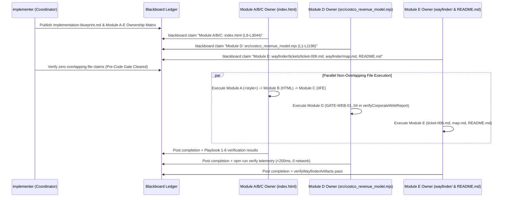

# Implementation Blueprint: Costco Wholesale Corporation (`COST`) Webpage Refinement, Visual & Geometric Polish, Data Reconciliation, and Straightforward Technical English Editorial Overhaul

**Document Version:** 1.0 (Lead Implementation Coordinator Blueprint — Synthesized from Seed `functional_specification_003.md`, `refined-specification.md`, and Live Blackboard Session `planner-2.1` .. `planner-2.5`)  
**Run ID:** `20261103T204534-693-1b8y`  
**Author:** `implementer` (Lead Implementation Coordinator)  
**Governing Specifications:**
- [`functional_specification_003.md`](../../functional_specification_003.md) (Seed Specification)
- [`wayfinder/20261103T204534-693-1b8y/refined-specification.md`](./refined-specification.md) (Refined Technical Specification)
- [`LANGUAGE.md`](../../LANGUAGE.md) (Authoritative Domain Vocabulary & Evaluation Parameters)
- [`data/costco_revenue_breakdown.json`](../../data/costco_revenue_breakdown.json) (Canonical SEC Form 10-K Primary-Source Dataset)

**Blackboard Ledger Inputs Synthesized:**
- `planner-2.1` (`seq=#1`, `seq=#16`, `seq=#21` — System Architecture, 5-Module Boundaries, Function I/O Contracts & Execution DAG)
- `planner-2.2` (`seq=#5`, `seq=#9`, `seq=#15` — Zero-Network Storage Engine Physics, Canonical Note 11 & Item 2 Reconciliation Contract, Single-Threaded Serializability & `GATE-WEB-01..04`)
- `planner-2.3` (`seq=#10`, `seq=#12`, `seq=#20` — Runtime & Language Baselines, Straightforward Technical English Style Guide, SVG Keyboard Focus Restoration, TOC Scroll-Spy Parent Sync & MCP Playbooks 1–6)
- `planner-2.4` (`seq=#8`, `seq=#11`, `seq=#13`, `seq=#14`, `seq=#19` — Cross-Domain Hot-Path Optimizations, JS-Comment-Safe ` // ` Divider Audit, `<style>` Slice Extraction, Singleton `Intl.NumberFormat`, and Trigonometric Bounding-Box Proof for `viewBox="-55 -28 510 456"`)
- `planner-2.5` (`seq=#17`, `seq=#18`, `seq=#22` — Institutional Daylight Financial Aesthetic, Empirical `getBBox()` Polar Viewport Proof, 3-Year Overlay Legend Bar, Structured Drill-Down Card Wells & Crimson Simulator Breach State)
- `plan-2` (`seq=#2`..`seq=#7`, `seq=#24` — Lead Architecture Coordinator Verification & Stage 2 Sign-Off)

**Status:** Authoritative Implementation & Deconfliction Blueprint (`wayfinder/20261103T204534-693-1b8y/implementation-blueprint.md`). **DO NOT CODE YET** until Blackboard ownership claims are posted and deconflicted.

---

## 1. Executive Summary & Core Architectural Invariants (`LANGUAGE.md` & `RULE[user_global]`)

This blueprint defines the exact module boundaries, file ownership partitions, data reconciliation tables, CSS/SVG geometric specifications, ES2022 controller contracts, deterministic CLI verification gates, and Blackboard anti-collision protocols required to refine the interactive corporate report ([`index.html`](../../index.html)), its zero-network verification engine ([`src/costco_revenue_model.mjs`](../../src/costco_revenue_model.mjs)), and supporting governance documentation ([`wayfinder/tickets/ticket-006.md`](../tickets/ticket-006.md), [`wayfinder/map.md`](../map.md), and [`README.md`](../../README.md)).

Every downstream implementer (`implementer-1` .. `implementer-5`), reviewer, and tester MUST strictly enforce the evaluation parameters defined in [`LANGUAGE.md`](../../LANGUAGE.md):

| Evaluation Parameter | Blueprint Enforcement Contract |
| :--- | :--- |
| **`{errors}`** | Zero tolerance for: (1) raw `{Net Sales}`, `{Membership Fees}`, `{Gross Margin Ceiling}`, or `{Operating Income Flywheel}` curly-brace tokens in [`index.html`](../../index.html); (2) ` // ` pseudo-code dividers in visible headings, eyebrows, drill-down banners, step telemetry headers, or ticket tabs; (3) unstyled `.polar-grid-ring` (solid black SVG circles), invisible `.polar-axis-spoke`, uncentered `.polar-center-title`/`.polar-center-sub`, clipped outer sector labels at `390px`–`1440px`, unstyled `.drilldown-meta-grid`/`.drilldown-meta-item`, missing `.sim-output-banner.is-breach`, or undefined `var(--emerald-audit)`; (4) any discrepancy between Note 11 / Item 2 figures in [`index.html`](../../index.html) and [`data/costco_revenue_breakdown.json`](../../data/costco_revenue_breakdown.json); (5) residual Dreamcore markers or broken corporate DOM IDs; (6) browser console errors or non-zero exit codes from `npm run verify`. |
| **`{correctness}`** | Exact mathematical, accounting, geometric, and editorial fidelity: consolidated total revenue `$254,453M = $249,625M + $4,828M` (FY24), `$242,290M = $237,710M + $4,580M` (FY23), `$226,954M = $222,730M + $4,224M` (FY22); Note 11 category sales (`85,629`/`96,175`/`101,463` Foods and Sundries `+5.50%`; `61,100`/`60,865`/`63,973` Non-Foods `+5.11%`; `46,474`/`48,693`/`49,969` Warehouse Ancillary `+2.62%`; `29,527`/`31,977`/`34,220` Fresh Foods `+7.01%`) and Item 2 warehouse ownership (`890` total = `703` owned land & building + `187` leased [`134` land leases w/ owned building = `837` owned buildings]; U.S. `614` [`499`/`115`], Other Intl `168` [`113`/`55`, Spain `4`], Canada `108` [`91`/`17`]); `10.92%` merchandise gross margin (`$27,267M`), `9.14%` SG&A (`$22,810M`), `$4,457M` (`48.00%`) net merchandise contribution, `$4,828M` (`52.00%`) membership fee share of `$9,285M` operating income, `$7,367M` net income, `12.60x` inventory turnover, and `104.15%` AP (`$19,421M`) to inventory (`$18,647M`) coverage. |
| **`{functionality}`** | Seamless end-to-end interactive corporate report at `1440px` desktop and `390px` mobile viewports with straightforward technical English throughout, crisp hairline SVG polar charts with zero clipped labels, full pointer and keyboard (`Enter`/`Space`) accessibility with focus preservation, live scroll-spy Table of Contents highlighting (activating both `.toc-sublink` and parent `.toc-link`), and deterministic CLI verification in $\le 250\text{ ms}$ with `0` external network requests. |
| **`{correct required outputs}`** | (1) Refined [`index.html`](../../index.html), (2) Enhanced [`src/costco_revenue_model.mjs`](../../src/costco_revenue_model.mjs), (3) Reconciled [`wayfinder/tickets/ticket-006.md`](../tickets/ticket-006.md), [`wayfinder/map.md`](../map.md), and [`README.md`](../../README.md), all passing `node src/costco_revenue_model.mjs --verify` with `status: "VERIFIED"`. |

---

## 2. Synthesized Architecture & Module Ownership Boundaries (Anti-Collision Matrix)

```mermaid
flowchart TD
    subgraph Canonical Read-Only Ground Truth
        JSON["data/costco_revenue_breakdown.json\n(251 lines · 8.8 KB · Read-Only)"]
        MONO["research/costco_revenue_architecture.md\n(322 lines · 40.1 KB · Read-Only)"]
    end

    subgraph Module A: Stylesheet & Polar/Drilldown CSS (index.html L9-L983)
        MOD_A["Module A: CSS Layer\n.polar-grid-ring, .polar-axis-spoke,\n.polar-center-title/.polar-center-sub,\n.polar-sector-label/.polar-axis-label,\n.polar-sector-path:focus-visible,\n.drilldown-*, .sim-output-banner.is-breach"]
    end

    subgraph Module B: Static HTML5 Markup & ViewBox (index.html L985-L1850)
        MOD_B["Module B: Semantic HTML & Editorial Copy\nZero {Token} braces · Zero '//' dividers\nPlain technical English in Sections 01-05\nSVG viewBox='-55 -28 510 456'"]
    end

    subgraph Module C: Embedded ES2022 IIFE Data & Controllers (index.html L1852-L3044)
        MOD_C["Module C: Client Data & Controllers\nReconciled CATEGORY_DATA & GEOGRAPHY_DATA\nbindPolarSectorEvents (Enter/Space + focus)\nsyncTocActiveState & initScrollSpy\n3-Year Overlay legend · var(--cat-emerald)"]
    end

    subgraph Module D: Deterministic Verification Engine (src/costco_revenue_model.mjs)
        MOD_D["Module D: verifyCorporateWebReport()\nGATE-WEB-01: PROHIBITED_SPEC_TOKENS\nGATE-WEB-02: PROHIBITED_PSEUDOCODE_DIVIDERS\nGATE-WEB-03: REQUIRED_POLAR_CSS_SELECTORS\nGATE-WEB-04: REQUIRED_RECONCILED_CATEGORY_FIGURES"]
    end

    subgraph Module E: Governance & Documentation (wayfinder/ & README.md)
        MOD_E["Module E: Documentation & Lineage\nwayfinder/tickets/ticket-006.md\nwayfinder/map.md (verify/preserve)\nREADME.md (plain technical English)"]
    end

    JSON ==> MOD_C
    JSON ==> MOD_D
    MOD_A --> MOD_B
    MOD_B --> MOD_C
    MOD_C --> MOD_D
    MOD_E --> MOD_D
```

### 2.1 Strict Module & File Ownership Partition Table

To guarantee zero merge conflicts, zero duplicate helper functions, and zero race conditions during the implementation phase, repository files and line ranges are partitioned into five non-overlapping modules (`Module A` through `Module E`):

| Module ID | Target File(s) & Exact Line Range | Designated Owner Slot | Scope of Exclusive Ownership | Anti-Collision Boundary Rule |
| :--- | :--- | :--- | :--- | :--- |
| **`Module A`** | [`index.html`](../../index.html)<br>`<style>` block (`lines 9–983`) | `implementer-1` (or `index.html` Owner Phase 1) | All CSS custom properties, `.polar-grid-ring`, `.polar-axis-spoke`, `.polar-center-title`, `.polar-center-sub`, `.polar-sector-label`, `.polar-axis-label`, `.polar-sector-path:focus-visible`, `.drilldown-eyebrow`, `.drilldown-title`, `.drilldown-copy`, `.drilldown-meta-grid`, `.drilldown-meta-item`, `.sim-output-banner.is-breach`, and responsive `@media` rules. | Must NOT edit below `</style>` (line `983`). |
| **`Module B`** | [`index.html`](../../index.html)<br>Static `<body>` HTML (`lines 985–1850`) | `implementer-2` (or `index.html` Owner Phase 2) | All static HTML5 headings, section eyebrows (`·` replacing `//`), KPI cards, polar panel headers, `viewBox="-55 -28 510 456"` attributes on `#svg-polar-categories`, `#svg-polar-geography`, and `#svg-polar-flywheel`, 5-step narrative copy (`#step-1`..`#step-5`), simulator labels, and ticket tab labels. | Must NOT edit `<style>` (`L9–L983`) or `<script>` (`L1852–L3044`). Must preserve all 15 `REQUIRED_CORPORATE_DOM_IDS` and 14 `REQUIRED_TOC_ANCHOR_TARGETS`. |
| **`Module C`** | [`index.html`](../../index.html)<br>Embedded `<script>` IIFE (`lines 1852–3044`) | `implementer-3` (or `index.html` Owner Phase 3) | Reconciled `CATEGORY_DATA` & `GEOGRAPHY_DATA`, cleaned strings in `FLYWHEEL_ASYMMETRY_DATA`, `ANCILLARY_ROSE_DATA`, `STEP_SUMMARIES`, and `WAYFINDER_TICKETS`, singleton `Intl.NumberFormat` in `formatUsdM()`, unclipped polar geometry (`maxR = 120`, `rInner = 36..42`, `labelOffset = 15`), 3-Year Overlay SVG legend, `bindPolarSectorEvents()`, `syncTocActiveState()` + `initScrollSpy()`, `renderGaapWaterfall()`, `updateSimulator()`, and `renderTicketInspector()` (`var(--cat-emerald)`). | Must NOT edit above `<script>` (line `1852`). Must reuse existing IIFE functions in-place without creating duplicate globals. |
| **`Module D`** | [`src/costco_revenue_model.mjs`](../../src/costco_revenue_model.mjs)<br>(`lines 1–1196`, specifically `L92–L110` & `L907–L1028`) | `implementer-4` | Extending `verifyCorporateWebReport(rawOptions)` with `GATE-WEB-01` (`PROHIBITED_SPEC_TOKENS`), `GATE-WEB-02` (comment-safe `PROHIBITED_PSEUDOCODE_DIVIDERS`), `GATE-WEB-03` (`REQUIRED_POLAR_CSS_SELECTORS` & `--emerald-audit` check), and `GATE-WEB-04` (`REQUIRED_RECONCILED_CATEGORY_FIGURES` & `PROHIBITED_UNVERIFIED_HISTORICAL_FIGURES`). | Exclusive lock on `src/costco_revenue_model.mjs`. Must preserve all 6 exported function names, CLI flags, and existing return fields. |
| **`Module E`** | [`wayfinder/tickets/ticket-006.md`](../tickets/ticket-006.md), [`wayfinder/map.md`](../map.md), [`README.md`](../../README.md) | `implementer-5` | Updating `ticket-006.md` Resolution summary and `README.md` to eliminate raw `{...}` braces and document the reconciled Note 11 / Item 2 figures, polar CSS rules, keyboard accessibility, and scroll-spy TOC; verifying `wayfinder/map.md` governance invariants. | Exclusive lock on `wayfinder/tickets/ticket-006.md`, `wayfinder/map.md`, and `README.md`. Must NOT edit `data/costco_revenue_breakdown.json` or `research/costco_revenue_architecture.md`. |

> [!IMPORTANT]
> **Single-File Serialization Rule for `index.html` (`Modules A, B, C`):** Because `Modules A, B, and C` reside in non-overlapping line ranges of [`index.html`](../../index.html), if multiple implementer agents are spawned in a shared workspace, only ONE agent may hold the active write lock on `index.html` at a time (or a single designated `index.html` owner executes `Module A` $\rightarrow$ `Module B` $\rightarrow$ `Module C` sequentially), coordinated via `blackboard claim` before any file write.

---

## 3. Detailed Component Specifications (`Modules A–E`)

### 3.1 Module A Specification: Stylesheet & Polar/Drill-Down Visual Polish (`index.html` `<style>` L9–L983)

Synthesizing `planner-2.1`, `planner-2.3`, `planner-2.4` (`OPT-02` / `OPT-03`), and `planner-2.5` (`seq=#18`), add the following exact CSS rules inside `<style>` in [`index.html`](../../index.html) immediately after `.polar-sector-path:hover, .polar-sector-path.is-selected` (around line `565`) and `.sim-output-banner` (around line `917`):

```css
    /* Polar SVG Grid Rings, Spokes, Hub Typography & Callout Labels */
    .polar-grid-ring {
      fill: none;
      stroke: var(--border-strong);
      stroke-width: 1px;
      stroke-dasharray: 3 3;
    }

    .polar-axis-spoke {
      stroke: var(--border-strong);
      stroke-width: 1px;
    }

    .polar-center-title {
      text-anchor: middle;
      font-family: var(--font-mono);
      font-size: 11px;
      font-weight: 800;
      fill: var(--ink-primary);
    }

    .polar-center-sub {
      text-anchor: middle;
      font-family: var(--font-mono);
      font-size: 9px;
      font-weight: 600;
      fill: var(--ink-muted);
    }

    .polar-sector-label {
      font-family: var(--font-sans);
      font-size: 11px;
      font-weight: 700;
      fill: var(--ink-primary);
    }

    .polar-axis-label {
      font-family: var(--font-mono);
      font-size: 9.5px;
      font-weight: 600;
      fill: var(--ink-secondary);
    }

    .polar-sector-path:focus-visible {
      outline: none;
      stroke: var(--ink-primary);
      stroke-width: 2.5px;
      opacity: 1;
      filter: drop-shadow(0 4px 10px rgba(15, 23, 42, 0.25));
    }

    /* Structured Sector Drill-Down Card Typography & Key-Value Grid Wells */
    .drilldown-eyebrow {
      font-family: var(--font-mono);
      font-size: 10.5px;
      font-weight: 700;
      text-transform: uppercase;
      letter-spacing: 0.06em;
      color: var(--costco-crimson);
      margin-bottom: 4px;
    }

    .drilldown-title {
      font-size: 15px;
      font-weight: 800;
      color: var(--ink-primary);
      margin-bottom: 6px;
    }

    .drilldown-copy {
      font-size: 13px;
      color: var(--ink-secondary);
      line-height: 1.55;
    }

    .drilldown-meta-grid {
      display: grid;
      grid-template-columns: repeat(auto-fit, minmax(150px, 1fr));
      gap: 10px;
      margin-top: 12px;
      padding-top: 12px;
      border-top: 1px solid var(--border-subtle);
    }

    .drilldown-meta-item {
      background: var(--bg-well);
      border: 1px solid var(--border-subtle);
      border-radius: var(--radius-sm);
      padding: 8px 10px;
      display: flex;
      flex-direction: column;
      gap: 2px;
    }

    .drilldown-meta-item span {
      font-size: 11px;
      font-weight: 600;
      color: var(--ink-muted);
    }

    .drilldown-meta-item strong {
      font-family: var(--font-mono);
      font-size: 12.5px;
      font-weight: 800;
      color: var(--ink-primary);
    }

    /* Simulator Gross Margin Ceiling Breach State (> 11.50%) */
    .sim-output-banner.is-breach {
      background: var(--costco-crimson-soft);
      border-color: var(--costco-crimson);
      border-left: 4px solid var(--costco-crimson);
      color: var(--ink-primary);
    }
```

Additionally:
1. Update `.polar-svg` (line `548`) to include `max-width: 440px; aspect-ratio: 510 / 456; overflow: visible;` and update `.polar-grid-layout` (line `531`) to `grid-template-columns: minmax(280px, 440px) minmax(0, 1fr);` so the `510×456` coordinate space scales cleanly without layout shift (`CLS = 0`).
2. Add `@media (max-width: 640px)` rules ensuring `.report-section { padding: 18px 14px; }`, `.polar-panel { padding: 14px 12px; }`, `.corporate-shell { padding: 12px; }`, and `.stepper-pills { grid-template-columns: 1fr; }` so `390px` mobile viewports have zero horizontal overflow (`document.documentElement.scrollWidth <= window.innerWidth`).

---

### 3.2 Module B Specification: Straightforward Technical English & SVG `viewBox` Expansion (`index.html` `<body>` L985–L1850)

1. **Expand Polar SVG `viewBox` Attributes:**
   - Update `#svg-polar-categories` (line `1237`), `#svg-polar-geography` (line `1294`), and `#svg-polar-flywheel` (line `1350`) from `viewBox="0 0 400 400"` to:
     ```html
     viewBox="-55 -28 510 456"
     ```
2. **Eliminate All Raw `{...}` Specification Tokens & `//` Pseudo-Code Dividers in Static HTML:**
   - Apply the following exact replacements across lines `985–1850` of [`index.html`](../../index.html):

| Line(s) | Current Raw / Figurative Text | Straightforward Technical English Replacement |
| :--- | :--- | :--- |
| `1120` | `Section 01 // Institutional Executive Briefing` | `Section 01 · Executive Summary` |
| `1127–1131` | `10.92% {Gross Margin Ceiling}`, `$249,625M of {Net Sales}`, `$4,828M of recurring {Membership Fees}` | `10.92% gross margin cap (Gross Margin Ceiling)`, `$249,625M in merchandise Net Sales`, `$4,828M in annual Membership Fees` |
| `1139, 1143, 1150, 1157` | `{Net Sales}`, `{Membership Fees}`, `{Gross Margin Ceiling}` in KPI cards | `Net Sales`, `Membership Fees`, `Gross Margin Ceiling` |
| `1181` | `R_total ($254,453M) = {Net Sales} ($249,625M) + {Membership Fees} ($4,828M)` | `R_total ($254,453M) = Net Sales ($249,625M) + Membership Fees ($4,828M)` |
| `1192` | `Section 02 // Interactive Polar Coordinate Visual Analytics` | `Section 02 · Interactive Polar Revenue Charts` |
| `1197–1200` | Section 02 lead paragraph | Explain plainly how each polar chart measures revenue and operating profit, and how the three radial scaling modes work (`Area √r` where sector area is proportional to dollar volume, `Linear Radius r` where radial length is proportional to dollar volume, and `Share Angle θ_i` where sector angle matches revenue share). |
| `1209, 1242` | `2.1 {Net Sales} Disaggregation...`, `FY2024 Note 11 {Net Sales}: $249,625M` | `2.1 Net Sales Disaggregation by Merchandise Category ($249,625M Note 11 Polar Rose)`, `FY2024 Note 11 Net Sales: $249,625M` |
| `1330, 1333` | `...vs. {Operating Income Flywheel} & Ancillary Sub-Drivers`, `How 1.90% in {Membership Fees} ($4,828M)... propelled by $49,969M in Ancillary & Digital magnets` | `2.3 Structural Polar Asymmetry: Top-Line Revenue vs. Operating Income Flywheel & Ancillary Channels`, `How 1.90% in Membership Fees ($4,828M) becomes 52.00% of Operating Income ($9,285M), supported by $49,969M in Warehouse Ancillary & E-Commerce sales` |
| `1375, 1382, 1399` | `{Net Sales} Merchandise & Ancillary`, `{Membership Fees} Subscription Annuity`, `High-frequency weekly parking-lot trip magnet` | `Net Sales (Merchandise & Ancillary)`, `Membership Fees (Annual Club Subscriptions)`, `Drives frequent repeat member visits to warehouse locations` |
| `1424` | `Section 03 // Sequential Business Model Walkthrough` | `Section 03 · Five-Step Revenue Model` |
| `1429–1433` | `...high-frequency gas and ancillary magnets...` | `...frequent repeat visits from gas stations and ancillary services, a 10.92% gross margin cap, and supplier-financed inventory combine to generate $9,285M in operating income and $7,367M in net income.` |
| `1450, 1458, 1471` | `Membership Gate ($4,828M)`, `719 Gas & Digital Magnets`, `Step 1 (Gatekeeper Subscription)... {Membership Fees}... {Net Sales}` | `Paid Membership ($4,828M)`, `Ancillary & E-Commerce`, `Step 1 (Paid Membership Access): 76.2M paid members (136.8M total cardholders) pay $65/$130 annually, generating $4,828M in earned Membership Fees at a 92.9% U.S./Canada renewal rate while 35.4M Executive members generate 73.3% of worldwide Net Sales.` |
| `1483, 1486, 1500, 1506, 1507, 1512` | `Gatekeeper Subscription — Paid Membership Tiers & 92.9% Renewal Lock-In`, `$4,828M {Membership Fees}`, `{Net Sales}`, `Step 01 // Primary-Source SEC 10-K Telemetry` | `Paid Membership Access and Executive Tier Concentration ($4,828M Membership Fees)`, `$4,828M Membership Fees (1.90% of Revenue)`, `Net Sales`, `Step 1 Key Figures (FY2024 Form 10-K)` |
| `1526, 1529, 1538, 1542, 1549, 1550, 1557` | `Concentrated Purchasing Scale — <4,000 Warehouse SKUs & Kirkland Signature`, `{Net Sales}`, `"treasure-hunt" baskets`, `Step 02 // Primary-Source SEC 10-K Telemetry` | `High-Volume Purchasing Across Fewer Than 4,000 SKUs ($249,625M Net Sales)`, `Net Sales`, `rotating seasonal and discretionary general merchandise`, `Step 2 Key Figures (FY2024 Form 10-K)` |
| `1569, 1578, 1580, 1584, 1586, 1591, 1592, 1596` | `High-Frequency Trip Magnets — 719 Gas Stations...`, `perceive unmistakable value`, `{Net Sales}`, `Step 03 // Primary-Source SEC 10-K Telemetry` | `Ancillary Businesses and E-Commerce Fulfillment ($49,969M Ancillary + ~7% E-Commerce)`, `realize consistent savings on everyday purchases`, `Net Sales`, `Step 3 Key Figures (FY2024 Form 10-K)` |
| `1611, 1621, 1626, 1627, 1633` | `Disciplined Pricing & Negative Working Capital — The 10.92% {Gross Margin Ceiling} & 104.15% Supplier Float`, `{Gross Margin Ceiling}`, `{Net Sales}`, `Step 04 // Primary-Source SEC 10-K Telemetry` | `The 10.92% Gross Margin Cap and Supplier-Financed Inventory (104.15% Accounts Payable to Inventory)`, `Gross Margin Ceiling`, `Net Sales`, `Step 4 Key Figures (FY2024 Form 10-K)` |
| `1653, 1665, 1666, 1669, 1676, 1678` | `The {Operating Income Flywheel} — Converting $4,828M of Fees into 52.00% of Consolidated Operating Profit`, `{Net Sales}`, `{Membership Fees}`, `Step 05 // Primary-Source SEC 10-K Telemetry` | `Operating Profit Conversion ($9,285M Operating Income to $7,367M Net Income)`, `Net Sales`, `Membership Fees`, `Step 5 Key Figures (FY2024 Form 10-K)` |
| `1694, 1700, 1701, 1737, 1740, 1762` | `Section 04 // Quantitative Financial Conservation & Stress Testing`, `{Operating Income Flywheel}`, `{Gross Margin Ceiling}`, `{Net Sales}` | `Section 04 · Multi-Year GAAP Income Statement & Sensitivity Simulator`, `Operating Income Flywheel`, `Gross Margin Ceiling`, `Net Sales` |
| `1789, 1801–1806` | `Section 05 // Primary-Source Governance & Decision Lineage`, `ticket-001.md // ...` through `ticket-006.md // ...` | `Section 05 · Primary-Source SEC Form 10-K Citations & Wayfinder Audit`, `ticket-001.md · Revenue Recognition (ASC 606)`, `ticket-002.md · Merchandise Categories & SKUs`, `ticket-003.md · Membership Tiers & Renewals`, `ticket-004.md · Ancillary & E-Commerce`, `ticket-005.md · Gross Margin Cap & Working Capital`, `ticket-006.md · Corporate Report & Polar Charts` |

---

### 3.3 Module C Specification: Embedded ES2022 Data Reconciliation, Unclipped Polar Geometry, Keyboard A11y & Scroll-Spy (`index.html` `<script>` L1852–L3044)

#### 1. Reconciled `CATEGORY_DATA` (Note 11 Multi-Year Figures, `L1857–L1902`)
Replace `CATEGORY_DATA` with the exact audited Note 11 values from [`data/costco_revenue_breakdown.json`](../../data/costco_revenue_breakdown.json) and clean technical English descriptions:

```javascript
    var CATEGORY_DATA = [
      {
        id: "foods_and_sundries",
        name: "Foods and Sundries",
        shortName: "Foods & Sundries",
        color: "#005DAA",
        salesByYear: { 2022: 85629, 2023: 96175, 2024: 101463 },
        shareByYear: { 2022: 38.45, 2023: 40.46, 2024: 40.65 },
        yoy24: "+5.50%",
        departments: "Dry grocery, snacks, candy, alcoholic & non-alcoholic beverages, cooler, freezer, deli,cleaning supplies, household paper & sundries",
        role: "Largest merchandise category ($101,463M or 40.65% of FY2024 Net Sales; +5.50% YoY); anchors weekly household grocery replenishment and high-turnover Kirkland Signature staple volume."
      },
      {
        id: "non_foods",
        name: "Non-Foods (Hardlines & Softlines)",
        shortName: "Non-Foods",
        color: "#0F172A",
        salesByYear: { 2022: 61100, 2023: 60865, 2024: 63973 },
        shareByYear: { 2022: 27.43, 2023: 25.60, 2024: 25.63 },
        yoy24: "+5.11%",
        departments: "Major appliances, consumer electronics, health & beauty aids, hardware, lawn & garden, sporting goods, tires, apparel, furniture, housewares, jewelry",
        role: "Generates $63,973M or 25.63% of FY2024 Net Sales (+5.11% YoY) across hardlines, softlines, and big-and-bulky e-commerce orders fulfilled through Costco Logistics."
      },
      {
        id: "warehouse_ancillary_and_other",
        name: "Warehouse Ancillary and Other Businesses",
        shortName: "Ancillary & Gas",
        color: "#E31837",
        salesByYear: { 2022: 46474, 2023: 48693, 2024: 49969 },
        shareByYear: { 2022: 20.87, 2023: 20.48, 2024: 20.02 },
        yoy24: "+2.62%",
        departments: "719 Gasoline stations (~$30B / ~12% of Net Sales), Pharmacy (+3% YoY / +$1,276M), Optical, Food Court ($1.50 hot dog combo), Hearing Aids, Tire Installation, E-Commerce, Costco Travel",
        role: "Generates $49,969M or 20.02% of FY2024 Net Sales (+2.62% YoY); fuel savings, pharmacy prescriptions, and optical services drive frequent repeat visits and support the 92.9% U.S./Canada renewal rate."
      },
      {
        id: "fresh_foods",
        name: "Fresh Foods",
        shortName: "Fresh Foods",
        color: "#059669",
        salesByYear: { 2022: 29527, 2023: 31977, 2024: 34220 },
        shareByYear: { 2022: 13.26, 2023: 13.45, 2024: 13.71 },
        yoy24: "+7.01%",
        departments: "Meat (captive processing plants), fresh produce, service deli ($4.99 rotisserie chicken), in-warehouse scratch bakery",
        role: "Fastest-growing merchandise category in FY2024 ($34,220M or 13.71% of Net Sales, +7.01% YoY); drives weekly perishable shopping frequency and 12.60x annual inventory turnover."
      }
    ];
```

#### 2. Reconciled `GEOGRAPHY_DATA` (Note 11 & Item 2 Property Ownership, `L1904–L1962`)
Replace `GEOGRAPHY_DATA` with the exact Item 2 (`p. 18`) and Note 11 (`p. 61`) figures from [`data/costco_revenue_breakdown.json`](../../data/costco_revenue_breakdown.json):

```javascript
    var GEOGRAPHY_DATA = [
      {
        id: "united_states",
        name: "United States",
        shortName: "United States",
        color: "#005DAA",
        revenueM: 184143,
        revSharePct: 72.37,
        opIncM: 6217,
        opIncSharePct: 66.96,
        opMarginPct: 3.38,
        warehouses: 614,
        clubSharePct: 68.99,
        ownedWarehouses: 499,
        leasedWarehouses: 115,
        floorSpaceSqFtM: 91.1,
        employees: 219000,
        revPerClubM: 299.91,
        opIncPerClubM: 10.13,
        role: "Primary domestic segment (614 warehouses across 47 states, Washington, D.C., and Puerto Rico; 499 owned and 115 leased; 91.1M sq ft; 219,000 employees); generates $184,143M in total revenue (72.37%) and $6,217M in operating income ($299.91M revenue per warehouse)."
      },
      {
        id: "other_international",
        name: "Other International (12 Countries)",
        shortName: "Other Intl",
        color: "#059669",
        revenueM: 35436,
        revSharePct: 13.93,
        opIncM: 1420,
        opIncSharePct: 15.29,
        opMarginPct: 4.01,
        warehouses: 168,
        clubSharePct: 18.88,
        ownedWarehouses: 113,
        leasedWarehouses: 55,
        floorSpaceSqFtM: 24.3,
        employees: 61000,
        revPerClubM: 210.93,
        opIncPerClubM: 8.45,
        role: "International operations across 12 countries: Mexico (40), Japan (35), U.K. (29), Korea (19), Australia (15), Taiwan (14), China (7), Spain (4), France (2), Iceland (1), New Zealand (1), and Sweden (1) (113 owned and 55 leased; 24.3M sq ft; 61,000 employees); generates $35,436M in revenue and $1,420M in operating income (4.01% operating margin)."
      },
      {
        id: "canada",
        name: "Canada",
        shortName: "Canada",
        color: "#E31837",
        revenueM: 34874,
        revSharePct: 13.71,
        opIncM: 1648,
        opIncSharePct: 17.75,
        opMarginPct: 4.73,
        warehouses: 108,
        clubSharePct: 12.13,
        ownedWarehouses: 91,
        leasedWarehouses: 17,
        floorSpaceSqFtM: 15.5,
        employees: 53000,
        revPerClubM: 322.91,
        opIncPerClubM: 15.26,
        role: "Highest-productivity segment per club: 108 Canadian warehouses (91 owned and 17 leased; 15.5M sq ft; 53,000 employees) average $322.91M in revenue and $15.26M in operating income per warehouse with a 4.73% operating margin ($1,648M operating income)."
      }
    ];
```

In `renderPolarGeography()`:
- Update `#polar-geo-caption` when `geoState.metric === "warehouses"` to:
  `"Metric: Warehouse Footprint (890 Total) · 703 Owned Land & Building, 187 Leased (incl. 134 Land Leases w/ Owned Building = 837 Owned Buildings)"`
- Update `#polar-geography-drilldown` eyebrow to `"Selected Segment Detail · Note 11 & Item 2 Geographic Operations"` and metadata items to:
  1. `Revenue / Club (${sel.warehouses} Clubs · ${sel.floorSpaceSqFtM}M sq ft)` $\rightarrow$ `$${sel.revPerClubM.toFixed(2)}M / Club`
  2. `Operating Income & Margin (${sel.employees.toLocaleString("en-US")} Employees)` $\rightarrow$ `${formatUsdM(sel.opIncM)} (${sel.opMarginPct.toFixed(2)}%)`
  3. `Property Ownership (Item 2)` $\rightarrow$ `${sel.ownedWarehouses} Owned · ${sel.leasedWarehouses} Leased`
- Update `#tbody-polar-geography` club ownership column to render `${g.warehouses} (${g.ownedWarehouses}/${g.leasedWarehouses})` (`614 (499/115)`, `168 (113/55)`, `108 (91/17)`) and the consolidated total row to render **`890 (703/187)`**.

#### 3. Unclipped Polar Coordinate Geometry (`planner-2.4` `seq=#14` & `planner-2.5` `seq=#18`)
To guarantee that 100% of `.polar-sector-label` and `.polar-axis-label` elements lie strictly inside `viewBox="-55 -28 510 456"` ($X \in [-55, 455]$, $Y \in [-28, 428]$) across all 9 polar modes at both `390px` and `1440px`:
- Set `cx = 200`, `cy = 200`.
- In `renderPolarCategories()`: set `rInner = 36`, `maxR = 120`, and `labelPos = polarPoint(cx, cy, maxR + 15, midDeg)`. When `catState.year === "overlay"`, append an inline SVG legend group at `y = 398`:
  ```javascript
  if (catState.year === "overlay") {
    svgMarkup +=
      '<g transform="translate(200, 398)" text-anchor="middle">' +
      '<rect x="-175" y="-12" width="350" height="22" rx="4" fill="#F8FAFC" stroke="#CBD5E1" stroke-width="1" />' +
      '<text x="0" y="3" class="polar-axis-label">Overlay Key: FY24 Filled Sector · FY23 Dark Dashed (5-2) · FY22 Slate Dotted (2-2)</text>' +
      '</g>';
  }
  ```
- In `renderPolarGeography()`: set `rInner = 36`, `maxR = 118`, and `labelPos = polarPoint(cx, cy, maxR + 14, midDeg)`. Use concise SVG sector value sub-labels (`valLabel = geoState.metric === "revenue" ? formatUsdM(seg.revenueM) + " (" + seg.revSharePct.toFixed(1) + "%)" : geoState.metric === "opinc" ? formatUsdM(seg.opIncM) + " (" + seg.opMarginPct.toFixed(2) + "%)" : seg.warehouses + " Clubs ($" + seg.revPerClubM.toFixed(0) + "M)"`) so the `60°` and `300°` callouts fit with $>20\text{px}$ margin inside `[-55, 455]`, while keeping full strings in `aria-label` and `#polar-geography-drilldown`.
- In `renderPolarFlywheel()`:
  - In `asymmetry` mode: set outer ring `100..136`, inner ring `48..90`, center hub `r="38"`, top label at `y="32"` (`Outer Ring: Membership Fees 1.90% ($4,828M)`), bottom label at `y="368"` (`Outer Ring: Net Sales 98.10% ($249,625M)`), and inner ring labels at `x="268"` and `x="132"`. Add `data-fly-ring="outer"` and `data-fly-ring="inner"` attributes to disambiguate the 2 outer and 2 inner sector paths for keyboard focus restoration.
  - In `ancillary` mode: set `rInner = 36`, `maxR = 118`, and `labelPos = polarPoint(cx, cy, maxR + 14, midDeg)`.

#### 4. Singleton `Intl.NumberFormat` & Reusable Keyboard Accessibility Helper (`bindPolarSectorEvents`)
- Replace `formatUsdM(num)` (`L2182–L2184`) with a cached formatter (`planner-2.4` `OPT-02`):
  ```javascript
  var USD_FORMATTER = new Intl.NumberFormat("en-US");
  function formatUsdM(num) {
    return "$" + USD_FORMATTER.format(Number(num)) + "M";
  }
  ```
- Add `bindPolarSectorEvents(svgElement, attrName, onSelect)` and invoke it in `renderPolarCategories()`, `renderPolarGeography()`, and `renderPolarFlywheel()`:
  ```javascript
  function bindPolarSectorEvents(svgElement, attrName, onSelect) {
    var paths = svgElement.querySelectorAll("[" + attrName + "]");
    for (var i = 0; i < paths.length; i++) {
      paths[i].addEventListener("click", function () {
        var idx = Number(this.getAttribute(attrName));
        onSelect(idx, false, this.getAttribute("data-fly-ring"));
      });
      paths[i].addEventListener("keydown", function (evt) {
        if (evt.key === "Enter" || evt.key === " " || evt.key === "Spacebar") {
          evt.preventDefault();
          var idx = Number(this.getAttribute(attrName));
          var ring = this.getAttribute("data-fly-ring");
          onSelect(idx, true, ring);
        }
      });
    }
  }
  ```
  When `isKeyboard === true`, after re-rendering `svgElement.innerHTML`, restore focus via:
  ```javascript
  var selector = "[" + attrName + '="' + idx + '"]' + (ring ? '[data-fly-ring="' + ring + '"]' : "");
  var targetPath = svgElement.querySelector(selector) || svgElement.querySelector("[" + attrName + '="' + idx + '"]');
  if (targetPath && typeof targetPath.focus === "function") {
    targetPath.focus({ preventScroll: true });
  }
  ```

#### 5. Sticky Table of Contents Scroll-Spy & Parent `.toc-link` Synchronization (`syncTocActiveState` & `initScrollSpy`)
- Pre-index all 14 `a[data-toc-target]` links in `#table-of-contents` (`section-executive-summary`, `section-polar-graphs`, `polar-chart-categories`, `polar-chart-geography`, `polar-chart-flywheel`, `section-five-steps`, `step-1`..`step-5`, `section-gaap-model`, `section-wayfinder-audit`) along with each `.toc-sublink`'s parent `.toc-link` (`#section-polar-graphs` for `polar-chart-*`; `#section-five-steps` for `step-1`..`step-5`).
- Implement `syncTocActiveState(targetId)` so that:
  1. Every `a[data-toc-target]` in `#table-of-contents` has `.is-active` and `aria-current` cleared unless it matches `targetId` or is the parent `.toc-link` of the active `.toc-sublink`.
  2. The exact matching `a[data-toc-target="${targetId}"]` receives `.is-active` and `aria-current="location"`.
  3. If the matching link is a `.toc-sublink`, its parent `.toc-link` also receives `.is-active`.
- Wire both the TOC `click` handler and an `IntersectionObserver` + passive `scroll` listener (`{ passive: true }`) in `init()` to `syncTocActiveState(targetId)`. When a link with `data-toc-step="1..5"` is clicked, also call `setActiveStep(Number(stepAttr), false)`.

#### 6. Clean Technical English in All JS Strings & `var(--cat-emerald)` Fix
- Strip all `{Net Sales}`, `{Membership Fees}`, `{Gross Margin Ceiling}`, and `{Operating Income Flywheel}` curly braces and all `//` dividers from `FLYWHEEL_ASYMMETRY_DATA`, `ANCILLARY_ROSE_DATA`, `STEP_SUMMARIES`, `WAYFINDER_TICKETS`, `renderPolarCategories()`, `renderPolarGeography()`, `renderPolarFlywheel()`, `renderGaapWaterfall()`, `updateSimulator()`, and `renderTicketInspector()`.
- In `updateSimulator()` (`L2856–L2865`), replace `"threatens the 92.9% renewal moat"` with `"reduces Costco's price advantage over supermarkets and risks lowering the 92.9% U.S./Canada membership renewal rate."`
- In `renderTicketInspector()` (`L2880–L2881`), replace `"RESOLVED WAYFINDER TICKET // "` with `"Resolved Wayfinder Ticket · "` and replace `var(--emerald-audit)` with `var(--cat-emerald)`.

---

### 3.4 Module D Specification: Deterministic Verification Hardening (`src/costco_revenue_model.mjs`)

Extend `verifyCorporateWebReport(rawOptions = {})` (`lines 907–1028` of [`src/costco_revenue_model.mjs`](../../src/costco_revenue_model.mjs)) while preserving all existing exports, CLI flags, and return properties:

1. **Module-Scope Verification Constants (`add near lines 92–110`):**
   ```javascript
   const PROHIBITED_SPEC_TOKENS = [
     "{Net Sales}",
     "{Membership Fees}",
     "{Gross Margin Ceiling}",
     "{Operating Income Flywheel}"
   ];

   const PROHIBITED_PSEUDOCODE_DIVIDER_REGEX =
     /(?:Section\s+0[1-5]|Step\s+0[1-5]|ACTIVE\s+POLAR|DRILLDOWN|RESOLVED\s+WAYFINDER\s+TICKET|ticket-00[1-6]\.md)\s*\/\//i;

   const REQUIRED_POLAR_CSS_SELECTORS = [
     ".polar-grid-ring",
     ".polar-axis-spoke",
     ".polar-sector-label",
     ".polar-center-title",
     ".polar-center-sub",
     ".drilldown-meta-grid",
     ".drilldown-meta-item",
     ".sim-output-banner.is-breach"
   ];

   const REQUIRED_RECONCILED_CATEGORY_FIGURES = [
     ["85,629", "85629"],
     ["96,175", "96175"],
     ["101,463", "101463"],
     ["61,100", "61100"],
     ["60,865", "60865"],
     ["63,973", "63973"],
     ["46,474", "46474"],
     ["48,693", "48693"],
     ["49,969", "49969"],
     ["29,527", "29527"],
     ["31,977", "31977"],
     ["34,220", "34220"],
     ["703/187", "ownedWarehouses: 499"],
     ["499/115", "ownedWarehouses: 499"],
     ["113/55", "ownedWarehouses: 113"],
     ["91/17", "ownedWarehouses: 91"]
   ];

   const PROHIBITED_UNVERIFIED_HISTORICAL_FIGURES = [
     "88,948",
     "88948",
     "96,936",
     "96936",
     "60,876",
     "60876",
     "60,292",
     "60292",
     "43,443",
     "43443",
     "29,463",
     "29463",
     "31,789",
     "31789",
     "704/124/62",
     "505/80/29",
     "103/35/30",
     "96/9/3"
   ];
   ```
2. **Fail-Fast Gates Inside `verifyCorporateWebReport` (`add after line 1011`):**
   - **`GATE-WEB-01` (Zero Raw `{...}` Specification Tokens):**
     ```javascript
     for (const specToken of PROHIBITED_SPEC_TOKENS) {
       if (resolvedHtml.includes(specToken)) {
         throw new Error(
           `Corporate web report audit failed for ${htmlLabel}: unrefined specification token "${specToken}" detected in reader-facing HTML.`
         );
       }
     }
     ```
   - **`GATE-WEB-02` (JS-Comment-Safe Pseudo-Code Divider Check — `planner-2.4` `seq=#13`):**
     ```javascript
     const htmlWithoutScripts = resolvedHtml.replace(/<script\b[^>]*>[\s\S]*?<\/script>/gi, "");
     const dividerMatch = PROHIBITED_PSEUDOCODE_DIVIDER_REGEX.exec(resolvedHtml);
     if (dividerMatch || htmlWithoutScripts.includes(" // ")) {
       const foundToken = dividerMatch ? dividerMatch[0] : " // ";
       throw new Error(
         `Corporate web report audit failed for ${htmlLabel}: pseudo-code divider "${foundToken}" detected in reader-facing HTML.`
       );
     }
     ```
   - **`GATE-WEB-03` (Required Polar & Drill-Down CSS Selectors & Undefined Token Check):**
     ```javascript
     const styleBlocks = [];
     const styleRegex = /<style\b[^>]*>([\s\S]*?)<\/style>/gi;
     let styleMatch;
     while ((styleMatch = styleRegex.exec(resolvedHtml)) !== null) {
       styleBlocks.push(styleMatch[1]);
     }
     const combinedCss = styleBlocks.join("\n");
     for (const selector of REQUIRED_POLAR_CSS_SELECTORS) {
       if (!combinedCss.includes(selector)) {
         throw new Error(
           `Corporate web report audit failed for ${htmlLabel}: missing required CSS style rule "${selector}" in <style>.`
         );
       }
     }
     if (resolvedHtml.includes("--emerald-audit")) {
       throw new Error(
         `Corporate web report audit failed for ${htmlLabel}: undefined CSS custom property "--emerald-audit" detected.`
       );
     }
     ```
   - **`GATE-WEB-04` (Reconciled Multi-Year Note 11 & Item 2 Figures):**
     ```javascript
     for (const [formattedFig, rawFig] of REQUIRED_RECONCILED_CATEGORY_FIGURES) {
       if (!resolvedHtml.includes(formattedFig) && !resolvedHtml.includes(rawFig)) {
         throw new Error(
           `Corporate web report audit failed for ${htmlLabel}: missing audited Note 11 / Item 2 figure "${formattedFig}".`
         );
       }
     }
     for (const legacyFig of PROHIBITED_UNVERIFIED_HISTORICAL_FIGURES) {
       if (resolvedHtml.includes(legacyFig)) {
         throw new Error(
           `Corporate web report audit failed for ${htmlLabel}: unverified historical figure "${legacyFig}" detected (diverges from Note 11 / Item 2).`
         );
       }
     }
     ```
3. **Backward-Compatible Return Object (`lines 1013–1025`):**
   ```javascript
   return {
     valid: true,
     htmlPath: htmlLabel,
     byteLength: Buffer.byteLength(resolvedHtml, "utf8"),
     tableOfContentsVerified: true,
     polarChartsVerified: [
       "polar-chart-categories",
       "polar-chart-geography",
       "polar-chart-flywheel"
     ],
     fiveStepsVerified: ["step-1", "step-2", "step-3", "step-4", "step-5"],
     dreamcoreMarkersDetected: 0,
     specTokensDetected: 0,
     polarCssSelectorsVerified: true,
     historicalNote11Reconciled: true
   };
   ```

---

### 3.5 Module E Specification: Governance & Documentation Alignment (`wayfinder/tickets/ticket-006.md`, `wayfinder/map.md`, `README.md`)

1. **[`wayfinder/tickets/ticket-006.md`](../tickets/ticket-006.md):**
   - Preserve the YAML frontmatter (`status: resolved`), `## Question`, `## Blocked By` (with all 5 descriptive human-readable ticket links wrapping `./ticket-001.md`..`./ticket-005.md`), and `## Resolution`.
   - Refine `## Resolution` to remove raw `{...}` curly braces in prose descriptions and explicitly document:
     - Complete CSS rules for `.polar-grid-ring`, `.polar-axis-spoke`, `.polar-center-title`, `.polar-center-sub`, `.polar-sector-label`, `.polar-axis-label`, `.drilldown-meta-grid`, `.drilldown-meta-item`, and `.sim-output-banner.is-breach`, plus padded `viewBox="-55 -28 510 456"`.
     - Exact multi-year Note 11 category sales reconciliation (`$85,629M`/`$96,175M`/`$101,463M` Foods and Sundries; `$61,100M`/`$60,865M`/`$63,973M` Non-Foods; `$46,474M`/`$48,693M`/`$49,969M` Warehouse Ancillary; `$29,527M`/`$31,977M`/`$34,220M` Fresh Foods) and Item 2 warehouse ownership reconciliation (`890` total = `703` owned land & building and `187` leased across `614` U.S. [`499`/`115`], `168` Other International [`113`/`55`, Spain `4`], and `108` Canada [`91`/`17`]).
     - Keyboard accessibility (`Enter`/`Space` + `:focus-visible`) on SVG polar sectors and active scroll-spy (`IntersectionObserver` + parent `.toc-link` sync) on `#table-of-contents`.
2. **[`wayfinder/map.md`](../map.md):**
   - Preserve all 5 required H2 sections (`## Destination`, `## Notes`, `## Decisions so far`, `## Not yet specified`, `## Out of scope`) and all 6 descriptive human-readable ticket links (`./tickets/ticket-001.md`..`./tickets/ticket-006.md`). Update the `ticket-006.md` bullet summary if needed to mention the reconciled multi-year Note 11 / Item 2 figures and polar SVG/accessibility polish.
3. **[`README.md`](../../README.md):**
   - Rewrite headings and bullet descriptions in clean, straightforward technical English (removing raw `{Net Sales}`, `{Membership Fees}`, `{Gross Margin Ceiling}`, `{Operating Income Flywheel}` curly braces and promotional phrasing like `Gatekeeper Subscription` or `High-Frequency Trip Magnets`) and note the enhanced `verifyCorporateWebReport` checks in `npm run verify`.

---

## 4. Integration Sequence, Blackboard Deconfliction Protocol & Live Verification Gates



### 4.1 Blackboard Pre-Code Registration & Anti-Collision Protocol

1. **Mandatory Pre-Code Gate (`DO NOT CODE YET` until claimed):**
   - Before modifying any file, each active `implementer-x` agent MUST post a `blackboard claim` specifying its exact assigned Module (`Module A/B/C`, `Module D`, or `Module E`), target file path(s), and exported/global function signatures.
   - No two agents may edit [`index.html`](../../index.html) simultaneously. If `Modules A, B, and C` are assigned to separate sub-agents in a shared worktree, they MUST execute strictly sequentially (`Module A` completes and posts `done` $\rightarrow$ `Module B` claims and completes $\rightarrow$ `Module C` claims and completes).
2. **End-to-End Verification Gate Before Handoff:**
   - **Gate 1 (CLI Deterministic Audit):** Run `npm run verify` (`node src/costco_revenue_model.mjs --verify`) and confirm `status: "VERIFIED"`, `specTokensDetected: 0`, `polarCssSelectorsVerified: true`, `historicalNote11Reconciled: true`, `elapsedMs <= 250`, `rssMb <= 128`, and `externalNetworkRequests === 0`.
   - **Gate 2 (Headless Browser Playbooks 1–6):** Verify via `puppeteer` / `playwright` MCP that:
     - `document.body.innerText` contains `0` raw `{...}` tokens and `0` ` // ` dividers (`AC-01`).
     - `.polar-grid-ring` has `fill: none`, `.polar-axis-spoke` has visible stroke, `.polar-center-title` has `text-anchor: middle`, `.drilldown-meta-grid` has `display: grid`, and `0` `.polar-sector-label` / `.polar-axis-label` nodes clip outside their `<svg>` bounding box at both `390px` and `1440px` across all 9 chart modes (`AC-02`).
     - `#tbody-polar-categories` and `#tbody-polar-geography` render all reconciled Note 11 and Item 2 figures (`AC-03`).
     - `#table-of-contents` updates `.is-active` and `aria-current="location"` on scroll and click (highlighting parent `.toc-link` when `.toc-sublink` is active), SVG polar sectors respond to `Enter`/`Space` with focus restoration, and `#sim-output-banner.is-breach` turns crimson above `11.50%` (`AC-04`).
     - `0` console errors and `0` external network requests occur (`AC-05`).
