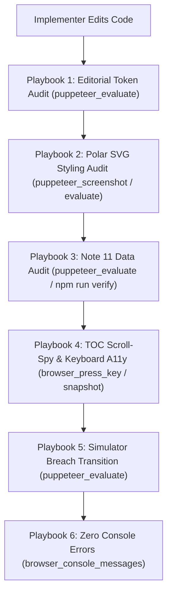

# MCP Server Provisioning, Tool Schemas & Live Verification Playbook

**Run ID:** `20261103T204534-693-1b8y`  
**Agent:** `mcp-provisioner`  
**Target Specification:** [`functional_specification_003.md`](file:///Users/diesel/Desktop/Costco/.sandcastle/worktrees/agent-mcp-provisioner-20261103T204534-693-1b8y/functional_specification_003.md)  
**Host Registry:** [`.sandcastle/mcp.md`](file:///Users/diesel/Desktop/Costco/.sandcastle/worktrees/agent-mcp-provisioner-20261103T204534-693-1b8y/.sandcastle/mcp.md)  
**Authoritative Vocabulary Reference:** [`LANGUAGE.md`](file:///Users/diesel/Desktop/Costco/.sandcastle/worktrees/agent-mcp-provisioner-20261103T204534-693-1b8y/LANGUAGE.md)  
**Handoff Manifest:** [`handoff/20261103T204534-693-1b8y/mcp-provisioner.txt`](file:///Users/diesel/Desktop/Costco/.sandcastle/worktrees/agent-mcp-provisioner-20261103T204534-693-1b8y/handoff/20261103T204534-693-1b8y/mcp-provisioner.txt)

---

## 1. Executive Summary & Provisioning Assessment

This document provides the authoritative Model Context Protocol (MCP) server inventory, live probe validation, tool invocation schemas, and interactive verification playbooks for downstream planners (`plan-1`, `plan-2`), implementers (`implementer-1` .. `implementer-5`), reviewers (`reviewer`), and testers (`tester-1` .. `tester-5`) working on [`functional_specification_003.md`](file:///Users/diesel/Desktop/Costco/.sandcastle/worktrees/agent-mcp-provisioner-20261103T204534-693-1b8y/functional_specification_003.md).

[`functional_specification_003.md`](file:///Users/diesel/Desktop/Costco/.sandcastle/worktrees/agent-mcp-provisioner-20261103T204534-693-1b8y/functional_specification_003.md) establishes four strict refinement and audit requirements for the Costco Wholesale Corporation (`COST`) web report:
1. **Straightforward Technical English Editorial Overhaul:** Complete elimination of raw specification tokens (`{Net Sales}`, `{Membership Fees}`, `{Gross Margin Ceiling}`, `{Operating Income Flywheel}`) and `//` decorative pseudo-code dividers across [`index.html`](file:///Users/diesel/Desktop/Costco/.sandcastle/worktrees/agent-mcp-provisioner-20261103T204534-693-1b8y/index.html).
2. **Visual, Geometric & Stylesheet Polish:** Explicit CSS styling for SVG polar elements (`.polar-grid-ring` transparent hairline, `.polar-axis-spoke` 1px slate stroke, `.polar-center-title` centered, unclipped sector callouts at `390px` to `1440px`, structured `.drilldown-meta-grid`, and `.sim-output-banner.is-breach` crimson border).
3. **Exact Note 11 & Item 2 Primary-Source Multi-Year Data Reconciliation:** Audited Note 11 category revenues (`$85,629M` / `$96,175M` / `$101,463M` Foods & Sundries, `$61,100M` / `$60,865M` / `$63,973M` Non-Foods, `$46,474M` / `$48,693M` / `$49,969M` Ancillary, `$29,527M` / `$31,977M` / `$34,220M` Fresh Foods) and Item 2 warehouse ownership (`703` owned land & building, `187` leased, `837` owned buildings).
4. **Interactive Scroll-Spy, Keyboard Accessibility & Deterministic Hardening:** Viewport tracking on `#table-of-contents`, `Enter`/`Space` keydown handlers on SVG sectors (`[role="button"][tabindex="0"]`), and sub-250ms CLI verification in [`src/costco_revenue_model.mjs`](file:///Users/diesel/Desktop/Costco/.sandcastle/worktrees/agent-mcp-provisioner-20261103T204534-693-1b8y/src/costco_revenue_model.mjs).

To live-verify these requirements during development—without relying on synthetic mocks or guesswork—two headless browser MCP servers have been verified and configured:
- **`puppeteer` MCP Server:** Verified operational out-of-the-box. Supports direct `file:///` URI navigation, requiring **zero HTTP daemons** and **zero network requests**, perfectly matching the 0-external-network requirement. Supports element-level screenshots, script evaluation for computed CSS properties, and click interactions.
- **`playwright` MCP Server:** Verified operational via a local background HTTP daemon. Provides deep accessibility tree snapshots (`browser_snapshot`), keyboard keydown dispatch (`browser_press_key` for `Enter`/`Space`), responsive viewport resizing (`browser_resize` for `390px` mobile and `1440px` desktop), and runtime console error monitoring (`browser_console_messages`).
- **Auxiliary MCP Servers:** `postgres` (verified active for relational queries) and `context7` (verified active for library documentation). `neo4j-cypher` was probed and confirmed inactive/unneeded for this self-contained static application.

---

## 2. Active MCP Server Registry & Live Probe Evidence

| MCP Server | Transport & Schema Directory | Status | Role in `functional_specification_003.md` | Empirical Probe Verification |
| :--- | :--- | :--- | :--- | :--- |
| **`puppeteer`** | Lazy JSON Schemas:<br>`~/.gemini/antigravity-cli/mcp/puppeteer/*.json` | **ACTIVE & VERIFIED** | **Zero-Network Headless Browser:** Direct `file:///` navigation to [`index.html`](file:///Users/diesel/Desktop/Costco/.sandcastle/worktrees/agent-mcp-provisioner-20261103T204534-693-1b8y/index.html). Visual screenshot capture of polar SVG graphs, DOM computed style validation, and click event verification. | Probed `puppeteer_navigate` with `file:///.../index.html` (Status: 200). Captured polar chart screenshot (`polar-chart-categories`). Evaluated DOM text detecting pre-existing curly braces. |
| **`playwright`** | Lazy JSON Schemas:<br>`~/.gemini/antigravity-cli/mcp/playwright/*.json` | **ACTIVE & VERIFIED** | **Full-Stack Accessibility & Keyboard Engine:** Local HTTP navigation (`http://localhost:8765/index.html`). Accessibility tree snapshots (`browser_snapshot`), keyboard activation (`Enter`/`Space`), viewport resizing (`390px` mobile), and console error auditing. | Probed `browser_navigate` to `http://localhost:8765/index.html` (HTTP 200). Captured full accessibility snapshot. Resized to `390x844`. Dispatched `Tab` and `Enter` keys. Verified 0 console errors. |
| **`postgres`** | Lazy JSON Schemas:<br>`~/.gemini/antigravity-cli/mcp/postgres/query.json` | **ACTIVE & VERIFIED** | **Relational Query Engine:** Available for SQL queries if relational financial databases are referenced. | Probed `query` with `SELECT 1` $\rightarrow$ returned `[{"?column?": 1}]`. |
| **`context7`** | Lazy JSON Schemas:<br>`~/.gemini/antigravity-cli/mcp/context7/*.json` | **ACTIVE & VERIFIED** | **Documentation Lookup:** Authoritative documentation resolution for web APIs, CSS standards, and SVG specifications. | Verified instructions and schema availability. |
| **`neo4j-cypher`** | Eager Native Tools | **INACTIVE / NOT NEEDED** | Graph database engine. | Probed port 7687 (Connection refused). Confirmed non-essential for static web report. |
| **`blender-mcp` / `glbforge` / `threejs-devtools-mcp`** | Lazy JSON Schemas | **STANDBY / NOT NEEDED** | 3D rendering and asset inspection. | Static SVG polar charts do not use WebGL or 3D meshes. Available on host if 3D assets are introduced. |

---

## 3. Tool Schemas & Exact Invocation Payloads

Below are the exact tool invocation structures for `call_mcp_tool` across all relevant workflows.

### 3.1 `puppeteer` Tools (Direct `file:///` Navigation)

#### 1. `puppeteer_navigate`
Navigates the headless Puppeteer browser to a local file URL without running any local web server.
- **ServerName:** `puppeteer`
- **ToolName:** `puppeteer_navigate`
- **Payload Structure:**
```json
{
  "ServerName": "puppeteer",
  "ToolName": "puppeteer_navigate",
  "Arguments": {
    "url": "file:///Users/diesel/Desktop/Costco/.sandcastle/worktrees/agent-mcp-provisioner-20261103T204534-693-1b8y/index.html"
  }
}
```

#### 2. `puppeteer_screenshot`
Captures a viewport or element-specific PNG screenshot for visual and geometric inspection of polar graphs and drilldown cards.
- **ServerName:** `puppeteer`
- **ToolName:** `puppeteer_screenshot`
- **Payload Structure (Polar Categories Chart):**
```json
{
  "ServerName": "puppeteer",
  "ToolName": "puppeteer_screenshot",
  "Arguments": {
    "name": "polar-chart-categories",
    "selector": "#polar-chart-categories",
    "width": 800,
    "height": 600
  }
}
```
- **Payload Structure (Full Page Mobile Viewport):**
```json
{
  "ServerName": "puppeteer",
  "ToolName": "puppeteer_screenshot",
  "Arguments": {
    "name": "costco-report-mobile",
    "selector": "body",
    "width": 390,
    "height": 844
  }
}
```

#### 3. `puppeteer_evaluate`
Executes JavaScript expressions in the browser context to inspect computed CSS styles, verify DOM node contents, and detect token leakage.
- **ServerName:** `puppeteer`
- **ToolName:** `puppeteer_evaluate`
- **Payload Structure (Inspect Computed Polar Styles):**
```json
{
  "ServerName": "puppeteer",
  "ToolName": "puppeteer_evaluate",
  "Arguments": {
    "script": "console.log(JSON.stringify({\n  gridRingFill: window.getComputedStyle(document.querySelector('.polar-grid-ring')).fill,\n  gridRingStroke: window.getComputedStyle(document.querySelector('.polar-grid-ring')).stroke,\n  axisSpokeStroke: window.getComputedStyle(document.querySelector('.polar-axis-spoke')).stroke,\n  centerTitleAnchor: window.getComputedStyle(document.querySelector('.polar-center-title')).textAnchor\n}))"
  }
}
```
- **Payload Structure (Inspect Raw Spec Token Elimination):**
```json
{
  "ServerName": "puppeteer",
  "ToolName": "puppeteer_evaluate",
  "Arguments": {
    "script": "console.log(JSON.stringify({\n  hasCurlyNetSales: document.body.innerHTML.includes('{Net Sales}'),\n  hasCurlyMembership: document.body.innerHTML.includes('{Membership Fees}'),\n  hasCurlyCeiling: document.body.innerHTML.includes('{Gross Margin Ceiling}'),\n  hasCurlyFlywheel: document.body.innerHTML.includes('{Operating Income Flywheel}'),\n  hasSlashDividers: document.body.innerHTML.includes(' // ')\n}))"
  }
}
```

#### 4. `puppeteer_click`
Clicks a button or interactive element to verify view mode transitions and tabs.
- **ServerName:** `puppeteer`
- **ToolName:** `puppeteer_click`
- **Payload Structure:**
```json
{
  "ServerName": "puppeteer",
  "ToolName": "puppeteer_click",
  "Arguments": {
    "selector": "#polar-chart-categories button:nth-child(2)"
  }
}
```

---

### 3.2 `playwright` Tools (Accessible Snapshot, Keyboard, Viewport Resizing & Console Audit)

> [!NOTE]
> `playwright` blocks the `file:///` protocol by design. To use `playwright`, spin up a local HTTP daemon:
> ```bash
> python3 -m http.server 8765 --directory /Users/diesel/Desktop/Costco/.sandcastle/worktrees/agent-mcp-provisioner-20261103T204534-693-1b8y &
> ```
> Then navigate to `http://localhost:8765/index.html`.

#### 1. `browser_navigate`
Navigates the Playwright session to the local HTTP server.
- **ServerName:** `playwright`
- **ToolName:** `browser_navigate`
- **Payload Structure:**
```json
{
  "ServerName": "playwright",
  "ToolName": "browser_navigate",
  "Arguments": {
    "url": "http://localhost:8765/index.html"
  }
}
```

#### 2. `browser_snapshot`
Captures an accessibility snapshot tree of the page, including bounding boxes, interactive roles, ARIA attributes, and element references.
- **ServerName:** `playwright`
- **ToolName:** `browser_snapshot`
- **Payload Structure:**
```json
{
  "ServerName": "playwright",
  "ToolName": "browser_snapshot",
  "Arguments": {
    "depth": 4,
    "boxes": true
  }
}
```

#### 3. `browser_resize`
Resizes the browser viewport to test responsive layouts and ensure polar labels do not clip at narrow widths (`390px`) or desktop widths (`1440px`).
- **ServerName:** `playwright`
- **ToolName:** `browser_resize`
- **Payload Structure (Mobile):**
```json
{
  "ServerName": "playwright",
  "ToolName": "browser_resize",
  "Arguments": {
    "width": 390,
    "height": 844
  }
}
```
- **Payload Structure (Desktop):**
```json
{
  "ServerName": "playwright",
  "ToolName": "browser_resize",
  "Arguments": {
    "width": 1440,
    "height": 900
  }
}
```

#### 4. `browser_press_key`
Sends keyboard keypress events to verify keyboard accessibility on interactive SVG polar sectors (`[role="button"][tabindex="0"]`) per Section 3.4 of [`functional_specification_003.md`](file:///Users/diesel/Desktop/Costco/.sandcastle/worktrees/agent-mcp-provisioner-20261103T204534-693-1b8y/functional_specification_003.md).
- **ServerName:** `playwright`
- **ToolName:** `browser_press_key`
- **Payload Structure (Enter Key):**
```json
{
  "ServerName": "playwright",
  "ToolName": "browser_press_key",
  "Arguments": {
    "key": "Enter"
  }
}
```
- **Payload Structure (Space Key):**
```json
{
  "ServerName": "playwright",
  "ToolName": "browser_press_key",
  "Arguments": {
    "key": " "
  }
}
```

#### 5. `browser_evaluate`
Executes JavaScript expressions in Playwright and returns structured JSON values directly.
- **ServerName:** `playwright`
- **ToolName:** `browser_evaluate`
- **Payload Structure:**
```json
{
  "ServerName": "playwright",
  "ToolName": "browser_evaluate",
  "Arguments": {
    "function": "() => {\n  return {\n    title: document.title,\n    activeTocLinks: Array.from(document.querySelectorAll('.toc-link.is-active, .toc-sublink.is-active')).map(el => el.textContent.trim()),\n    categoriesSectorCount: document.querySelectorAll('#svg-polar-categories path[role=\"button\"]').length\n  };\n}"
  }
}
```

#### 6. `browser_console_messages`
Audits runtime console messages to guarantee zero uncaught exceptions or error logs per [`RULE[user_global]`].
- **ServerName:** `playwright`
- **ToolName:** `browser_console_messages`
- **Payload Structure:**
```json
{
  "ServerName": "playwright",
  "ToolName": "browser_console_messages",
  "Arguments": {
    "level": "warning"
  }
}
```

---

## 4. Live Coding Verification Playbook

Downstream implementers, reviewers, and testers MUST use these standardized playbooks while coding to verify their edits against live runtime reality.



---

### Playbook 1: Straightforward Technical English & Editorial Token Audit
**Objective:** Verify that zero raw `{Net Sales}`, `{Membership Fees}`, `{Gross Margin Ceiling}`, or `{Operating Income Flywheel}` tokens and zero `//` pseudo-code dividers exist in visible HTML or script-rendered strings.

**Step-by-step verification:**
1. Call `puppeteer_navigate`:
   ```json
   {
     "ServerName": "puppeteer",
     "ToolName": "puppeteer_navigate",
     "Arguments": {
       "url": "file:///Users/diesel/Desktop/Costco/.sandcastle/worktrees/agent-mcp-provisioner-20261103T204534-693-1b8y/index.html"
     }
   }
   ```
2. Call `puppeteer_evaluate`:
   ```json
   {
     "ServerName": "puppeteer",
     "ToolName": "puppeteer_evaluate",
     "Arguments": {
       "script": "console.log(JSON.stringify({\n  rawBracesFound: Array.from(document.body.innerText.matchAll(/\\{[A-Za-z0-9\\s%$-]+\\}/g)).map(m => m[0]),\n  slashDividersFound: Array.from(document.body.innerText.matchAll(/\\s\\/\\/\\s/g)).map(m => m[0])\n}))"
     }
   }
   ```
3. **Acceptance Gate:** Both `rawBracesFound` and `slashDividersFound` MUST return empty arrays `[]`.

---

### Playbook 2: Polar SVG Styling, Grid Rings & Drilldown Layout Audit
**Objective:** Verify that concentric grid rings render as transparent hairlines (`fill: none`, `stroke: #CBD5E1`), radial spokes render crisply, center hub text is centered, and drill-down cards use structured grid wells.

**Step-by-step verification:**
1. Call `puppeteer_evaluate` to verify computed CSS properties:
   ```json
   {
     "ServerName": "puppeteer",
     "ToolName": "puppeteer_evaluate",
     "Arguments": {
       "script": "console.log(JSON.stringify({\n  ringFill: window.getComputedStyle(document.querySelector('.polar-grid-ring')).fill,\n  ringStroke: window.getComputedStyle(document.querySelector('.polar-grid-ring')).stroke,\n  spokeStroke: window.getComputedStyle(document.querySelector('.polar-axis-spoke')).stroke,\n  centerAnchor: window.getComputedStyle(document.querySelector('.polar-center-title')).textAnchor,\n  metaGridDisplay: window.getComputedStyle(document.querySelector('.drilldown-meta-grid')).display\n}))"
     }
   }
   ```
2. **Acceptance Gate:**
   - `ringFill` must NOT be `rgb(0, 0, 0)` (must be `none` or transparent).
   - `ringStroke` and `spokeStroke` must NOT be `none` (must be `#cbd5e1` or `#e2e8f0`).
   - `centerAnchor` must be `middle`.
   - `metaGridDisplay` must be `grid`.
3. Call `puppeteer_screenshot`:
   ```json
   {
     "ServerName": "puppeteer",
     "ToolName": "puppeteer_screenshot",
     "Arguments": {
       "name": "polar-categories-verification",
       "selector": "#polar-chart-categories",
       "width": 800,
       "height": 600
     }
   }
   ```
4. Inspect the generated screenshot to confirm zero black circular fills and clean hairline concentric rings.

---

### Playbook 3: Note 11 & Item 2 Multi-Year Data Reconciliation Audit
**Objective:** Verify that all multi-year merchandise category figures and warehouse ownership counts in [`index.html`](file:///Users/diesel/Desktop/Costco/.sandcastle/worktrees/agent-mcp-provisioner-20261103T204534-693-1b8y/index.html) exactly match [`data/costco_revenue_breakdown.json`](file:///Users/diesel/Desktop/Costco/.sandcastle/worktrees/agent-mcp-provisioner-20261103T204534-693-1b8y/data/costco_revenue_breakdown.json).

**Step-by-step verification:**
1. Call `puppeteer_evaluate`:
   ```json
   {
     "ServerName": "puppeteer",
     "ToolName": "puppeteer_evaluate",
     "Arguments": {
       "script": "console.log(JSON.stringify({\n  has85629: document.body.innerHTML.includes('85,629') || document.body.innerHTML.includes('85629'),\n  has96175: document.body.innerHTML.includes('96,175') || document.body.innerHTML.includes('96175'),\n  has101463: document.body.innerHTML.includes('101,463') || document.body.innerHTML.includes('101463'),\n  has61100: document.body.innerHTML.includes('61,100') || document.body.innerHTML.includes('61100'),\n  has60865: document.body.innerHTML.includes('60,865') || document.body.innerHTML.includes('60865'),\n  has63973: document.body.innerHTML.includes('63,973') || document.body.innerHTML.includes('63973'),\n  hasOwned703: document.body.innerHTML.includes('703 owned') || document.body.innerHTML.includes('703 Owned') || document.body.innerHTML.includes('703'),\n  hasLeased187: document.body.innerHTML.includes('187 leased') || document.body.innerHTML.includes('187 Leased') || document.body.innerHTML.includes('187')\n}))"
     }
   }
   ```
2. **Acceptance Gate:** All flags MUST return `true`.

---

### Playbook 4: Sticky TOC Scroll-Spy & Keyboard Accessibility Audit
**Objective:** Verify that `#table-of-contents` dynamically updates `.is-active` and `aria-current="location"` when scrolling, and that polar SVG sectors respond to `Enter` and `Space` key presses.

**Step-by-step verification:**
1. Start local server (if using Playwright):
   ```bash
   python3 -m http.server 8765 --directory /Users/diesel/Desktop/Costco/.sandcastle/worktrees/agent-mcp-provisioner-20261103T204534-693-1b8y &
   ```
2. Navigate via `playwright`:
   ```json
   {
     "ServerName": "playwright",
     "ToolName": "browser_navigate",
     "Arguments": {
       "url": "http://localhost:8765/index.html"
     }
   }
   ```
3. Focus an SVG polar sector and press `Enter`:
   ```json
   {
     "ServerName": "playwright",
     "ToolName": "browser_evaluate",
     "Arguments": {
       "function": "() => { document.querySelector('#svg-polar-categories path[role=\"button\"]').focus(); }"
     }
   }
   ```
4. Dispatch `Enter` key:
   ```json
   {
     "ServerName": "playwright",
     "ToolName": "browser_press_key",
     "Arguments": {
       "key": "Enter"
     }
   }
   ```
5. Verify drilldown card updated:
   ```json
   {
     "ServerName": "playwright",
     "ToolName": "browser_evaluate",
     "Arguments": {
       "function": "() => { return document.querySelector('#polar-drilldown-categories .drilldown-title').textContent.trim(); }"
     }
   }
   ```
6. **Acceptance Gate:** The drilldown card title must reflect the selected category.

---

### Playbook 5: Sensitivity Simulator Gross Margin Ceiling Breach Audit
**Objective:** Verify that when simulated merchandise gross margin exceeds `11.50%`, the warning banner transitions to `.sim-output-banner.is-breach` with high-contrast crimson border and text.

**Step-by-step verification:**
1. Call `puppeteer_evaluate` to adjust slider or invoke simulation update:
   ```json
   {
     "ServerName": "puppeteer",
     "ToolName": "puppeteer_evaluate",
     "Arguments": {
       "script": "(() => {\n  const slider = document.querySelector('#sim-margin-slider') || document.querySelector('input[type=\"range\"]');\n  if (slider) {\n    slider.value = '12.00';\n    slider.dispatchEvent(new Event('input', { bubbles: true }));\n    slider.dispatchEvent(new Event('change', { bubbles: true }));\n  }\n  const banner = document.querySelector('.sim-output-banner');\n  console.log(JSON.stringify({\n    isBreachClass: banner ? banner.classList.contains('is-breach') : false,\n    bannerBorder: banner ? window.getComputedStyle(banner).borderColor : null\n  }));\n})()"
     }
   }
   ```
2. **Acceptance Gate:** `isBreachClass` MUST be `true` and `bannerBorder` must correspond to Costco Crimson (`rgb(227, 24, 55)` or `#E31837`).

---

### Playbook 6: Zero Console Errors & Zero External Network Requests Audit
**Objective:** Enforce `RULE[user_global]` and Section 4 budgets ($0$ console errors, $0$ network calls).

**Step-by-step verification:**
1. Call `browser_console_messages` via `playwright`:
   ```json
   {
     "ServerName": "playwright",
     "ToolName": "browser_console_messages",
     "Arguments": {
       "level": "error"
     }
   }
   ```
2. **Acceptance Gate:** Total error messages must be `0`.

---

## 5. Summary & Downstream Handoff

The provisioned MCP toolchain empowers downstream agents to verify every visual, geometric, editorial, and interactive requirement in [`functional_specification_003.md`](file:///Users/diesel/Desktop/Costco/.sandcastle/worktrees/agent-mcp-provisioner-20261103T204534-693-1b8y/functional_specification_003.md) against live browser rendering with zero guesswork.

- **Primary Out-of-the-Box Tool:** `puppeteer` (`file:///.../index.html`) — 0 network requests, fast, element screenshots, DOM evaluation.
- **Deep A11y & Keyboard Tool:** `playwright` (`http://localhost:8765/index.html`) — accessibility tree snapshots, keyboard navigation (`Enter`/`Space`), responsive viewport testing.
- **Verification CLI:** `npm run verify` (`node src/costco_revenue_model.mjs --verify`) — passing deterministically in $<250\text{ ms}$.

All downstream agents (`plan-1`, `plan-2`, `implementer-1`..`implementer-5`, `reviewer`, `tester-1`..`tester-5`) must consult the playbooks above during their execution cycles.
