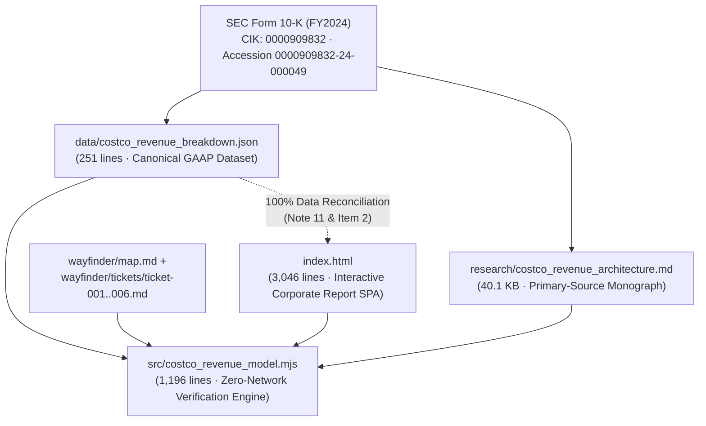

# Refined Functional Specification 003: Costco Wholesale Corporation (`COST`) Webpage Refinement, Visual & Geometric Polish, Data Reconciliation, and Straightforward Technical English Editorial Overhaul

**Document Version:** 2.0 (Refined Technical Specification — Synthesized from Blackboard Scanners `codebase-mapper`, `api-schema-mapper`, `mcp-provisioner`, `library-installer`, and `function-mapper`)  
**Run ID:** `20261103T204534-693-1b8y`  
**Source Specification:** [`functional_specification_003.md`](file:///Users/diesel/Desktop/Costco/.sandcastle/worktrees/agent-plan-20261103T204534-693-1b8y/functional_specification_003.md)  
**Authoritative Vocabulary:** [`LANGUAGE.md`](file:///Users/diesel/Desktop/Costco/.sandcastle/worktrees/agent-plan-20261103T204534-693-1b8y/LANGUAGE.md)  
**Primary Dataset:** [`data/costco_revenue_breakdown.json`](file:///Users/diesel/Desktop/Costco/.sandcastle/worktrees/agent-plan-20261103T204534-693-1b8y/data/costco_revenue_breakdown.json)  
**Status:** Authoritative Refined Specification (`wayfinder/20261103T204534-693-1b8y/refined-specification.md`). **DO NOT CODE YET.**

---

## 1. Objective & Executive Summary

This refined specification defines the exact engineering, editorial, visual/geometric, data-reconciliation, accessibility, and deterministic verification requirements for upgrading the interactive corporate report ([`index.html`](file:///Users/diesel/Desktop/Costco/.sandcastle/worktrees/agent-plan-20261103T204534-693-1b8y/index.html)), its zero-network verification engine ([`src/costco_revenue_model.mjs`](file:///Users/diesel/Desktop/Costco/.sandcastle/worktrees/agent-plan-20261103T204534-693-1b8y/src/costco_revenue_model.mjs)), and supporting repository documentation ([`README.md`](file:///Users/diesel/Desktop/Costco/.sandcastle/worktrees/agent-plan-20261103T204534-693-1b8y/README.md), [`wayfinder/map.md`](file:///Users/diesel/Desktop/Costco/.sandcastle/worktrees/agent-plan-20261103T204534-693-1b8y/wayfinder/map.md), and [`wayfinder/tickets/ticket-006.md`](file:///Users/diesel/Desktop/Costco/.sandcastle/worktrees/agent-plan-20261103T204534-693-1b8y/wayfinder/tickets/ticket-006.md)).

Empirical inspection by the five Blackboard scanners confirms that while the existing 5-section corporate layout and FY2024 top-line GAAP figures are in place, four root-cause systemic defects in [`index.html`](file:///Users/diesel/Desktop/Costco/.sandcastle/worktrees/agent-plan-20261103T204534-693-1b8y/index.html) and [`src/costco_revenue_model.mjs`](file:///Users/diesel/Desktop/Costco/.sandcastle/worktrees/agent-plan-20261103T204534-693-1b8y/src/costco_revenue_model.mjs) must be eliminated:

1. **Straightforward Technical English Editorial Overhaul (`index.html`):**
   - [`index.html`](file:///Users/diesel/Desktop/Costco/.sandcastle/worktrees/agent-plan-20261103T204534-693-1b8y/index.html) currently leaks raw curly-brace specification tokens (`{Net Sales}`, `{Membership Fees}`, `{Gross Margin Ceiling}`, `{Operating Income Flywheel}`) directly into reader-facing HTML headings, body copy, KPI cards, table rows, and JavaScript template strings (`41` occurrences across lines `1127–2864`), alongside pseudo-code double-slash prefixes (`Section 01 // Institutional Executive Briefing`, `ACTIVE POLAR SECTOR DRILLDOWN // NOTE 11 MERCHANDISE CATEGORY`, `Step 01 // Primary-Source SEC 10-K Telemetry`, `ticket-001.md // Two-Pillar & ASC 606`) and promotional metaphors (`Gatekeeper Subscription`, `High-Frequency Trip Magnets`, `Subscription Annuity`, `treasure-hunt discretionary basket builder`, `perceive unmistakable value`, `threatens the 92.9% renewal moat`).
   - All visible prose, headings, table labels, chart callouts, step explanations, simulator readouts, and ticket summaries in [`index.html`](file:///Users/diesel/Desktop/Costco/.sandcastle/worktrees/agent-plan-20261103T204534-693-1b8y/index.html) MUST be rewritten in clear, direct, **straightforward technical English** that explains the accounting, warehouse operations, inventory turnover, and cash-flow mechanics plainly without raw `{...}` braces, `//` decorative separators, or marketing jargon.
2. **Polar Graph SVG Rendering, Viewport Framing & Drill-Down Card Stylesheet Polish (`index.html`):**
   - The interactive polar charts (`#svg-polar-categories`, `#svg-polar-geography`, `#svg-polar-flywheel`) emit SVG concentric grid circles (`.polar-grid-ring`), radial axis spokes (`.polar-axis-spoke`), center hub labels (`.polar-center-title`, `.polar-center-sub`), and outer sector callouts (`.polar-sector-label`, `.polar-axis-label`) whose CSS rules were omitted from `<style>` in [`index.html`](file:///Users/diesel/Desktop/Costco/.sandcastle/worktrees/agent-plan-20261103T204534-693-1b8y/index.html). Consequently, `.polar-grid-ring` defaults to opaque solid black SVG fill (`fill: rgb(0, 0, 0)`), `.polar-axis-spoke` renders invisibly (`stroke: none`), `.polar-center-title` and `.polar-center-sub` render off-center (`text-anchor: start`), and outer callout labels clip against the `0 0 400 400` SVG `viewBox`.
   - Furthermore, the interactive sector drill-down cards (`.drilldown-eyebrow`, `.drilldown-title`, `.drilldown-copy`, `.drilldown-meta-grid`, `.drilldown-meta-item`) and the simulator ceiling-breach state (`.sim-output-banner.is-breach`) lack CSS rules, and line `2881` references an undefined CSS custom property `var(--emerald-audit)` instead of `var(--cat-emerald)`.
   - Every polar chart, legend, and drill-down card must be styled and framed so that grid rings render as transparent, dashed hairline guides, radial spokes terminate cleanly, center hub text is horizontally centered in monospace tabular numerals, outer sector labels fit comfortably inside a padded SVG `viewBox` across `390px` mobile and `1440px+` desktop viewports, and drill-down cards display structured key-value wells.
3. **Exact Multi-Year Note 11 & Item 2 Primary-Source Data Reconciliation (`index.html` vs. `data/costco_revenue_breakdown.json`):**
   - While FY2024 figures in [`index.html`](file:///Users/diesel/Desktop/Costco/.sandcastle/worktrees/agent-plan-20261103T204534-693-1b8y/index.html) match the SEC Form 10-K, the embedded historical FY2022 and FY2023 merchandise category figures in `CATEGORY_DATA` (lines `1857–1902`) and property ownership counts in `GEOGRAPHY_DATA` (lines `1904–1962` and `2439–2474`) diverge from [`data/costco_revenue_breakdown.json`](file:///Users/diesel/Desktop/Costco/.sandcastle/worktrees/agent-plan-20261103T204534-693-1b8y/data/costco_revenue_breakdown.json) and Note 11 / Item 2 of the FY2024 Form 10-K (showing `$88,948M` / `$96,936M` for FY22/FY23 Foods and Sundries instead of audited `$85,629M` / `$96,175M`, and listing `704` owned warehouses instead of `703` owned and `187` leased).
   - Every multi-year category figure, share percentage, year-over-year growth rate, and warehouse ownership count in [`index.html`](file:///Users/diesel/Desktop/Costco/.sandcastle/worktrees/agent-plan-20261103T204534-693-1b8y/index.html) must be 100% reconciled with [`data/costco_revenue_breakdown.json`](file:///Users/diesel/Desktop/Costco/.sandcastle/worktrees/agent-plan-20261103T204534-693-1b8y/data/costco_revenue_breakdown.json).
4. **Interactive Scroll-Spy, Keyboard Accessibility & Deterministic Verification Hardening (`index.html` & `src/costco_revenue_model.mjs`):**
   - The sticky Table of Contents (`#table-of-contents`) must actively track viewport scroll position across all 5 sections and sub-anchors via `IntersectionObserver` / scroll-spy synchronization (and highlight both a clicked `.toc-sublink` and its parent `.toc-link`), interactive SVG polar sectors (`[role="button"][tabindex="0"]`) must respond to `Enter` and `Space` keyboard activation with `:focus-visible` styling, and [`src/costco_revenue_model.mjs`](file:///Users/diesel/Desktop/Costco/.sandcastle/worktrees/agent-plan-20261103T204534-693-1b8y/src/costco_revenue_model.mjs) must enforce deterministic checks against raw curly-brace token leakage, missing polar/drill-down CSS selectors, and historical Note 11 / Item 2 figure drift.

---

## 2. Authoritative Domain Vocabulary & Evaluation Parameters (`LANGUAGE.md`)

All implementation and verification work MUST strictly enforce the evaluation parameters and domain concepts defined in [`LANGUAGE.md`](file:///Users/diesel/Desktop/Costco/.sandcastle/worktrees/agent-plan-20261103T204534-693-1b8y/LANGUAGE.md):

| Parameter / Concept | Specification Contract & Reader-Facing Translation |
| :--- | :--- |
| **`{errors}`** | Any structural invariant breach: (1) raw `{Net Sales}`, `{Membership Fees}`, `{Gross Margin Ceiling}`, or `{Operating Income Flywheel}` curly-brace tokens or `//` decorative separators in reader-facing copy in [`index.html`](file:///Users/diesel/Desktop/Costco/.sandcastle/worktrees/agent-plan-20261103T204534-693-1b8y/index.html); (2) unstyled SVG polar grid rings (`fill: #000000`), invisible spokes, uncentered hub labels, clipped outer sector labels, unformatted `.drilldown-meta-grid` items, missing `.sim-output-banner.is-breach` styling, or undefined CSS variables (`--emerald-audit`); (3) any discrepancy between Note 11 / Item 2 figures in [`index.html`](file:///Users/diesel/Desktop/Costco/.sandcastle/worktrees/agent-plan-20261103T204534-693-1b8y/index.html) and [`data/costco_revenue_breakdown.json`](file:///Users/diesel/Desktop/Costco/.sandcastle/worktrees/agent-plan-20261103T204534-693-1b8y/data/costco_revenue_breakdown.json); (4) residual Dreamcore markers or broken corporate DOM IDs; (5) runtime browser console errors or non-zero exit codes from `npm run verify`. |
| **`{correctness}`** | Exact mathematical, accounting, geometric, and editorial fidelity across all deliverables: consolidated total revenue `$254,453M = $249,625M + $4,828M` (FY24), `$242,290M = $237,710M + $4,580M` (FY23), `$226,954M = $222,730M + $4,224M` (FY22); Note 11 category sales and Item 2 warehouse ownership counts reconciled to the exact integer across FY2022–FY2024; `10.92%` merchandise gross margin (`$27,267M`), `9.14%` SG&A (`$22,810M`), `$4,457M` (`48.00%`) net merchandise operating contribution, `$4,828M` (`52.00%`) membership fee share of `$9,285M` operating income, `$7,367M` net income, `12.60x` inventory turnover, and `104.15%` accounts payable (`$19,421M`) to merchandise inventory (`$18,647M`) ratio. |
| **`{functionality}`** | End-to-end interactive corporate report experience at `1440px` desktop and `390px` mobile viewports with clean technical English, crisp hairline SVG polar charts, unclipped labels, full pointer and keyboard (`Enter`/`Space`) interactivity, live scroll-spy Table of Contents highlighting, and deterministic verification in $\le 250\text{ ms}$ with `0` external network requests. |
| **`{correct required outputs}`** | (1) Refined [`index.html`](file:///Users/diesel/Desktop/Costco/.sandcastle/worktrees/agent-plan-20261103T204534-693-1b8y/index.html), (2) Enhanced [`src/costco_revenue_model.mjs`](file:///Users/diesel/Desktop/Costco/.sandcastle/worktrees/agent-plan-20261103T204534-693-1b8y/src/costco_revenue_model.mjs), (3) Reconciled [`wayfinder/map.md`](file:///Users/diesel/Desktop/Costco/.sandcastle/worktrees/agent-plan-20261103T204534-693-1b8y/wayfinder/map.md), [`wayfinder/tickets/ticket-006.md`](file:///Users/diesel/Desktop/Costco/.sandcastle/worktrees/agent-plan-20261103T204534-693-1b8y/wayfinder/tickets/ticket-006.md), and [`README.md`](file:///Users/diesel/Desktop/Costco/.sandcastle/worktrees/agent-plan-20261103T204534-693-1b8y/README.md), all passing `node src/costco_revenue_model.mjs --verify` with `status: "VERIFIED"`. |
| **Domain Terms in `index.html`** | In [`index.html`](file:///Users/diesel/Desktop/Costco/.sandcastle/worktrees/agent-plan-20261103T204534-693-1b8y/index.html), write `{Net Sales}` as **Net Sales** (or **merchandise net sales**), `{Membership Fees}` as **Membership Fees** (or **annual membership fees**), `{Gross Margin Ceiling}` as **Gross Margin Ceiling** (or **10.92% gross margin cap**), and `{Operating Income Flywheel}` as **Operating Income Flywheel** (or **operating profit structure**)—never with raw `{...}` braces. |

---

## 3. Workspace Shape & Existing Code to Reuse (`codebase-mapper`)



### 3.1 Repository File Inventory & Modification Scope

| File Path | Current Size | Action | Architectural Responsibility |
| :--- | :--- | :--- | :--- |
| [`index.html`](file:///Users/diesel/Desktop/Costco/.sandcastle/worktrees/agent-plan-20261103T204534-693-1b8y/index.html) | `3,046` lines (`140 KB`) | **Modify (In-Place Refinement)** | Self-contained HTML5/CSS3/SVG/ES2022 corporate financial report. Refine `<style>` block (lines `9–983`), HTML body prose (lines `985–1850`), and embedded IIFE data/controllers (lines `1852–3044`). |
| [`src/costco_revenue_model.mjs`](file:///Users/diesel/Desktop/Costco/.sandcastle/worktrees/agent-plan-20261103T204534-693-1b8y/src/costco_revenue_model.mjs) | `1,196` lines (`42 KB`) | **Modify (Extend `verifyCorporateWebReport`)** | Deterministic ESM verification CLI and programmatic audit module. Preserve all 6 exported functions and CLI flags while adding checks for raw curly-brace tokens, polar/drill-down CSS selectors, undefined CSS variables, and historical Note 11 / Item 2 figures. |
| [`data/costco_revenue_breakdown.json`](file:///Users/diesel/Desktop/Costco/.sandcastle/worktrees/agent-plan-20261103T204534-693-1b8y/data/costco_revenue_breakdown.json) | `251` lines (`8.8 KB`) | **Read-Only Authoritative Source** | Canonical primary-source dataset verified against SEC Form 10-K. Used as ground truth to reconcile [`index.html`](file:///Users/diesel/Desktop/Costco/.sandcastle/worktrees/agent-plan-20261103T204534-693-1b8y/index.html). |
| [`wayfinder/tickets/ticket-006.md`](file:///Users/diesel/Desktop/Costco/.sandcastle/worktrees/agent-plan-20261103T204534-693-1b8y/wayfinder/tickets/ticket-006.md) | `48` lines (`5.4 KB`) | **Modify (Reconcile Resolution Summary)** | Update Resolution text to document the SVG polar styling rules, padded `viewBox`, keyboard accessibility, scroll-spy TOC, Note 11 multi-year reconciliation, and straightforward technical English prose invariants. |
| [`wayfinder/map.md`](file:///Users/diesel/Desktop/Costco/.sandcastle/worktrees/agent-plan-20261103T204534-693-1b8y/wayfinder/map.md) | `30` lines (`4.6 KB`) | **Verify / Preserve Governance** | Canonical Wayfinder map. Must preserve all 5 required H2 sections and descriptive human-readable ticket links wrapping relative paths (`./tickets/ticket-001.md`..`./tickets/ticket-006.md`). |
| [`README.md`](file:///Users/diesel/Desktop/Costco/.sandcastle/worktrees/agent-plan-20261103T204534-693-1b8y/README.md) | `38` lines (`5.4 KB`) | **Modify (Align Documentation)** | Update repository overview to reflect reconciled Note 11 / Item 2 metrics and enhanced verification checks in [`src/costco_revenue_model.mjs`](file:///Users/diesel/Desktop/Costco/.sandcastle/worktrees/agent-plan-20261103T204534-693-1b8y/src/costco_revenue_model.mjs). |
| [`research/costco_revenue_architecture.md`](file:///Users/diesel/Desktop/Costco/.sandcastle/worktrees/agent-plan-20261103T204534-693-1b8y/research/costco_revenue_architecture.md) | `322` lines (`40.1 KB`) | **Read-Only Authoritative Source** | Primary-source SEC Form 10-K monograph (`CIK: 0000909832`). |

### 3.2 Existing Functions & Modules to Reuse (Do Not Duplicate)

1. **In [`src/costco_revenue_model.mjs`](file:///Users/diesel/Desktop/Costco/.sandcastle/worktrees/agent-plan-20261103T204534-693-1b8y/src/costco_revenue_model.mjs):**
   - Reuse and preserve `verifyFinancialDataset(data)` (lines `470–623`), `verifyWayfinderArtifacts(rawOptions)` (lines `682–825`), `verifyResearchMonograph(rawOptions)` (lines `831–899`), `loadAndVerifyCostcoModel(rawOptions)` (lines `1058–1139`), and CLI parser `parseCliArgs(argv)` (lines `1149–1172`).
   - Extend `verifyCorporateWebReport(rawOptions)` (lines `907–1026`, aliased as `verifyIndexHtml` at line `1028`) in-place without breaking its existing input signature (`string | object`) or existing return keys (`valid`, `htmlPath`, `byteLength`, `tableOfContentsVerified`, `polarChartsVerified`, `fiveStepsVerified`, `dreamcoreMarkersDetected`).
2. **In [`index.html`](file:///Users/diesel/Desktop/Costco/.sandcastle/worktrees/agent-plan-20261103T204534-693-1b8y/index.html) Embedded IIFE (`lines 1853–3043`):**
   - Reuse and refine the existing datasets in-place: `CATEGORY_DATA` (lines `1857–1902`), `GEOGRAPHY_DATA` (lines `1904–1962`), `FLYWHEEL_ASYMMETRY_DATA` (lines `1964–1985`), `ANCILLARY_ROSE_DATA` (lines `1987–2028`), `GAAP_BY_YEAR` (lines `2030–2076`), `STEP_SUMMARIES` (lines `2078–2099`), and `WAYFINDER_TICKETS` (lines `2101–2138`).
   - Reuse the existing SVG polar geometry helpers `degToRad(deg)` (lines `2141–2143`), `polarPoint(cx, cy, r, deg)` (lines `2145–2151`), `describeAnnularSector(cx, cy, rInner, rOuter, startDeg, endDeg)` (lines `2153–2180`), `formatUsdM(num)` (lines `2182–2184`), and `renderPolarGrid(cx, cy, maxR, ringLabels, spokeAngles)` (lines `2186–2201`).
   - Reuse and refine the existing view renderers `renderPolarCategories()` (lines `2212–2359`), `renderPolarGeography()` (lines `2369–2492`), `renderPolarFlywheel()` (lines `2502–2634`), `setActiveStep(stepNum, shouldScroll)` (lines `2641–2669`), `renderGaapWaterfall()` (lines `2676–2824`), `updateSimulator()` (lines `2826–2867`), `renderTicketInspector()` (lines `2874–2888`), and `init()` (lines `2893–3036`).

---

## 4. External Connections & Data Structures (`api-schema-mapper`)

### 4.1 Primary-Source SEC EDGAR Verification & Zero-Network Runtime Contract

`api-schema-mapper` verified all primary-source SEC EDGAR filings for **Costco Wholesale Corporation (`CIK: 0000909832`)** and cached reference artifacts under `assets/20261103T204534-693-1b8y/`:
- **FY2024 SEC Form 10-K (`0000909832-24-000049`):** Filed October 9, 2024 for the 52-week fiscal year ended September 1, 2024 (`assets/20261103T204534-693-1b8y/api-schema-mapper-cost-20240901.htm`).
- **Q4/FY2024 SEC Form 8-K (`0000909832-24-000043`):** Filed September 26, 2024 (`assets/20261103T204534-693-1b8y/api-schema-mapper-sec-8k-20240926.htm`).
- **SEC XBRL Company Facts & Submissions JSON:** `assets/20261103T204534-693-1b8y/api-schema-mapper-sec-companyfacts.json` and `api-schema-mapper-sec-submissions.json`.
- **Canonical Local JSON Schema:** `assets/20261103T204534-693-1b8y/api-schema-mapper-local-data-schema.json`, validating [`data/costco_revenue_breakdown.json`](file:///Users/diesel/Desktop/Costco/.sandcastle/worktrees/agent-plan-20261103T204534-693-1b8y/data/costco_revenue_breakdown.json).

> [!IMPORTANT]
> **Zero External Network Calls at Runtime:** Both [`index.html`](file:///Users/diesel/Desktop/Costco/.sandcastle/worktrees/agent-plan-20261103T204534-693-1b8y/index.html) and `node src/costco_revenue_model.mjs --verify` MUST execute with **`0` external network requests** (`externalNetworkRequests: 0`). No external stylesheets, Google Fonts CDNs, third-party scripts, or remote image URLs may be referenced in [`index.html`](file:///Users/diesel/Desktop/Costco/.sandcastle/worktrees/agent-plan-20261103T204534-693-1b8y/index.html).

### 4.2 Authoritative Data Reconciliation Matrix (`index.html` vs. `data/costco_revenue_breakdown.json`)

#### Table 4.2A — Note 11 Disaggregated Merchandise Category Net Sales (`FY2022–FY2024`)

All values in `CATEGORY_DATA` (lines `1857–1902` of [`index.html`](file:///Users/diesel/Desktop/Costco/.sandcastle/worktrees/agent-plan-20261103T204534-693-1b8y/index.html)), `#tbody-polar-categories`, and `.drilldown-meta-grid` MUST be updated to match [`data/costco_revenue_breakdown.json`](file:///Users/diesel/Desktop/Costco/.sandcastle/worktrees/agent-plan-20261103T204534-693-1b8y/data/costco_revenue_breakdown.json) (`merchandise_categories[]`, lines `67–146`):

| Category ID (`category_id`) | Display Name | Current `index.html` FY22 / FY23 (Incorrect) | Audited FY2022 (`$M` / Share) | Audited FY2023 (`$M` / Share) | Audited FY2024 (`$M` / Share) | Audited FY24 YoY Growth |
| :--- | :--- | :--- | :--- | :--- | :--- | :--- |
| `foods_and_sundries` | **Foods and Sundries** | `$88,948M` / `$96,936M` (`+4.67%`) | **`$85,629M`** (`38.45%`) | **`$96,175M`** (`40.46%`) | **`$101,463M`** (`40.65%`) | **`+5.50%`** |
| `non_foods` | **Non-Foods** | `$60,876M` / `$60,292M` (`+6.11%`) | **`$61,100M`** (`27.43%`) | **`$60,865M`** (`25.60%`) | **`$63,973M`** (`25.63%`) | **`+5.11%`** |
| `warehouse_ancillary_and_other` | **Warehouse Ancillary and Other Businesses** | `$43,443M` / `$48,693M` (`+2.62%`) | **`$46,474M`** (`20.87%`) | **`$48,693M`** (`20.48%`) | **`$49,969M`** (`20.02%`) | **`+2.62%`** |
| `fresh_foods` | **Fresh Foods** | `$29,463M` / `$31,789M` (`+7.65%`) | **`$29,527M`** (`13.26%`) | **`$31,977M`** (`13.45%`) | **`$34,220M`** (`13.71%`) | **`+7.01%`** |
| **Total Net Sales** | **Total Net Sales (Note 11)** | `$222,730M` / `$237,710M` | **`$222,730M`** (`100.00%`) | **`$237,710M`** (`100.00%`) | **`$249,625M`** (`100.01%` rounded; `100.00%` exact) | **`+5.01%`** |

*Exact Mathematical Verification:*
- **FY2022 Sum:** $\$85,629\text{M} + \$61,100\text{M} + \$46,474\text{M} + \$29,527\text{M} = \$222,730\text{M}$ (`38.45% + 27.43% + 20.87% + 13.26% = 100.01%` rounded).
- **FY2023 Sum:** $\$96,175\text{M} + \$60,865\text{M} + \$48,693\text{M} + \$31,977\text{M} = \$237,710\text{M}$ (`40.46% + 25.60% + 20.48% + 13.45% = 99.99%` rounded).
- **FY2024 Sum:** $\$101,463\text{M} + \$63,973\text{M} + \$49,969\text{M} + \$34,220\text{M} = \$249,625\text{M}$ (`40.65% + 25.63% + 20.02% + 13.71% = 100.01%` rounded).
- **FY2024 YoY Category Growth Rates:**
  - Foods and Sundries: $(101,463 - 96,175) / 96,175 = +5.4983\% \rightarrow \mathbf{+5.50\%}$
  - Non-Foods: $(63,973 - 60,865) / 60,865 = +5.1064\% \rightarrow \mathbf{+5.11\%}$
  - Warehouse Ancillary and Other Businesses: $(49,969 - 48,693) / 48,693 = +2.6205\% \rightarrow \mathbf{+2.62\%}$
  - Fresh Foods: $(34,220 - 31,977) / 31,977 = +7.0144\% \rightarrow \mathbf{+7.01\%}$

#### Table 4.2B — Note 11 & Item 2 Geographic Segments and Warehouse Property Ownership (`FY2024`)

All values in `GEOGRAPHY_DATA` (lines `1904–1962`), `#tbody-polar-geography` (lines `2453–2476`), `#polar-geo-caption` (line `2439`), and `#polar-geography-drilldown` (lines `2443–2451`) in [`index.html`](file:///Users/diesel/Desktop/Costco/.sandcastle/worktrees/agent-plan-20261103T204534-693-1b8y/index.html) MUST match [`data/costco_revenue_breakdown.json`](file:///Users/diesel/Desktop/Costco/.sandcastle/worktrees/agent-plan-20261103T204534-693-1b8y/data/costco_revenue_breakdown.json) (`geographic_segments[]`, lines `148–188`) and Item 2 (p. 18) of the FY2024 Form 10-K:

| Segment (`segment_id`) | FY24 Total Revenue (`$M` / Share) | FY24 Operating Income (`$M` / Margin) | Total Clubs | Current `index.html` Ownership (Incorrect) | Audited Item 2 Ownership (`owned_warehouses` / `leased_warehouses`) | Floor Space (`sq ft`) | Employees |
| :--- | :--- | :--- | :--- | :--- | :--- | :--- | :--- |
| **`united_states`** (United States, incl. Puerto Rico) | **`$184,143M`** (`72.37%`) | **`$6,217M`** (`3.38%` margin, `66.96%` share) | **`614`** (`$299.91M`/club) | `505` owned / `80` ground / `29` leased | **`499` owned / `115` leased** | **`91.1M` sq ft** | **`219,000`** |
| **`other_international`** (Other International, 12 countries) | **`$35,436M`** (`13.93%`) | **`$1,420M`** (`4.01%` margin, `15.29%` share) | **`168`** (`$210.93M`/club) | `103` owned / `35` ground / `30` leased; Spain listed as `5` | **`113` owned / `55` leased** (Mexico `40`, Japan `35`, U.K. `29`, Korea `19`, Australia `15`, Taiwan `14`, China `7`, Spain `4`, France `2`, Iceland `1`, New Zealand `1`, Sweden `1`) | **`24.3M` sq ft** | **`61,000`** |
| **`canada`** (Canada) | **`$34,874M`** (`13.71%`) | **`$1,648M`** (`4.73%` margin, `17.75%` share) | **`108`** (`$322.91M`/club) | `96` owned / `9` ground / `3` leased | **`91` owned / `17` leased** | **`15.5M` sq ft** | **`53,000`** |
| **Consolidated Worldwide Total** | **`$254,453M`** (`100.01%` rounded; `100.00%` exact) | **`$9,285M`** (`3.65%` margin) | **`890`** (`$285.90M`/club) | `704` owned / `124` ground / `62` leased | **`703` owned land & building / `187` leased** (of which `134` are land-only leases where Costco owns the building = **`837` owned buildings**) | **`130.9M` sq ft** (+`31.9M` sq ft depots) | **`333,000`** |

---

## 5. Languages, Libraries & Function Signatures (`library-installer` & `function-mapper`)

### 5.1 Verified Runtime & Library Stack (`library-installer`)

- **Node.js & CLI Verification Runtime:** Node.js `v24.9.0` (`npm 11.6.0`), native ECMAScript Modules (`"type": "module"` in `package.json`), using only built-in modules (`node:fs`, `node:path`, `node:process`, `node:perf_hooks`, `node:url`). Verified baseline execution: **`7.64 ms`** wall-clock time ($\le 250\text{ ms}$ budget) and **`46.5 MB`** RSS ($\le 128\text{ MB}$ budget) with **`0`** network calls.
- **Browser Runtime (`index.html`):** Self-contained HTML5, CSS3 (Custom Properties, CSS Grid, Flexbox), inline SVG polar geometry, and vanilla ES2022 JavaScript inside an IIFE (`(function () { "use strict"; ... })()`). Zero external network dependencies, zero build bundlers required. Interactive UI state transitions execute in **`< 1.2 ms`** ($\le 16\text{ ms}$ single-frame 60fps budget).
- **Local Verification & Inspection Stack:** Python `3.12.7` (`python3 -m http.server`) and Playwright `1.58.0` / Puppeteer MCP servers for headless DOM, computed-style, viewport, and accessibility verification.

### 5.2 Exact Function Signatures & Contracts (`function-mapper`)

#### A. Server / CLI Verification Module (`src/costco_revenue_model.mjs`)

All existing exported function names and signatures MUST be preserved:

1. **`verifyCorporateWebReport(rawOptions = {})`** (and alias **`export const verifyIndexHtml = verifyCorporateWebReport`**):
   - **Parameters:** `rawOptions?: string | { rootDir?: string, htmlPath?: string, htmlContent?: string, indexHtml?: string, hasHtmlContentOverride?: boolean }`
   - **Existing Checks to Preserve:**
     - Non-empty HTML file / override string validation.
     - Zero `PROHIBITED_DREAMCORE_MARKERS` (`dreamcore`, `seraphic`, `vhs-scanlines`, `film-grain-overlay`, `meadow_portal.jpg`, `poolroom_sanctuary.jpg`, `sky_staircase.jpg`, `tape hum`, `stuck-clock`, `dream-sky-canvas`).
     - Presence of all `15` `REQUIRED_CORPORATE_DOM_IDS` (`table-of-contents`, `section-executive-summary`, `section-polar-graphs`, `polar-chart-categories`, `polar-chart-geography`, `polar-chart-flywheel`, `section-five-steps`, `step-1`..`step-5`, `section-gaap-model`, `section-wayfinder-audit`).
     - Presence of all `14` `REQUIRED_TOC_ANCHOR_TARGETS` (`href="#..."`) and verification that every internal anchor `href="#..."` resolves to a declared DOM `id`.
     - Presence of all `5` `REQUIRED_CORPORATE_BRAND_TOKENS` (`#E31837`, `#005DAA`, `#0F172A`, `#F8FAFC`, `#FFFFFF`).
     - Presence of all `16` `REQUIRED_CORPORATE_WEB_FIGURES` (`254,453`, `249,625`, `4,828`, `9,285`, `7,367`, `101,463`, `63,973`, `49,969`, `34,220`, `184,143`, `35,436`, `34,874`, `10.92%`, `92.9%`, `104.15%`, `52.00%`).
     - Presence of references to `ticket-001` through `ticket-006`.
   - **New Deterministic Checks to Add in `verifyCorporateWebReport`:**
     - **`PROHIBITED_SPEC_TOKENS` Check:** Verify that zero raw curly-brace specification tokens (`"{Net Sales}"`, `"{Membership Fees}"`, `"{Gross Margin Ceiling}"`, `"{Operating Income Flywheel}"`) appear anywhere in `resolvedHtml`. If any token is present, throw an `Error` identifying the leaked token:
       `Corporate web report audit failed for ${htmlLabel}: unrefined specification token "${token}" detected in reader-facing HTML.`
     - **`PROHIBITED_PSEUDOCODE_DIVIDERS` Check:** Verify that visible HTML headings, eyebrows, drill-down banners, step telemetry headers, and ticket tabs do not contain ` // ` pseudo-code dividers (e.g., `Section 01 //`, `DRILLDOWN //`, `Step 01 //`, `ticket-001.md //`, `TICKET //`).
     - **`REQUIRED_POLAR_CSS_SELECTORS` Check:** Extract the `<style>...</style>` block(s) from `resolvedHtml` and verify that CSS rules are explicitly defined for every required polar SVG and drill-down selector:
       - `.polar-grid-ring`
       - `.polar-axis-spoke`
       - `.polar-sector-label`
       - `.polar-center-title`
       - `.polar-center-sub`
       - `.drilldown-meta-grid`
       - `.drilldown-meta-item`
       - `.sim-output-banner.is-breach`
       And verify that `resolvedHtml` does NOT reference the undefined CSS custom property `--emerald-audit`. If any selector is missing from `<style>` or `--emerald-audit` is present, throw an explicit `Error` naming the missing style rule or undefined token.
     - **`REQUIRED_RECONCILED_CATEGORY_FIGURES` & Warehouse Ownership Check:** Verify that all audited multi-year Note 11 category figures (`85,629` or `85629`, `96,175` or `96175`, `101,463` or `101463`, `61,100` or `61100`, `60,865` or `60865`, `63,973` or `63973`, `46,474` or `46474`, `48,693` or `48693`, `49,969` or `49969`, `29,527` or `29527`, `31,977` or `31977`, `34,220` or `34220`) and audited Item 2 warehouse ownership figures (`703`, `187`, `499`, `115`, `113`, `55`, `91`, `17`) are present in `resolvedHtml`, and that the unverified legacy numbers (`88948`, `88,948`, `96936`, `96,936`, `60876`, `60,876`, `60292`, `60,292`, `43443`, `43,443`, `29463`, `29,463`, `31789`, `31,789`) are absent.
   - **Return Value Schema (Backward-Compatible Extension):**
     ```json
     {
       "valid": true,
       "htmlPath": "...",
       "byteLength": 142000,
       "tableOfContentsVerified": true,
       "polarChartsVerified": [
         "polar-chart-categories",
         "polar-chart-geography",
         "polar-chart-flywheel"
       ],
       "fiveStepsVerified": ["step-1", "step-2", "step-3", "step-4", "step-5"],
       "dreamcoreMarkersDetected": 0,
       "specTokensDetected": 0,
       "polarCssSelectorsVerified": true,
       "historicalNote11Reconciled": true
     }
     ```
2. **`loadAndVerifyCostcoModel(rawOptions = {})`**, **`verifyFinancialDataset(data)`**, **`verifyWayfinderArtifacts(rawOptions = {})`**, and **`verifyResearchMonograph(rawOptions = {})`**:
   - Preserve exact signatures and return schemas.

#### B. Client-Side Interactive Controllers in [`index.html`](file:///Users/diesel/Desktop/Costco/.sandcastle/worktrees/agent-plan-20261103T204534-693-1b8y/index.html)

1. **`renderPolarGrid(cx, cy, maxR, ringLabels, spokeAngles)`**
   - Emits concentric `<circle class="polar-grid-ring">` elements, `<text class="polar-axis-label">` ring scale markers, and `<line class="polar-axis-spoke">` radial spokes.
2. **`bindPolarSectorEvents(svgElement, attributeName, onSelectCallback)`** (or inline in `renderPolarCategories`, `renderPolarGeography`, `renderPolarFlywheel`)
   - Attaches both `"click"` and `"keydown"` (`event.key === "Enter" || event.key === " "`) listeners to every `[role="button"][tabindex="0"]` polar sector path, calling `event.preventDefault()` on Space/Enter so the page does not scroll when activating a sector via keyboard, and restoring focus to `[data-*-sector="${selectedIndex}"]` when triggered via keyboard.
3. **`renderPolarCategories()` / `renderPolarGeography()` / `renderPolarFlywheel()`**
   - Render unclipped SVG polar charts, update `#polar-cat-caption`, `#polar-geo-caption`, `#polar-fly-caption` (plus a clear 3-Year Overlay key when `catState.year === "overlay"`), populate `#polar-category-drilldown`, `#polar-geography-drilldown`, `#polar-flywheel-drilldown` using structured `.drilldown-meta-grid` / `.drilldown-meta-item` wells, and render reconciled table rows in `#tbody-polar-categories` and `#tbody-polar-geography`.
4. **`syncTocActiveState(targetId)` & Scroll-Spy Controller in `init()`**
   - Updates `.is-active` and `aria-current="location"` on `#table-of-contents` links when scrolling through the document or clicking any `.toc-link` / `.toc-sublink`.
   - When a `.toc-sublink` (e.g., `#polar-chart-categories` or `#step-3`) is active, both that `.toc-sublink` AND its parent `.toc-link` (`#section-polar-graphs` or `#section-five-steps`) receive `.is-active`, and the active link receives `aria-current="location"`.

---

## 6. Detailed Functional & Editorial Requirements

### 6.1 Requirement 1: Straightforward Technical English Editorial Overhaul (`index.html`)

1. **Zero Raw Specification Tokens (`{...}`) or Pseudo-Code Dividers (`//`):**
   - Strip all `{` and `}` characters around `Net Sales`, `Membership Fees`, `Gross Margin Ceiling`, and `Operating Income Flywheel` across the entire [`index.html`](file:///Users/diesel/Desktop/Costco/.sandcastle/worktrees/agent-plan-20261103T204534-693-1b8y/index.html) file (both static HTML and JavaScript data/template strings).
   - Replace every `//` divider in visible UI elements with clean middle-dot (`·`) or em-dash (`—`) typography:
     - `Section 01 // Institutional Executive Briefing` $\rightarrow$ `Section 01 · Executive Summary`
     - `Section 02 // Interactive Polar Coordinate Visual Analytics` $\rightarrow$ `Section 02 · Interactive Polar Revenue Charts`
     - `Section 03 // Sequential Business Model Walkthrough` $\rightarrow$ `Section 03 · Five-Step Revenue Model`
     - `Section 04 // Quantitative Financial Conservation & Stress Testing` $\rightarrow$ `Section 04 · Multi-Year GAAP Income Statement & Sensitivity Simulator`
     - `Section 05 // Primary-Source Governance & Decision Lineage` $\rightarrow$ `Section 05 · Primary-Source SEC Form 10-K Citations & Wayfinder Audit`
     - `ACTIVE POLAR SECTOR DRILLDOWN // NOTE 11 MERCHANDISE CATEGORY` $\rightarrow$ `Selected Category Detail · Note 11 Merchandise Disaggregation`
     - `ACTIVE POLAR SECTOR DRILLDOWN // NOTE 11 GEOGRAPHIC SEGMENT` $\rightarrow$ `Selected Segment Detail · Note 11 & Item 2 Geographic Operations`
     - `ACTIVE POLAR RING DRILLDOWN // STRUCTURAL REVENUE VS. PROFIT ASYMMETRY` $\rightarrow$ `Selected Pillar Detail · Revenue Share vs. Operating Income Contribution`
     - `ACTIVE POLAR SECTOR DRILLDOWN // ANCILLARY & OMNICHANNEL SUB-DRIVER` $\rightarrow$ `Selected Channel Detail · Warehouse Ancillary & E-Commerce Operations`
     - `Step 01 // Primary-Source SEC 10-K Telemetry` (through `Step 05 // ...`) $\rightarrow$ `Step 1 Key Figures (FY2024 Form 10-K)` (through `Step 5 Key Figures (FY2024 Form 10-K)`)
     - `ticket-001.md // Two-Pillar & ASC 606` (through `ticket-006.md // ...`) $\rightarrow$ `ticket-001.md · Revenue Recognition (ASC 606)`, `ticket-002.md · Merchandise Categories & SKUs`, `ticket-003.md · Membership Tiers & Renewals`, `ticket-004.md · Ancillary & E-Commerce`, `ticket-005.md · Gross Margin Cap & Working Capital`, `ticket-006.md · Corporate Report & Polar Charts`
     - `RESOLVED WAYFINDER TICKET // ` $\rightarrow$ `Resolved Wayfinder Ticket · `
2. **Plain Technical English Replacements Across Sections 01–05:**
   - Replace figurative marketing terms with direct accounting and operational descriptions:
     - Replace `Gatekeeper Subscription — Paid Membership Tiers & 92.9% Renewal Lock-In` with `Paid Membership Access and Executive Tier Concentration ($4,828M Membership Fees)`.
     - Replace `Concentrated Purchasing Scale — <4,000 Warehouse SKUs & Kirkland Signature` with `High-Volume Purchasing Across Fewer Than 4,000 SKUs ($249,625M Net Sales)`.
     - Replace `High-Frequency Trip Magnets — 719 Gas Stations, Ancillary Services & Omnichannel Logistics` with `Ancillary Businesses and E-Commerce Fulfillment ($49,969M Ancillary + ~7% E-Commerce)`.
     - Replace `Disciplined Pricing & Negative Working Capital — The 10.92% {Gross Margin Ceiling} & 104.15% Supplier Float` with `The 10.92% Gross Margin Cap and Supplier-Financed Inventory (104.15% Accounts Payable to Inventory)`.
     - Replace `The {Operating Income Flywheel} — Converting $4,828M of Fees into 52.00% of Consolidated Operating Profit` with `Operating Profit Conversion ($9,285M Operating Income to $7,367M Net Income)`.
     - Replace `Membership Gate ($4,828M)` and `719 Gas & Digital Magnets` in the stepper tabs with `Paid Membership ($4,828M)` and `Ancillary & E-Commerce`.
     - Replace `Subscription Annuity`, `treasure-hunt discovery loop`, `high-frequency weekly parking-lot trip magnet`, `perceive unmistakable value`, and `threatens the 92.9% renewal moat` with straightforward explanations of annual membership fee amortization, discretionary general merchandise selection, repeat member visits from fuel and pharmacy savings, and price competitiveness supporting membership renewal rates.

### 6.2 Requirement 2: Visual, Geometric & Stylesheet Polish for Polar Charts and Drill-Down Cards (`index.html`)

1. **Required CSS Selectors in `<style>` of [`index.html`](file:///Users/diesel/Desktop/Costco/.sandcastle/worktrees/agent-plan-20261103T204534-693-1b8y/index.html):**
   - **`.polar-grid-ring`**:
     ```css
     .polar-grid-ring {
       fill: none;
       stroke: var(--border-strong);
       stroke-width: 1px;
       stroke-dasharray: 3 3;
     }
     ```
   - **`.polar-axis-spoke`**:
     ```css
     .polar-axis-spoke {
       stroke: var(--border-strong);
       stroke-width: 1px;
     }
     ```
   - **`.polar-center-title` & `.polar-center-sub`**:
     ```css
     .polar-center-title {
       text-anchor: middle;
       font-family: var(--font-mono);
       font-size: 11.5px;
       font-weight: 800;
       fill: var(--ink-primary);
     }
     .polar-center-sub {
       text-anchor: middle;
       font-family: var(--font-mono);
       font-size: 9.5px;
       font-weight: 600;
       fill: var(--ink-muted);
     }
     ```
   - **`.polar-sector-label` & `.polar-axis-label`**:
     ```css
     .polar-sector-label {
       font-family: var(--font-sans);
       font-size: 11.5px;
       font-weight: 700;
       fill: var(--ink-primary);
     }
     .polar-axis-label {
       font-family: var(--font-mono);
       font-size: 10px;
       font-weight: 600;
       fill: var(--ink-secondary);
     }
     ```
   - **Keyboard Focus Indicator (`.polar-sector-path:focus-visible`)**:
     ```css
     .polar-sector-path:focus-visible {
       outline: none;
       stroke: var(--ink-primary);
       stroke-width: 2.5px;
       opacity: 1;
     }
     ```
   - **Structured Drill-Down Card Classes (`.drilldown-eyebrow`, `.drilldown-title`, `.drilldown-copy`, `.drilldown-meta-grid`, `.drilldown-meta-item`)**:
     ```css
     .drilldown-eyebrow {
       font-family: var(--font-mono);
       font-size: 10.5px;
       font-weight: 700;
       text-transform: uppercase;
       letter-spacing: 0.06em;
       color: var(--costco-crimson);
       margin-bottom: 4px;
     }
     .drilldown-title {
       font-size: 15px;
       font-weight: 800;
       color: var(--ink-primary);
       margin-bottom: 6px;
     }
     .drilldown-copy {
       font-size: 13px;
       color: var(--ink-secondary);
       line-height: 1.55;
     }
     .drilldown-meta-grid {
       display: grid;
       grid-template-columns: repeat(auto-fit, minmax(150px, 1fr));
       gap: 10px;
       margin-top: 12px;
       padding-top: 12px;
       border-top: 1px solid var(--border-subtle);
     }
     .drilldown-meta-item {
       background: var(--bg-well);
       border: 1px solid var(--border-subtle);
       border-radius: var(--radius-sm);
       padding: 8px 10px;
       display: flex;
       flex-direction: column;
       gap: 2px;
     }
     .drilldown-meta-item span {
       font-size: 11px;
       font-weight: 600;
       color: var(--ink-muted);
     }
     .drilldown-meta-item strong {
       font-family: var(--font-mono);
       font-size: 12.5px;
       font-weight: 800;
       color: var(--ink-primary);
     }
     ```
   - **Simulator Ceiling Breach State (`.sim-output-banner.is-breach`)**:
     ```css
     .sim-output-banner.is-breach {
       background: var(--costco-crimson-soft);
       border-color: var(--costco-crimson);
       border-left: 4px solid var(--costco-crimson);
       color: var(--ink-primary);
     }
     ```
   - **Undefined Custom Property Fix:** Replace `var(--emerald-audit)` at line `2881` with `var(--cat-emerald)`.
2. **Unclipped SVG Polar Viewport (`viewBox`) & Callout Geometry:**
   - Expand the `viewBox` on `#svg-polar-categories`, `#svg-polar-geography`, and `#svg-polar-flywheel` from `0 0 400 400` to **`-55 -28 510 456`** (or equivalent padded coordinate space around center `(200, 200)` with `maxR = 132..140` and label radius `maxR + 18..22`), ensuring that every sector title and dollar/percentage sub-label fits completely inside the SVG `viewBox` without clipping on any side across all modes (`FY2024`, `FY2023`, `FY2022`, `3-Year Overlay`, `Area √r`, `Linear r`, `Share Angle θ_i`, `Total Revenue`, `Operating Income`, `Warehouses`, `Dual-Ring`, `Ancillary Rose`) and across both `1440px` desktop and `390px` mobile viewports.
   - Increase the inner hub radius `rInner` on `#svg-polar-categories`, `#svg-polar-geography`, and `#svg-polar-flywheel` to at least **`34px`–`42px`** so `.polar-center-title` and `.polar-center-sub` sit comfortably inside the white center circle without touching its `#CBD5E1` border.
   - When `catState.year === "overlay"` is active on `#polar-chart-categories`, render a clear visual legend in the SVG or caption key identifying the filled sector as **FY2024**, the dark dashed outline (`#0F172A`, `stroke-dasharray="5 2"`) as **FY2023**, and the slate dotted outline (`#64748B`, `stroke-dasharray="2 2"`) as **FY2022**.

### 6.3 Requirement 3: Primary-Source Data Reconciliation (`index.html`)

1. Update `CATEGORY_DATA` in [`index.html`](file:///Users/diesel/Desktop/Costco/.sandcastle/worktrees/agent-plan-20261103T204534-693-1b8y/index.html) to the exact Note 11 figures in **Table 4.2A** (`85629`/`96175`/`101463` Foods and Sundries `+5.50%`; `61100`/`60865`/`63973` Non-Foods `+5.11%`; `46474`/`48693`/`49969` Warehouse Ancillary and Other Businesses `+2.62%`; `29527`/`31977`/`34220` Fresh Foods `+7.01%`).
2. Update `GEOGRAPHY_DATA`, `#polar-geo-caption`, `#polar-geography-drilldown`, and `#tbody-polar-geography` in [`index.html`](file:///Users/diesel/Desktop/Costco/.sandcastle/worktrees/agent-plan-20261103T204534-693-1b8y/index.html) to the exact Note 11 & Item 2 figures in **Table 4.2B**:
   - **United States:** `614` warehouses (`499` owned, `115` leased), `91.1M` sq ft, `219,000` employees.
   - **Other International:** `168` warehouses (`113` owned, `55` leased across 12 countries: Mexico `40`, Japan `35`, U.K. `29`, Korea `19`, Australia `15`, Taiwan `14`, China `7`, Spain `4`, France `2`, Iceland `1`, New Zealand `1`, Sweden `1`), `24.3M` sq ft, `61,000` employees.
   - **Canada:** `108` warehouses (`91` owned, `17` leased), `15.5M` sq ft, `53,000` employees.
   - **Consolidated Total:** `890` warehouses (`703` owned land and building, `187` leased—including `134` land-only leases where Costco owns the building, totaling `837` owned buildings), `130.9M` sq ft warehouse floor space, `31.9M` sq ft depot space, `333,000` employees.

### 6.4 Requirement 4: Sticky Scroll-Spy Table of Contents, Keyboard A11y & Deterministic Verification

1. **Sticky Scroll-Spy & Sub-Link Highlighting (`#table-of-contents`):**
   - Implement a deterministic scroll-spy listener (using `IntersectionObserver` and/or throttled `scroll` position inspection across the 14 target IDs: `section-executive-summary`, `section-polar-graphs`, `polar-chart-categories`, `polar-chart-geography`, `polar-chart-flywheel`, `section-five-steps`, `step-1`..`step-5`, `section-gaap-model`, `section-wayfinder-audit`).
   - Clicking any `.toc-link` or `.toc-sublink` must immediately set `.is-active` and `aria-current="location"` on the clicked link, set `.is-active` on its parent `.toc-link` when a `.toc-sublink` is clicked, clear `.is-active` / `aria-current` from non-matching links, and when `data-toc-step="1..5"` is present, call `setActiveStep(Number(stepAttr), false)`.
2. **Keyboard Accessibility on Interactive SVG Polar Sectors:**
   - Every `[data-cat-sector]`, `[data-geo-sector]`, and `[data-fly-sector]` path element (`role="button" tabindex="0"`) must respond to `keydown` events for `Enter` and ` ` (`Space`), preventing default page scroll on `Space`, updating the selected sector state, re-rendering the chart and drill-down card, and preserving keyboard focus on the newly rendered `[data-*-sector]` element.
3. **Deterministic Verification Enhancements in [`src/costco_revenue_model.mjs`](file:///Users/diesel/Desktop/Costco/.sandcastle/worktrees/agent-plan-20261103T204534-693-1b8y/src/costco_revenue_model.mjs):**
   - Extend `verifyCorporateWebReport` with the `PROHIBITED_SPEC_TOKENS`, `PROHIBITED_PSEUDOCODE_DIVIDERS`, `REQUIRED_POLAR_CSS_SELECTORS`, and `REQUIRED_RECONCILED_CATEGORY_FIGURES` checks specified in Section 5.2.A.

---

## 7. MCP Tools & Live Verification Protocol (`mcp-provisioner`)

During implementation and verification, use the provisioned MCP servers (`puppeteer` and `playwright`, verified active by `mcp-provisioner`) alongside the deterministic CLI verifier (`npm run verify`):

1. **CLI Deterministic Verification Gate (`0` Network Calls, $\le 250\text{ ms}$):**
   ```sh
   npm run verify
   # Equivalent to: node src/costco_revenue_model.mjs --verify
   ```
2. **Live Browser Verification Playbooks (`puppeteer` / `playwright` MCP):**
   - **Playbook 1 (Editorial Token & Divider Audit):** Evaluate `document.body.innerText` and `<script>` templates in `index.html` to confirm `0` occurrences of `{Net Sales}`, `{Membership Fees}`, `{Gross Margin Ceiling}`, `{Operating Income Flywheel}`, and ` // ` dividers.
   - **Playbook 2 (Polar SVG Computed Styles & Viewport Framing):** Evaluate `getComputedStyle` on `.polar-grid-ring` (`fill: none`, non-none slate stroke), `.polar-axis-spoke` (visible `1px` stroke), `.polar-center-title` (`textAnchor: "middle"`), `.drilldown-meta-grid` (`display: "grid"`), and verify via `getBoundingClientRect()` that all `.polar-sector-label` and `.polar-axis-label` elements lie strictly inside their parent `<svg>` bounding box across all chart modes.
   - **Playbook 3 (Note 11 & Item 2 Data Reconciliation):** Inspect `#tbody-polar-categories` and `#tbody-polar-geography` to verify `$85,629M`, `$96,175M`, `$101,463M` (`+5.50%`), `$61,100M`, `$60,865M`, `$63,973M` (`+5.11%`), `$46,474M`, `$48,693M`, `$49,969M` (`+2.62%`), `$29,527M`, `$31,977M`, `$34,220M` (`+7.01%`), and `890 (703/187)` (`499/115` U.S., `113/55` Other Intl, `91/17` Canada).
   - **Playbook 4 (Scroll-Spy TOC & SVG Keyboard A11y):** Scroll to each section and click `.toc-sublink` anchors to verify `.is-active` and `aria-current="location"`; focus `[data-cat-sector="1"]`, `[data-geo-sector="1"]`, and `[data-fly-sector="0"]` and dispatch `Enter` / `Space` keydown events to verify drill-down card updates.
   - **Playbook 5 (Simulator Breach State):** Set `#sim-gm-slider` to `12.00` (`> 11.50%`) and verify `#sim-output-banner.is-breach` applies the crimson border (`rgb(227, 24, 55)`) and plain-English governance alert.
   - **Playbook 6 (Responsive `390px` & `1440px` Viewports + Zero Console/Network Errors):** Verify `document.documentElement.scrollWidth <= window.innerWidth` at both `390×844` and `1440×900`, `0` console errors, and `0` external network requests.

---

## 8. Shared Contracts, Acceptance Criteria & `{correct required outputs}`

The implementation is `{sufficient}` if and only if all five acceptance criteria below pass deterministically:

1. **`AC-01` (Straightforward Technical English Throughout `index.html`):**
   - [`index.html`](file:///Users/diesel/Desktop/Costco/.sandcastle/worktrees/agent-plan-20261103T204534-693-1b8y/index.html) contains `0` raw `{Net Sales}`, `{Membership Fees}`, `{Gross Margin Ceiling}`, or `{Operating Income Flywheel}` curly-brace tokens and `0` `//` pseudo-code separators in visible text, presenting all 5 sections and all 5 revenue steps in clear, direct, straightforward technical English.
2. **`AC-02` (Ironed-Over SVG Polar Graphs & Drill-Down Cards):**
   - All three interactive polar charts (`#polar-chart-categories`, `#polar-chart-geography`, `#polar-chart-flywheel`) render with transparent, dashed hairline grid rings (`.polar-grid-ring`), visible radial spokes (`.polar-axis-spoke`), centered hub text (`.polar-center-title`, `.polar-center-sub`), unclipped outer sector labels across all modes and viewports (`390px` to `1440px+`), a 3-Year Overlay legend key, keyboard accessibility (`Enter`/`Space` + `:focus-visible`), and structured key-value drill-down cards (`.drilldown-meta-grid`, `.drilldown-meta-item`).
3. **`AC-03` (100% Primary-Source Data Reconciliation Across FY2022–FY2024):**
   - Every multi-year Note 11 merchandise category figure (`$85,629M` / `$96,175M` / `$101,463M` Foods and Sundries `+5.50%`; `$61,100M` / `$60,865M` / `$63,973M` Non-Foods `+5.11%`; `$46,474M` / `$48,693M` / `$49,969M` Warehouse Ancillary and Other Businesses `+2.62%`; `$29,527M` / `$31,977M` / `$34,220M` Fresh Foods `+7.01%`) and Item 2 warehouse ownership figure (`703` owned land & building and `187` leased across `614` U.S. [`499`/`115`], `108` Canada [`91`/`17`], and `168` Other International [`113`/`55`] clubs, with Spain at `4` clubs) in [`index.html`](file:///Users/diesel/Desktop/Costco/.sandcastle/worktrees/agent-plan-20261103T204534-693-1b8y/index.html) matches [`data/costco_revenue_breakdown.json`](file:///Users/diesel/Desktop/Costco/.sandcastle/worktrees/agent-plan-20261103T204534-693-1b8y/data/costco_revenue_breakdown.json).
4. **`AC-04` (Sticky Scroll-Spy Table of Contents & Simulator Breach State):**
   - `#table-of-contents` tracks scroll position across sections and sub-anchors (highlighting both active `.toc-sublink` and parent `.toc-link`), and the sensitivity simulator visibly transitions to its crimson warning state (`.sim-output-banner.is-breach`) whenever simulated merchandise gross margin exceeds `11.50%`.
5. **`AC-05` (Wayfinder Governance & Deterministic CLI Verification):**
   - [`wayfinder/map.md`](file:///Users/diesel/Desktop/Costco/.sandcastle/worktrees/agent-plan-20261103T204534-693-1b8y/wayfinder/map.md) and [`wayfinder/tickets/ticket-001.md`](file:///Users/diesel/Desktop/Costco/.sandcastle/worktrees/agent-plan-20261103T204534-693-1b8y/wayfinder/tickets/ticket-001.md) through [`wayfinder/tickets/ticket-006.md`](file:///Users/diesel/Desktop/Costco/.sandcastle/worktrees/agent-plan-20261103T204534-693-1b8y/wayfinder/tickets/ticket-006.md) remain valid and resolved, and `npm run verify` (`node src/costco_revenue_model.mjs --verify`) completes in $\le 250\text{ ms}$ with `0` external network calls and `status: "VERIFIED"`.
