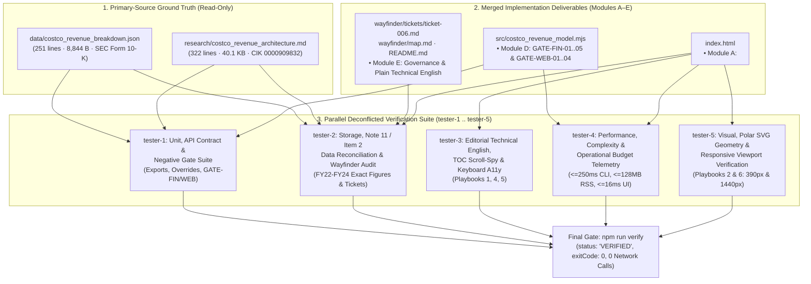

# End-to-End Verification, Review & Deconfliction Blueprint: Costco Wholesale Corporation (`COST`) Webpage Refinement, Visual & Geometric Polish, Data Reconciliation, and Straightforward Technical English Overhaul

**Document Version:** 1.0 (Lead Verification & Review Coordinator Blueprint — Synthesized from Seed [`functional_specification_003.md`](../../functional_specification_003.md), [`refined-specification.md`](./refined-specification.md), [`implementation-blueprint.md`](./implementation-blueprint.md), and Live Implementer Blackboard Session `seq=#1`..`#9`+)  
**Run ID:** `20261103T204534-693-1b8y`  
**Author:** `tester` (Lead Verification & Review Coordinator)  
**Governing Specifications & Authoritative References:**
- [`LANGUAGE.md`](../../LANGUAGE.md) (Authoritative Domain Vocabulary & Evaluation Parameters)
- [`functional_specification_003.md`](../../functional_specification_003.md) (Seed Functional Specification)
- [`wayfinder/20261103T204534-693-1b8y/refined-specification.md`](./refined-specification.md) (Refined Technical Specification)
- [`wayfinder/20261103T204534-693-1b8y/implementation-blueprint.md`](./implementation-blueprint.md) (Module A–E Implementation Blueprint)
- [`wayfinder/20261103T204534-693-1b8y/mcp-tools.md`](./mcp-tools.md) (Provisioned `puppeteer` & `playwright` MCP Verification Playbooks 1–6)
- [`data/costco_revenue_breakdown.json`](../../data/costco_revenue_breakdown.json) (Canonical SEC Form 10-K Primary-Source Dataset)

**Live Implementer Blackboard Decisions Synthesized (`seq=#1`..`#13`):**
- `implementer-1` (`seq=#4`, `seq=#9`, `seq=#10` — **Module A:** [`index.html`](../../index.html) `` when checking `REQUIRED_POLAR_CSS_SELECTORS`, and uses comment-safe `PROHIBITED_PSEUDOCODE_DIVIDER_REGEX`.

---

### 4.5 `tester-5`: Visual, Stylesheet, Polar SVG Geometry & Responsive Viewport Verification (`Playbooks 2 & 6`)

`tester-5` performs live visual, computed-style, and geometric bounding-box inspection of [`index.html`](../../index.html) across both **`1440×900` desktop** and **`390×844` mobile** viewports using `puppeteer` / `playwright` MCP:

1. **Playbook 2A — Computed CSS Styles on All Polar SVG & Drill-Down Selectors (`AC-02`):**
   - Evaluate `window.getComputedStyle(...)` in Chromium and assert:
     - `.polar-grid-ring`: `fill === "none"` (NEVER `rgb(0, 0, 0)`!), `stroke === "rgb(203, 213, 225)"` (`#CBD5E1`), `strokeDasharray` non-none (`3px, 3px`).
     - `.polar-axis-spoke`: `stroke === "rgb(203, 213, 225)"` (`#CBD5E1`), `strokeWidth === "1px"`.
     - `.polar-center-title` & `.polar-center-sub`: `textAnchor === "middle"`.
     - `.polar-sector-label` & `.polar-axis-label`: defined font sizes (`11px`–`11.5px` and `9.5px`–`10px`) and high-contrast fills (`rgb(15, 23, 42)` and `rgb(51, 65, 85)`).
     - `.drilldown-meta-grid`: `display === "grid"`.
     - `.drilldown-meta-item`: `display === "flex"`, `flexDirection === "column"`, `backgroundColor === "rgb(241, 245, 249)"` (`#F1F5F9`).
     - `.sim-output-banner.is-breach` (when active): `borderLeftColor === "rgb(227, 24, 55)"` (`#E31837`).
2. **Playbook 2B — Exhaustive 9-Mode SVG Polar Bounding-Box & Zero-Clipping Proof (`AC-02`):**
   - Verify that `#svg-polar-categories`, `#svg-polar-geography`, and `#svg-polar-flywheel` have `viewBox="-55 -28 510 456"`.
   - Cycle through **all 9 polar chart modes** at both `1440×900` and `390×844`:
     1. Categories — `FY2024` + `Area √r`
     2. Categories — `FY2023` + `Linear r`
     3. Categories — `FY2022` + `Share Angle θ_i`
     4. Categories — `3-Year Overlay` (and verify the inline 3-Year Overlay legend key is rendered and visible!)
     5. Geography — `Total Revenue ($254.5B)`
     6. Geography — `Operating Income ($9.29B)`
     7. Geography — `Warehouses (890)`
     8. Flywheel — `Revenue vs. Operating Profit (Dual-Ring)`
     9. Flywheel — `Ancillary & E-Commerce Rose ($49.97B)`
   - In every mode, measure `el.getBoundingClientRect()` for every `.polar-sector-label` and `.polar-axis-label` against its parent `svg.getBoundingClientRect()` (and `el.getBBox()` against `[-55, 455] × [-28, 428]`) and assert **zero horizontal or vertical clipping** (`textRect.left >= svgRect.left`, `textRect.right <= svgRect.right`, `textRect.top >= svgRect.top`, `textRect.bottom <= svgRect.bottom`).
   - Also verify that `.polar-center-title` and `.polar-center-sub` bounding boxes sit strictly inside the inner white hub circle (`r = 36..42px` around `(200, 200)`).
3. **Playbook 6 — Responsive Viewport Stability (`390×844` Mobile & `1440×900` Desktop), Zero Console Errors & Zero Network Calls (`AC-02`, `AC-05`):**
   - At `1440×900` desktop and `390×844` mobile viewports, assert `document.documentElement.scrollWidth <= window.innerWidth` (`0px` horizontal page overflow).
   - Capture visual screenshots (`assets/20261103T204534-693-1b8y/tester-5-polar-categories.png`, `tester-5-polar-geography.png`, `tester-5-polar-flywheel.png`, `tester-5-mobile-390px.png`) to empirically confirm crisp hairline concentric rings, centered hub labels, unclipped outer callouts, and structured drill-down cards.
   - Assert `0` browser console errors/warnings and `0` external network requests (`performance.getEntriesByType("resource")` contains zero `http://`/`https://` external URLs).

---

## 5. Final Sign-Off Checklist Before `tester-1`..`5` Completion

Before any `tester-x` agent runs `blackboard done` and outputs `<promise>COMPLETE</promise>`, it MUST verify:
1. `node src/costco_revenue_model.mjs --verify` (`npm run verify`) exits with code `0`, `status: "VERIFIED"`, `specTokensDetected: 0`, `polarCssSelectorsVerified: true`, `historicalNote11Reconciled: true`, `elapsedMs <= 250`, and `externalNetworkRequests: 0`.
2. `git status --short` shows zero untracked temporary scripts in the repository root and zero unintended modifications outside the tester's assigned artifact/handoff files (and deconflicted remediation boundary, if any).
3. Findings and verification metrics are posted to the Blackboard (`blackboard post --to all --type finding "..."`) and recorded in `handoff/20261103T204534-693-1b8y/tester-<N>.txt`.
