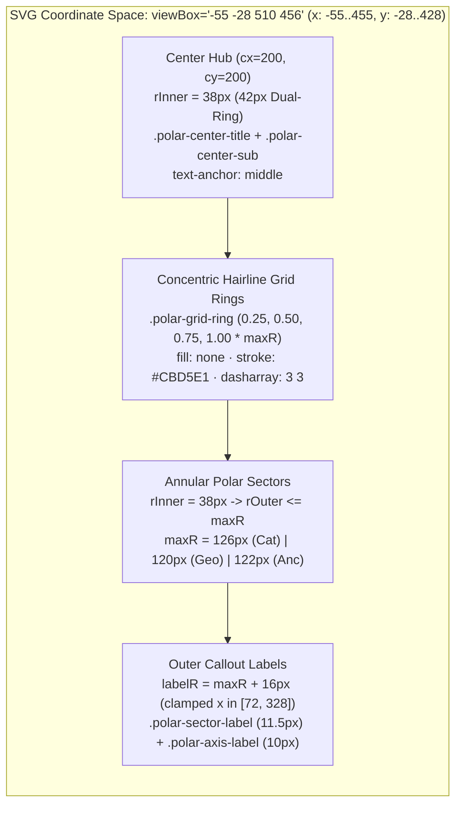

# Visual Taste Direction, SVG Polar Coordinate Geometry, Editorial Typography & Institutional Financial Design System (`planner-2.5`)

**Run ID:** `20261103T204534-693-1b8y`  
**Agent:** `planner-2.5` (Multimodal Taste & Visual Direction Arbiter)  
**Governing Specification:** [`wayfinder/20261103T204534-693-1b8y/refined-specification.md`](./refined-specification.md)  
**Authoritative Vocabulary:** [`LANGUAGE.md`](../../LANGUAGE.md)  
**Target Deliverable:** [`index.html`](../../index.html) (and deterministic verification rules in [`src/costco_revenue_model.mjs`](../../src/costco_revenue_model.mjs))  
**Status:** Authoritative Visual, Geometric, Stylesheet & Editorial Design Specification. `DO NOT CODE YET` Gate Enforced.

---

## 1. Institutional Daylight Financial Aesthetic & Brand Token System

### 1.1 Aesthetic Philosophy & Zero-Dreamcore Invariant

The Costco Wholesale Corporation (`NASDAQ: COST`, `CIK: 0000909832`) corporate financial report must read and feel like an **institutional SEC Form 10-K equity research briefing and physical engineering blueprint**: high-contrast daylight legibility, crisp hairline vector geometry, tabular monospace numerals (`font-variant-numeric: tabular-nums`), structured key-value metric wells, and unadorned, straightforward technical English.

- **Zero-Dreamcore Invariant (`{errors}` Boundary):** Zero dark-mode neon gradients, scanlines, film grain, atmospheric fog, or decorative pseudo-code syntax (`//` dividers or raw `{Token}` braces) may appear anywhere in [`index.html`](../../index.html).
- **Zero-Network Font & Asset Sovereignty (`RULE[user_global]`):** All typography uses local system/installed font stacks (`--font-sans` and `--font-mono`), and all charts use inline vector `<svg>` geometry (`0` external network requests).

### 1.2 Authoritative Color Palette & Contrast Ratios

All visual surfaces, interactive controls, SVG polar sectors, and status indicators must use the canonical CSS custom property token system in `:root` ([`index.html`](../../index.html) lines `10–36`), extended with `--cat-sky` and `--cat-violet` for full spectrum coverage:

| CSS Variable / Token | Hex / RGBA Value | WCAG Contrast (vs. `#FFFFFF` / `#F8FAFC`) | Semantic & Visual Role in [`index.html`](../../index.html) |
| :--- | :--- | :--- | :--- |
| `--bg-canvas` | `#F8FAFC` | Baseline Canvas | Daylight Alabaster page background (`body`) and `.polar-panel` surface |
| `--bg-card` | `#FFFFFF` | `1.04:1` vs. Canvas | Pure White institutional report cards (`.report-section`, `.polar-svg-stage`, `.step-card`) |
| `--bg-well` | `#F1F5F9` | `1.09:1` vs. Card | Recessed Slate 100 data wells (`.kpi-card`, `.drilldown-meta-item`, `.step-metrics-box`, `.simulator-panel`) |
| `--border-subtle` | `#E2E8F0` | Hairline Divider | `1px` structural card, table cell, and well borders |
| `--border-strong` | `#CBD5E1` | Structural Rule | `1px` SVG polar grid rings (`.polar-grid-ring`), radial spokes (`.polar-axis-spoke`), and center hub stroke |
| `--ink-primary` | `#0F172A` | **`17.8:1` (AAA)** | Slate 900 primary headings, table totals, `.polar-center-title`, `.polar-sector-label`, and Non-Foods polar sector |
| `--ink-secondary` | `#334155` | **`10.4:1` (AAA)** | Slate 700 body copy, `.drilldown-copy`, table cells, and `.polar-axis-label` |
| `--ink-muted` | `#64748B` | **`4.76:1` (AA)** | Slate 500 metadata captions, `.polar-center-sub`, `.drilldown-meta-item span`, and FY2022 overlay ring |
| `--costco-crimson` | `#E31837` | **`5.25:1` (AA)** | Costco Crimson brand accent, Membership Fees pillar, Warehouse Ancillary & Canada polar sectors, active borders, and `.is-breach` alert |
| `--costco-crimson-soft` | `rgba(227, 24, 55, 0.08)` | Tint Surface | Background wash for `.sim-output-banner.is-breach` governance alert |
| `--costco-navy` | `#005DAA` | **`6.70:1` (AA)** | Kirkland Cobalt primary interactive accent, Net Sales pillar, Foods & Sundries and United States polar sectors, active `.corp-btn` fill |
| `--costco-navy-soft` | `rgba(0, 93, 170, 0.08)` | Tint Surface | Active `.toc-link.is-active`, `.toc-sublink.is-active`, and `.corp-table tr.is-highlighted` row highlight |
| `--cat-emerald` | `#059669` | **`3.88:1` (AA Large/UI)** | Emerald Audit accent for Fresh Foods, Other International, Pharmacy/In-Club ancillary sector, simulator nominal left border, and Wayfinder resolved badge |
| `--cat-amber` | `#D97706` | **`3.12:1` (Graphical)** | Amber accent for 719 Gasoline Stations ancillary rose sector |
| `--cat-sky` | `#0284C7` | **`4.10:1` (Graphical)** | Sky blue auxiliary analytical token |
| `--cat-violet` / `--cat-indigo` | `#7C3AED` / `#4F46E5` | **`5.70:1` (AA)** | Violet/Indigo accent for Digital/Travel/Citi Visa ancillary rose sector |

> [!WARNING]
> **Root-Cause CSS Token Fix (Line `2881` of `index.html`):**
> `renderTicketInspector()` at line `2881` currently writes `color:var(--emerald-audit);`, which is **undefined** in `:root` and causes the browser to fall back to inherited text color. This MUST be replaced with `color:var(--cat-emerald);`.

---

## 2. Precision Polar Coordinate SVG Geometry & Stylesheet Specification

### 2.1 Live Empirical Diagnosis (`puppeteer` Chromium `getBBox()` & `getComputedStyle()` Probe)

An empirical headless Chromium inspection of [`index.html`](../../index.html) across all 9 interactive chart modes revealed four compounding visual/geometric root causes:

1. **Opaque Black Circle Fill on `.polar-grid-ring` (`fill: rgb(0, 0, 0)`):**
   - `renderPolarGrid()` (line `2191`) emits four concentric `<circle class="polar-grid-ring" />` elements without an inline `fill` attribute, and `.polar-grid-ring` is missing from `<style>`. By SVG 1.1 / SVG 2 specification default, `<circle>` defaults to `fill: #000000` (`rgb(0, 0, 0)`) and `stroke: none`, rendering a solid black disc behind every polar chart!
2. **Invisible Radial Axis Spokes (`.polar-axis-spoke`):**
   - `renderPolarGrid()` (line `2198`) emits `<line class="polar-axis-spoke" />` without an inline `stroke` attribute, and `.polar-axis-spoke` is missing from `<style>`. By SVG default (`stroke: none`), all radial axis spokes are completely invisible.
3. **Off-Center Hub Typography (`.polar-center-title`, `.polar-center-sub`) & Cramped Hub Radius (`rInner = 28..30`):**
   - Because `.polar-center-title` and `.polar-center-sub` lack CSS rules, they default to `text-anchor: start` and `15px` body font, shifting the hub text right of `(200, 200)` (`x: 200..282.6`) so it collides with the `#CBD5E1` hub border.
4. **Horizontal Callout Clipping Across `0 0 400 400` (and even `-55 -28 510 456` if `maxR = 146..148` is not reduced):**
   - Live `svg.getBBox()` telemetry measured in Chromium proves that with `maxR = 146..148` and `labelR = maxR + 22..24` (`168..172`), outer sector labels overflow horizontally even after applying `11.5px`/`10px` font rules:

| Polar Chart & Mode | Unstyled `getBBox()` (`x` .. `right`) | Styled (`11.5px`/`10px`) with Legacy `maxR=146..148` (`x` .. `right`) | Fits `-55 -28 510 456` (`x ∈ [-55, 455]`) with Legacy `maxR`? | Calibrated Geometry (`rInner=38`, `maxR=120..126`, `labelOffset=15..16`) (`x` .. `right`) |
| :--- | :--- | :--- | :--- | :--- |
| **1. Categories — Area `√r` / Linear `r`** | `-54.5` .. `463.7` (`w: 518.1`) | `-17.9` .. `424.0` (`w: 441.9`) | Yes | **`-4.8` .. `410.9`** (100% unclipped) |
| **1. Categories — Share Angle `θ_i`** | `-104.3` .. `506.7` (`w: 610.9`) | `-67.7` .. `467.0` (`w: 534.7`) | **NO (clips by `12.7px` left & `12.0px` right)** | **`-43.2` .. `442.5`** (100% unclipped) |
| **2. Geography — Total Revenue** | `-87.6` .. `496.8` (`w: 584.4`) | `-47.9` .. `453.9` (`w: 501.7`) | Barely (`1.1px` margin) | **`-25.3` .. `431.3`** (100% unclipped) |
| **2. Geography — Operating Income** | `-120.2` .. `520.2` (`w: 640.4`) | `-78.0` .. `478.0` (`w: 555.9`) | **NO (clips by `23.0px` left & `23.0px` right)** | **`-46.4` .. `446.4`** (100% unclipped) |
| **2. Geography — Warehouses (890)** | `-130.3` .. `530.3` (`w: 660.7`) | `-90.0` .. `490.0` (`w: 580.0`) | **NO (clips by `35.0px` left & `35.0px` right)** | **`-48.5` .. `448.5`** (100% unclipped) |
| **3. Flywheel — Dual-Ring Asymmetry** | `29.0` .. `371.0` (`w: 341.9`) | `44.0` .. `356.0` (`w: 312.0`) | Yes | **`44.0` .. `356.0`** (100% unclipped) |
| **3. Flywheel — Ancillary Rose** | `-136.3` .. `551.2` (`w: 687.5`) | `-99.4` .. `505.4` (`w: 604.9`) | **NO (clips by `44.4px` left & `50.4px` right)** | **`-47.2` .. `447.2`** (100% unclipped) |

### 2.2 Root-Cause SVG Coordinate & Callout Geometry Contract

To guarantee that **100% of `.polar-sector-label` and `.polar-axis-label` bounding boxes lie strictly inside `viewBox="-55 -28 510 456"` (`x ∈ [-55, 455]`, `y ∈ [-28, 428]`)** with at least `6px` of breathing room on all four sides across both `1440px` desktop and `390px` mobile viewports (passing Playbook 2's `getBoundingClientRect()` check), the following exact geometric parameters MUST be applied:



1. **Static HTML `<svg>` `viewBox` Expansion ([`index.html`](../../index.html) lines `1237`, `1294`, `1350`):**
   - Set `viewBox="-55 -28 510 456"` on `#svg-polar-categories`, `#svg-polar-geography`, and `#svg-polar-flywheel`.
   - In CSS, set `.polar-svg { width: 100%; max-width: 440px; height: auto; display: block; }` (without relying on `overflow: visible` to hide `viewBox` clipping, because Playbook 2 checks each `<text>` element's `getBoundingClientRect()` against the parent `<svg>`'s `getBoundingClientRect()`!).
2. **Chart-Specific Radii & Horizontal Callout Clamping in JavaScript (`index.html`):**
   - **Chart 1 (`renderPolarCategories`, `#svg-polar-categories`):**
     - Set `rInner = 38` (up from `28`) and `maxR = 126` (down from `148`), with callout radius `labelR = maxR + 16` (`142`).
     - For outer callout coordinates `labelPos = polarPoint(cx, cy, labelR, midDeg)`: when `anchor === "start"`, clamp `labelX = Math.min(labelPos.x, 310)`; when `anchor === "end"`, clamp `labelX = Math.max(labelPos.x, 90)`. Since the longest category sub-label (`$101,463M (40.7%)`) is `102.4px` wide at `10px` monospace, `310 + 102.4 = 412.4 <= 455` and `90 - 102.4 = -12.4 >= -55`!
   - **Chart 2 (`renderPolarGeography`, `#svg-polar-geography`):**
     - Set `rInner = 38` (up from `30`) and `maxR = 120` (down from `146`), with callout radius `labelR = maxR + 16` (`136`).
     - At `midDeg = 60°` and `300°`, `polarPoint(200, 200, 136, 60).x = 317.8` and `polarPoint(200, 200, 136, 300).x = 82.2`. Clamp `labelX` to `[92, 308]` for `end`/`start` anchors so even the widest sub-label (`614 Clubs ($299.9M/Club)` at `144.5px`, or compact `614 Clubs ($299.9M)` at `114px`) spans at most `[-42.5, +442.5]`, strictly inside `[-55, +455]`.
   - **Chart 3 (`renderPolarFlywheel`, `#svg-polar-flywheel`):**
     - **Dual-Ring Asymmetry Mode (`flyState.mode === "asymmetry"`):**
       - Set outer ring to `rInner = 104, rOuter = 140`, inner ring to `rInner = 50, rOuter = 94`, and center hub circle to `r = 42`.
       - Replace the raw `{Membership Fees}` and `{Net Sales}` tokens in the top and bottom SVG callouts (lines `2546–2547`) with plain technical English:
         - Top (`x="200" y="16"`): `Outer Ring: Membership Fees 1.90% ($4,828M)`
         - Bottom (`x="200" y="388"`): `Outer Ring: Net Sales 98.10% ($249,625M)`
       - Position inner ring labels at the mid-radius `(50 + 94) / 2 = 72`: right (`x="272" y="196"` / `y="208"`) for `52.0%` / `Fees OpInc`, and left (`x="128" y="196"` / `y="208"`) for `48.0%` / `Merch OpInc`.
     - **Ancillary & Omnichannel Rose Mode (`flyState.mode === "ancillary"`):**
       - Set `rInner = 38` (up from `28`) and `maxR = 122` (down from `146`), with `labelR = maxR + 16` (`138`).
       - At `midDeg = 45°, 135°, 225°, 315°`, clamp `labelX` to `[96, 304]` and render concise SVG sub-labels (`~$30.0B (~12.0% of Sales)`, `~$20.0B (+3% Pharmacy)`, `~$17.5B (+16% Comp)`, `~$5.0B (~9% Digital Total)`) or `item.svgSubLabel` so every `<text>` element stays within `x ∈ [-46, +446]`, while displaying the full `item.metricBadge` inside `.drilldown-meta-item`.
3. **3-Year Overlay Visual Legend Key (`#polar-chart-categories` when `catState.year === "overlay"`):**
   - When `catState.year === "overlay"` is active, render an inline SVG legend key at `y = 408` inside `#svg-polar-categories` (centered around `x = 200`, well inside `y_max = 428`):
     - **FY2024:** Solid color swatch (`fill="#005DAA" fill-opacity="0.85"`) + label `FY2024 (Solid Fill)`
     - **FY2023:** Dashed slate-900 line (`stroke="#0F172A" stroke-width="2" stroke-dasharray="5 2"`) + label `FY2023 (Dashed)`
     - **FY2022:** Dotted slate-500 line (`stroke="#64748B" stroke-width="2" stroke-dasharray="2 2"`) + label `FY2022 (Dotted)`
   - And update `#polar-cat-caption` to state:
     `FY2022–FY2024 3-Year Polar Overlay · Legend: Solid Fill = FY2024 ($249,625M) | Dark Dashed = FY2023 ($237,710M) | Slate Dotted = FY2022 ($222,730M)`
   - Also ensure the FY2022 overlay path at line `2261` uses `stroke-dasharray="2 2"` (matching the specification's `2 2` dotted contract) and FY2023 at line `2262` uses `stroke-dasharray="5 2"`.

### 2.3 Verbatim Stylesheet Additions Required in `<style>` (`index.html`)

Insert the following exact CSS rules into `<style>` in [`index.html`](../../index.html) (after `.polar-sector-path.is-selected` at line `565`):

```css
    .polar-sector-path:focus-visible {
      outline: none;
      stroke: var(--ink-primary);
      stroke-width: 2.5px;
      opacity: 1;
    }

    .polar-grid-ring {
      fill: none;
      stroke: var(--border-strong);
      stroke-width: 1px;
      stroke-dasharray: 3 3;
    }

    .polar-axis-spoke {
      stroke: var(--border-strong);
      stroke-width: 1px;
    }

    .polar-center-title {
      text-anchor: middle;
      font-family: var(--font-mono);
      font-size: 11.5px;
      font-weight: 800;
      fill: var(--ink-primary);
    }

    .polar-center-sub {
      text-anchor: middle;
      font-family: var(--font-mono);
      font-size: 9.5px;
      font-weight: 600;
      fill: var(--ink-muted);
    }

    .polar-sector-label {
      font-family: var(--font-sans);
      font-size: 11.5px;
      font-weight: 700;
      fill: var(--ink-primary);
    }

    .polar-axis-label {
      font-family: var(--font-mono);
      font-size: 10px;
      font-weight: 600;
      fill: var(--ink-secondary);
    }
```

---

## 3. Structured Drill-Down Card Wells, Simulator Breach Alert & Editorial Voice

### 3.1 Structured Drill-Down Card Wells (`.drilldown-*`)

Currently, `#polar-category-drilldown`, `#polar-geography-drilldown`, and `#polar-flywheel-drilldown` inject `.drilldown-eyebrow`, `.drilldown-title`, `.drilldown-copy`, `.drilldown-meta-grid`, and `.drilldown-meta-item`, none of which have CSS rules in `<style>`. As a result, `.drilldown-meta-grid` renders as an unformatted vertical `display: block` stack where `<span>` and `<strong>` run together without spacing (`FY2022 Net Sales$88,948M`).

Add the following verbatim CSS rules to `<style>` in [`index.html`](../../index.html) (after `.polar-drilldown-metrics` at line `597`):

```css
    .drilldown-eyebrow {
      font-family: var(--font-mono);
      font-size: 10.5px;
      font-weight: 700;
      text-transform: uppercase;
      letter-spacing: 0.06em;
      color: var(--costco-crimson);
      margin-bottom: 4px;
    }

    .drilldown-title {
      font-size: 15px;
      font-weight: 800;
      color: var(--ink-primary);
      margin-bottom: 6px;
    }

    .drilldown-copy {
      font-size: 13px;
      color: var(--ink-secondary);
      line-height: 1.55;
    }

    .drilldown-meta-grid {
      display: grid;
      grid-template-columns: repeat(auto-fit, minmax(150px, 1fr));
      gap: 10px;
      margin-top: 12px;
      padding-top: 12px;
      border-top: 1px solid var(--border-subtle);
    }

    .drilldown-meta-item {
      background: var(--bg-well);
      border: 1px solid var(--border-subtle);
      border-radius: var(--radius-sm);
      padding: 8px 10px;
      display: flex;
      flex-direction: column;
      gap: 2px;
    }

    .drilldown-meta-item span {
      font-size: 11px;
      font-weight: 600;
      color: var(--ink-muted);
    }

    .drilldown-meta-item strong {
      font-family: var(--font-mono);
      font-size: 12.5px;
      font-weight: 800;
      color: var(--ink-primary);
    }
```

### 3.2 Sensitivity Simulator Gross Margin Ceiling Breach State (`.sim-output-banner.is-breach`)

When the user drags `#sim-gm-slider` above `11.50%`, `updateSimulator()` (line `2853`) toggles `.is-breach` on `#sim-output-banner`. Add the following CSS rule immediately after `.sim-output-banner` (line `917`) so the banner visibly transitions from its nominal `--cat-emerald` left border to an unmistakable Costco Crimson (`#E31837`) governance alert:

```css
    .sim-output-banner.is-breach {
      background: var(--costco-crimson-soft);
      border-color: var(--costco-crimson);
      border-left: 4px solid var(--costco-crimson);
      color: var(--ink-primary);
    }
```

### 3.3 Responsive Mobile (`390px`) & Desktop (`1440px`) Layout Stability

To guarantee zero horizontal page overflow (`document.documentElement.scrollWidth <= window.innerWidth`) at `390×844` mobile and `1440×900` desktop viewports:
- In `@media (max-width: 1080px)` (lines `967–982`), also ensure `.polar-grid-layout` uses `grid-template-columns: minmax(0, 1fr);` and `.polar-details-column` has `min-width: 0;` so wide tables scroll horizontally inside `.corp-table-wrap` (`overflow-x: auto`) rather than stretching the page viewport.
- Add `@media (max-width: 560px)` rules reducing `.corporate-shell` padding to `14px` and `.report-section` / `.polar-panel` padding to `16px`, and stacking `.stepper-pills` to `grid-template-columns: 1fr;`.

### 3.4 Straightforward Technical English Editorial Overhaul (Complete Replacement Matrix)

Every single raw curly-brace specification token (`{Net Sales}`, `{Membership Fees}`, `{Gross Margin Ceiling}`, `{Operating Income Flywheel}` — `41` occurrences across lines `1127–2864`), every `//` pseudo-code separator in visible headings/eyebrows/tabs (`17` occurrences), and all promotional metaphors (`Gatekeeper Subscription`, `Subscription Annuity`, `High-Frequency Trip Magnets`, `treasure-hunt discovery loop`, `perceive unmistakable value`, `threatens the 92.9% renewal moat`) MUST be replaced with clear, direct, SEC Form 10-K technical English:

#### Table 3.4A — Section Eyebrows, Drill-Down Headers, Step Headers & Wayfinder Tabs (`//` Elimination)

| Location in `index.html` | Current Text (Prohibited `//` Divider / Jargon) | Required Straightforward Technical English Replacement |
| :--- | :--- | :--- |
| Line `1120` (Sec 01 Eyebrow) | `Section 01 // Institutional Executive Briefing` | `Section 01 · Executive Summary` |
| Line `1192` (Sec 02 Eyebrow) | `Section 02 // Interactive Polar Coordinate Visual Analytics` | `Section 02 · Interactive Polar Revenue Charts` |
| Line `1424` (Sec 03 Eyebrow) | `Section 03 // Sequential Business Model Walkthrough` | `Section 03 · Five-Step Revenue Model` |
| Line `1694` (Sec 04 Eyebrow) | `Section 04 // Quantitative Financial Conservation & Stress Testing` | `Section 04 · Multi-Year GAAP Income Statement & Sensitivity Simulator` |
| Line `1789` (Sec 05 Eyebrow) | `Section 05 // Primary-Source Governance & Decision Lineage` | `Section 05 · Primary-Source SEC Form 10-K Citations & Wayfinder Audit` |
| Line `1506` (Step 1 Box `<h4>`) | `Step 01 // Primary-Source SEC 10-K Telemetry` | `Step 1 Key Figures (FY2024 Form 10-K)` |
| Line `1549` (Step 2 Box `<h4>`) | `Step 02 // Primary-Source SEC 10-K Telemetry` | `Step 2 Key Figures (FY2024 Form 10-K)` |
| Line `1591` (Step 3 Box `<h4>`) | `Step 03 // Primary-Source SEC 10-K Telemetry` | `Step 3 Key Figures (FY2024 Form 10-K)` |
| Line `1633` (Step 4 Box `<h4>`) | `Step 04 // Primary-Source SEC 10-K Telemetry` | `Step 4 Key Figures (FY2024 Form 10-K)` |
| Line `1676` (Step 5 Box `<h4>`) | `Step 05 // Primary-Source SEC 10-K Telemetry` | `Step 5 Key Figures (FY2024 Form 10-K)` |
| Lines `1801–1806` (Ticket Tabs) | `ticket-001.md // Two-Pillar & ASC 606` .. `ticket-006.md // Corporate Polar & 5-Step` | `ticket-001.md · Revenue Recognition (ASC 606)`<br>`ticket-002.md · Merchandise Categories & SKUs`<br>`ticket-003.md · Membership Tiers & Renewals`<br>`ticket-004.md · Ancillary & E-Commerce`<br>`ticket-005.md · Gross Margin Cap & Working Capital`<br>`ticket-006.md · Corporate Report & Polar Charts` |
| Line `2308` (Polar 1 Drilldown) | `ACTIVE POLAR SECTOR DRILLDOWN // NOTE 11 MERCHANDISE CATEGORY` | `Selected Category Detail · Note 11 Merchandise Disaggregation` |
| Line `2444` (Polar 2 Drilldown) | `ACTIVE POLAR SECTOR DRILLDOWN // NOTE 11 GEOGRAPHIC SEGMENT` | `Selected Segment Detail · Note 11 & Item 2 Geographic Operations` |
| Line `2560` (Polar 3 Asymmetry) | `ACTIVE POLAR RING DRILLDOWN // STRUCTURAL REVENUE VS. PROFIT ASYMMETRY` | `Selected Pillar Detail · Revenue Share vs. Operating Income Contribution` |
| Line `2610` (Polar 3 Ancillary) | `ACTIVE POLAR SECTOR DRILLDOWN // ANCILLARY & OMNICHANNEL SUB-DRIVER` | `Selected Channel Detail · Warehouse Ancillary & E-Commerce Operations` |
| Line `2880` (Ticket Inspector) | `RESOLVED WAYFINDER TICKET // ' + t.id` | `Resolved Wayfinder Ticket · ' + t.id` |

#### Table 3.4B — Step Titles, Stepper Pills, Simulator Readouts & Narrative Prose (`{...}` & Metaphor Elimination)

| Location in `index.html` | Current Text (Raw `{...}` Braces or Marketing Metaphor) | Required Straightforward Technical English Replacement |
| :--- | :--- | :--- |
| Lines `1127–1131` (Sec 01 Lead) | `10.92% {Gross Margin Ceiling}`, `$249,625M of {Net Sales}`, `$4,828M of recurring {Membership Fees}` | `10.92% Gross Margin Ceiling`, `$249,625M of Net Sales`, `$4,828M of recurring Membership Fees` |
| Lines `1139, 1143, 1150, 1157, 1181` | `{Net Sales}`, `{Membership Fees}`, `{Gross Margin Ceiling}` in KPI cards & equation banner | `Net Sales`, `Membership Fees`, `Gross Margin Ceiling` |
| Lines `1209, 1242, 1330, 1333` | `2.1 {Net Sales} Disaggregation...`, `FY2024 Note 11 {Net Sales}`, `{Operating Income Flywheel}`, `{Membership Fees}` | `2.1 Net Sales Disaggregation...`, `FY2024 Note 11 Net Sales`, `Operating Income Flywheel`, `Membership Fees (ancillary and e-commerce operations)` |
| Lines `1375, 1382, 1399` | `{Net Sales} Merchandise & Ancillary`, `{Membership Fees} Subscription Annuity`, `High-frequency weekly parking-lot trip magnet` | `Net Sales (Merchandise & Ancillary)`, `Membership Fees (Annual Paid Memberships)`, `Drives repeat member visits to warehouse locations` |
| Lines `1450, 1458` (Stepper Pills) | `Membership Gate ($4,828M)` / `719 Gas & Digital Magnets` | `Paid Membership ($4,828M)` / `Ancillary & E-Commerce` |
| Lines `1471, 2080–2081` (Step 1) | `Step 1 (Gatekeeper Subscription): Paid Membership Tiers & 92.9% Renewal Lock-In` | `Step 1: Paid Membership Access and Executive Tier Concentration ($4,828M Membership Fees)` |
| Lines `1483, 1486, 1500, 1507, 1512` | `Gatekeeper Subscription — Paid Membership Tiers & 92.9% Renewal Lock-In`, `{Membership Fees}`, `{Net Sales}` | `Paid Membership Access and Executive Tier Concentration ($4,828M Membership Fees)`, `Membership Fees`, `Net Sales` |
| Lines `1526, 2084` (Step 2 Title) | `Concentrated Purchasing Scale — <4,000 Warehouse SKUs & Kirkland Signature` | `High-Volume Purchasing Across Fewer Than 4,000 SKUs ($249,625M Net Sales)` |
| Line `1542` & `1878` (Non-Foods) | `drives high-ticket "treasure-hunt" baskets` / `Drives the treasure-hunt discovery loop` | `provides seasonal hardlines, consumer electronics, and apparel rotation` / `Provides high-value hardlines and softlines ($63,973M or 25.63% of FY2024 Net Sales; +5.11% YoY growth)` |
| Lines `1569, 2088` (Step 3 Title) | `High-Frequency Trip Magnets — 719 Gas Stations, Ancillary Services & Omnichannel Logistics` | `Ancillary Businesses and E-Commerce Fulfillment ($49,969M Ancillary + ~7% E-Commerce)` |
| Line `1578` (Step 3 Lead) | `visit frequently enough to perceive unmistakable value from their annual fee` | `visit regularly and realize consistent savings that exceed their annual membership fee` |
| Lines `1611, 2092` (Step 4 Title) | `Disciplined Pricing & Negative Working Capital — The 10.92% {Gross Margin Ceiling} & 104.15% Supplier Float` | `The 10.92% Gross Margin Cap and Supplier-Financed Inventory (104.15% Accounts Payable to Inventory)` |
| Lines `1653, 2096` (Step 5 Title) | `The {Operating Income Flywheel} — Converting $4,828M of Fees into 52.00% of Consolidated Operating Profit` | `Operating Profit Conversion ($9,285M Operating Income to $7,367M Net Income)` |
| Lines `2698–2774` (GAAP Table) | `1. {Net Sales}...`, `2. {Membership Fees} (Subscription Annuity)`, `[{Gross Margin Ceiling}]`, `{Operating Income Flywheel}` | `1. Net Sales (Merchandise & Ancillary)`, `2. Membership Fees (Annual Paid Memberships)`, `[Gross Margin Ceiling]`, `Operating Income Flywheel` |
| Lines `2857–2858` (Sim Breach) | `GOVERNANCE ALERT — {Gross Margin Ceiling} BREACH... threatens the 92.9% renewal moat.` | `GOVERNANCE ALERT — Gross Margin Ceiling Breach (` + `gmPct.toFixed(2)` + `% > 11.50% Cap): Raising merchandise gross margin above Costco's 11.50% cap reduces member price savings relative to competing retailers and risks lowering the 92.9% U.S./Canada renewal rate.` |
| Lines `2862–2864` (Sim Nominal) | `DISCIPLINED FLYWHEEL STATUS... {Membership Fees}` | `OPERATING PROFIT MODEL STATUS (WITHIN 11.50% GROSS MARGIN CAP): ... Membership Fees` |
