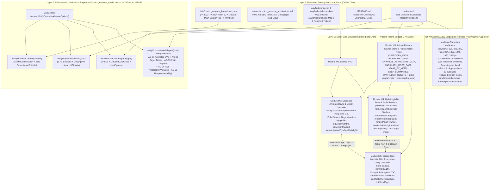
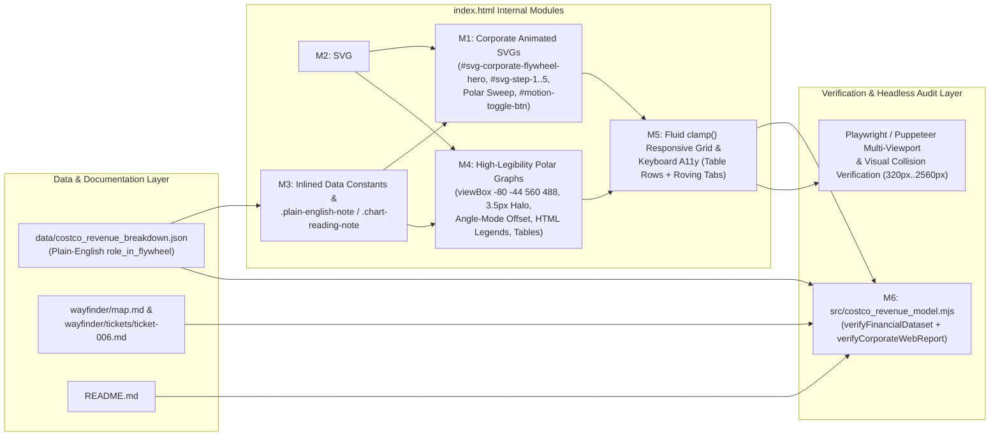
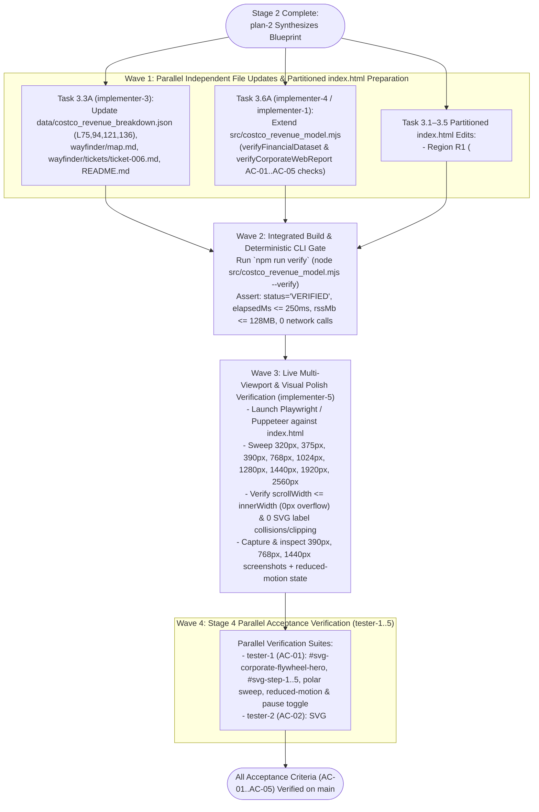

# System Architecture, Dataflow, Module Decomposition & Execution DAG (`planner-2.1`)

**Run ID:** `20261104T004059-606-j6a7`  
**Branch:** `agent/planner-2.1-20261104T004059-606-j6a7`  
**Planner Role:** `planner-2.1` (System Architecture, Dataflow, Discrete Modules & Execution DAG Planner)  
**Governing Specifications:**
- [`wayfinder/20261104T004059-606-j6a7/refined-specification.md`](./refined-specification.md) (`plan-1` Refined Technical Specification v2.0)
- [`functional_specification_005.md`](../../functional_specification_005.md) (Authoritative Seed Specification 005)
- [`LANGUAGE.md`](../../LANGUAGE.md) (Authoritative System Glossary & Domain Vocabulary)
**Upstream Scanner Syntheses & Peer Blackboard Alignment:**
- [`wayfinder/20261104T004059-606-j6a7/codebase-map.md`](./codebase-map.md) (`codebase-mapper`)
- [`wayfinder/20261104T004059-606-j6a7/api-schemas.md`](./api-schemas.md) (`api-schema-mapper`)
- [`wayfinder/20261104T004059-606-j6a7/installed-libraries.md`](./installed-libraries.md) (`library-installer`)
- [`wayfinder/20261104T004059-606-j6a7/mcp-tools.md`](./mcp-tools.md) (`mcp-provisioner`)
- [`wayfinder/20261104T004059-606-j6a7/library-functions.md`](./library-functions.md) (`function-mapper`)
- Blackboard Coordination Ledger (`seq=#1` through `seq=#14`: `plan-2`, `planner-2.2`, `planner-2.3`, `planner-2.4`, `planner-2.5`)  
**Strict Gate Enforced:** **DO NOT CODE YET.** System architecture, dataflow topology, discrete module/function I/O contracts, and execution DAG only.

---

## 1. Executive Summary & Architectural Mandate

This document defines the complete system architecture, end-to-end runtime and verification dataflows, discrete module boundaries, function input/output contracts, and sequential-versus-parallel Execution Directed Acyclic Graph (DAG) for upgrading Costco Wholesale Corporation's (`NASDAQ: COST`, `CIK: 0000909832`) interactive corporate web report ([`index.html`](../../index.html)), primary-source financial dataset ([`data/costco_revenue_breakdown.json`](../../data/costco_revenue_breakdown.json)), Wayfinder decision lineage ([`wayfinder/map.md`](../../wayfinder/map.md), [`wayfinder/tickets/ticket-006.md`](../../wayfinder/tickets/ticket-006.md)), repository documentation ([`README.md`](../../README.md)), and deterministic verification engine ([`src/costco_revenue_model.mjs`](../../src/costco_revenue_model.mjs)).

In strict compliance with [`RULE[user_global]`](../../LANGUAGE.md), this architecture **reuses and extends existing project modules in-place** rather than creating duplicate files or shadow verification scripts, and enforces all five pillars of [`functional_specification_005.md`](../../functional_specification_005.md):

1. **Pillar 1 (`AC-01`) — Corporate Animated SVG Elements & Motion Resilience:** Institutional 4-node animated SVG Revenue & Operating Profit Flywheel schematic (`#svg-corporate-flywheel-hero`) in `#section-executive-summary` synchronized with the 5-step walkthrough, step-level animated SVG micro-schematics (`#svg-step-1`..`#svg-step-5`) inside `#step-1`..`#step-5`, animated polar chart sweep/selection rings in `#svg-polar-categories`, `#svg-polar-geography`, and `#svg-polar-flywheel`, an accessible pause/play toggle (`#motion-toggle-btn` / `[data-motion-toggle]`), and automatic pause under `@media (prefers-reduced-motion: reduce)`.
2. **Pillar 2 (`AC-02`) — High-Density Halftone & Ordered Bayer Dithering Effects:** Self-contained, zero-network global SVG `<defs>` `<pattern>` atlas (`#dither-bayer-navy`, `#dither-bayer-crimson`, `#dither-halftone-slate`, `#dither-polar-engraving`) and CSS ordered-Bayer/halftone accent plates (`.dither-accent-band`, `.dither-header-plate`) in Costco Crimson (`#E31837`), Executive Navy (`#005DAA`), and Slate Ink (`#0F172A`) that never sit behind unbacked text ($\ge 4.5:1$ normal text contrast, $\ge 7:1$ primary metrics) and introduce zero prohibited Dreamcore markers.
3. **Pillar 3 (`AC-03`) — Simplified, Straightforward English Explanations & Plain-English Notes:** Dedicated `.plain-english-note` callout boxes in all 5 report sections and `.chart-reading-note` boxes in all 3 polar chart panels explaining the `10.92%` markup cap, `104.15%` supplier-financed inventory float, `52.00%` membership fee share of operating income, and `$2,804M` Executive 2% contra-revenue; complete elimination of algebraic/code shorthand (`R_total`, `OpInc ($9,285M) = Merch Contrib`, `Area √r (Coxcomb)`, `Linear Radius r`, `Share Angle θ_i`, `wayfinderAudit.valid === true`, `Negative Working-Capital Float`); and plain-English rewrites of `merchandise_categories[].role_in_flywheel` in [`data/costco_revenue_breakdown.json`](../../data/costco_revenue_breakdown.json).
4. **Pillar 4 (`AC-04`) — High-Legibility Polar Graphs, Halo Callouts, Legends & Companion Tables:** Padded polar SVG coordinate space (`viewBox="-80 -44 560 488"`), halo-stroked sector labels (`.polar-sector-label >= 12px`, `paint-order: stroke fill; stroke: #FFFFFF; stroke-width: 3.5px`), halo-stroked scale/sub-labels (`.polar-axis-label >= 10.5px`), enlarged center hub (`r >= 40px`, `.polar-center-title >= 12.5px`, `.polar-center-sub >= 10px`), non-colliding diagonal ring scale offset (`labelAngleDeg = 25` in `angle` mode), Dual-Ring high-contrast callout badges, explicit HTML visual legends (`.polar-html-legend`), and companion tables at `font-size: 12.5px–13px` with `8px 10px` cell padding.
5. **Pillar 5 (`AC-05`) — 100% Screen-Size-Agnostic Responsive Architecture & Keyboard Accessibility:** Fluid `clamp()` typography and spacing, `minmax(0, 1fr)` CSS Grid overflow containment, adaptive `#table-of-contents` at `<= 1080px`, single-column polar stacking at `<= 1120px`, zero horizontal page overflow (`document.documentElement.scrollWidth <= window.innerWidth`) across `320px`, `375px`, `390px`, `768px`, `1024px`, `1280px`, `1440px`, `1920px`, and `2560px` viewports, and full bidirectional keyboard navigation (`tabindex="0"`, `Enter`/`Space`, `ArrowLeft`/`ArrowRight`/`ArrowUp`/`ArrowDown`) across interactive table rows (`[data-cat-row]`, `[data-geo-row]`), polar sectors (`[data-cat-sector]`, `[data-geo-sector]`, `[data-fly-sector]`), step buttons (`[data-step-btn]`), and ticket tabs (`[data-ticket-tab]`).

---

## 2. Authoritative Domain Vocabulary & First-Principles Physical Modeling

### 2.1 `LANGUAGE.md` Domain & Evaluation Alignment
All modules, data structures, and verification gates strictly enforce [`LANGUAGE.md`](../../LANGUAGE.md):
- **`{Net Sales}` (`$249,625M` in FY2024, `98.10%` of Consolidated Total Revenue):** Disaggregated per Note 11 across `Foods and Sundries` (`$101,463M`, `40.65%`), `Non-Foods` (`$63,973M`, `25.63%`), `Warehouse Ancillary and Other Businesses` (`$49,969M`, `20.02%`), and `Fresh Foods` (`$34,220M`, `13.71%`), net of returns and `$2,804M` Executive 2% reward contra-revenue.
- **`{Membership Fees}` (`$4,828M` in FY2024, `1.90%` of Consolidated Total Revenue):** Recurring annual subscription fees across `76.2M` paid members (`63.7M` Gold Star + `12.5M` Business; `136.8M` total cardholders; `35.4M` paid Executive members generating `73.3%` of worldwide sales) recognized ratably over 12 months under `ASC 606` against `$2,501M` Deferred membership fees liability (`92.9%` U.S./Canada and `90.5%` worldwide renewal rates).
- **`{Gross Margin Ceiling}` (`10.92%` in FY2024, `$27,267M` Merchandise Gross Margin):** Structural pricing discipline capping merchandise markups inside `[10.0%, 11.5%]` (`$249,625M` Net Sales minus `$222,358M` Merchandise Costs = `$27,267M`).
- **`{Operating Income Flywheel}` (`$9,285M` Operating Income $\rightarrow$ `$7,367M` Net Income):** Merchandise Gross Margin (`$27,267M`, `10.92%`) minus SG&A (`$22,810M`, `9.14%`) leaves `+$4,457M` (`48.00%` of Operating Income) in Net Merchandise Operating Profit, enabling `$4,828M` (`52.00%` of Operating Income) in Membership Fees to drive `$9,285M` Consolidated Operating Income (`3.65%` margin) and `$7,367M` Net Income (`$16.56` diluted EPS), reinforced by `12.60x` inventory turnover (`~28.97` DIO vs. `~31.88` DPO) where `$19,421M` Accounts Payable finances `104.15%` of `$18,647M` Merchandise Inventories (`+$774M` supplier-financed float).
- **Evaluation Parameters:** Zero `{errors}` (zero leaked raw `{...}` braces, zero `//` pseudo-code dividers, zero `R_total`/`θ_i`/`wayfinderAudit.valid === true` shorthand, zero promotional clichés, zero Dreamcore markers, zero console/page errors, zero clipped/colliding SVG labels, zero horizontal viewport overflow), 100% `{correctness}`, end-to-end `{functionality}`, measurable `{correct required outputs}`, and `{sufficient}` architectural specification.

### 2.2 First-Principles Physical, Memory, Latency & Frame-Rate Model (`RULE[user_global]`)

| System Dimension | Physical / Algorithmic Model | Empirical Baseline | Target Budget (`Spec 005 §4`) | Architectural Guarantee |
| :--- | :--- | :--- | :--- | :--- |
| **External Network Roundtrips** | $N_{\text{net}} = 0$. All HTML, CSS, inline SVG `<defs>` patterns, animated SVG schematics, and primary-source JSON constants are embedded locally. | `0` requests | `0` requests | **100% offline deterministic execution** in both browser (`file://` / local HTTP) and Node.js CLI (`fs.readFileSync`). |
| **CLI Verification Wall-Clock Latency** | Single-pass $O(B)$ string/regex & JSON inspection over `data/costco_revenue_breakdown.json` (`~9.6 KB`), `wayfinder/map.md` + 6 tickets (`~28 KB`), `research/costco_revenue_architecture.md` (`40.1 KB`), and `index.html` (`~175 KB` post-refinement). | `12.78 ms – 16.98 ms` | $\le 250\text{ ms}$ | Reusing `resolvedHtml`, `lowerHtml`, `declaredIds` Set, and `combinedCss` in a single pass adds $< 2\text{ ms}$, maintaining `~15–22 ms` total latency ($> 11\times$ faster than budget). |
| **CLI Memory Footprint (RSS)** | V8 ESM isolate baseline (`~42 MB`) + UTF-8 file buffers (`< 0.5 MB` total working set). | `46.66 MB – 47.00 MB` | $\le 128\text{ MB}$ | Zero external npm runtime imports; RSS remains `< 52 MB` ($> 59\%$ headroom below ceiling). |
| **Browser Interactive & Animation Frame Time** | GPU compositor-only animations (`stroke-dashoffset`, `opacity`, `transform` with `transform-box: fill-box`); $O(1)$ delegated event handling on polar `<svg>` and companion `<tbody>`; `requestAnimationFrame`-gated scroll-spy fallback. | `< 1.5 ms / frame` | $\le 16.0\text{ ms}$ (`60fps`) | Eliminates main-thread layout thrashing during scrolling and SVG animation ticks; pauses immediately via `SVGSVGElement.pauseAnimations()` + `.is-motion-paused` class. |
| **Dither Pattern GPU Tile Memory** | Shared global `<svg width="0" height="0"><defs>` atlas with $8\times 8$ and $6\times 6$ `userSpaceOnUse` vector `<pattern>` tiles instead of full-screen `<feTurbulence>` filter shaders. | `< 64 KB` GPU texture | Zero frame drop at `2560x1440` | Avoids `8–15 MB` full-viewport raster filter buffers on 4K/5K displays while delivering crisp vector Bayer/halftone stippling at any DPR. |

---

## 3. End-to-End System Architecture & Dataflow Topology

### 3.1 Runtime State Synchronization & Bidirectional Dataflow
Within [`index.html`](../../index.html), user interactions trigger deterministic, synchronous state transitions without external fetches:

1. **Executive Flywheel Schematic $\leftrightarrow$ 5-Step Walkthrough Synchronization:**
   - Selecting any step button (`[data-step-btn="1..5"]`), clicking `#step-prev-btn` / `#step-next-btn`, pressing `ArrowLeft` / `ArrowRight` on the step tablist, clicking a TOC step sublink (`[data-toc-step="1..5"]`), or clicking an interactive node (`[data-flywheel-node="1..4"]`) inside `#svg-corporate-flywheel-hero` invokes `setActiveStep(stepNum, shouldScroll)` and `syncAnimatedFlywheelHighlight(stepNum)`:
     - **Step 1 (`$4,828M` Membership Fees):** Highlights **Node 1** (`Paid Membership Base: 76.2M Paid Members, 92.9% US/CA Renewal, $4,828M Fees`).
     - **Step 2 (`< 4,000` SKUs & `$249,625M` Net Sales) & Step 3 (`$49,969M` Ancillary & `719` Gas Stations):** Highlights **Node 2** (`High-Velocity Warehouse & Ancillary Sales: $249,625M Net Sales across 890 Clubs`).
     - **Step 4 (`10.92%` Gross Margin Cap & `104.15%` AP-to-Inventory Coverage):** Highlights **Node 3** (`10.92% Gross Margin Ceiling & 104.15% Supplier-Financed Inventory: $27,267M GM - $22,810M SG&A = $4,457M Merch Profit; +$774M Float`).
     - **Step 5 (`52.00%` Fee Share of `$9,285M` Operating Income $\rightarrow$ `$7,367M` Net Income):** Highlights **Node 4** (`Consolidated Operating & Net Income: $4,457M Merch [48.00%] + $4,828M Fees [52.00%] = $9,285M OpInc -> $7,367M Net Income`).
2. **Polar SVG Sectors $\leftrightarrow$ Companion Table Rows $\leftrightarrow$ Drill-Down Card Synchronization:**
   - In `#polar-chart-categories` (`catState`) and `#polar-chart-geography` (`geoState`), activating either an SVG sector (`[data-cat-sector="i"]`, `[data-geo-sector="i"]`) or a companion table row (`[data-cat-row="i"]`, `[data-geo-row="i"]`) via pointer click or keyboard (`Enter`, `Space`, `ArrowUp`, `ArrowDown`, `ArrowLeft`, `ArrowRight`) updates `selectedIndex = i`, re-renders/updates `.is-selected` on the SVG sector, updates `.is-highlighted` and `aria-selected="true"` on the companion table row, refreshes the `.polar-drilldown-card` (`aria-live="polite"`), and restores keyboard focus to the originating interactive element (`sector` or `row`) without page scroll jumps (`focus({ preventScroll: true })`).
3. **Global Motion State Synchronization (`prefers-reduced-motion` & `#motion-toggle-btn`):**
   - `initMotionControl()` reads `window.matchMedia("(prefers-reduced-motion: reduce)")` at startup and binds a `change` listener plus a `click` listener on `#motion-toggle-btn` (`[data-motion-toggle]`).
   - Calling `setMotionPaused(paused)` toggles `document.documentElement.classList.toggle("is-motion-paused", paused)`, updates `#motion-toggle-btn` (`aria-pressed="true|false"` and label `"Resume SVG Animations"` / `"Pause SVG Animations"`), and iterates over `document.querySelectorAll("svg")` to invoke `svg.pauseAnimations()` or `svg.unpauseAnimations()`.

---

## 4. Discrete Modules & Function Responsibilities

To prevent architectural duplication and merge conflicts, the system is decomposed into **six discrete modules (`M1`–`M6`)** mapped directly to existing files and line anchors in [`codebase-map.md`](./codebase-map.md).

### 4.1 Module Overview Matrix

| Module ID | Module Name | Target File(s) & Line Anchors | Governing Pillar | Primary Owner (Stage 3 / Stage 4) |
| :--- | :--- | :--- | :--- | :--- |
| **`M1`** | **Corporate Animated SVG & Motion Control Engine** | `index.html` (Header L1165–1187, Section 01 L1358, Section 03 L1648–1859, JS L2424–2910 & L3248–3394) | Pillar 1 (`AC-01`) | `implementer-1` / `tester-1` |
| **`M2`** | **Halftone & Ordered Bayer Dithering Pattern Atlas** | `index.html` (CSS ``) | Global CSS Variables, Layout Grid, Polar & Step Styles, Media Queries | **M1 + M2 + M4 + M5:** Add fluid `clamp()` variables/rules; `.dither-accent-band` & `.dither-header-plate`; `.plain-english-note`, `.chart-reading-note`, & `.polar-html-legend`; upgrade `.polar-svg` (`aspect-ratio: 560 / 488`), `.polar-sector-label` (`12.5px`, `3.5px` white halo), `.polar-axis-label` (`11px`, `3.5px` white halo), `.polar-center-title` (`13px`), `.polar-center-sub` (`10.5px`), and `.polar-details-column .corp-table` (`12.5px–13px`, `padding: 8px 10px`); add `@keyframes` for animated SVG flow/sweep, `html.is-motion-paused`, `@media (prefers-reduced-motion: reduce)`, and screen-size-agnostic breakpoints (`<= 1120px`, `<= 1080px`, `<= 640px`, `<= 480px`, `>= 1920px`). |
| **`R2`** | `L1155 – L1359` (Top of `<body>`, Header, `#table-of-contents`, `#section-executive-summary`) | Global SVG `<defs>`, `.corporate-header`, `#table-of-contents`, `#section-executive-summary` | **M1 + M2 + M3 + M5:** Insert shared `<svg id="svg-global-dither-defs" aria-hidden="true" width="0" height="0"><defs>...</defs></svg>` at top of `<body>`; add `#motion-toggle-btn` (`[data-motion-toggle]`) in `.header-main-bar`; add mobile/tablet collapsible TOC toggle if needed; replace `OpInc` and `Negative Working-Capital Float` in KPI cards; replace `R_total` and `OpInc` in `.executive-equation-banner` with plain-English equations; insert `.plain-english-note` (`#note-exec-summary`) and `#svg-corporate-flywheel-hero` (4-node animated SVG schematic). |
| **`R3`** | `L1360 – L1591` (`#section-polar-graphs`: Polar Charts 2.1, 2.2, 2.3) | `#polar-chart-categories`, `#polar-chart-geography`, `#polar-chart-flywheel` | **M2 + M3 + M4:** Replace `Area √r`, `Linear Radius r`, `Share Angle θ_i`, and `OpInc Share` in section lead, buttons, and table headers with plain English (`By Area (Square-Root Scale)`, `By Radius (Linear Scale)`, `By Revenue Share (Angle)`, `Operating Profit Share`); insert `#note-polar-suite` (`.plain-english-note`); update all 3 `<svg>` elements to `viewBox="-80 -44 560 488"`; insert `.chart-reading-note` and `.polar-html-legend` in each of the 3 polar panels; add companion table explanatory footnotes. |
| **`R4`** | `L1592 – L2020` (`#section-five-steps`, `#section-gaap-model`, `#section-wayfinder-audit`, `<footer>`) | `#step-1`..`#step-5`, `#section-gaap-model`, `#section-wayfinder-audit` | **M1 + M2 + M3:** Replace `52.00% Fee OpInc Flywheel`, `48.00% of OpInc`, `52.00% of OpInc`, and `$9,285M OpInc - $169M IntExp...` with full plain English; insert `.plain-english-note` boxes in Sections 03, 04, and 05; embed animated SVG micro-schematics (`#svg-step-1`..`#svg-step-5`) with dithered accents inside `#step-1`..`#step-5`; replace `<code>wayfinderAudit.valid === true</code>` at L1994 with `Verified: 6 resolved research tickets and canonical decision map`. |
| **`R5`** | `L2022 – L3395` (`<script>` IIFE Controller) | Inlined Datasets, Polar Renderers, Stepper, Waterfall, Simulator, Ticket Inspector, ScrollSpy, `init()` | **M1 + M3 + M4 + M5:** Clean `R_total` and `OpInc` from `STEP_SUMMARIES` (L2274) and `WAYFINDER_TICKETS` (L2283, L2307); update `rInner = 40` in polar renderers; add `labelAngleDeg = (catState.mode === "angle" ? 25 : 0)` in `renderPolarRingLabels` to eliminate angle-mode collisions; add dithered outer halo ring & animated sweep/selection ring in `renderPolarCategories`, `renderPolarGeography`, and `renderPolarFlywheel`; replace Dual-Ring raw text with high-contrast pill callouts (`Fee Profit (52.0%)`, `Merch Profit (48.0%)`); replace `OpInc` in `renderGaapWaterfall` and `updateSimulator`; add `setMotionPaused`, `initMotionControl`, `syncAnimatedFlywheelHighlight`, `bindInteractiveTableRows` (`[data-cat-row]`, `[data-geo-row]`), `bindTablistKeyboardNav` (`[data-step-btn]`, `[data-ticket-tab]`), and `requestAnimationFrame`-gated scroll-spy in `initScrollSpy()`. |

---

## 6. Verification & Acceptance Gate Matrix (`AC-01` through `AC-05`)

| Acceptance Criterion | Verification Mechanism | Target Metric / Required Output | Failure Boundary (`{errors}`) |
| :--- | :--- | :--- | :--- |
| **`AC-01`: Corporate Animated SVGs & Motion Resilience** | `verifyCorporateWebReport()` + Playwright `browser_emulate_media({ reducedMotion: "reduce" })` + `#motion-toggle-btn` click | `#svg-corporate-flywheel-hero` (4 nodes), `#svg-step-1`..`#svg-step-5`, polar sweep rings, `#motion-toggle-btn`, and `@media (prefers-reduced-motion: reduce)` active; frame time $\le 16\text{ ms}$. | Missing animated SVG schematic, unpaused animation under `prefers-reduced-motion: reduce`, or missing motion toggle control. |
| **`AC-02`: Halftone & Ordered Bayer Dithering** | `verifyCorporateWebReport()` + DOM `<defs> <pattern>` & WCAG contrast inspection | `#dither-bayer-navy`, `#dither-bayer-crimson`, `#dither-halftone-slate`, `#dither-polar-engraving` + `.dither-accent-band` active; text contrast $\ge 4.5:1$; `dreamcoreMarkersDetected === 0`. | Dither pattern obscuring text contrast below `4.5:1` or any residual Dreamcore marker. |
| **`AC-03`: Straightforward English & Plain-English Notes** | `verifyFinancialDataset()` + `verifyCorporateWebReport()` + Playwright full-text scan | `.plain-english-note` in all 5 sections + `.chart-reading-note` in all 3 polar panels; `0` occurrences of `R_total`, `θ_i`, `Area √r`, `wayfinderAudit.valid === true`, `Negative Working-Capital Float`, or promotional clichés in HTML or JSON. | Any leaked algebraic shorthand, code assertion, raw `{...}` token, `//` divider, or promotional cliché. |
| **`AC-04`: High-Legibility Polar Graphs, Halo Labels & Tables** | `verifyCorporateWebReport()` + Playwright bounding-box collision & clipping audit across all polar modes | Polar `viewBox="-80 -44 560 488"`, `.polar-sector-label >= 12px` with `3.5px` white halo, `.polar-axis-label >= 10.5px`, center hub `r >= 40px` (`>= 12.5px` title), `0` clipped or overlapping labels in `sqrt`, `linear`, `angle`, `overlay`, `asymmetry`, `ancillary` modes; companion tables $\ge 12.5\text{px}$. | Any clipped SVG label (`rect` outside `svgRect`) or overlapping sector/axis label (`overlapX > 2 && overlapY > 2`). |
| **`AC-05`: Screen-Size-Agnostic Responsive & Keyboard A11y** | Playwright multi-viewport sweep (`320px`, `375px`, `390px`, `768px`, `1024px`, `1280px`, `1440px`, `1920px`, `2560px`) + `npm run verify` | `scrollWidth <= innerWidth` (`0px` overflow) at every viewport; screenshots verified at `390px`, `768px`, `1440px`; `[data-cat-row]` & `[data-geo-row]` focusable (`tabindex="0"`) with `Enter`/`Space`/`Arrow` sync; CLI verify $\le 250\text{ ms}$, $\le 128\text{ MB}$ RSS, `0` network calls, `status: "VERIFIED"`. | Horizontal overflow (`scrollWidth > innerWidth`) at any viewport, unfocusable table rows, console errors, or CLI exit code $\ne 0$. |
