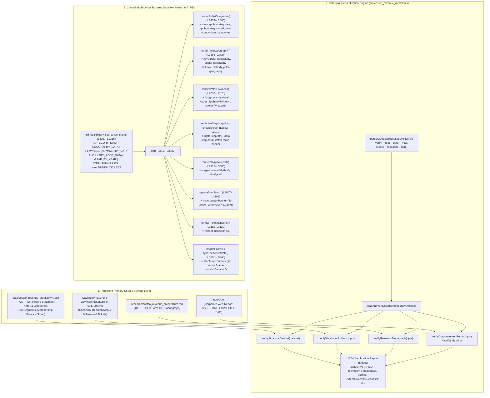
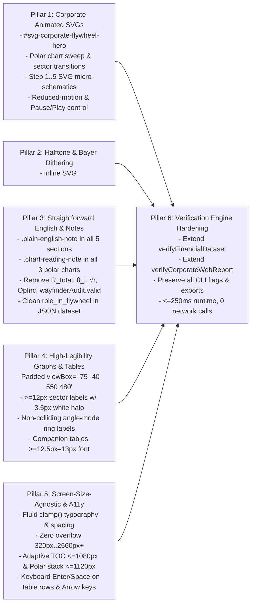

# Codebase & Dataflow Map: Costco Wholesale Corporation (`COST`) Corporate Animated SVG, Halftone/Bayer Dithering, Straightforward English, High-Legibility Polar Graphs & Screen-Size-Agnostic Architecture

**Run ID:** `20261104T004059-606-j6a7`  
**Branch:** `agent/codebase-mapper-20261104T004059-606-j6a7`  
**Agent:** `codebase-mapper` (Codebase & Dataflow Discovery Scanner)  
**Governing Specification:** [`functional_specification_005.md`](../../functional_specification_005.md)  
**Authoritative Domain Glossary:** [`LANGUAGE.md`](../../LANGUAGE.md)  
**Status:** Authoritative Codebase, Module, Storage, and Runtime Dataflow Map. Strict `DO NOT CODE YET` Gate Enforced.

---

## 1. Executive Summary & Discovery Scope

This document maps the existing project structure, modules, functions, persistent storage schemas, and runtime dataflows of the Costco Wholesale Corporation (`NASDAQ: COST`, `CIK: 0000909832`) repository against [`functional_specification_005.md`](../../functional_specification_005.md) and [`LANGUAGE.md`](../../LANGUAGE.md).

The codebase consists of five tightly coupled, zero-network deliverables:
1. **Interactive Corporate Executive Web Report ([`index.html`](../../index.html), 3,397 lines / 152,622 bytes):** Self-contained single-page HTML5/CSS3/SVG/ES5+ application rendering an institutional financial report with a sticky scroll-spy Table of Contents (`#table-of-contents`), Executive Summary & KPI Scorecard (`#section-executive-summary`), 3 interactive SVG Polar Coordinate Graphs (`#polar-chart-categories`, `#polar-chart-geography`, `#polar-chart-flywheel`), a 5-Step Revenue Flywheel walkthrough (`#step-1`..`#step-5`), a Multi-Year GAAP Waterfall & Sensitivity Simulator (`#section-gaap-model`), and a Wayfinder & SEC Form 10-K Audit Inspector (`#section-wayfinder-audit`).
2. **Primary-Source GAAP Financial Dataset ([`data/costco_revenue_breakdown.json`](../../data/costco_revenue_breakdown.json), 251 lines / 9,583 bytes):** Canonical JSON dataset encoding FY2022–FY2024 Consolidated Statements of Income, Note 11 disaggregated merchandise categories (`Foods and Sundries`, `Non-Foods`, `Fresh Foods`, `Warehouse Ancillary and Other Businesses`), Note 11 & Item 2 geographic segments (`United States`, `Canada`, `Other International` across `890` clubs: `703` owned / `187` leased), membership metrics (`76.2M` paid members, `136.8M` cardholders, `92.9%` U.S./Canada renewal, `$2,804M` Executive 2% contra-revenue), and working-capital balance sheet accounts (`$18,647M` inventory, `$19,421M` accounts payable = `104.15%` coverage).
3. **Deterministic Verification Engine & CLI ([`src/costco_revenue_model.mjs`](../../src/costco_revenue_model.mjs), 1,368 lines / 51,471 bytes):** Zero-network Node.js ESM verification engine (`npm run verify` / `npm start`) executing in `~13–30 ms` wall-clock time (`<= 250 ms` budget) and `~46.7 MB` RSS (`<= 128 MB` budget) with `0` external network requests.
4. **Wayfinder Decision Lineage ([`wayfinder/map.md`](../../wayfinder/map.md) & [`wayfinder/tickets/ticket-001.md`](../../wayfinder/tickets/ticket-001.md)..[`ticket-006.md`](../../wayfinder/tickets/ticket-006.md)):** Canonical Wayfinder decision map and 6 resolved research tickets.
5. **Primary-Source SEC Form 10-K Monograph ([`research/costco_revenue_architecture.md`](../../research/costco_revenue_architecture.md), 40,118 bytes) & Repository Documentation ([`README.md`](../../README.md), 38 lines):** Primary-source monograph and developer documentation.

---

## 2. Current Project Shape & Entry Points

### 2.1 Workspace Directory Structure

```text
.
├── .sandcastle/                             # Sandcastle orchestration & blackboard CLI
├── assets/                                  # Historical SEC Form 10-K primary-source extracts
├── data/
│   └── costco_revenue_breakdown.json        # Authoritative FY2022–FY2024 SEC Form 10-K JSON dataset (251 lines)
├── functional_specification_001.md          # Historical Seed Specification 001
├── functional_specification_002.md          # Historical Seed Specification 002
├── functional_specification_003.md          # Historical Seed Specification 003
├── functional_specification_004.md          # Historical Seed Specification 004
├── functional_specification_005.md          # Active Governing Seed Specification 005
├── handoff/                                 # Agent handoff manifests per run ID
├── index.html                               # Standalone corporate interactive web report (3,397 lines)
├── LANGUAGE.md                              # Authoritative domain vocabulary & evaluation parameters
├── package.json                             # Node.js ESM manifest ("type": "module", scripts: start, verify)
├── README.md                                # Repository documentation & local execution guide (38 lines)
├── research/
│   └── costco_revenue_architecture.md       # Primary-source SEC Form 10-K monograph (40,118 bytes)
├── src/
│   └── costco_revenue_model.mjs             # Deterministic GAAP, Wayfinder, Research & HTML audit CLI (1,368 lines)
└── wayfinder/
    ├── 20261104T004059-606-j6a7/            # Active run discovery & planning artifacts
    ├── map.md                               # Canonical Wayfinder decision map (30 lines)
    └── tickets/
        ├── ticket-001.md                    # Two-Pillar Revenue Engine and ASC 606 Recognition Mechanics
        ├── ticket-002.md                    # Merchandise Category Disaggregation, SKU Discipline & Kirkland
        ├── ticket-003.md                    # Membership Fee Tier Structure, Renewal Dynamics & Fee Cadence
        ├── ticket-004.md                    # Warehouse Ancillary Traffic Drivers, E-Commerce & Logistics
        ├── ticket-005.md                    # Gross Margin Ceiling, Negative Working-Capital & Flywheel
        └── ticket-006.md                    # Corporate Executive Design Architecture, 5 Steps & Polar Graphs
```

### 2.2 Active Entry Points & Runtime Configuration

| Entry Point | File Path | Invocation / Trigger | Runtime Environment | Measured Baseline Telemetry |
| :--- | :--- | :--- | :--- | :--- |
| **CLI Verification Runner** | [`src/costco_revenue_model.mjs`](../../src/costco_revenue_model.mjs) (L1358–L1368) | `npm run verify` (`node src/costco_revenue_model.mjs --verify`) or `npm start` | Node.js `v24.9.0` ESM (`"type": "module"`) | `12.7–30.4 ms` wall-clock (`<= 250 ms` budget), `46.66 MB` RSS (`<= 128 MB` budget), `0` network calls, `status: "VERIFIED"` |
| **Programmatic ESM API** | [`src/costco_revenue_model.mjs`](../../src/costco_revenue_model.mjs) | `import { loadAndVerifyCostcoModel, verifyFinancialDataset, verifyWayfinderArtifacts, verifyResearchMonograph, verifyCorporateWebReport, verifyIndexHtml } from "./src/costco_revenue_model.mjs"` | Node.js ESM test suites & verification scripts | Deterministic synchronous execution using `node:fs`, `node:path`, `node:process`, `node:perf_hooks` |
| **Interactive Corporate Web Report** | [`index.html`](../../index.html) (L1–L3397) | Direct browser load or `python3 -m http.server` + Playwright headless Chromium across `320px`–`2560px+` viewports | Browser DOM/SVG/CSSOM + IIFE controller (`init()` at L3248–L3394) | `0` external network requests; all CSS, SVG, and data self-contained inline |

---

## 3. End-to-End Dataflow & Storage Architecture



### 3.1 Storage Schemas & Inlined Runtime State

1. **`data/costco_revenue_breakdown.json` (L1–L251):**
   - `company` (L2–L12): `name`, `ticker` (`"COST"`), `exchange` (`"NASDAQ"`), `cik` (`"0000909832"`), `fiscal_year` (`2024`), `fiscal_year_end` (`"2024-09-01"`), `fiscal_weeks` (`52`), `currency` (`"USD"`), `units` (`"millions"`).
   - `consolidated_income_statement` (L13–L25): `net_sales_usd_m` (`249625`), `membership_fees_usd_m` (`4828`), `total_revenue_usd_m` (`254453`), `merchandise_costs_usd_m` (`222358`), `selling_general_and_administrative_usd_m` (`22810`), `operating_income_usd_m` (`9285`), `interest_expense_usd_m` (`169`), `interest_income_and_other_net_usd_m` (`624`), `income_before_taxes_usd_m` (`9740`), `provision_for_income_taxes_usd_m` (`2373`), `net_income_usd_m` (`7367`).
   - `historical_comparison` (L26–L66): 3-element array for `FY2022` (`222730 + 4224 = 226954`, OpInc `7793`, NetInc `5844`), `FY2023` (`237710 + 4580 = 242290`, OpInc `8114`, NetInc `6292`), and `FY2024` (`249625 + 4828 = 254453`, OpInc `9285`, NetInc `7367`).
   - `merchandise_categories` (L67–L147): 4-element array (`foods_and_sundries`, `non_foods`, `fresh_foods`, `warehouse_ancillary_and_other`) with `category_id`, `name`, `share_of_net_sales_pct`, `estimated_net_sales_usd_m`, `fy2023_net_sales_usd_m`, `fy2022_net_sales_usd_m`, `role_in_flywheel`, and `examples`.
     - **Gap Identified for `functional_specification_005.md`:** `role_in_flywheel` strings at **L75, L94, L121, L136** currently contain promotional/consulting clichés prohibited by Requirement 3.3 & 3.6 (`"High-frequency staple repeat-visit anchor driving predictable pallet velocity and household pantry consolidation"`, `"Treasure-hunt discretionary basket builder showcasing extreme brand-name and Kirkland Signature price gaps"`, `"Perishable weekly trip driver and rapid inventory-turn engine minimizing spoilage while anchoring perceived member value"`, `"High-frequency member trip and renewal magnet led by 719 gas stations (~12% of net sales), pharmacy, optical, food court, and Costco Travel"`).
   - `geographic_segments` (L148–L188): 3-element array (`united_states`, `canada`, `other_international`) totaling `890` warehouses (`703` owned, `187` leased).
   - `membership_metrics` (L189–L208) & `working_capital_balance_sheet` (L209–L217) & `primary_sources` (L218–L250).

2. **`index.html` Inlined State & DOM Architecture (L1–L3397):**
   - **CSS Stylesheet (`<style>`, L9–L1153):** Defines CSS custom properties (`:root` at L10–L38), top header bar (`.corporate-header` at L62–L192), two-column grid shell (`.corporate-shell` at L195–L203), sticky sidebar TOC (`.toc-sidebar` at L206–L333), report sections and KPI scorecard (`.report-section`, `.kpi-scorecard-grid` at L343–L452), polar chart suite and drill-down cards (`.polar-panel`, `.polar-svg`, `.polar-sector-label`, `.polar-axis-label` at L455–L794), 5-step walkthrough (`.stepper-controller-bar`, `.step-card` at L797–L1005), simulator & ticket inspector (`.simulator-panel`, `.ticket-inspector-box` at L1008–L1113), and two media queries (`@media (max-width: 1080px)` at L1115–L1130 and `@media (max-width: 640px)` at L1132–L1152).
   - **Static HTML Markup (`<body>`, L1155–L2020):**
     - Header (`L1158–L1188`)
     - `#table-of-contents` (`L1192–L1284`)
     - `#section-executive-summary` (`L1289–L1358`)
     - `#section-polar-graphs` (`L1361–L1590`) containing `#polar-chart-categories` (`L1375–L1436`), `#polar-chart-geography` (`L1439–L1493`), and `#polar-chart-flywheel` (`L1496–L1588`)
     - `#section-five-steps` (`L1593–L1860`) containing `#step-1` (`L1648`), `#step-2` (`L1691`), `#step-3` (`L1734`), `#step-4` (`L1776`), and `#step-5` (`L1818`)
     - `#section-gaap-model` (`L1863–L1955`)
     - `#section-wayfinder-audit` (`L1958–L2014`)
   - **Client-Side JavaScript Controller (`<script>`, L2022–L3395):**
     - Inlined datasets (`CATEGORY_DATA`, `GEOGRAPHY_DATA`, `FLYWHEEL_ASYMMETRY_DATA`, `ANCILLARY_ROSE_DATA`, `GAAP_BY_YEAR`, `STEP_SUMMARIES`, `WAYFINDER_TICKETS` at L2027–L2315)
     - Polar coordinate geometry & SVG helpers (`degToRad`, `polarPoint`, `describeAnnularSector`, `formatUsdM`, `renderPolarGrid`, `renderPolarRingLabels`, `bindPolarSectorEvents` at L2318–L2413)
     - Interactive chart, stepper, waterfall, simulator, ticket, and scroll-spy controllers (`L2418–L3394`).

---

## 4. Existing Modules & Functions to Reuse

Downstream stages (`plan-2`, `planner-2.1..2.5`, `implementer-1..5`, `tester-1..5`) MUST reuse and extend these existing modules and functions rather than creating duplicate files or shadow verification scripts.

### 4.1 Node.js Verification Engine (`src/costco_revenue_model.mjs`)

| Function / Export | Lines | Signature | Input Parameters & Return Contract | Reuse & Extension Mandate (`functional_specification_005.md`) |
| :--- | :--- | :--- | :--- | :--- |
| `verifyFinancialDataset(data)` | L576–L729 | `export function verifyFinancialDataset(data)` | **Input:** Parsed JSON object from `data/costco_revenue_breakdown.json`.<br>**Returns:** `{ totalRevenueCheck, operatingIncomeCheck, preTaxAndNetIncomeCheck, netSalesSharePct, membershipFeeShareOfRevenuePct, merchandiseGrossMarginDollarM, merchandiseGrossMarginPct, sgaPctOfNetSales, membershipFeeShareOfOperatingIncomePct, merchandiseOperatingContributionUsdM, merchandiseOperatingContributionSharePct, accountsPayableToInventoryRatioPct, formattedRatios, disaggregationSummary }`. | **EXTEND IN-PLACE.** Preserve all existing return fields and GAAP checks. Add validation inside `verifyMerchandiseCategories` (L467–L515) or `verifyFinancialDataset` asserting that `role_in_flywheel` contains zero prohibited promotional clichés (`treasure-hunt discretionary basket builder`, `renewal magnet`, `perishable weekly trip driver and rapid inventory-turn engine`) or raw code/math leaks. |
| `verifyWayfinderArtifacts(rawOptions)` | L788–L931 | `export function verifyWayfinderArtifacts(rawOptions = {})` | **Input:** `{ rootDir?, mapPath?, ticketsDir?, mapContent?, mapMarkdown?, ticketContents?, tickets? }` or string path.<br>**Returns:** `{ valid: true, mapPath, requiredSectionsVerified: 5, resolvedTicketCount: 6, ticketsVerified }`. | **REUSE AS-IS.** Already enforces all 5 canonical `wayfinder/map.md` H2 sections, descriptive human-readable ticket link labels (zero bare ticket IDs), and `ticket-001.md`..`ticket-006.md` resolution metadata. |
| `verifyResearchMonograph(rawOptions)` | L937–L1005 | `export function verifyResearchMonograph(rawOptions = {})` | **Input:** `{ rootDir?, researchPath?, researchContent?, researchMarkdown? }` or string path.<br>**Returns:** `{ valid: true, researchPath, byteLength, citationsVerified, keyFiguresVerified }`. | **REUSE AS-IS.** Validates `research/costco_revenue_architecture.md` byte length (`>= 8000`), citations, and figures. |
| `verifyCorporateWebReport(rawOptions)` / `verifyIndexHtml` | L1013–L1200 | `export function verifyCorporateWebReport(rawOptions = {})`<br>`export const verifyIndexHtml = verifyCorporateWebReport` | **Input:** `{ rootDir?, htmlPath?, htmlContent?, indexHtml? }` or string path.<br>**Returns:** `{ valid: true, htmlPath, byteLength, tableOfContentsVerified, polarChartsVerified, fiveStepsVerified, dreamcoreMarkersDetected: 0, specTokensDetected: 0, polarCssSelectorsVerified: true, historicalNote11Reconciled: true, ... }`. | **EXTEND IN-PLACE.** Preserve all existing checks and return keys while adding Requirement 3.6 assertions: (1) corporate animated SVG elements (`#svg-corporate-flywheel-hero` / animated flywheel & step SVG schematics, `@media (prefers-reduced-motion: reduce)` and motion pause/play toggle), (2) halftone/Bayer dithering SVG `<pattern>` / CSS classes, (3) zero algebraic/code leaks (`R_total`, `θ_i`, `&theta;_i`, `Area √r`, `Area &radic;r`, `wayfinderAudit.valid === true`) or promotional clichés, (4) plain-English note containers (`.plain-english-note` / `.chart-reading-note`) & high-legibility SVG halo/typography rules, and (5) screen-size-agnostic responsive rules (`clamp(`, `minmax(0, 1fr)`) and keyboard accessibility handlers on table rows and tabs. |
| `loadAndVerifyCostcoModel(rawOptions)` | L1230–L1311 | `export function loadAndVerifyCostcoModel(rawOptions = {})` | **Input:** `{ verifyOnly?, rootDir?, dataPath?, mapPath?, ticketsDir?, researchPath?, htmlPath?, data?, dataset?, mapMarkdown?, mapContent?, tickets?, ticketContents?, researchMarkdown?, researchContent?, htmlContent?, indexHtml? }` or string path or dataset object.<br>**Returns:** `{ status: "VERIFIED", mode, company, ...financialMetrics, wayfinderAudit, researchAudit, corporateWebAudit, telemetry: { elapsedMs, rssMb, externalNetworkRequests: 0 } }`. | **REUSE AS-IS.** Orchestrates all 4 verification routines and records `elapsedMs` and `rssMb`. |
| `parseCliArgs(argv)` | L1321–L1344 | `function parseCliArgs(argv)` | **Input:** `process.argv.slice(2)` supporting `--verify`, `--root`, `--data`, `--map`, `--tickets`, `--research`, `--html`. | **REUSE AS-IS.** All CLI flags must remain 100% backward-compatible. |

### 4.2 Browser UI & Polar Graph Controllers (`index.html`)

| Function / Object | Lines | Signature & Purpose | Reuse & Extension Mandate (`functional_specification_005.md`) |
| :--- | :--- | :--- | :--- |
| `degToRad(deg)`, `polarPoint(cx, cy, r, deg)`, `describeAnnularSector(cx, cy, rInner, rOuter, startDeg, endDeg)` | L2318–L2357 | Polar coordinate math & SVG path `<path d="...">` generator (0° = 12 o'clock clockwise). | **REUSE AS-IS.** Core polar geometry primitives used by all three polar charts. |
| `renderPolarGrid(cx, cy, maxR, ringLabels, spokeAngles)` & `renderPolarRingLabels(cx, cy, maxR, ringLabels)` | L2364–L2394 | Generates `.polar-grid-ring` circles, `.polar-axis-spoke` lines, and `.polar-axis-label` scale markers. | **EXTEND.** Accept an optional `angleDeg` or offset parameter in `renderPolarRingLabels` so that in `By Revenue Share (Angle)` mode (`data-cat-mode="angle"`), radial ring scale labels do not collide with sector labels near 12 o'clock (`0°`), and enhance halo stroke width (`3.5px` white halo) or pill backing. |
| `bindPolarSectorEvents(svgElement, attrName, onSelect)` | L2396–L2413 | Attaches `click` and `keydown` (`Enter`/`Space`) handlers to SVG polar sectors `[data-cat-sector]`, `[data-geo-sector]`, `[data-fly-sector]`. | **REUSE & EXTEND.** Keep sector keyboard support and add a companion helper `bindTableRowEvents(tbodyElement, attrName, onSelect)` so companion table rows (`[data-cat-row]`, `[data-geo-row]`) also have `tabindex="0"`, `role="button"`, `aria-selected`, and `keydown` (`Enter`/`Space`) activation with focus restoration. |
| `renderPolarCategories()` | L2424–L2585 | Renders `#svg-polar-categories`, `#polar-category-drilldown`, `#tbody-polar-categories`, and `#polar-cat-caption`. | **EXTEND.** (1) Apply dithered SVG accent ring/pattern overlay so sectors retain crisp corporate colors (`#005DAA`, `#0F172A`, `#E31837`, `#059669`) plus tactile annual-report texture; (2) add animated active-sector selection ring / sweep indicator; (3) replace `Area-Proportional √r` and `Share-Weighted Sector Angle θ_i` in caption (L2514–L2518) with plain English (`By Area (Square-Root Scale)`, `By Radius (Linear Scale)`, `By Revenue Share (Angle)`); (4) offset ring scale labels in `angle` mode to prevent collisions; (5) enlarge center hub (`r >= 40`) and add `tabindex="0"` + keyboard handlers to `[data-cat-row]`. |
| `renderPolarGeography()` | L2595–L2727 | Renders `#svg-polar-geography`, `#polar-geography-drilldown`, `#tbody-polar-geography`, and `#polar-geo-caption`. | **EXTEND.** (1) Add animated active-sector selection ring & dithered outer halo accent; (2) enlarge center hub (`r >= 40`) and replace `3.65% OpM` / `OpInc` shorthand with plain English (`3.65% Margin`, `Operating Income`); (3) add `tabindex="0"` + `Enter`/`Space` keyboard handlers to `[data-geo-row]`. |
| `renderPolarFlywheel()` | L2737–L2875 | Renders `#svg-polar-flywheel` (`asymmetry` Dual-Ring mode & `ancillary` Rose mode), `#polar-flywheel-drilldown`, and `#polar-fly-caption`. | **EXTEND.** (1) In `asymmetry` Dual-Ring mode (L2747–L2808), replace cramped raw text overlays (`Fees OpInc`, `Merch OpInc` at L2784–L2787) with clean high-contrast pill badges/callouts and an explicit HTML visual legend below the chart; (2) add animated flow/sweep indicator and dithered ring accent; (3) enlarge center hub (`r >= 40`) and use plain English (`FY24 Operating Profit`). |
| `setActiveStep(stepNum, shouldScroll)` | L2882–L2910 | Synchronizes `.step-pill-btn`, `.step-card`, and `#step-focus-banner` across Steps 1–5. | **EXTEND.** Synchronize active step with the new `#svg-corporate-flywheel-hero` animated schematic nodes and support `ArrowLeft` / `ArrowRight` roving keyboard navigation on `[data-step-btn]`. |
| `renderGaapWaterfall()` & `updateSimulator()` | L2917–L3108 | Populates `#gaap-waterfall-tbody` and updates `#sim-output-banner` (including `.is-breach` when `gmPct > 11.50`). | **EXTEND.** Replace `OpInc`, `IntExp`, `IntInc` abbreviations in `renderGaapWaterfall` and `updateSimulator` (L2954, L3004, L3015, L3100) with clear, straightforward English (`Operating Income`, `Merchandise Profit`, `Membership Fees`). |
| `renderTicketInspector()` | L3115–L3129 | Renders selected Wayfinder ticket into `#ticket-inspector-box`. | **EXTEND.** Eliminate `R_total ($254,453M)` and `OpInc` shorthand in `WAYFINDER_TICKETS` (L2283, L2307) and add `ArrowLeft` / `ArrowRight` keyboard navigation to `[data-ticket-tab]`. |
| `initScrollSpy()` & `init()` | L3190–L3387 | Initializes scroll-spy `IntersectionObserver` and binds UI event listeners. | **EXTEND.** Wire up the accessible motion pause/play toggle button (`#motion-toggle-btn` or `[data-motion-toggle]`) and `@media (prefers-reduced-motion: reduce)` listener, plus mobile/tablet collapsible TOC toggle if applicable. |

---

## 5. Comprehensive Gap Analysis & Required Code Edits (`functional_specification_005.md`)



### 5.1 Pillar 1: Corporate Animated SVG Elements (Requirement 3.1 / `AC-01`)

- **Current State in `index.html`:**
  - Zero `<animate>`, `<animateTransform>`, `@keyframes`, or animated SVG flow diagrams exist in `index.html`.
  - No `@media (prefers-reduced-motion: reduce)` rule or user-accessible animation pause/play toggle control exists.
  - `#section-executive-summary` (L1289–L1358) has only static KPI cards and a text equation banner; `#step-1`..`#step-5` (L1648–L1859) have only text lists and key-value boxes without SVG schematics.
- **Required Additions & Edits in `index.html`:**
  1. **Corporate Animated SVG Revenue & Profit Flywheel Schematic (`#svg-corporate-flywheel-hero`):** Add a responsive, self-contained animated SVG diagram in `#section-executive-summary` (and/or synchronized with `#section-five-steps`) visually animating the 4 core nodes and flow paths:
     - **Node 1 (Paid Membership Base):** `76.2M` Paid Members (`136.8M` Cardholders, `92.9%` U.S./Canada Renewal) $\rightarrow$ `$4,828M` Membership Fees (`1.90%` of Total Revenue).
     - **Node 2 (High-Velocity Warehouse & Ancillary Sales):** `< 4,000` active SKUs across `890` clubs (`719` gas stations + e-commerce) $\rightarrow$ `$249,625M` Net Sales (`98.10%` of Total Revenue).
     - **Node 3 (10.92% Gross Margin Cap & 104.15% Supplier-Financed Inventory):** `$27,267M` Gross Margin (`10.92%`) minus `$22,810M` SG&A (`9.14%`) = `$4,457M` Net Merchandise Profit (`48.00%` of Operating Income), backed by `$19,421M` Accounts Payable funding `104.15%` of `$18,647M` Inventory (`+$774M` cash float).
     - **Node 4 (Consolidated Operating & Net Income):** `$4,457M` Merchandise Profit (`48.00%`) + `$4,828M` Membership Fees (`52.00%`) = `$9,285M` Operating Income $\rightarrow$ `$7,367M` Net Income (`$16.56` Diluted EPS).
     - Use crisp animated SVG stroke paths (`stroke-dashoffset` flow pulses, directional chevrons, subtle status rings, and active node highlighting synchronized with `#step-1`..`#step-5`).
  2. **Animated SVG Polar Chart Enhancements (`#svg-polar-categories`, `#svg-polar-geography`, `#svg-polar-flywheel`):**
     - Add animated active-sector selection rings, gentle radar/polar sweep indicators, and smooth sector/callout transitions when switching fiscal years (`FY2024`, `FY2023`, `FY2022`, `3-Year Overlay`) or scaling modes.
  3. **Step-Card Animated SVG Mini-Schematics (`#step-1`..`#step-5`):**
     - Embed dedicated corporate animated SVG micro-schematics inside each of the 5 step cards illustrating: (Step 1) Membership card & 12-month ratable recognition bar, (Step 2) `< 4,000` SKU cross-docked pallet velocity, (Step 3) `719` gas station canopy & e-commerce logistics loop, (Step 4) `10.92%` margin cap & `104.15%` AP-to-Inventory balance gauge, and (Step 5) `48.00%` Merchandise Profit + `52.00%` Membership Fees $\rightarrow$ `$9,285M` Operating Income $\rightarrow$ `$7,367M` Net Income waterfall schematic.
  4. **Accessible Motion Control & `@media (prefers-reduced-motion: reduce)`:**
     - Add an accessible pause/play motion toggle button in the header/toolbar (`aria-pressed`, keyboard operable) that toggles a root class (e.g., `body.is-motion-paused` / `data-motion="paused"`) and pauses/resumes SVG animations, plus full `@media (prefers-reduced-motion: reduce)` CSS rules that cleanly pause all CSS `@keyframes` and SVG animations into high-contrast static states.

### 5.2 Pillar 2: High-Density Halftone & Ordered Bayer Dithered Visual Effects (Requirement 3.2 / `AC-02`)

- **Current State in `index.html`:**
  - Zero SVG `<defs>` dither patterns (`<pattern>`) or Bayer matrix halftone CSS classes exist in `index.html`.
- **Required Additions & Edits in `index.html`:**
  1. **Global SVG `<defs>` Ordered Bayer & Halftone Stipple Library:**
     - Include inline SVG `<defs>` defining reusable ordered Bayer $4\times 4$ / $8\times 8$ dot/crosshatch matrices and halftone stipple `<pattern>` definitions in Costco's corporate palette (`#005DAA` Costco Executive Navy, `#E31837` Costco Crimson, `#0F172A` Slate Ink, `#059669` Emerald, `#D97706` Amber) as well as CSS `.dither-band-navy`, `.dither-band-crimson`, `.dither-card-header`, `.dither-badge-accent` classes using inline SVG data-URI or SVG `<pattern>` backgrounds.
  2. **Targeted Application Across Corporate Surfaces:**
     - Apply dithered accent bands/plates to section header banners, KPI scorecard top accent strips, polar chart outer decorative rings and dual-layer sector pattern overlays (preserving unmistakable primary sector color distinction), and 5-step card header plates.
  3. **Strict Anti-Obscuration & WCAG Contrast Guard ($\ge 4.5:1$):**
     - Never place high-opacity dither dots directly behind body text or table numerals. Every text element, KPI figure, polar sector label, and note must sit on a clean solid surface (`#FFFFFF` / `#F8FAFC`) or have a crisp `3.5px` white SVG text halo (`paint-order: stroke fill`).
     - Zero prohibited Dreamcore/VHS/liminal markers (`dreamcore`, `seraphic`, `vhs-scanlines`, `film-grain-overlay`, `meadow_portal.jpg`, `poolroom_sanctuary.jpg`, `sky_staircase.jpg`, `tape hum`, `stuck-clock`, `dream-sky-canvas`).

### 5.3 Pillar 3: Simplified, Straightforward English Explanations & Plain-English Note Boxes (Requirement 3.3 / `AC-03`)

- **Exact Locations of Remaining Shorthand, Code Assertions & Jargon to Remediate:**

| File | Exact Line(s) | Current Unrefined Text / Token | Required Plain-English Replacement (`functional_specification_005.md`) |
| :--- | :--- | :--- | :--- |
| [`data/costco_revenue_breakdown.json`](../../data/costco_revenue_breakdown.json) | L75 | `"High-frequency staple repeat-visit anchor driving predictable pallet velocity and household pantry consolidation"` | Rewrite in straightforward, plain English explaining that everyday grocery and household staples drive steady weekly shopping trips and rapid inventory sales across all warehouses (zero promotional clichés). |
| [`data/costco_revenue_breakdown.json`](../../data/costco_revenue_breakdown.json) | L94 | `"Treasure-hunt discretionary basket builder showcasing extreme brand-name and Kirkland Signature price gaps"` | Rewrite in straightforward, plain English explaining how appliances, electronics, apparel, and seasonal home goods offer large savings over regular retail prices and increase average purchase size (zero `"treasure-hunt discretionary basket builder"` cliché). |
| [`data/costco_revenue_breakdown.json`](../../data/costco_revenue_breakdown.json) | L121 | `"Perishable weekly trip driver and rapid inventory-turn engine minimizing spoilage while anchoring perceived member value"` | Rewrite in straightforward, plain English explaining how fresh meat, produce, bakery, and deli items bring members into the warehouse every week and sell quickly so spoilage stays low (zero `"perishable weekly trip driver and rapid inventory-turn engine"` cliché). |
| [`data/costco_revenue_breakdown.json`](../../data/costco_revenue_breakdown.json) | L136 | `"High-frequency member trip and renewal magnet led by 719 gas stations (~12% of net sales), pharmacy, optical, food court, and Costco Travel"` | Rewrite in straightforward, plain English explaining how 719 discounted gas stations (~12% of net sales), pharmacy, optical, hearing aids, tire service, food courts, and Costco Travel bring members back frequently and encourage annual membership renewal (zero `"renewal magnet"` cliché). |
| [`index.html`](../../index.html) | L1330, L1341, L1344 | `48.00% of OpInc`, `Negative Working-Capital Float`, `$9,285M OpInc &rarr; $7,367M Net Income` | `48.00% of Operating Income`, `Supplier-Financed Inventory (104.15%)`, `$9,285M Operating Income → $7,367M Net Income`. |
| [`index.html`](../../index.html) | L1350–L1356 | `R_total ($254,453M) = Net Sales ($249,625M) + Membership Fees ($4,828M)` and `OpInc ($9,285M) = Merch Contrib ($4,457M \| 48.00%) + Membership Fees ($4,828M \| 52.00%)` | `Total Revenue ($254,453M) = Net Sales ($249,625M) + Membership Fees ($4,828M)` and `Operating Income ($9,285M) = Net Merchandise Profit ($4,457M, or 48.00%) + Membership Fees ($4,828M, or 52.00%)`. |
| [`index.html`](../../index.html) | L1369–L1370 | `(<code>Area &radic;r</code> ..., <code>Linear Radius r</code> ..., or <code>Share Angle &theta;_i</code> ...)` | Plain-English explanation of the three chart views: `By Area (Square-Root Scale)`, `By Radius (Linear Scale)`, and `By Revenue Share (Angle)`. |
| [`index.html`](../../index.html) | L1395–L1397 | `Area &radic;r (Coxcomb)`, `Linear Radius r`, `Share Angle &theta;_i` | `By Area (Square-Root Scale)`, `By Radius (Linear Scale)`, `By Revenue Share (Angle)`. |
| [`index.html`](../../index.html) | L1412 & L2514–L2518 | `Mode: Area-Proportional √r (90° Coxcomb Sectors)`, `Linear Radius r (90° Sectors)`, `Share-Weighted Sector Angle θ_i` | `View Mode: By Area (Square-Root Scale, 90° Sectors)`, `By Radius (Linear Scale, 90° Sectors)`, `By Revenue Share (Angle Proportional to Sales Share)`. |
| [`index.html`](../../index.html) | L1509, L1540 | `Dual-Ring: Revenue vs. OpInc Share`, `OpInc Share` | `Dual-Ring: Revenue vs. Operating Profit Share`, `Operating Profit Share`. |
| [`index.html`](../../index.html) | L1636, L1847–L1848, L1854 | `52.00% Fee OpInc Flywheel`, `48.00% of OpInc`, `52.00% of OpInc`, `$9,285M OpInc - $169M IntExp + $624M IntInc = $9,740M PreTax` | Replace with full plain-English terms (`52.00% Fee Profit Share`, `48.00% of Operating Income`, `52.00% of Operating Income`, `$9,285M Operating Income - $169M Interest Expense + $624M Interest & Other Income = $9,740M Pre-Tax Income`). |
| [`index.html`](../../index.html) | L1994 | `<code>wayfinderAudit.valid === true</code> (6 resolved tickets verified)` | `Verified: 6 resolved research tickets and canonical decision map`. |
| [`index.html`](../../index.html) | L2274, L2283, L2307 | `R_total ($254,453M)`, `48.00% of OpInc` in `STEP_SUMMARIES` and `WAYFINDER_TICKETS` | Replace `R_total` with `Total Revenue` and `OpInc` with `Operating Income`. |
| [`index.html`](../../index.html) | L2656, L2785, L2787, L2792, L2954, L3100 | `3.65% OpM`, `Fees OpInc`, `Merch OpInc`, `FY24 OpInc`, `% of OpInc`, `Simulated OpInc:` | Replace with clear English (`3.65% Margin`, `Fee Profit (52.0%)`, `Merch Profit (48.0%)`, `FY24 Profit`, `% of Operating Income`, `Simulated Operating Income:`). |
| [`README.md`](../../README.md) | L11–L12 | `Area √r (Coxcomb)`, `Linear Radius r`, `Share Angle θ_i`, `OpInc` | Update `README.md` descriptions to reflect the new plain-English button labels, animated SVG diagrams, halftone/Bayer dithering, and screen-size-agnostic responsive verification. |

- **Required Plain-English Note Boxes (`.plain-english-note` & `.chart-reading-note`):**
  - Add dedicated, high-legibility **"In Plain English"** callout boxes (`.plain-english-note`) in all 5 report sections (`#section-executive-summary`, `#section-polar-graphs`, `#section-five-steps`, `#section-gaap-model`, `#section-wayfinder-audit`) and **"How to Read This Chart"** note boxes (`.chart-reading-note`) in all 3 polar chart panels (`#polar-chart-categories`, `#polar-chart-geography`, `#polar-chart-flywheel`), clearly explaining:
    1. Why Costco caps markups at `~11%` (`10.92%` Gross Margin Ceiling vs. `25%–40%` at regular stores) so members save money and renew at `92.9%` in the U.S. and Canada,
    2. How supplier-financed inventory works (`12.60x` annual turnover = `~29` days to sell inventory vs. `~32` days to pay suppliers, so `$19,421M` in accounts payable funds `104.15%` of `$18,647M` in inventory, leaving `+$774M` of cash float),
    3. How `1.90%` of revenue becomes `52.00%` of operating profit (`$27,267M` merchandise gross margin covers all `$22,810M` of warehouse SG&A expenses with `$4,457M` or `48.00%` left over, allowing `$4,828M` in membership fees to contribute `52.00%` of `$9,285M` operating income),
    4. What contra-revenue means in one sentence (the `2%` annual reward earned by Executive members—`$2,804M` in FY2024—is subtracted directly from reported Net Sales rather than counted as an operating expense).

### 5.4 Pillar 4: High-Legibility Graphs, Callout Labels, Legends & Companion Tables (Requirement 3.4 / `AC-04`)

- **Current Gaps in `index.html`:**
  1. **Polar Typography & Halo Sizes (L588–L616):**
     - `.polar-sector-label` is `11px` without a CSS white stroke halo (Requirement 3.4 mandates $\ge 12\text{px}$, `font-weight: 700`, `#0F172A`, with `paint-order: stroke fill; stroke: #FFFFFF; stroke-width: 3.5px; stroke-linejoin: round`).
     - `.polar-axis-label` is `9.5px` (Requirement 3.4 mandates $\ge 10.5\text{px}$–$11\text{px}$, `font-weight: 600`, with a crisp white stroke halo).
     - `.polar-center-title` is `11px` and `.polar-center-sub` is `9px` inside an `r="36"` or `r="38"` circle (Requirement 3.4 mandates `.polar-center-title >= 12.5px`, `.polar-center-sub >= 10px`, inside a center hub circle `r >= 40px`).
  2. **SVG `viewBox` Padding (L1407, L1464, L1520):**
     - Currently `viewBox="-55 -28 510 456"`. Expanding to `viewBox="-75 -40 550 480"` (with matching aspect-ratio) gives generous breathing room so outer sector labels and sub-labels never clip or touch the border in any mode.
  3. **Label Collision in `#polar-chart-categories` under `By Revenue Share (Angle)` Mode (`data-cat-mode="angle"`):**
     - In `renderPolarCategories()` (L2485–L2496), `renderPolarRingLabels` draws ring scale markers (`25%`, `50%`, `75%`, `100% Share`) vertically along `x = cx + 4` (`0°` / 12 o'clock spoke), which can collide with sector labels when angles shift. Offsetting ring scale markers (e.g., along a non-colliding spoke angle or pill badge column) prevents any label overlap.
  4. **Dual-Ring Label Legibility & HTML Visual Legends (`#polar-chart-categories`, `#polar-chart-geography`, `#polar-chart-flywheel`):**
     - Add explicit HTML visual legends (`.polar-html-legend`) and explanatory notes below each polar SVG stage so color swatches, ring definitions (Outer Ring = Top-Line Revenue `98.10%` vs. `1.90%`; Inner Ring = Operating Income `48.00%` vs. `52.00%`), and 3-year overlay line styles are immediately readable outside the SVG as well as via clean pill callouts inside the SVG.
  5. **Companion Table Typography (L778–L785):**
     - Currently `.polar-details-column .corp-table` is set to `font-size: 11.5px; padding: 7px 6px;`. Upgrade to `font-size: 12.5px`–`13px` and `padding: 8px 10px` with clear explanatory footnotes below each companion table.

### 5.5 Pillar 5: 100% Screen-Size-Agnostic Responsive Architecture & Accessibility (Requirement 3.5 / `AC-05`)

- **Current Gaps in `index.html`:**
  1. **Fluid Typography & Spacing (`clamp()`):**
     - Currently `index.html` uses fixed pixel font sizes and paddings with `0` occurrences of `clamp(`. Upgrading headings (`.section-title`, `.polar-panel-title`, `.step-card-title`), KPI values (`.kpi-value`), and container paddings to fluid `clamp(...)` expressions ensures effortless scaling from `320px` compact phones to `2560px+` ultra-wide monitors.
  2. **Responsive Breakpoints (`320px`, `375px`, `390px`, `768px`, `1024px`, `1280px`, `1440px`, `1920px`, `2560px+`):**
     - Expand `.corporate-shell` (`max-width: min(1680px, 100%)` or fluid widescreen container) so ultra-wide screens (`1920px`, `2560px`) use space gracefully while `<= 1120px` stacks `.polar-grid-layout` cleanly into a single full-width column, `<= 1080px` converts `#table-of-contents` into a compact/collapsible full-width navigation card at the top of the report, and `<= 480px` (`320px`–`390px`) wraps control button groups (`.ctrl-group`), equation banners, and table containers (`.corp-table-wrap { overflow-x: auto; -webkit-overflow-scrolling: touch; max-width: 100%; }`) with zero horizontal page overflow (`document.documentElement.scrollWidth <= window.innerWidth`).
  3. **Full Keyboard Accessibility on Table Rows & Tabs:**
     - Currently `[data-cat-row]` (L2547) and `[data-geo-row]` (L2690) only have `click` listeners (`L2579–L2584`, `L2720–L2726`) and lack `tabindex="0"`, `role="button"`, and `keydown` (`Enter`/`Space`) handlers.
     - Currently `[data-step-btn]` (L3299) and `[data-ticket-tab]` (L3368) only have `click` listeners and lack `ArrowLeft` / `ArrowRight` roving tab keyboard navigation.

### 5.6 Pillar 6: Deterministic Verification Hardening (`src/costco_revenue_model.mjs`, Requirement 3.6)

- **File:** [`src/costco_revenue_model.mjs`](../../src/costco_revenue_model.mjs)
- **Required Enhancements in `verifyFinancialDataset` (L576–L729) and `verifyCorporateWebReport` (L1013–L1200):**
  1. In `verifyMerchandiseCategories` / `verifyFinancialDataset`: Assert that every `merchandise_categories[].role_in_flywheel` string is free of prohibited promotional clichés (`treasure-hunt discretionary basket builder`, `renewal magnet`, `perishable weekly trip driver and rapid inventory-turn engine`) and raw spec braces.
  2. In `verifyCorporateWebReport`:
     - Verify presence of corporate animated SVG elements (e.g., `#svg-corporate-flywheel-hero` / animated SVG flywheel & step schematics, SVG animation/transition hooks, motion toggle button, and `@media (prefers-reduced-motion: reduce)`).
     - Verify presence of corporate halftone / ordered Bayer dithering definitions (`<pattern` and dither CSS classes) and zero prohibited Dreamcore markers.
     - Verify zero occurrences of prohibited promotional clichés (`treasure-hunt discretionary basket builder`, `renewal magnet`, `perishable weekly trip driver and rapid inventory-turn engine`) or raw code/algebraic shorthand leaks (`wayfinderAudit.valid === true`, `R_total`, `θ_i`, `&theta;_i`, `Area √r`, `Area &radic;r`, `Negative Working-Capital Float`) in `index.html`.
     - Verify presence of plain-English explanatory note containers (`.plain-english-note`, `.chart-reading-note`) and high-legibility SVG halo/typography rules (`paint-order: stroke fill`, `.polar-sector-label`, `.polar-axis-label`).
     - Verify presence of screen-size-agnostic responsive CSS rules (`clamp(`, `@media`, `minmax(0, 1fr)`) and keyboard accessibility handlers (`Enter`/`Space` on `[data-cat-row]`, `[data-geo-row]`, and polar sectors; `ArrowLeft`/`ArrowRight` on tabs).

---

## 6. File-by-File Modification Matrix & Caller/Consumer Dependencies

| File Path | Role in Repository | Upstream Callers / Triggers | Downstream Consumers | Required Modifications for `functional_specification_005.md` |
| :--- | :--- | :--- | :--- | :--- |
| [`data/costco_revenue_breakdown.json`](../../data/costco_revenue_breakdown.json) | Canonical primary-source SEC Form 10-K dataset | `loadAndVerifyCostcoModel()` in `src/costco_revenue_model.mjs` | `verifyFinancialDataset()`, test suites, human analysts | Rewrite `role_in_flywheel` at L75, L94, L121, L136 into simplified, straightforward English with zero promotional clichés while preserving 100% of schema keys and numeric values. |
| [`index.html`](../../index.html) | Self-contained corporate interactive web report | Browser runtime (`file://` or HTTP server), `verifyCorporateWebReport()`, Playwright headless visual verifier | End users across `320px`–`2560px+` viewports, CLI audit engine | (1) Add `#svg-corporate-flywheel-hero`, step SVG micro-schematics, polar sweep/selection animations, motion toggle & `@media (prefers-reduced-motion: reduce)`; (2) add SVG `<defs>` `<pattern>` halftone/Bayer dithering & CSS dither accents; (3) add `.plain-english-note` & `.chart-reading-note` boxes and remove `R_total`, `θ_i`, `√r`, `OpInc`, `wayfinderAudit.valid === true`; (4) upgrade polar `viewBox="-75 -40 550 480"`, label font sizes/halos, angle-mode ring label offsets, Dual-Ring callouts, HTML legends, and table font size (`>= 12.5px`); (5) add `clamp()` fluid sizing, responsive breakpoints (`320px`–`2560px+`), and keyboard handlers on table rows and tabs. |
| [`src/costco_revenue_model.mjs`](../../src/costco_revenue_model.mjs) | Deterministic verification CLI & programmatic ESM module | `npm run verify`, `npm start`, stage 4 test suites | `stdout` JSON verification report (`status: "VERIFIED"`) | Extend `verifyFinancialDataset()` and `verifyCorporateWebReport()` to enforce all `AC-01`..`AC-05` invariants while keeping all existing CLI flags, exported function names, and return object properties intact. |
| [`wayfinder/map.md`](../../wayfinder/map.md) & [`wayfinder/tickets/ticket-006.md`](../../wayfinder/tickets/ticket-006.md) | Canonical Wayfinder decision lineage artifacts | `verifyWayfinderArtifacts()` in `src/costco_revenue_model.mjs` | `wayfinderAudit` report & repository readers | Reconcile `ticket-006.md` and `wayfinder/map.md` descriptions with the `functional_specification_005.md` corporate animated SVG, halftone/Bayer dithering, plain English, padded `viewBox`, and screen-size-agnostic architecture while preserving descriptive human-readable ticket links and required H2 headings. |
| [`README.md`](../../README.md) | Repository documentation & usage guide | Human developers & documentation checks | Repository readers | Update feature descriptions to document the corporate animated SVG schematics, halftone/Bayer dithered visual effects, plain-English explanations, high-legibility polar graphs, and screen-size-agnostic responsive design. |
| [`research/costco_revenue_architecture.md`](../../research/costco_revenue_architecture.md) | Primary-source SEC Form 10-K research monograph (`40,118` bytes) | `verifyResearchMonograph()` in `src/costco_revenue_model.mjs` | `researchAudit` report & Wayfinder ticket links | **No structural changes required** (already verified at `40,118` bytes with all required citations and figures; preserve intact). |
| [`LANGUAGE.md`](../../LANGUAGE.md) | Authoritative domain vocabulary & evaluation glossary | All pipeline stages (`RULE[user_global]`) | All agents & specifications | **Read-only authoritative reference** (preserve intact). |
