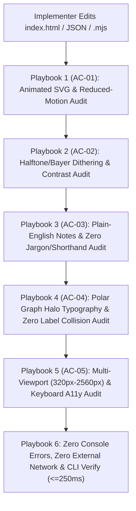

# MCP Server Provisioning, Tool Schemas & Live Verification Playbook

**Run ID:** `20261104T004059-606-j6a7`  
**Agent:** `mcp-provisioner`  
**Target Specification:** [`functional_specification_005.md`](file:///Users/diesel/Desktop/Costco/.sandcastle/worktrees/agent-mcp-provisioner-20261104T004059-606-j6a7/functional_specification_005.md)  
**Host Registry:** [`.sandcastle/mcp.md`](file:///Users/diesel/Desktop/Costco/.sandcastle/worktrees/agent-mcp-provisioner-20261104T004059-606-j6a7/.sandcastle/mcp.md)  
**Authoritative Vocabulary Reference:** [`LANGUAGE.md`](file:///Users/diesel/Desktop/Costco/.sandcastle/worktrees/agent-mcp-provisioner-20261104T004059-606-j6a7/LANGUAGE.md)  
**Handoff Manifest:** [`handoff/20261104T004059-606-j6a7/mcp-provisioner.txt`](file:///Users/diesel/Desktop/Costco/.sandcastle/worktrees/agent-mcp-provisioner-20261104T004059-606-j6a7/handoff/20261104T004059-606-j6a7/mcp-provisioner.txt)

---

## 1. Executive Summary & Provisioning Assessment

This document provides the authoritative Model Context Protocol (MCP) server inventory, live empirical probe validation, exact tool invocation schemas, and step-by-step live coding verification playbooks for downstream planners (`plan-1`, `plan-2`, `planner-2.1`..`planner-2.5`), implementers (`implementer-1`..`implementer-5`), reviewers (`reviewer`), and testers (`tester-1`..`tester-5`) executing [`functional_specification_005.md`](file:///Users/diesel/Desktop/Costco/.sandcastle/worktrees/agent-mcp-provisioner-20261104T004059-606-j6a7/functional_specification_005.md).

[`functional_specification_005.md`](file:///Users/diesel/Desktop/Costco/.sandcastle/worktrees/agent-mcp-provisioner-20261104T004059-606-j6a7/functional_specification_005.md) establishes five core pillars for refining the Costco Wholesale Corporation (`COST`) interactive corporate report ([`index.html`](file:///Users/diesel/Desktop/Costco/.sandcastle/worktrees/agent-mcp-provisioner-20261104T004059-606-j6a7/index.html)), primary-source dataset ([`data/costco_revenue_breakdown.json`](file:///Users/diesel/Desktop/Costco/.sandcastle/worktrees/agent-mcp-provisioner-20261104T004059-606-j6a7/data/costco_revenue_breakdown.json)), and deterministic verification engine ([`src/costco_revenue_model.mjs`](file:///Users/diesel/Desktop/Costco/.sandcastle/worktrees/agent-mcp-provisioner-20261104T004059-606-j6a7/src/costco_revenue_model.mjs)):

1. **Corporate Animated SVG Elements (`AC-01`):** Animated SVG Revenue & Profit Flywheel schematic (`#svg-corporate-flywheel-hero` / 4-node flow schematic), animated polar chart sector/sweep indicators, and step-level animated SVG illustrations across `#step-1`..`#step-5`, operating within `<= 16 ms` (60fps) frame budget and supporting `@media (prefers-reduced-motion: reduce)` and an accessible motion pause/play toggle.
2. **Highly Dithered Corporate Print & Halftone Visual Effects (`AC-02`):** Self-contained ordered Bayer matrix and halftone stipple dithering (`<pattern>`, `<filter>`, or inline data-URI/CSS) in Costco Crimson (`#E31837`), Executive Navy (`#005DAA`), and Slate Ink (`#0F172A`) that never obscures text contrast ($\ge 4.5:1$) and introduces zero prohibited Dreamcore markers.
3. **Simplified Straightforward English Explanations (`AC-03`):** Dedicated plain-English callout boxes (`.plain-english-note` / `.chart-reading-note`) across all 5 report sections and 3 polar charts, elimination of all algebraic/code shorthand (`R_total ($254,453M)`, `OpInc ($9,285M) = Merch Contrib`, `Area √r (Coxcomb)`, `Linear Radius r`, `Share Angle θ_i`, `wayfinderAudit.valid === true`), and plain-English rewrites of `role_in_flywheel` in [`data/costco_revenue_breakdown.json`](file:///Users/diesel/Desktop/Costco/.sandcastle/worktrees/agent-mcp-provisioner-20261104T004059-606-j6a7/data/costco_revenue_breakdown.json) eliminating promotional clichés (`treasure-hunt discretionary basket builder`, `renewal magnet`, `perishable weekly trip driver and rapid inventory-turn engine`).
4. **High-Legibility Graphs, Callout Labels, Legends & Companion Tables (`AC-04`):** Generously padded polar SVG viewports, high-contrast halo-stroked labels (`>= 12px` sector titles with `3.5px` white stroke halo, `>= 10.5px` scale/value labels, `>= 12.5px` center hub titles inside `r >= 40px`), zero label collisions across all modes (`By Area`, `By Radius`, `By Revenue Share`, `3-Year Overlay`, `Dual-Ring`, `Ancillary Rose`), HTML visual legends, and `>= 12.5px` companion tables.
5. **100% Screen-Size-Agnostic Responsive Architecture & Keyboard A11y (`AC-05`):** Fluid `clamp()` typography, flexible CSS Grid (`minmax(0, 1fr)`), adaptive `#table-of-contents`, zero horizontal overflow (`document.documentElement.scrollWidth <= window.innerWidth`) across `320px`, `390px`, `768px`, `1024px`, `1440px`, `1920px`, and `2560px` viewports, and full keyboard accessibility (`tabindex="0"`, `Enter`/`Space`, `ArrowLeft`/`ArrowRight`) across `[data-cat-row]`, `[data-geo-row]`, `[data-cat-sector]`, `[data-geo-sector]`, `[data-fly-sector]`, `[data-step-btn]`, and `[data-ticket-tab]`.

To live-verify all five pillars against runtime reality (`RULE[user_global]`), two complementary headless browser MCP servers have been provisioned and empirically probed against this worktree:
- **`puppeteer` MCP Server (Zero-Network Direct `file:///` Engine):** Probed and verified active (`Status: 200` on `file:///.../index.html`). Requires **zero HTTP servers** and **zero network requests**, enabling instantaneous DOM inspection, computed CSS style verification, bounding-box collision checks, and element-level screenshot capture.
- **`playwright` MCP Server (Multi-Viewport, Reduced-Motion, A11y & Network/Console Audit Engine):** Probed and verified active via local HTTP server (`http://localhost:8766/index.html`). Provides native `browser_emulate_media` (`reducedMotion: "reduce"`), `browser_resize` (`320px` through `2560px`), `browser_take_screenshot`, `browser_press_key` (`Enter`, `Space`, `ArrowRight`, `ArrowLeft`), `browser_snapshot`, `browser_console_messages`, and `browser_network_requests`.

---

## 2. Active MCP Server Registry & Live Probe Evidence

| MCP Server | Transport & Schema Directory | Status | Role in `functional_specification_005.md` | Live Empirical Probe Results (`20261104T004059-606-j6a7`) |
| :--- | :--- | :--- | :--- | :--- |
| **`puppeteer`** | Lazy JSON Schemas:<br>`~/.gemini/antigravity-cli/mcp/puppeteer/*.json` | **ACTIVE & VERIFIED** | **Zero-Network Headless Browser:** Direct `file:///` navigation to [`index.html`](file:///Users/diesel/Desktop/Costco/.sandcastle/worktrees/agent-mcp-provisioner-20261104T004059-606-j6a7/index.html). Rapid DOM evaluation, computed style checks (halo strokes, font sizes, dither patterns), and element screenshots. | Navigated to `file:///.../index.html` (`Status: 200`). Baseline evaluation confirmed current gaps: `hasRTotal: true`, `hasThetaI: true`, `hasWayfinderAuditValid: true`, `svgPatternCount: 0`, `svgAnimateCount: 0`, `plainEnglishNoteCount: 0`, `catRowsFocusable: 0`. |
| **`playwright`** | Lazy JSON Schemas:<br>`~/.gemini/antigravity-cli/mcp/playwright/*.json` | **ACTIVE & VERIFIED** | **Multi-Viewport, Reduced-Motion & Keyboard A11y Engine:** Emulates `@media (prefers-reduced-motion: reduce)`, resizes across `320px`–`2560px`, captures full/viewport screenshots, dispatches keyboard events, and audits console/network. | Navigated to `http://localhost:8766/index.html` (`200 OK`). Probed `browser_emulate_media({ reducedMotion: "reduce" })` $\rightarrow$ `matchMedia('(prefers-reduced-motion: reduce)').matches === true`. Resized to `320x844` (`scrollWidth: 320 <= innerWidth: 320`). Verified `0` console errors and `0` external network requests. |
| **`context7`** | Lazy JSON Schemas:<br>`~/.gemini/antigravity-cli/mcp/context7/*.json` | **ACTIVE & STANDBY** | **Documentation Lookup:** Reference lookup for SVG `<pattern>`/`<filter>` dithering and WCAG contrast rules if needed. | Schemas verified at `~/.gemini/antigravity-cli/mcp/context7/`. |
| **`postgres` / `neo4j-cypher` / `blender-mcp` / `glbforge` / `threejs-devtools-mcp`** | Lazy JSON Schemas | **STANDBY / NOT NEEDED** | Database & 3D mesh engines. | Not required for self-contained 2D SVG/HTML/CSS corporate web report with 0 external runtime dependencies. |

---

## 3. Tool Schemas & Exact Invocation Payloads

Use `call_mcp_tool` with the exact JSON structures below. Never guess parameter names.

### 3.1 `puppeteer` Tools (Zero-Network Direct `file:///` Verification)

#### 1. `puppeteer_navigate`
Navigates Puppeteer directly to the local [`index.html`](file:///Users/diesel/Desktop/Costco/.sandcastle/worktrees/agent-mcp-provisioner-20261104T004059-606-j6a7/index.html) via `file:///` URI with zero network servers.
- **ServerName:** `puppeteer`
- **ToolName:** `puppeteer_navigate`
- **Arguments Schema:** `{"url": "string (required)"}`
```json
{
  "ServerName": "puppeteer",
  "ToolName": "puppeteer_navigate",
  "Arguments": {
    "url": "file:///Users/diesel/Desktop/Costco/.sandcastle/worktrees/agent-mcp-provisioner-20261104T004059-606-j6a7/index.html"
  }
}
```

#### 2. `puppeteer_evaluate`
Executes JavaScript in the page context. Note: `puppeteer_evaluate` captures `console.log(...)` output alongside the return value, so wrapping diagnostics in `console.log(JSON.stringify(...))` provides structured telemetry.
- **ServerName:** `puppeteer`
- **ToolName:** `puppeteer_evaluate`
- **Arguments Schema:** `{"script": "string (required)"}`
```json
{
  "ServerName": "puppeteer",
  "ToolName": "puppeteer_evaluate",
  "Arguments": {
    "script": "console.log(JSON.stringify({\n  svgPatterns: document.querySelectorAll('svg pattern').length,\n  svgAnimations: document.querySelectorAll('svg animate, svg animateTransform, .svg-flow-animated, [data-svg-animated]').length,\n  plainEnglishNotes: document.querySelectorAll('.plain-english-note, .chart-reading-note').length,\n  hasLeakedShorthand: /R_total|θ_i|wayfinderAudit\\.valid\\s*===\\s*true|Area √r \\(Coxcomb\\)|Linear Radius r|Share Angle/.test(document.body.innerText)\n}))"
  }
}
```

#### 3. `puppeteer_screenshot`
Captures a viewport or element screenshot (`selector`, `width`, `height`).
- **ServerName:** `puppeteer`
- **ToolName:** `puppeteer_screenshot`
- **Arguments Schema:** `{"name": "string (required)", "selector": "string (optional)", "width": "number (optional, default 800)", "height": "number (optional, default 600)", "encoded": "boolean (optional)"}`
```json
{
  "ServerName": "puppeteer",
  "ToolName": "puppeteer_screenshot",
  "Arguments": {
    "name": "polar-chart-categories-desktop",
    "selector": "#polar-chart-categories",
    "width": 1000,
    "height": 680
  }
}
```

#### 4. `puppeteer_click`
Clicks an interactive element matching a CSS selector (e.g., polar mode buttons, step buttons, motion toggle).
- **ServerName:** `puppeteer`
- **ToolName:** `puppeteer_click`
- **Arguments Schema:** `{"selector": "string (required)"}`
```json
{
  "ServerName": "puppeteer",
  "ToolName": "puppeteer_click",
  "Arguments": {
    "selector": "[data-cat-mode=\"angle\"]"
  }
}
```

---

### 3.2 `playwright` Tools (Multi-Viewport, Reduced-Motion, Keyboard A11y & Screenshot Verification)

> [!IMPORTANT]
> `playwright` blocks `file:///` URLs for security. Before invoking `playwright` tools, start a lightweight local HTTP server in the worktree root (`IsDaemon: true` in `run_command`), and stop it when finished:
> ```bash
> python3 -m http.server 8766 --directory /path/to/worktree
> ```

#### 1. `browser_navigate`
Navigates Playwright to the local HTTP server.
- **ServerName:** `playwright`
- **ToolName:** `browser_navigate`
- **Arguments Schema:** `{"url": "string (required)"}`
```json
{
  "ServerName": "playwright",
  "ToolName": "browser_navigate",
  "Arguments": {
    "url": "http://localhost:8766/index.html"
  }
}
```

#### 2. `browser_resize`
Resizes the browser window to verify screen-size-agnostic responsiveness across all required viewports (`320px`, `375px`, `390px`, `768px`, `1024px`, `1280px`, `1440px`, `1920px`, `2560px`).
- **ServerName:** `playwright`
- **ToolName:** `browser_resize`
- **Arguments Schema:** `{"width": "number (required)", "height": "number (required)"}`
```json
{
  "ServerName": "playwright",
  "ToolName": "browser_resize",
  "Arguments": {
    "width": 390,
    "height": 844
  }
}
```

#### 3. `browser_emulate_media`
Emulates CSS media features, including `@media (prefers-reduced-motion: reduce)` required by Section 3.1.3 and `AC-01` of [`functional_specification_005.md`](file:///Users/diesel/Desktop/Costco/.sandcastle/worktrees/agent-mcp-provisioner-20261104T004059-606-j6a7/functional_specification_005.md).
- **ServerName:** `playwright`
- **ToolName:** `browser_emulate_media`
- **Arguments Schema:** `{"reducedMotion": "\"reduce\" | \"no-preference\" | null", "colorScheme": "\"light\" | \"dark\" | null", "contrast": "\"more\" | \"no-preference\" | null", "forcedColors": "\"active\" | \"none\" | null", "media": "\"screen\" | \"print\" | null"}`
```json
{
  "ServerName": "playwright",
  "ToolName": "browser_emulate_media",
  "Arguments": {
    "reducedMotion": "reduce"
  }
}
```

#### 4. `browser_evaluate`
Evaluates a JavaScript arrow function `() => { ... }` in the live page and returns the serialized JSON result directly.
- **ServerName:** `playwright`
- **ToolName:** `browser_evaluate`
- **Arguments Schema:** `{"function": "string (required)", "element": "string (optional)", "target": "string (optional)", "filename": "string (optional)"}`
```json
{
  "ServerName": "playwright",
  "ToolName": "browser_evaluate",
  "Arguments": {
    "function": "() => {\n  return {\n    innerWidth: window.innerWidth,\n    scrollWidth: document.documentElement.scrollWidth,\n    overflowPx: document.documentElement.scrollWidth - window.innerWidth\n  };\n}"
  }
}
```

#### 5. `browser_take_screenshot`
Saves a PNG/JPEG/WebP screenshot of the current viewport, full page, or specific element to inspect visual polish, halftone dithering, polar label legibility, and responsive layouts.
- **ServerName:** `playwright`
- **ToolName:** `browser_take_screenshot`
- **Arguments Schema:** `{"scale": "\"css\" | \"device\" (required)", "filename": "string (optional)", "fullPage": "boolean (optional)", "element": "string (optional)", "target": "string (optional)", "type": "\"png\" | \"jpeg\" | \"webp\" (optional)"}`
```json
{
  "ServerName": "playwright",
  "ToolName": "browser_take_screenshot",
  "Arguments": {
    "scale": "css",
    "fullPage": false,
    "filename": "verify-viewport-390px.png"
  }
}
```

#### 6. `browser_press_key`
Dispatches keyboard events (`Enter`, ` `, `ArrowRight`, `ArrowLeft`, `Tab`) to verify keyboard accessibility across table rows, polar sectors, step buttons, and ticket tabs.
- **ServerName:** `playwright`
- **ToolName:** `browser_press_key`
- **Arguments Schema:** `{"key": "string (required)"}`
```json
{
  "ServerName": "playwright",
  "ToolName": "browser_press_key",
  "Arguments": {
    "key": "Enter"
  }
}
```

#### 7. `browser_console_messages` & `browser_network_requests`
Verifies zero runtime console errors/warnings and zero external network requests.
- **ServerName:** `playwright`
- **ToolName:** `browser_console_messages`
- **Arguments Schema:** `{"level": "\"error\" | \"warning\" | \"info\" | \"debug\" (required)", "all": "boolean (optional)"}`
```json
{
  "ServerName": "playwright",
  "ToolName": "browser_console_messages",
  "Arguments": {
    "level": "error"
  }
}
```
- **ServerName:** `playwright`
- **ToolName:** `browser_network_requests`
- **Arguments Schema:** `{"static": "boolean (required)", "all": "boolean (optional)", "filter": "string (optional)"}`
```json
{
  "ServerName": "playwright",
  "ToolName": "browser_network_requests",
  "Arguments": {
    "static": true,
    "all": true
  }
}
```

---

## 4. Live Coding Verification Playbook (`functional_specification_005.md`)

Downstream implementers (`implementer-1`..`implementer-5`), reviewers, and testers (`tester-1`..`tester-5`) MUST execute these six live verification playbooks while coding and testing to verify every acceptance criterion (`AC-01` through `AC-05`) against live browser telemetry.



---

### Playbook 1 (`AC-01`): Corporate Animated SVG Elements & Reduced-Motion Resilience
**Objective:** Verify that [`index.html`](file:///Users/diesel/Desktop/Costco/.sandcastle/worktrees/agent-mcp-provisioner-20261104T004059-606-j6a7/index.html) renders the Corporate Animated SVG Revenue & Profit Flywheel Diagram (`#svg-corporate-flywheel-hero` or equivalent animated schematic with all 4 nodes: `$4,828M` Membership Fees, `$249,625M` Net Sales, `10.92%` Gross Margin Cap & `104.15%` Payable-to-Inventory, and `$9,285M` Operating Income $\rightarrow$ `$7,367M` Net Income), step-level SVG schematics in `#step-1`..`#step-5`, polar chart sweep/transition animations, an accessible motion pause/play toggle, and automatic pause under `@media (prefers-reduced-motion: reduce)`.

1. **Emulate normal motion and inspect SVG animation hooks via `playwright`:**
   ```json
   {
     "ServerName": "playwright",
     "ToolName": "browser_emulate_media",
     "Arguments": {
       "reducedMotion": "no-preference"
     }
   }
   ```
   ```json
   {
     "ServerName": "playwright",
     "ToolName": "browser_evaluate",
     "Arguments": {
       "function": "() => {\n  const heroSvg = document.querySelector('#svg-corporate-flywheel-hero, [data-corporate-flywheel-svg]');\n  const stepSvgs = document.querySelectorAll('#section-five-steps svg');\n  const motionToggle = document.querySelector('[data-motion-toggle], #btn-motion-toggle, .motion-toggle-btn');\n  const animatedPaths = document.querySelectorAll('svg animate, svg animateTransform, .svg-flow-pulse, .polar-sweep-indicator, [class*=\"anim\"]');\n  return {\n    hasHeroFlywheelSvg: !!heroSvg,\n    stepSvgCount: stepSvgs.length,\n    hasMotionToggle: !!motionToggle,\n    animatedElementCount: animatedPaths.length\n  };\n}"
     }
   }
   ```
2. **Emulate `@media (prefers-reduced-motion: reduce)` and verify animations pause:**
   ```json
   {
     "ServerName": "playwright",
     "ToolName": "browser_emulate_media",
     "Arguments": {
       "reducedMotion": "reduce"
     }
   }
   ```
   ```json
   {
     "ServerName": "playwright",
     "ToolName": "browser_evaluate",
     "Arguments": {
       "function": "() => {\n  const animEl = document.querySelector('.svg-flow-pulse, .polar-sweep-indicator, [data-animated-stroke]');\n  const style = animEl ? window.getComputedStyle(animEl) : null;\n  return {\n    reducedMotionActive: window.matchMedia('(prefers-reduced-motion: reduce)').matches,\n    animationPlayState: style ? style.animationPlayState : 'none',\n    animationDuration: style ? style.animationDuration : '0s'\n  };\n}"
     }
   }
   ```
3. **Acceptance Gate:** `hasHeroFlywheelSvg === true`, `stepSvgCount >= 5`, `hasMotionToggle === true`, and under `reducedMotion: "reduce"`, continuous CSS/SVG animations are paused (`animationPlayState === "paused"` or `animationName === "none"` / `0s`). Reset `reducedMotion: "no-preference"` afterward.

---

### Playbook 2 (`AC-02`): High-Density Halftone / Ordered Bayer Dithering & Anti-Obscuration Audit
**Objective:** Verify that inline SVG `<pattern>` / `<filter>` halftone stipple matrices and CSS ordered Bayer dither treatments are active across section headers, KPI scorecards, polar chart accents, and step cards in Costco's corporate palette (`#E31837`, `#005DAA`, `#0F172A`), with zero prohibited Dreamcore markers and unobstructed high-contrast text ($\ge 4.5:1$).

1. **Inspect SVG `<defs>` patterns and dithered containers via `puppeteer_evaluate` or `browser_evaluate`:**
   ```json
   {
     "ServerName": "playwright",
     "ToolName": "browser_evaluate",
     "Arguments": {
       "function": "() => {\n  const patterns = Array.from(document.querySelectorAll('svg defs pattern')).map(p => p.id);\n  const ditherElements = document.querySelectorAll('[class*=\"dither\"], [class*=\"halftone\"], [class*=\"bayer\"], [fill^=\"url(#\"]');\n  const html = document.documentElement.outerHTML.toLowerCase();\n  const dreamcoreTokens = ['dreamcore', 'seraphic', 'vhs-scanlines', 'film-grain-overlay', 'meadow_portal.jpg', 'poolroom_sanctuary.jpg', 'sky_staircase.jpg', 'tape hum', 'stuck-clock', 'dream-sky-canvas'];\n  const dreamcoreFound = dreamcoreTokens.filter(t => html.includes(t));\n  return {\n    svgPatternIds: patterns,\n    ditherElementCount: ditherElements.length,\n    dreamcoreFound\n  };\n}"
     }
   }
   ```
2. **Acceptance Gate:** `svgPatternIds.length >= 2`, `ditherElementCount >= 5`, and `dreamcoreFound.length === 0`.

---

### Playbook 3 (`AC-03`): Simplified Straightforward English Explanations & Jargon/Shorthand Elimination Audit
**Objective:** Verify that every section and polar chart includes a plain-English callout note (`.plain-english-note` / `.chart-reading-note`), and that zero algebraic shorthand (`R_total`, `OpInc ($9,285M) = Merch Contrib`, `Area √r (Coxcomb)`, `Linear Radius r`, `Share Angle θ_i`), zero code assertions (`wayfinderAudit.valid === true`), zero raw `{...}` braces, and zero promotional clichés (`treasure-hunt discretionary basket builder`, `renewal magnet`, `perishable weekly trip driver and rapid inventory-turn engine`) appear in [`index.html`](file:///Users/diesel/Desktop/Costco/.sandcastle/worktrees/agent-mcp-provisioner-20261104T004059-606-j6a7/index.html) or [`data/costco_revenue_breakdown.json`](file:///Users/diesel/Desktop/Costco/.sandcastle/worktrees/agent-mcp-provisioner-20261104T004059-606-j6a7/data/costco_revenue_breakdown.json).

1. **Run live DOM text audit via `browser_evaluate`:**
   ```json
   {
     "ServerName": "playwright",
     "ToolName": "browser_evaluate",
     "Arguments": {
       "function": "() => {\n  const text = document.body.innerText;\n  const html = document.body.innerHTML;\n  const prohibitedPhrases = [\n    'R_total',\n    'OpInc ($9,285M) = Merch Contrib',\n    'Area √r (Coxcomb)',\n    'Linear Radius r',\n    'Share Angle θ_i',\n    'θ_i',\n    'wayfinderAudit.valid === true',\n    'treasure-hunt discretionary basket builder',\n    'renewal magnet',\n    'perishable weekly trip driver and rapid inventory-turn engine',\n    'Negative Working-Capital Float'\n  ];\n  const foundProhibited = prohibitedPhrases.filter(p => text.includes(p) || html.includes(p));\n  const plainNotes = document.querySelectorAll('.plain-english-note, .chart-reading-note');\n  return {\n    foundProhibited,\n    plainNoteCount: plainNotes.length,\n    catButtons: Array.from(document.querySelectorAll('[data-cat-mode]')).map(b => b.textContent.trim())\n  };\n}"
     }
   }
   ```
2. **Acceptance Gate:** `foundProhibited` MUST be `[]`, `plainNoteCount >= 5`, and `catButtons` MUST use plain English (`By Area (Square-Root Scale)`, `By Radius (Linear Scale)`, `By Revenue Share (Angle)`).

---

### Playbook 4 (`AC-04`): High-Legibility Polar Graphs, Halo Typography & Zero Label Collision Audit
**Objective:** Verify that all three polar graphs (`#svg-polar-categories`, `#svg-polar-geography`, `#svg-polar-flywheel`) render with generous `viewBox` padding, halo-stroked sector labels (`>= 12px`, `paint-order: stroke fill`), axis/sub-labels (`>= 10.5px`), center hub titles (`>= 12.5px` inside `r >= 40px`), companion tables (`>= 12.5px`), and **zero overlapping or clipped bounding boxes** across all interactive modes (`area`, `radius`, `angle`, `overlay`, `asymmetry`, `ancillary`).

1. **Run automated bounding-box collision and clipping detector across all polar modes via `browser_evaluate`:**
   ```json
   {
     "ServerName": "playwright",
     "ToolName": "browser_evaluate",
     "Arguments": {
       "function": "() => {\n  function checkSvgLegibility(svgSelector) {\n    const svg = document.querySelector(svgSelector);\n    if (!svg) return { missing: true };\n    const svgRect = svg.getBoundingClientRect();\n    const labels = Array.from(svg.querySelectorAll('.polar-sector-label, .polar-sector-sub, .polar-axis-label'));\n    const clipped = [];\n    for (const el of labels) {\n      const r = el.getBoundingClientRect();\n      if (r.width === 0 || r.height === 0) continue;\n      if (r.left < svgRect.left - 2 || r.right > svgRect.right + 2 || r.top < svgRect.top - 2 || r.bottom > svgRect.bottom + 2) {\n        clipped.push({ text: el.textContent.trim(), left: r.left - svgRect.left, right: svgRect.right - r.right });\n      }\n    }\n    const sectorLabels = Array.from(svg.querySelectorAll('.polar-sector-label'));\n    const axisLabels = Array.from(svg.querySelectorAll('.polar-axis-label'));\n    const collisions = [];\n    for (const s of sectorLabels) {\n      const sr = s.getBoundingClientRect();\n      for (const a of axisLabels) {\n        const ar = a.getBoundingClientRect();\n        const overlapX = Math.max(0, Math.min(sr.right, ar.right) - Math.max(sr.left, ar.left));\n        const overlapY = Math.max(0, Math.min(sr.bottom, ar.bottom) - Math.max(sr.top, ar.top));\n        if (overlapX > 2 && overlapY > 2) {\n          collisions.push({ sector: s.textContent.trim(), axis: a.textContent.trim() });\n        }\n      }\n    }\n    const sampleLabel = svg.querySelector('.polar-sector-label');\n    const sampleStyle = sampleLabel ? window.getComputedStyle(sampleLabel) : null;\n    return {\n      viewBox: svg.getAttribute('viewBox'),\n      clippedCount: clipped.length,\n      clipped,\n      collisionCount: collisions.length,\n      collisions,\n      sectorFontSizePx: sampleStyle ? parseFloat(sampleStyle.fontSize) : 0,\n      paintOrder: sampleStyle ? sampleStyle.paintOrder : null\n    };\n  }\n  // Switch categories to By Revenue Share (angle) mode and check\n  const angleBtn = document.querySelector('[data-cat-mode=\"angle\"]');\n  if (angleBtn) angleBtn.click();\n  const catAngleAudit = checkSvgLegibility('#svg-polar-categories');\n  const areaBtn = document.querySelector('[data-cat-mode=\"area\"]');\n  if (areaBtn) areaBtn.click();\n  const catAreaAudit = checkSvgLegibility('#svg-polar-categories');\n  const geoAudit = checkSvgLegibility('#svg-polar-geography');\n  const flyAudit = checkSvgLegibility('#svg-polar-flywheel');\n  const tableCell = document.querySelector('.polar-details-column .corp-table td');\n  const tableFontSizePx = tableCell ? parseFloat(window.getComputedStyle(tableCell).fontSize) : 0;\n  return { catAngleAudit, catAreaAudit, geoAudit, flyAudit, tableFontSizePx };\n}"
     }
   }
   ```
2. **Acceptance Gate:** `clippedCount === 0` and `collisionCount === 0` across all three polar charts (including `catAngleAudit`), `sectorFontSizePx >= 12`, `paintOrder` includes `stroke`, and `tableFontSizePx >= 12.5`.

---

### Playbook 5 (`AC-05`): Screen-Size-Agnostic Multi-Viewport Sweep (`320px`–`2560px`) & Keyboard A11y Audit
**Objective:** Verify zero horizontal page overflow (`document.documentElement.scrollWidth <= window.innerWidth`) across `320px`, `375px`, `390px`, `768px`, `1024px`, `1440px`, `1920px`, and `2560px`, capture mobile (`390px`), tablet (`768px`), and desktop (`1440px`) screenshots (`tester-5` / `implementer-5`), and verify full keyboard accessibility (`tabindex="0"`, `Enter`/`Space`, `ArrowLeft`/`ArrowRight`) on interactive table rows, polar sectors, step buttons, and ticket tabs.

1. **Resize and verify zero horizontal overflow across all viewports:**
   For each width in `[320, 390, 768, 1024, 1440, 1920, 2560]`, call `browser_resize` followed by `browser_evaluate`:
   ```json
   {
     "ServerName": "playwright",
     "ToolName": "browser_resize",
     "Arguments": {
       "width": 390,
       "height": 844
     }
   }
   ```
   ```json
   {
     "ServerName": "playwright",
     "ToolName": "browser_evaluate",
     "Arguments": {
       "function": "() => ({\n  width: window.innerWidth,\n  scrollWidth: document.documentElement.scrollWidth,\n  overflow: document.documentElement.scrollWidth > window.innerWidth\n})"
     }
   }
   ```
2. **Capture visual verification screenshots at `390px`, `768px`, and `1440px`:**
   ```json
   {
     "ServerName": "playwright",
     "ToolName": "browser_take_screenshot",
     "Arguments": {
       "scale": "css",
       "fullPage": false,
       "filename": "viewport-390px.png"
     }
   }
   ```
   *(View the saved PNG image using `read_file` to visually inspect typography, dithered accents, and layout flow.)*
3. **Verify Keyboard Accessibility & Bidirectional Synchronization on Table Rows and Tabs:**
   ```json
   {
     "ServerName": "playwright",
     "ToolName": "browser_evaluate",
     "Arguments": {
       "function": "() => {\n  const catRowsFocusable = document.querySelectorAll('[data-cat-row][tabindex=\"0\"]').length;\n  const geoRowsFocusable = document.querySelectorAll('[data-geo-row][tabindex=\"0\"]').length;\n  const secondCatRow = document.querySelectorAll('[data-cat-row]')[1];\n  if (secondCatRow) {\n    secondCatRow.focus();\n    secondCatRow.dispatchEvent(new KeyboardEvent('keydown', { key: 'Enter', bubbles: true }));\n  }\n  const activeCatRowKey = document.querySelector('[data-cat-row].is-active')?.getAttribute('data-cat-row');\n  return {\n    catRowsFocusable,\n    geoRowsFocusable,\n    activeCatRowKeyAfterEnter: activeCatRowKey\n  };\n}"
     }
   }
   ```
4. **Acceptance Gate:** `overflow === false` at every viewport width from `320px` to `2560px`, `catRowsFocusable === 4`, `geoRowsFocusable === 3`, and dispatching `Enter`/`Space` on a table row or polar sector synchronizes both the table row `.is-active` state, the polar sector `.is-selected` state, and the drill-down card.

---

### Playbook 6: Zero Console Errors, Zero External Network Requests & Deterministic CLI Verification
**Objective:** Confirm that [`index.html`](file:///Users/diesel/Desktop/Costco/.sandcastle/worktrees/agent-mcp-provisioner-20261104T004059-606-j6a7/index.html) emits zero console errors/warnings, triggers zero external network calls, and passes `node src/costco_revenue_model.mjs --verify` in $\le 250\text{ ms}$.

1. **Check browser console errors via `playwright`:**
   ```json
   {
     "ServerName": "playwright",
     "ToolName": "browser_console_messages",
     "Arguments": {
       "level": "error",
       "all": true
     }
   }
   ```
2. **Check browser network requests via `playwright`:**
   ```json
   {
     "ServerName": "playwright",
     "ToolName": "browser_network_requests",
     "Arguments": {
       "static": true,
       "all": true
     }
   }
   ```
   *(Confirm only `http://localhost:8766/index.html` is requested and zero external HTTP/HTTPS origins appear.)*
3. **Run the deterministic CLI verification suite via `run_command`:**
   ```bash
   npm run verify
   ```
4. **Acceptance Gate:** `0` console errors, `0` external network requests, `status: "VERIFIED"`, `elapsedMs <= 250`, and `rssMb <= 128`.
