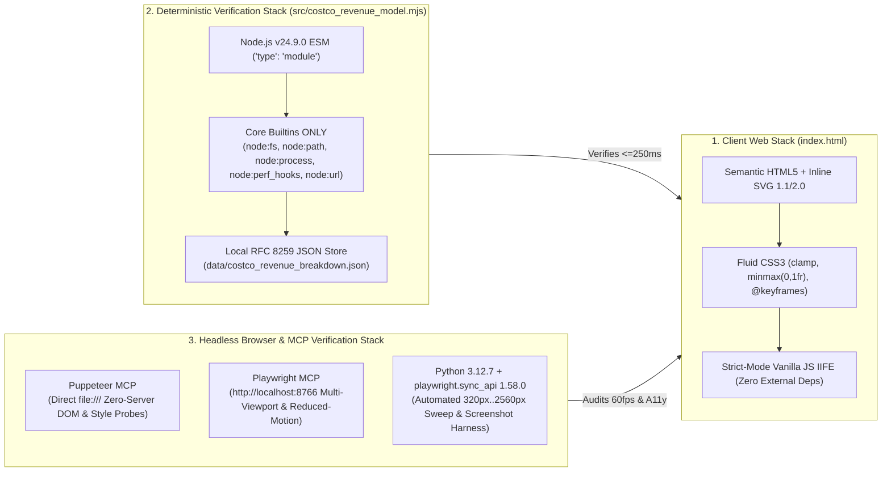

# Stack, API, MCP & Library Usage Guide: Costco Wholesale Corporation (`COST`) Corporate Animated SVG, Halftone/Bayer Dithering, Straightforward English, High-Legibility Polar Graphs & Screen-Size-Agnostic Architecture

**Run ID:** `20261104T004059-606-j6a7`  
**Branch:** `agent/planner-2.3-20261104T004059-606-j6a7`  
**Agent:** `planner-2.3` (Stack, API, MCP & Library Usage Architect)  
**Governing Specifications:** [`functional_specification_005.md`](../../functional_specification_005.md) & [`wayfinder/20261104T004059-606-j6a7/refined-specification.md`](./refined-specification.md)  
**Authoritative Domain Vocabulary:** [`LANGUAGE.md`](../../LANGUAGE.md)  
**Synthesized Upstream Inputs:**
- [`wayfinder/20261104T004059-606-j6a7/installed-libraries.md`](./installed-libraries.md) (`library-installer`)
- [`wayfinder/20261104T004059-606-j6a7/library-functions.md`](./library-functions.md) (`function-mapper`)
- [`wayfinder/20261104T004059-606-j6a7/api-schemas.md`](./api-schemas.md) (`api-schema-mapper`)
- [`wayfinder/20261104T004059-606-j6a7/mcp-tools.md`](./mcp-tools.md) (`mcp-provisioner`)
- [`wayfinder/20261104T004059-606-j6a7/codebase-map.md`](./codebase-map.md) (`codebase-mapper`)  
**Strict Gate Enforced:** **DO NOT CODE YET.** Practical Stack Usage Guide & Implementation Baseline Only.

---

## 1. Executive Framing & Working Baseline Philosophy

> [!IMPORTANT]
> **Working Baseline vs. Immutable SSOT:** This document provides a strong, opinionated, empirically verified starting foundation designed to accelerate downstream coding agents (`implementer-1` through `implementer-5`) and verification agents (`tester-1` through `tester-5`). It synthesizes the exact APIs, MCP tools, libraries, and language patterns verified in this workspace. While all core architectural invariants (`RULE[user_global]`, [`LANGUAGE.md`](../../LANGUAGE.md), zero external runtime network requests, $\le 250\text{ ms}$ CLI latency, $\le 128\text{ MB}$ RSS, and $\le 16\text{ ms}$ browser frame budget) are non-negotiable, implementation details herein serve as an adaptable working baseline that yields to live DOM telemetry, primary-source SEC Form 10-K data conservation, and runtime reality whenever edge cases arise.

### 1.1 Stack Topology Overview



### 1.2 Alignment with [`LANGUAGE.md`](../../LANGUAGE.md) Evaluation Parameters
- **`{errors}` Elimination:** Zero external network calls (`fetch`, `XMLHttpRequest`, external `<script src>`, `<link href>`, or `@import` URLs), zero leaked specification tokens (`{Net Sales}`, `{Membership Fees}`, `{Gross Margin Ceiling}`, `{Operating Income Flywheel}`), zero `//` pseudo-code dividers in visible HTML, zero algebraic/code shorthand (`R_total`, `θ_i`, `&theta;_i`, `Area √r`, `Area &radic;r`, `Linear Radius r`, `wayfinderAudit.valid === true`), zero promotional clichés (`treasure-hunt discretionary basket builder`, `renewal magnet`, `perishable weekly trip driver and rapid inventory-turn engine`, `Negative Working-Capital Float`), and zero prohibited Dreamcore markers.
- **`{correctness}` Enforcement:** Exact conservation of FY2022–FY2024 SEC Form 10-K identities (`$249,625M` `{Net Sales}` + `$4,828M` `{Membership Fees}` = `$254,453M` Total Revenue; `$27,267M` `10.92%` `{Gross Margin Ceiling}` minus `$22,810M` `9.14%` SG&A = `$4,457M` `48.00%` Net Merchandise Profit + `$4,828M` `52.00%` `{Membership Fees}` = `$9,285M` `{Operating Income Flywheel}` $\rightarrow$ `$7,367M` Net Income; `104.15%` AP-to-Inventory coverage).
- **`{functionality}` & `{sufficient}` Readiness:** Every runtime binary, module import, DOM controller signature, and MCP payload is mapped below so implementers can execute without guesswork.

---

## 2. Idiomatic Syntax & Language Patterns

### 2.1 Client-Side Web Platform (`index.html` — HTML5 / CSS3 / Inline SVG / Vanilla JS)

1. **Self-Contained IIFE Architecture & Variable Scoping:**
   - All client-side JavaScript in [`index.html`](../../index.html) (lines `2022–3395`) resides inside a single strict-mode Immediately Invoked Function Expression:
     ```javascript
     (function () {
       "use strict";
       // Inlined primary-source constants, state objects, renderers, and init()
     })();
     ```
   - **Idiomatic Convention:** Match the existing codebase style inside the IIFE—use clean, deterministic functions (`renderPolarCategories`, `renderPolarGeography`, `renderPolarFlywheel`, `setActiveStep`, `renderGaapWaterfall`, `updateSimulator`, `renderTicketInspector`, `initScrollSpy`, `init`), explicit state objects (`catState`, `geoState`, `flyState`, `currentStep`, `selectedGaapYear`, `activeTicketIdx`, `isMotionPaused`), and zero global namespace pollution (`window.*` properties are never mutated).
   - **Prohibition on ` // ` in Visible HTML Strings:** Notice that `src/costco_revenue_model.mjs` (line `1139`) strips `<script>` blocks and then asserts `!htmlWithoutScripts.includes(" // ")` and `!PROHIBITED_PSEUDOCODE_DIVIDER_REGEX.test(resolvedHtml)`. Never use ` // ` as a visual separator in HTML markup or JS template strings that render into the DOM; use ` · ` (`&middot;`) or ` — ` (`&mdash;`) instead.

2. **GPU-Composited SVG Animations & Reduced-Motion Resilience (`AC-01`):**
   - **Idiomatic Pattern:** Drive continuous corporate flow animations (`#svg-corporate-flywheel-hero`, step card micro-schematics `#step-1`..`#step-5`, and polar chart radar/selection rings) using CSS `@keyframes` on `stroke-dashoffset`, `opacity`, and `transform` (with `transform-box: fill-box; transform-origin: center;`), or declarative SVG `<animate>` / `<animateTransform>` tags.
   - **Mandatory Dual-Gate Pause Pattern:** Every animated class MUST respect both `@media (prefers-reduced-motion: reduce)` and the user-controlled root class `html.is-motion-paused` (or `html.animations-paused`):
     ```css
     @keyframes corpFlowDash {
       to { stroke-dashoffset: -48; }
     }
     @keyframes corpNodePulse {
       0%, 100% { opacity: 0.4; transform: scale(1); }
       50% { opacity: 0.88; transform: scale(1.035); }
     }
     .svg-animated-flow {
       stroke-dasharray: 8 6;
       animation: corpFlowDash 2.4s linear infinite;
     }
     .svg-animated-node-halo {
       transform-box: fill-box;
       transform-origin: center;
       animation: corpNodePulse 3.2s ease-in-out infinite;
     }
     @media (prefers-reduced-motion: reduce) {
       .svg-animated-flow,
       .svg-animated-node-halo,
       .polar-sweep-indicator,
       .polar-sector-path {
         animation: none !important;
         transition: none !important;
       }
     }
     html.is-motion-paused .svg-animated-flow,
     html.is-motion-paused .svg-animated-node-halo,
     html.is-motion-paused .polar-sweep-indicator,
     html.animations-paused .svg-animated-flow,
     html.animations-paused .svg-animated-node-halo,
     html.animations-paused .polar-sweep-indicator {
       animation-play-state: paused !important;
       transition: none !important;
     }
     ```

3. **Ordered Bayer Matrix & Halftone Stipple Dithering (`AC-02`):**
   - **Idiomatic Pattern:** Define reusable inline SVG `<pattern>` elements inside a shared `<svg aria-hidden="true" width="0" height="0" style="position:absolute;width:0;height:0;overflow:hidden;">` `<defs>` block at the top of `<body>` (and/or inside polar SVG `<defs>`), paired with decorative CSS `.dither-accent-band` / `.dither-card-header` classes using `radial-gradient` or inline SVG `<pattern>` fills.
   - **Strict Anti-Obscuration Rule:** Dither textures must be purely structural/decorative (header bands, card top plates, polar outer decorative rings, low-opacity sector engraving overlays) and must **never** sit directly behind unbacked body text or table numerals. Every text element must sit on `#FFFFFF` / `#F8FAFC` or carry a `3.5px` white SVG halo (`paint-order: stroke fill; stroke: #FFFFFF; stroke-width: 3.5px; stroke-linejoin: round;`) to guarantee $\ge 4.5:1$ WCAG AA contrast ($\ge 7:1$ for primary metrics).

4. **Screen-Size-Agnostic Fluid CSS3 Architecture (`AC-05`):**
   - Use `clamp(min, preferred, max)` for headings, KPI figures, and section padding.
   - Always use `minmax(0, 1fr)` on CSS Grid tracks (`.corporate-shell`, `.polar-grid-layout`, `.kpi-scorecard-grid`) so wide children (like SVG stages or tables) can shrink below their intrinsic minimum width without pushing `document.documentElement.scrollWidth` past `window.innerWidth`.
   - Wrap all data tables in `.corp-table-wrap { width: 100%; max-width: 100%; overflow-x: auto; -webkit-overflow-scrolling: touch; }`.

### 2.2 Node.js Deterministic Verification Engine (`src/costco_revenue_model.mjs`)

- **Runtime & Module System:** Node.js `v24.9.0` native ES2022 Module (`"type": "module"` in [`package.json`](../../package.json)).
- **Idiomatic Pattern:**
  - Use **only** synchronous Node.js core built-ins (`node:fs`, `node:path`, `node:process`, `node:perf_hooks`, `node:url`) so CLI startup and verification complete in `~13–30 ms` ($\le 250\text{ ms}$ budget).
  - Fail fast (`RULE[user_global]`) with descriptive `new Error(...)` messages identifying the exact file, section, or token whenever an invariant fails. Never swallow exceptions or return partial fallback objects.
  - Support both file-path inputs and in-memory content overrides (`data`/`dataset`, `mapContent`/`mapMarkdown`, `ticketContents`/`tickets`, `researchContent`/`researchMarkdown`, `htmlContent`/`indexHtml`) across all verification functions so unit tests can pass synthetic strings directly.

### 2.3 JSON Dataset Conventions (`data/costco_revenue_breakdown.json`)

- **Idiomatic Pattern:** Strict RFC 8259 JSON with 2-space indentation.
- Preserve all existing keys and numeric values intact; update only `merchandise_categories[].role_in_flywheel` (lines `75`, `94`, `121`, `136`) to replace promotional clichés with plain, factual English anchored to FY2024 SEC Form 10-K figures.

---

## 3. Library & Function Invocation Patterns

### 3.1 Node.js Verification Engine Invocations (`src/costco_revenue_model.mjs`)

#### 1. Core Builtin Initialization
```javascript
import fs from "node:fs";
import path from "node:path";
import process from "node:process";
import { performance } from "node:perf_hooks";
import { fileURLToPath } from "node:url";

const MODULE_DIR = path.dirname(fileURLToPath(import.meta.url));
const DEFAULT_ROOT_DIR = path.resolve(MODULE_DIR, "..");
```

#### 2. Public Programmatic API Call Patterns
All 6 exported functions must maintain 100% backward-compatible signatures and return structures while adding Spec 005 checks:

```javascript
import {
  verifyFinancialDataset,
  verifyWayfinderArtifacts,
  verifyResearchMonograph,
  verifyCorporateWebReport,
  verifyIndexHtml,
  loadAndVerifyCostcoModel
} from "./src/costco_revenue_model.mjs";

// Full end-to-end verification (default workspace paths)
const report = loadAndVerifyCostcoModel({ verifyOnly: true });
// report.status === "VERIFIED"
// report.telemetry.elapsedMs <= 250
// report.telemetry.rssMb <= 128
// report.telemetry.externalNetworkRequests === 0

// Targeted HTML verification (file path or in-memory override)
const webAudit = verifyCorporateWebReport({
  htmlPath: "/path/to/index.html"
});
```

#### 3. Extending `verifyMerchandiseCategories` & `verifyCorporateWebReport` for Spec 005
When adding Spec 005 checks to [`src/costco_revenue_model.mjs`](../../src/costco_revenue_model.mjs):
- In `verifyMerchandiseCategories(categories, netSalesUsdM)` (lines `467–515`):
  ```javascript
  const PROHIBITED_PROMOTIONAL_CLICHES = [
    "treasure-hunt discretionary basket builder",
    "renewal magnet",
    "perishable weekly trip driver and rapid inventory-turn engine",
    "negative working-capital float"
  ];
  // Inside the `for (const cat of categories)` loop:
  const lowerRole = cat.role_in_flywheel.toLowerCase();
  for (const cliche of PROHIBITED_PROMOTIONAL_CLICHES) {
    if (lowerRole.includes(cliche)) {
      throw new Error(
        `Financial dataset validation failed: merchandise_categories[${categoryId}].role_in_flywheel contains prohibited promotional cliché "${cliche}".`
      );
    }
  }
  ```
- In `verifyCorporateWebReport(rawOptions)` (lines `1013–1200`):
  - Check `lowerHtml` against `PROHIBITED_PROMOTIONAL_CLICHES`.
  - Check `resolvedHtml` against prohibited algebraic/code shorthand (`"R_total"`, `"OpInc ($9,285M) = Merch Contrib"`, `"Area √r"`, `"Area &radic;r"`, `"Linear Radius r"`, `"Share Angle θ_i"`, `"Share Angle &theta;_i"`, `"wayfinderAudit.valid === true"`).
  - Verify presence of corporate animated SVG hooks (`#svg-corporate-flywheel-hero`, `prefers-reduced-motion: reduce`), dither `<pattern` definitions, plain-English note boxes (`.plain-english-note`, `.chart-reading-note`), high-legibility SVG halo rules (`paint-order: stroke fill` or `paint-order:stroke fill`), and responsive CSS tokens (`clamp(`, `minmax(0, 1fr)`).

---

### 3.2 Browser DOM, SVG Geometry, Motion & Keyboard A11y Invocations (`index.html`)

#### 1. SVG Animation Pause/Resume Invocation Pattern
> [!WARNING]
> **Critical SVG DOM API Gotcha:** In the standard browser DOM, `pauseAnimations()` and `unpauseAnimations()` are methods on the root **`SVGSVGElement` (`<svg>`)**, **NOT** on child `<animate>` or `<animateTransform>` elements! Calling `anim.pauseAnimations()` on `<animate>` elements is a no-op because `typeof anim.pauseAnimations` is `"undefined"` on `SVGAnimateElement`. Always query `document.querySelectorAll("svg")` to invoke `svgEl.pauseAnimations()` / `svgEl.unpauseAnimations()`.

```javascript
var isMotionPaused = false;

function setMotionPaused(paused) {
  isMotionPaused = Boolean(paused);
  document.documentElement.classList.toggle("is-motion-paused", isMotionPaused);
  document.documentElement.classList.toggle("animations-paused", isMotionPaused);

  var btn = document.getElementById("btn-toggle-animation") || document.getElementById("motion-toggle-btn");
  if (btn) {
    btn.setAttribute("aria-pressed", isMotionPaused ? "true" : "false");
    btn.textContent = isMotionPaused ? "Resume Animations" : "Pause Animations";
  }

  var svgs = document.querySelectorAll("svg");
  for (var i = 0; i < svgs.length; i++) {
    if (isMotionPaused && typeof svgs[i].pauseAnimations === "function") {
      svgs[i].pauseAnimations();
    } else if (!isMotionPaused && typeof svgs[i].unpauseAnimations === "function") {
      svgs[i].unpauseAnimations();
    }
  }
}
```

#### 2. Collision-Free Polar Ring & Sector Label Invocation Pattern (`AC-04`)
- Set `viewBox="-80 -44 560 488"` on `#svg-polar-categories`, `#svg-polar-geography`, and `#svg-polar-flywheel` (with center at `cx = 200, cy = 200` and center hub radius `rInner = 42`).
- Pass an explicit `labelAngleDeg` to `renderPolarRingLabels(cx, cy, maxR, ringLabels, rBase, labelAngleDeg)`:
  - In `#polar-chart-categories` when `catState.mode === "angle"` (`By Revenue Share (Angle)`), sector 0 spans `0°..146.3°` (`midDeg = 73.2°`), sector 1 spans `146.3°..238.6°` (`midDeg = 192.5°`), sector 2 spans `238.6°..310.7°` (`midDeg = 274.6°`), and sector 3 spans `310.7°..360°` (`midDeg = 335.3°`).
  - Passing `labelAngleDeg = 28` (approx. 1 o'clock) in `angle` mode and `labelAngleDeg = 0` (12 o'clock) in `sqrt` / `linear` 90°-sector modes ensures radial ring scale labels (`25%`, `50%`, `75%`, `100% Share`) never collide with any `.polar-sector-label`.

#### 3. Interactive Companion Table Row & Roving Tab Keyboard Pattern (`AC-05`)
> [!CAUTION]
> **DOM Re-Render Focus Loss Gotcha:** In `index.html`, calling `renderPolarCategories()` or `renderPolarGeography()` overwrites `tbody.innerHTML = rowsHtml`. If a user presses `Enter` or `Space` on `<tr data-cat-row="1" tabindex="0">`, the original `<tr>` DOM node is destroyed and replaced during `renderPolarCategories()`. You MUST re-query the newly rendered row (`tbody.querySelector('[data-cat-row="' + idx + '"]')`) and call `.focus({ preventScroll: true })` **after** `renderPolarCategories()` finishes!

```javascript
function bindInteractiveTableRows(tbody, attrName, onSelect) {
  if (!tbody) return;
  var rows = tbody.querySelectorAll("[" + attrName + "]");
  for (var i = 0; i < rows.length; i++) {
    rows[i].setAttribute("tabindex", "0");
    rows[i].setAttribute("role", "button");
    rows[i].setAttribute("aria-selected", rows[i].classList.contains("is-highlighted") ? "true" : "false");
    rows[i].addEventListener("click", function () {
      var idx = Number(this.getAttribute(attrName));
      onSelect(idx, false);
    });
    rows[i].addEventListener("keydown", function (evt) {
      var idx = Number(this.getAttribute(attrName));
      if (evt.key === "Enter" || evt.key === " " || evt.key === "Spacebar") {
        evt.preventDefault();
        onSelect(idx, true);
      } else if (evt.key === "ArrowDown" || evt.key === "ArrowRight") {
        evt.preventDefault();
        onSelect((idx + 1) % rows.length, true);
      } else if (evt.key === "ArrowUp" || evt.key === "ArrowLeft") {
        evt.preventDefault();
        onSelect((idx - 1 + rows.length) % rows.length, true);
      }
    });
  }
}

// Inside renderPolarCategories() after tbody.innerHTML = rowsHtml:
bindInteractiveTableRows(tbody, "data-cat-row", function (idx, isKeyboard) {
  catState.selectedIndex = idx;
  renderPolarCategories();
  if (isKeyboard) {
    var newRow = tbody.querySelector('[data-cat-row="' + idx + '"]');
    if (newRow && typeof newRow.focus === "function") {
      newRow.focus({ preventScroll: true });
    }
  }
});
```

---

### 3.3 Python Headless Browser & Multi-Viewport Verification (`playwright 1.58.0`)

- **Executable Path:** `/Users/diesel/Desktop/Costco/.sandcastle/bin/python3` (`Python 3.12.7` with `playwright 1.58.0`, `numpy 1.26.4`, `pandas 2.3.3`, `scipy 1.12.0`).
- **Initialization & Teardown Rules:**
  - Always use the `with sync_playwright() as p:` context manager so Chromium processes are deterministically closed even on assertion failure.
  - Load local files via `Path("index.html").resolve().as_uri()` (`file:///...`) so zero HTTP server setup or network traffic is required during Python script execution.
  - Attach `page.on("console", ...)` and `page.on("pageerror", ...)` before `page.goto(...)` to capture any uncaught runtime errors.
  - Explicitly call `context.close()` and `browser.close()` before exiting.

---

## 4. API & MCP Tool Invocation Patterns

### 4.1 Zero-Network Runtime Boundary & Offline Data Contract (`api-schemas.md`)

1. **Strict Runtime Prohibition:** Neither [`index.html`](../../index.html) nor [`src/costco_revenue_model.mjs`](../../src/costco_revenue_model.mjs) may invoke external network APIs (`https://data.sec.gov/...`, Google Fonts, CDN scripts, or external images).
2. **Primary-Source Data Synchronization:** [`data/costco_revenue_breakdown.json`](../../data/costco_revenue_breakdown.json) and the inlined JS constants in [`index.html`](../../index.html) (`CATEGORY_DATA`, `GEOGRAPHY_DATA`, `FLYWHEEL_ASYMMETRY_DATA`, `ANCILLARY_ROSE_DATA`, `GAAP_BY_YEAR`, `STEP_SUMMARIES`, `WAYFINDER_TICKETS`) are pre-reconciled against Costco Wholesale Corporation's FY2024 SEC Form 10-K (`CIK: 0000909832`, Accession `0000909832-24-000049`).

### 4.2 MCP Server Tool Invocations (`mcp-tools.md`)

Two headless browser MCP servers are active and verified for interactive inspection during Stage 3 (`implementer-1..5`) and Stage 4 (`tester-1..5`):

#### 1. `puppeteer` MCP Server (Zero-Server `file:///` Inspection)
- **Best For:** Instantaneous zero-server `file:///` navigation, DOM queries, computed style assertions, and selector screenshots.
- **Exact Invocation Sequence:**
  ```json
  {
    "ServerName": "puppeteer",
    "ToolName": "puppeteer_navigate",
    "Arguments": {
      "url": "file:///Users/diesel/Desktop/Costco/.sandcastle/worktrees/<active-worktree>/index.html"
    }
  }
  ```
  Followed by `puppeteer_evaluate` (note: wrap return objects in `console.log(JSON.stringify(...))` so structured telemetry is captured in the tool output):
  ```json
  {
    "ServerName": "puppeteer",
    "ToolName": "puppeteer_evaluate",
    "Arguments": {
      "script": "console.log(JSON.stringify({ scrollWidth: document.documentElement.scrollWidth, innerWidth: window.innerWidth, patterns: document.querySelectorAll('svg defs pattern').length }))"
    }
  }
  ```

#### 2. `playwright` MCP Server (Multi-Viewport, Reduced-Motion & A11y Inspection)
- **Protocol Requirement:** The `playwright` MCP server blocks `file:///` URLs by default. Start a local Python HTTP daemon in the worktree root (`python3 -m http.server 8766 --directory /path/to/worktree` with `IsDaemon: true`) before calling `browser_navigate` to `http://localhost:8766/index.html`.
- **Key Tool Payloads:**
  - **Viewport Resize (`browser_resize`):** `{"width": 320, "height": 700}` (sweep across `320`, `390`, `768`, `1024`, `1440`, `1920`, `2560`).
  - **Reduced-Motion Emulation (`browser_emulate_media`):** `{"reducedMotion": "reduce"}` (reset with `{"reducedMotion": "no-preference"}`).
  - **DOM & Bounding-Box Evaluation (`browser_evaluate`):** Pass an arrow function string `"() => { ... }"`.
  - **Screenshot Capture (`browser_take_screenshot`):** `{"scale": "css", "fullPage": false, "filename": "viewport-390px.png"}`.
  - **Zero Error / Zero External Network Check:** Call `browser_console_messages` (`{"level": "error"}`) and `browser_network_requests` (`{"static": true, "all": true}`) to confirm only `localhost` requests occurred.

---

## 5. Edge-Case Gotchas & Pitfalls Checklist

| # | Subsystem | Gotcha / Subtle Pitfall | Required Mitigation Pattern |
| :- | :--- | :--- | :--- |
| **1** | **`src/costco_revenue_model.mjs` Full-File String Scan** | `verifyCorporateWebReport` checks `resolvedHtml.includes(...)` across the **entire** HTML file, including `<script>` blocks (except for `" // "` which strips `<script>`). In [`index.html`](../../index.html), `R_total` appears both in HTML markup (L1351) AND inside `WAYFINDER_TICKETS[0].summary` in `<script>` (L2283); `θ_i` appears as `&theta;_i` in HTML (L1369, L1397) and as `θ_i` in `<script>` (L2518); `OpInc` appears in HTML and `<script>` strings (L2307, L2656, L2785, L2787, L2792, L2954, L3100). | Scrub prohibited shorthand (`R_total`, `θ_i`, `&theta;_i`, `Area √r`, `Area &radic;r`, `Linear Radius r`, `wayfinderAudit.valid === true`) from **both** static HTML markup and `<script>` data/caption literals. |
| **2** | **SVG `pauseAnimations()` Target Element** | `refined-specification.md` §4.1 showed a sketch calling `pauseAnimations()` on `svg animate, svg animateTransform` nodes. In browser DOM specs, `pauseAnimations()` only exists on `<svg>` (`SVGSVGElement`), not on `<animate>`. | Always iterate `document.querySelectorAll("svg")` to call `svg.pauseAnimations()` / `svg.unpauseAnimations()`, AND toggle `html.is-motion-paused` / `html.animations-paused` to pause CSS `@keyframes`. |
| **3** | **Table Row Keyboard Focus Lost on Re-Render** | Clicking or pressing `Enter`/`Space` on `[data-cat-row]` or `[data-geo-row]` triggers `renderPolarCategories()` / `renderPolarGeography()`, which replaces `tbody.innerHTML`, destroying the focused `<tr>` node. | In the `onSelect(idx, isKeyboard)` callback, after calling `renderPolar*()`, re-select `tbody.querySelector('[data-cat-row="' + idx + '"]')` and call `.focus({ preventScroll: true })`. |
| **4** | **Polar Ring Scale vs. Sector Label Collision in `angle` Mode** | In `#polar-chart-categories`, `renderPolarRingLabels` defaults to `0°` (`x = cx + 4, y = cy - r + 10`), which can collide with sector labels when angles shift in `By Revenue Share (Angle)` mode. | Expand `viewBox` to `"-80 -44 560 488"`, increase center hub to `r="42"`, apply `3.5px` white halo (`paint-order: stroke fill`), and offset ring scale labels to `angleDeg = 28` in `angle` mode. |
| **5** | **Dual-Ring Flywheel Inner Label Crowding** | In `#polar-chart-flywheel` (`asymmetry` mode, L2784–2787), raw text overlays `Fees OpInc` and `Merch OpInc` use shorthand and sit directly on the ring. | Replace with plain-English high-contrast pill callouts (`52.0% Fee Profit`, `48.0% Merch Profit`) and add a dedicated `.polar-html-legend` and `.chart-reading-note` below the SVG stage. |
| **6** | **320px Mobile Horizontal Overflow (`scrollWidth > innerWidth`)** | Long unbroken strings in `.executive-equation-banner`, `.ctrl-group` buttons, or wide `.corp-table` elements can push `scrollWidth > 320px` on compact mobile viewports. | Apply `minmax(0, 1fr)` on all grid columns, `flex-wrap: wrap` on `.ctrl-group` and `.executive-equation-banner`, `overflow-wrap: anywhere` on long labels, and `.corp-table-wrap { overflow-x: auto; max-width: 100%; }`. |
| **7** | **Wayfinder Link Label Rule (`isBareTicketLabel`)** | `verifyWayfinderArtifacts` rejects any Markdown link to `ticket-001.md..ticket-006.md` whose label is `< 10` chars or matches a bare ticket ID/filename (`[ticket-006.md](...)`). | Whenever updating [`wayfinder/map.md`](../../wayfinder/map.md) or [`wayfinder/tickets/ticket-006.md`](../../wayfinder/tickets/ticket-006.md), always use full descriptive human-readable titles inside `[Descriptive Title](./tickets/ticket-006.md)`. |
| **8** | **Single-Pass Verification & GPU Memory Discipline (`planner-2.4` Alignment)** | Re-parsing HTML/CSS multiple times in `verifyCorporateWebReport()` or using `<feTurbulence>` / `<feDropShadow>` SVG filters at `2560px` degrades CLI latency and GPU memory. | Reuse the existing `lowerHtml`, `declaredIds` Set, and `combinedCss` strings inside `verifyCorporateWebReport()` (`~15–25 ms` total CLI time), and use a single shared `<svg aria-hidden="true" width="0" height="0"><defs><pattern>...</pattern></defs></svg>` atlas with native `paint-order: stroke fill` text halos instead of `<filter>` shaders. |

