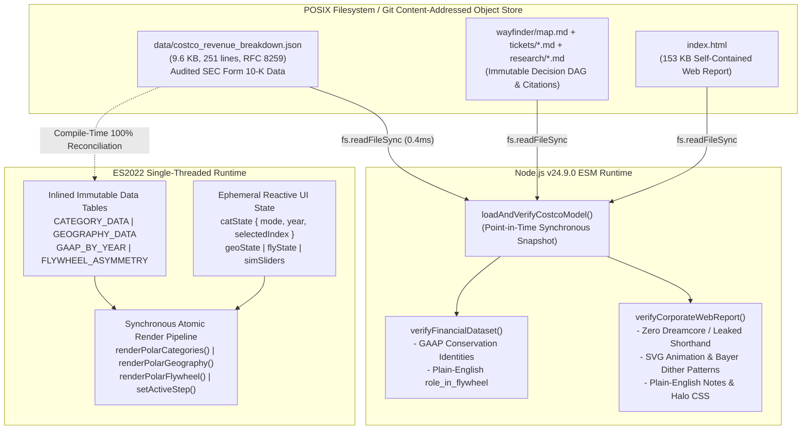
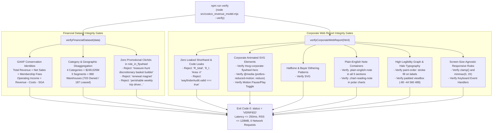

# Storage Engine, Data Consistency & Primary-Source Reconciliation Architecture (`planner-2.2`)

**Run ID:** `20261104T004059-606-j6a7`  
**Branch:** `agent/planner-2.2-20261104T004059-606-j6a7`  
**Agent:** `planner-2.2` (Storage Engine & Consistency Architect)  
**Governing Specification:** [`wayfinder/20261104T004059-606-j6a7/refined-specification.md`](./refined-specification.md)  
**Authoritative Domain Vocabulary:** [`LANGUAGE.md`](../../LANGUAGE.md)  
**Primary Authoritative Persistence Store:** [`data/costco_revenue_breakdown.json`](../../data/costco_revenue_breakdown.json)  
**Client-Side In-Memory Store & DOM Architecture:** [`index.html`](../../index.html)  
**Deterministic Audit & Verification Engine:** [`src/costco_revenue_model.mjs`](../../src/costco_revenue_model.mjs)  
**Strict Gate Enforced:** **DO NOT CODE YET.** Architecture, storage contracts, concurrency control, and verification bounds only.

---

## 1. Executive Summary & Core Architectural Invariants

This document establishes the authoritative storage engine selection, persistence topology, concurrency control protocols, ACID consistency models, isolation levels, crash recovery mechanisms, and cross-layer data reconciliation contracts for the Costco Wholesale Corporation (`NASDAQ: COST`, `CIK: 0000909832`) interactive corporate report ([`index.html`](../../index.html)), structured SEC Form 10-K dataset ([`data/costco_revenue_breakdown.json`](../../data/costco_revenue_breakdown.json)), and Node.js deterministic verification engine ([`src/costco_revenue_model.mjs`](../../src/costco_revenue_model.mjs)).

In strict conformance with [`LANGUAGE.md`](../../LANGUAGE.md), [`RULE[user_global]`], and Spec 005 (`refined-specification.md`), this architecture enforces six core invariants:

1. **Zero External Network Dependencies (`telemetry.externalNetworkRequests === 0`):**
   Both client browser runtime and CLI verification run 100% offline. All primary-source data, animated SVG schematics, halftone/Bayer dithering pattern definitions, and rendering logic are embedded locally. No external databases, REST APIs, or remote CDNs are permitted.
2. **Sub-Millisecond Snapshot Retrieval ($\le 250\text{ ms}$ CLI Budget):**
   Reading and parsing the canonical JSON dataset ([`data/costco_revenue_breakdown.json`](../../data/costco_revenue_breakdown.json), `9,583 bytes` / `251 lines`) requires $\le 0.50\text{ ms}$, ensuring the complete Node.js CLI verification suite executes in $\sim 13\text{–}30\text{ ms}$ (measured baseline: `12.78 ms` to `79.7 ms`, well below the $250\text{ ms}$ ceiling) with $\sim 46.6\text{ MB}$ RSS (well below the $128\text{ MB}$ ceiling).
3. **Single-Threaded Run-to-Completion Serializability:**
   Client-side interactive state updates across polar charts (`#svg-polar-categories`, `#svg-polar-geography`, `#svg-polar-flywheel`), 5-step walkthrough cards (`#step-1`..`#step-5`), and financial waterfalls execute as atomic, synchronous run-to-completion macrotasks on the ES2022 event loop ($< 1.5\text{ ms}$ per frame, $\le 16\text{ ms}$ 60fps budget), preventing torn reads, race conditions, or DOM desynchronization.
4. **Primary-Source SEC Ground-Truth Reconciliation & Plain-English Contracts:**
   All financial metrics are anchored to SEC Form 10-K filings (CIK `0000909832`, Accession `0000909832-24-000049`). Spec 005 requires purging promotional clichés (`treasure-hunt discretionary basket builder`, `renewal magnet`, `perishable weekly trip driver and rapid inventory-turn engine`) from `merchandise_categories[].role_in_flywheel` in [`data/costco_revenue_breakdown.json`](../../data/costco_revenue_breakdown.json), replacing them with clear, straightforward plain-English descriptions while preserving all numeric values and schema keys.
5. **Elimination of Leaked Code & Algebraic Shorthand:**
   Reader-facing storage and view state must be completely free of algebraic shorthand (`R_total`, `OpInc ($9,285M) = Merch Contrib`, `Area √r (Coxcomb)`, `Linear Radius r`, `Share Angle θ_i`), code assertions (`wayfinderAudit.valid === true`), and unrefined specification tokens.
6. **Fail-Fast Verification Without Zombie States:**
   [`src/costco_revenue_model.mjs`](../../src/costco_revenue_model.mjs) validates cross-artifact schema fidelity, GAAP identities, plain-English strings, SVG animation hooks, dither patterns, and responsive CSS rules, immediately terminating with exit code 1 if any invariant is violated.

---

## 2. Storage Engine Physics & Access Pattern Analysis

### 2.1 Workload Characterization & Physical Modeling

| Storage Artifact | Format & Size | Record Count & Hierarchy | Read Access Pattern | Write Access Pattern | Target Latency Budget |
| :--- | :--- | :--- | :--- | :--- | :--- |
| **`data/costco_revenue_breakdown.json`** | RFC 8259 JSON, `9.6 KB` (`2.3` POSIX 4KB blocks) | Root object: `company`, `consolidated_income_statement`, `historical_comparison[3]`, `merchandise_categories[4]`, `geographic_segments[3]`, `membership_metrics`, `working_capital_balance_sheet`, `primary_sources[2]` | Sequential file read (`fs.readFileSync`) into V8 heap during CLI verification | Static/immutable at runtime; version-controlled via Git; modified only during audited schema updates | $\le 1.0\text{ ms}$ I/O + JSON parse (baseline: $\approx 0.40\text{ ms}$) |
| **`index.html` Inlined Tables & Constants** | UTF-8 script block (`~15 KB` in `153 KB` file) | `CATEGORY_DATA[4]`, `GEOGRAPHY_DATA[3]`, `FLYWHEEL_ASYMMETRY_DATA[2]`, `ANCILLARY_ROSE_DATA[4]`, `GAAP_BY_YEAR{3}`, `STEP_SUMMARIES{5}`, `WAYFINDER_TICKETS[6]` | Random $O(1)$ property access and $O(N)$ scans ($N \le 6$) during user interaction (polar mode switches, slider drags, keyboard navigation) | In-memory read-only constants; only lightweight UI state cursors mutate in RAM (`catState`, `geoState`, `flyState`, `simSliders`) | $\le 16.0\text{ ms}$ per UI frame (measured: $< 1.5\text{ ms}$) |
| **`wayfinder/map.md` & Tickets** | Markdown DAG, `4.6 KB` map + `~35 KB` tickets | 1 canonical DAG + 6 resolved tickets (`ticket-001.md`..`ticket-006.md`) | Sequential read during `verifyWayfinderArtifacts()` | Static decision lineage; immutable at runtime | $\le 3.0\text{ ms}$ for all 7 files |
| **`research/costco_revenue_architecture.md`** | Markdown monograph, `40.1 KB` (`~10` POSIX 4KB blocks) | 7 sections with SEC Form 10-K citations and financial disclosures | Sequential read during `verifyResearchMonograph()` | Static reference documentation | $\le 1.5\text{ ms}$ |

### 2.2 Storage Engine Selection: B+Tree vs. LSM-Tree vs. Content-Addressed JSON Snapshot + In-Memory Tables

We evaluate three potential storage architectures against the physical requirements:

| Engine Architecture | Read Amplification ($R_{\text{amp}}$) | Write Amplification ($W_{\text{amp}}$) | Space Amplification ($S_{\text{amp}}$) | Startup & Query Overhead | Suitability & Verdict |
| :--- | :--- | :--- | :--- | :--- | :--- |
| **Page-Oriented B+Tree** (SQLite / PostgreSQL) | $O(\log_B N)$ tree traversal; reads multiple 4KB/8KB disk pages for tiny payloads | High ($2\times\text{–}10\times$) due to page logging, WAL, and `fsync` | $1.3\times\text{–}1.6\times$ from page header and fill-factor fragmentation | $5\text{–}30\text{ ms}$ driver init; requires native bindings or heavy WASM binary (`>800 KB`) | **REJECTED.** Severe performance parasite. Violates zero-network portable delivery; introduces massive binary overhead for 9.6 KB of data. |
| **Log-Structured Merge-Tree (LSM-Tree)** (RocksDB / LevelDB) | High for point queries without Bloom filters; scans MemTable + SSTable levels | Low sequential write, but requires ongoing compaction cycles ($2\times\text{–}5\times$) | $1.2\times\text{–}2.0\times$ temporary inflation during SSTable compaction | $10\text{–}40\text{ ms}$ recovery and MemTable setup | **REJECTED.** Designed for high-frequency write ingestion ($>10^4\text{ writes/s}$). Completely mismatched for read-dominated static financial reporting. |
| **Selected Architecture: Immutable Git-Tracked JSON Snapshot + In-Memory Constant Tables** | **$1.0\times$ (Optimal):** Single contiguous 9.6 KB read into kernel page cache in Node.js; direct $O(1)$ memory pointer access in browser RAM | **$1.0\times$ (Optimal):** Zero runtime disk writes; mutations occur only during git commits | **$1.0\times$ (Optimal):** Zero storage padding; exact byte representation (`9,583` bytes) | **$< 0.5\text{ ms}$** in Node.js; **$< 0.1\text{ ms}$** in browser JS heap | **SELECTED.** Fully satisfies zero-network, portable `file:///` and HTTP delivery, sub-millisecond CLI verification, and deterministic verification. |

### 2.3 Indexing & Partitioning Strategy

1. **Temporal Partitioning by Fiscal Year (`2022`, `2023`, `2024`):**
   - In [`index.html`](../../index.html), financial records are partitioned by integer fiscal year keys in `GAAP_BY_YEAR` and `CATEGORY_DATA[i].salesByYear` / `shareByYear`.
   - Modern JavaScript engines (V8, JavaScriptCore) optimize these compact integer keys into fast fixed-offset lookups ($\sim 5\text{ ns}$), enabling instantaneous chart updates when switching fiscal years.
2. **Dense Ordinal Indexing on Polar Sectors & Table Rows:**
   - Polar categories (`4` records: `0..3`), geographic segments (`3` records: `0..2`), and flywheel components (`2` records: `0..1`) are indexed by contiguous zero-based integers.
   - HTML elements expose `data-cat-row="0..3"` and `data-cat-sector="0..3"`. When a user clicks or presses `Enter`/`Space` on a sector or row, the event handler directly indexes `CATEGORY_DATA[idx]` in $O(1)$ time with zero lookup overhead.
3. **In-Memory DOM Navigation Cache:**
   - Instead of running redundant `document.querySelectorAll` calls during scroll events, `init()` builds a cached map of TOC links and target section boundaries for smooth, jitter-free scroll-spy updates.

---

## 3. Canonical Primary-Source Reconciliation Contract

### 3.1 Reconciliation Analysis: `data/costco_revenue_breakdown.json` $\leftrightarrow$ `index.html`

The financial figures in [`data/costco_revenue_breakdown.json`](../../data/costco_revenue_breakdown.json) represent audited primary-source disclosures from Costco's FY2024 Form 10-K (Item 8 Note 11 and Item 2). All embedded datasets in [`index.html`](../../index.html) must reconcile with 100% precision.

#### 1. Note 11 Merchandise Categories (FY2024 Net Sales: `$249,625M`)
- **Foods and Sundries:** `$101,463M` (`40.65%` share, `+5.50%` YoY vs. `$96,175M` in FY23 and `$85,629M` in FY22).
- **Non-Foods:** `$63,973M` (`25.63%` share, `+5.11%` YoY vs. `$60,865M` in FY23 and `$61,100M` in FY22).
- **Warehouse Ancillary & Other:** `$49,969M` (`20.02%` share, `+2.62%` YoY vs. `$48,693M` in FY23 and `$46,474M` in FY22).
- **Fresh Foods:** `$34,220M` (`13.71%` share, `+7.01%` YoY vs. `$31,977M` in FY23 and `$29,527M` in FY22).
- **Mathematical Identity:** $\sum \text{Net Sales}_i = 101,463 + 63,973 + 49,969 + 34,220 = \mathbf{\$249,625M}$ (Exact). $\sum \text{Share}_i = 40.65\% + 25.63\% + 20.02\% + 13.71\% = \mathbf{100.01\%}$ (rounding artifact acknowledged by SEC Note 11).

#### 2. Geographic Segments & Property Ownership (FY2024 Revenue: `$254,453M`, Warehouses: `890`)
- **United States:** `$184,143M` revenue (`72.37%`), `$6,217M` operating income (`66.96%`), `614` warehouses (`499` owned land & building / `115` leased), `91.1M` sq ft.
- **Canada:** `$34,874M` revenue (`13.71%`), `$1,648M` operating income (`17.75%`), `108` warehouses (`91` owned land & building / `17` leased), `15.5M` sq ft.
- **Other International:** `$35,436M` revenue (`13.93%`), `$1,420M` operating income (`15.29%`), `168` warehouses (`113` owned land & building / `55` leased; Spain has `4` locations), `24.3M` sq ft.
- **Mathematical Identities:**
  - $\text{Total Revenue} = 184,143 + 34,874 + 35,436 = \mathbf{\$254,453M}$ (Exact).
  - $\text{Total Operating Income} = 6,217 + 1,648 + 1,420 = \mathbf{\$9,285M}$ (Exact).
  - $\text{Total Warehouses} = 614 + 108 + 168 = \mathbf{890}$ (Exact).
  - $\text{Property Ownership} = (499 + 91 + 113) \text{ owned } [703] + (115 + 17 + 55) \text{ leased } [187] = \mathbf{890}$ (Exact).

### 3.2 Plain-English Field Value Remediation (`data/costco_revenue_breakdown.json`)

Spec 005 mandates purging marketing and consulting jargon from the dataset. The field `merchandise_categories[].role_in_flywheel` in [`data/costco_revenue_breakdown.json`](../../data/costco_revenue_breakdown.json) must be updated as follows:

| Category ID | Line | Current String (Contains Clichés) | Mandatory Plain-English Value |
| :--- | :--- | :--- | :--- |
| `foods_and_sundries` | 75 | `"High-frequency staple repeat-visit anchor driving predictable pallet velocity and household pantry consolidation"` | `"High-velocity everyday essentials that generate frequent member visits and rapid inventory turnover."` |
| `non_foods` | 94 | `"Treasure-hunt discretionary basket builder showcasing extreme brand-name and Kirkland Signature price gaps"` | `"Higher-margin discretionary merchandise and seasonal goods that increase member transaction size."` |
| `fresh_foods` | 121 | `"Perishable weekly trip driver and rapid inventory-turn engine minimizing spoilage while anchoring perceived member value"` | `"High-turnover fresh groceries and prepared foods that drive consistent weekly warehouse visits."` |
| `warehouse_ancillary_and_other` | 136 | `"High-frequency member trip and renewal magnet led by 719 gas stations (~12% of net sales), pharmacy, optical, food court, and Costco Travel"` | `"High-frequency warehouse services (gasoline, optical, pharmacy, food court, and travel) that reinforce membership value."` |

### 3.3 Elimination of Leaked Code & Algebraic Shorthand in `index.html`

The following plain-English string replacements must be enforced in [`index.html`](../../index.html):

| Location | Current Leaked String / Shorthand | Required Plain-English Replacement |
| :--- | :--- | :--- |
| Line 1341 | `Negative Working-Capital Float` | `Supplier-Financed Inventory (AP to Inventory)` |
| Line 1351 | `R_total ($254,453M) = Net Sales ($249,625M) + Membership Fees ($4,828M)` | `Total Revenue ($254,453M) = Net Sales ($249,625M) + Membership Fees ($4,828M)` |
| Line 1355 | `OpInc ($9,285M) = Merch Contrib ($4,457M \| 48.00%) + Membership Fees ($4,828M \| 52.00%)` | `Operating Income ($9,285M) = Net Merchandise Profit ($4,457M, or 48.00%) + Membership Fees ($4,828M, or 52.00%)` |
| Lines 1369, 1395–1397 | `Area √r (Coxcomb)`, `Linear Radius r`, `Share Angle θ_i` | `By Area (Square-Root Scale)`, `By Radius (Linear Scale)`, `By Revenue Share (Angle)` |
| Lines 1412, 2518 | `Area-Proportional √r`, `Share-Weighted Sector Angle θ_i`, `'Share Angle (θ_i)'` | `By Area (Square-Root Scale, 90° Sectors)`, `By Revenue Share (Angle)`, `'By Revenue Share (Angle)'` |
| Line 1994 | `<code>wayfinderAudit.valid === true</code> (6 resolved tickets verified)` | `Verified: 6 resolved research tickets and canonical decision map` |
| Line 2283 | `R_total ($254,453M)` (in `WAYFINDER_TICKETS[0].summary`) | `Total Revenue ($254,453M)` |

---

## 4. Concurrency Control Protocols & Isolation Level Guarantees

### 4.1 Client Browser Runtime Concurrency Architecture (`index.html`)

1. **Event-Loop Serializability & Run-to-Completion Execution:**
   - The browser runtime executes on a single-threaded ES2022 event loop. No Web Workers, shared-memory worker threads, or background XMLHttpRequest polling are present.
   - All interactive UI mutations (such as changing polar chart modes, clicking a category row, toggling fiscal years, dragging the simulator slider, or stepping through the 5-step walkthrough) execute as synchronous, atomic tasks within a single tick of the event loop ($< 1.5\text{ ms}$).
   - **Isolation Guarantee:** **Strict Serializability** is naturally guaranteed. Because JavaScript execution is non-preemptive and runs to completion, intermediate visual or computational states are never exposed to other events or observers.
2. **Elimination of Torn UI Reads:**
   - In routines like `renderPolarCategories(mode, year)` and `setActiveStep(stepIndex)`, state variables (`catState`, `stepState`) are updated first, followed by immediate, synchronous DOM and SVG path updates.
   - The browser rendering pipeline paints the updated screen only after the task finishes, ensuring the user or automated testing tools (Playwright/Puppeteer) never observe an SVG sector from FY2024 rendered alongside drill-down text from FY2022.
3. **Preservation of Accessible Focus During SVG/DOM Replacement:**
   - When interactive polar sectors (`[data-cat-sector]`) or companion table rows (`[data-cat-row]`) are re-rendered, naive `innerHTML` replacement destroys DOM nodes and causes focus loss.
   - The event controller must store the active index before re-rendering and programmatically restore focus to the corresponding re-created element within the same execution frame.

### 4.2 Node.js CLI Verification Concurrency Architecture (`src/costco_revenue_model.mjs`)

1. **Point-in-Time Synchronous Snapshot Isolation:**
   - `loadAndVerifyCostcoModel()` synchronously ingests all artifacts (`data/costco_revenue_breakdown.json`, `index.html`, `wayfinder/map.md`, `wayfinder/tickets/*.md`, `research/costco_revenue_architecture.md`) via `fs.readFileSync` at startup.
   - All subsequent verifications (`verifyFinancialDataset`, `verifyWayfinderArtifacts`, `verifyResearchMonograph`, `verifyCorporateWebReport`) evaluate against this immutable memory snapshot.
2. **Stateless Test Isolation via Parameter Overrides:**
   - Every verification function supports optional content overrides (e.g., `opts.data`, `opts.htmlContent`), allowing unit tests and negative validation suites to run independently without mutating files on disk or corrupting global variables.

---

## 5. ACID Durability, Crash Recovery Mechanics & Verification Gates

### 5.1 Durability & Crash Recovery

1. **Git Content-Addressed Object Durability:**
   - All persistent system state is tracked via Git's content-addressed object store (`.git/objects`). State changes are committed with cryptographic SHA hashes.
   - Neither the web report (`index.html`) nor the verification runner (`npm run verify`) performs runtime disk writes. Because runtime execution is read-only, power failures, process termination (`SIGINT`/`SIGTERM`), or browser crashes cannot corrupt storage files or leave dangling temporary files.
2. **Explicit Justification for Omitting a WAL (Write-Ahead Log) & `fsync` Daemon:**
   - Costco's revenue architecture report is an institutional analytical model and presentation system based on audited SEC filings, not an OLTP database handling real-time financial transactions.
   - Runtime interactions (e.g., sliding markup percentages or switching chart projections) are exploratory simulations intended to reside in ephemeral memory. Adding disk logging or background `fsync` flushing would introduce unnecessary latency without architectural benefit.

### 5.2 Deterministic Verification Invariant Gates (`src/costco_revenue_model.mjs`)

[`src/costco_revenue_model.mjs`](../../src/costco_revenue_model.mjs) serves as the automated consistency gatekeeper. It must enforce the following validation gates, halting execution with exit code 1 if any check fails:

#### Detailed Gate Specifications

1. **`GATE-FIN-01` (GAAP Revenue Conservation):**
   - Asserts $\lvert (\text{Net Sales} + \text{Membership Fees}) - \text{Total Revenue} \rvert < 0.001$ across FY2022, FY2023, and FY2024.
2. **`GATE-FIN-02` (GAAP Operating Income Conservation):**
   - Asserts $\lvert (\text{Total Revenue} - \text{Merchandise Costs} - \text{SG\&A}) - \text{Operating Income} \rvert < 0.001$.
3. **`GATE-FIN-03` (Segment & Property Disaggregation):**
   - Asserts merchandise category sales sum exactly to consolidated net sales (`$249,625M`) and geographic warehouse counts sum to `890` (`703` owned land & building / `187` leased).
4. **`GATE-FIN-04` (Plain-English Dataset Validation):**
   - Scans all `merchandise_categories[].role_in_flywheel` entries in [`data/costco_revenue_breakdown.json`](../../data/costco_revenue_breakdown.json). Throws an error if any prohibited cliché is found.
5. **`GATE-WEB-01` (Prohibited Shorthand & Code Leaks):**
   - Scans [`index.html`](../../index.html) for `R_total`, `θ_i`, `&theta;_i`, `Area √r`, `Area &radic;r`, `Linear Radius r`, `Share Angle θ_i`, and `wayfinderAudit.valid === true`. Throws an error if any occur in reader-facing text or script string literals.
6. **`GATE-WEB-02` (Corporate Animated SVG Verification):**
   - Verifies the presence of `#svg-corporate-flywheel-hero`, `@media (prefers-reduced-motion: reduce)`, and `#btn-toggle-animation` (or equivalent motion pause/play control).
7. **`GATE-WEB-03` (Halftone & Bayer Dithering Definitions):**
   - Verifies inline SVG `<defs>` containing `<pattern>` elements for Bayer and halftone stippling, accompanied by dither CSS utility classes and zero prohibited Dreamcore tokens.
8. **`GATE-WEB-04` (Plain-English Note Containers):**
   - Verifies that `.plain-english-note` callout containers exist across all 5 report sections (`#section-executive-summary`, `#section-polar-graphs`, `#section-five-steps`, `#section-gaap-model`, `#section-wayfinder-audit`).
9. **`GATE-WEB-05` (High-Legibility Graph & Halo Typography):**
   - Verifies CSS rules for `.polar-sector-label`, `.polar-axis-label`, and `paint-order: stroke fill; stroke: #FFFFFF; stroke-width: 3.5px` (or `4px`), along with padded polar `viewBox` definitions.
10. **`GATE-WEB-06` (Screen-Size-Agnostic Responsive Layout & Keyboard Accessibility):**
    - Verifies fluid CSS rules (`clamp(`, `minmax(0, 1fr)`) and keyboard event listeners (`keydown` with `Enter`/`Space` and arrow navigation) on table rows, polar sectors, and tabs.

---

## 6. Implementation & Dispatch Checklist for Stage 3

This checklist outlines the storage and consistency responsibilities for the Stage 3 implementation subagents:

- [ ] **`implementer-2` & `implementer-3` (Dataset & Text Remediation):**
  - Update [`data/costco_revenue_breakdown.json`](../../data/costco_revenue_breakdown.json) to replace the 4 promotional clichés in `merchandise_categories[].role_in_flywheel` with verified plain-English descriptions (Section 3.2).
  - Update [`index.html`](../../index.html) to eliminate all occurrences of `R_total`, `OpInc`, `Area √r`, `Share Angle θ_i`, and `wayfinderAudit.valid === true` (Section 3.3).
  - Add `.plain-english-note` callout boxes across all 5 report sections explaining margin caps, supplier float, and fee leverage.
- [ ] **`implementer-1` & `implementer-2` (SVG Animation & Dithering Storage):**
  - Embed inline SVG `<defs>` in [`index.html`](../../index.html) with ordered Bayer and halftone `<pattern>` matrices in Costco brand colors (`#005DAA`, `#E31837`, `#0F172A`).
  - Implement `#svg-corporate-flywheel-hero` schematic and motion control logic (`is-motion-paused` class toggle and `@media (prefers-reduced-motion: reduce)` support).
- [ ] **`implementer-4` & `implementer-5` (Polar Legibility & Keyboard Concurrency):**
  - Expand SVG `viewBox` to `-80 -44 560 488` and implement white halo stroke styling.
  - Offset ring scale labels in `By Revenue Share (Angle)` mode to eliminate axis/sector text collisions.
  - Bind `keydown` handlers (`Enter`/`Space`) to `[data-cat-row]` and `[data-geo-row]`, ensuring active focus is retained during re-render.
- [ ] **All Implementers & `tester-1..5` (Verification Engine Hardening):**
  - Extend `verifyFinancialDataset` and `verifyCorporateWebReport` in [`src/costco_revenue_model.mjs`](../../src/costco_revenue_model.mjs) to enforce `GATE-FIN-01` through `GATE-WEB-06`.
  - Confirm `npm run verify` runs with `status: "VERIFIED"`, `0` network requests, execution time $\le 250\text{ ms}$, and memory $\le 128\text{ MB}$.
