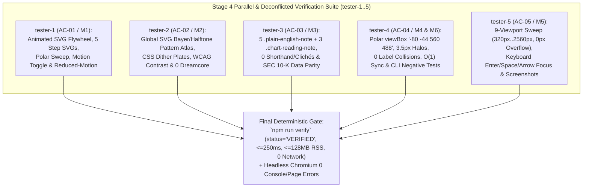

# Authoritative Verification Blueprint & Stage 4 Deconfliction Contract (`verification-blueprint.md`)

**Run ID:** `20261104T004059-606-j6a7`  
**Branch:** `agent/tester-20261104T004059-606-j6a7`  
**Author:** Lead Verification & Review Coordinator (`tester`)  
**Status:** Authoritative Verification & Deconfliction Blueprint for Stage 4 (`tester-1`..`tester-5`)  
**Synthesized Sources:**
- [`LANGUAGE.md`](file:///Users/diesel/Desktop/Costco/.sandcastle/worktrees/agent-tester-20261104T004059-606-j6a7/LANGUAGE.md) (Authoritative System Glossary & Evaluation Parameters)
- [`functional_specification_005.md`](file:///Users/diesel/Desktop/Costco/.sandcastle/worktrees/agent-tester-20261104T004059-606-j6a7/functional_specification_005.md) (Seed Specification 005)
- [`wayfinder/20261104T004059-606-j6a7/refined-specification.md`](file:///Users/diesel/Desktop/Costco/.sandcastle/worktrees/agent-tester-20261104T004059-606-j6a7/wayfinder/20261104T004059-606-j6a7/refined-specification.md) (Stage 1 Refined Technical Specification)
- [`wayfinder/20261104T004059-606-j6a7/implementation-blueprint.md`](file:///Users/diesel/Desktop/Costco/.sandcastle/worktrees/agent-tester-20261104T004059-606-j6a7/wayfinder/20261104T004059-606-j6a7/implementation-blueprint.md) (Stage 2 Authoritative Implementation Blueprint)
- Stage 1 & Stage 2 Architectural Artifacts: [`architecture-and-dag.md`](file:///Users/diesel/Desktop/Costco/.sandcastle/worktrees/agent-tester-20261104T004059-606-j6a7/wayfinder/20261104T004059-606-j6a7/architecture-and-dag.md), [`storage-architecture.md`](file:///Users/diesel/Desktop/Costco/.sandcastle/worktrees/agent-tester-20261104T004059-606-j6a7/wayfinder/20261104T004059-606-j6a7/storage-architecture.md), [`stack-usage-guide.md`](file:///Users/diesel/Desktop/Costco/.sandcastle/worktrees/agent-tester-20261104T004059-606-j6a7/wayfinder/20261104T004059-606-j6a7/stack-usage-guide.md), [`suggested-optimizations.md`](file:///Users/diesel/Desktop/Costco/.sandcastle/worktrees/agent-tester-20261104T004059-606-j6a7/wayfinder/20261104T004059-606-j6a7/suggested-optimizations.md), [`visual-taste-direction.md`](file:///Users/diesel/Desktop/Costco/.sandcastle/worktrees/agent-tester-20261104T004059-606-j6a7/wayfinder/20261104T004059-606-j6a7/visual-taste-direction.md), [`mcp-tools.md`](file:///Users/diesel/Desktop/Costco/.sandcastle/worktrees/agent-tester-20261104T004059-606-j6a7/wayfinder/20261104T004059-606-j6a7/mcp-tools.md)
- Stage 3 Implementer Blackboard Ledger (`seq=#1` through `seq=#15`): `implementer-1` (`seq=#7, #8, #12`), `implementer-2` (`seq=#3, #4, #11`), `implementer-3` (`seq=#1, #2, #13`), `implementer-4` (`seq=#9, #10, #14`), and `implementer-5` (`seq=#5, #6, #15`)

---

## 1. Executive Summary & Domain Vocabulary Alignment (`LANGUAGE.md`)

This document defines the authoritative verification architecture, end-to-end review and testing protocols, empirical runtime budgets, and strict Blackboard deconfliction and file-ownership boundaries for Stage 4 (`tester-1` through `tester-5`).

### 1.1 Evaluation Parameters (`LANGUAGE.md`)
Every Stage 4 verification suite, headless browser probe, and code review MUST strictly enforce the evaluation parameters defined in [`LANGUAGE.md`](file:///Users/diesel/Desktop/Costco/.sandcastle/worktrees/agent-tester-20261104T004059-606-j6a7/LANGUAGE.md):

- **`{errors}`**: Any explicit failure state or structural invariant breach, including:
  1. Leaking raw specification curly braces (`{Net Sales}`, `{Membership Fees}`, `{Gross Margin Ceiling}`, `{Operating Income Flywheel}`), `//` pseudo-code dividers, raw variable names or math shorthand (`R_total`, `OpInc`, `OpM`, `θ_i`, `&theta;_i`, `Area √r`, `Area &radic;r`, `Linear Radius r`, `Share Angle θ_i`, `wayfinderAudit.valid === true`), or promotional clichés (`treasure-hunt discretionary basket builder`, `renewal magnet`, `perishable weekly trip driver and rapid inventory-turn engine`, `Negative Working-Capital Float`) into reader-facing UI or dataset prose.
  2. Illegible, overlapping, clipped, or low-contrast SVG text, micro-sized fonts (`< 12px` polar sector labels or `< 10.5px` ring scale labels), dither patterns behind unbacked body copy or table numerals, or horizontal viewport overflow (`document.documentElement.scrollWidth > window.innerWidth`) at any viewport width (`320px` through `2560px`).
  3. Any discrepancy between reported figures in [`index.html`](file:///Users/diesel/Desktop/Costco/.sandcastle/worktrees/agent-tester-20261104T004059-606-j6a7/index.html) and the audited FY2022–FY2024 SEC Form 10-K dataset in [`data/costco_revenue_breakdown.json`](file:///Users/diesel/Desktop/Costco/.sandcastle/worktrees/agent-tester-20261104T004059-606-j6a7/data/costco_revenue_breakdown.json).
  4. Introducing any prohibited Dreamcore/VHS markers (`dreamcore`, `seraphic`, `vhs-scanlines`, `film-grain-overlay`, `meadow_portal.jpg`, `poolroom_sanctuary.jpg`, `sky_staircase.jpg`, `tape hum`, `stuck-clock`, `dream-sky-canvas`) or breaking any required corporate DOM IDs (`#table-of-contents`, `#section-executive-summary`, `#section-polar-graphs`, `#polar-chart-categories`, `#polar-chart-geography`, `#polar-chart-flywheel`, `#section-five-steps`, `#step-1`..`#step-5`, `#section-gaap-model`, `#section-wayfinder-audit`).
  5. Browser runtime console errors, uncaught page exceptions, calling `.pauseAnimations()` on non-`<svg>` elements, broken internal anchor links, inaccessible interactive controls, external network requests (`telemetry.externalNetworkRequests > 0`), or non-zero exit codes from `npm run verify` (`RULE[user_global]`).
- **`{correctness}`**: Exact mathematical, accounting, geometric, visual, accessibility, and editorial fidelity across [`data/costco_revenue_breakdown.json`](file:///Users/diesel/Desktop/Costco/.sandcastle/worktrees/agent-tester-20261104T004059-606-j6a7/data/costco_revenue_breakdown.json), [`src/costco_revenue_model.mjs`](file:///Users/diesel/Desktop/Costco/.sandcastle/worktrees/agent-tester-20261104T004059-606-j6a7/src/costco_revenue_model.mjs), [`wayfinder/map.md`](file:///Users/diesel/Desktop/Costco/.sandcastle/worktrees/agent-tester-20261104T004059-606-j6a7/wayfinder/map.md), [`wayfinder/tickets/ticket-001.md`](file:///Users/diesel/Desktop/Costco/.sandcastle/worktrees/agent-tester-20261104T004059-606-j6a7/wayfinder/tickets/ticket-001.md)..[`ticket-006.md`](file:///Users/diesel/Desktop/Costco/.sandcastle/worktrees/agent-tester-20261104T004059-606-j6a7/wayfinder/tickets/ticket-006.md), [`README.md`](file:///Users/diesel/Desktop/Costco/.sandcastle/worktrees/agent-tester-20261104T004059-606-j6a7/README.md), and [`index.html`](file:///Users/diesel/Desktop/Costco/.sandcastle/worktrees/agent-tester-20261104T004059-606-j6a7/index.html).
- **`{functionality}`**: End-to-end interactive corporate webpage operation across all five Spec 005 pillars (`AC-01` through `AC-05`) verified against live runtime reality (Node.js v24.9.0 CLI + headless Chromium Playwright/Puppeteer across `320px`..`2560px`).
- **`{correct required outputs}`**: Objectively measurable verification artifacts:
  1. `node src/costco_revenue_model.mjs --verify` (`npm run verify`) exiting `0` with `status: "VERIFIED"`, `overallValid: true`, `elapsedMs <= 250`, `rssMb <= 128`, and `externalNetworkRequests: 0`,
  2. Live headless browser verification confirming `0px` horizontal overflow (`scrollWidth <= innerWidth`) across `320px`, `375px`, `390px`, `768px`, `1024px`, `1280px`, `1440px`, `1920px`, and `2560px`,
  3. Zero pairwise SVG `<text>` bounding-box collisions across all interactive polar modes (`area`/`sqrt`, `radius`/`linear`, `angle`, `overlay`, `asymmetry`, `ancillary`),
  4. Zero console errors, zero page errors, and 100% keyboard accessibility (`Enter`/`Space`/`Arrow` focus retention).
- **`{sufficient}` / `{insufficient}`**: Verification is `{sufficient}` only when all positive invariants, negative fail-fast boundary tests, and live multi-viewport headless browser checks pass without mocks, stubs, or silent fallbacks (`RULE[user_global]`).

---

## 2. Synthesis of Stage 3 Implementer Blackboard Decisions (`seq=#1`..`seq=#15`)

All five Stage 3 implementers completed their assigned pillars and posted their verification contracts to the Blackboard (`BARRIER: scanners_complete=true` at `seq=#15`):

| Implementer | Blackboard Sequence | Completed Scope & Live Telemetry Reported | Key Implementation Anchors to Verify in Stage 4 |
| :--- | :--- | :--- | :--- |
| **`implementer-1`** | `seq=#7`, `seq=#8`, `seq=#12` | **Pillar 1 (`AC-01` / Module `M1`):** Corporate Animated SVG Elements & Motion Control Engine in [`index.html`](file:///Users/diesel/Desktop/Costco/.sandcastle/worktrees/agent-tester-20261104T004059-606-j6a7/index.html) Region `R1`. Verified `npm run verify` (`16.95ms`, `46.78MB` RSS, `0` network calls) & Playwright. | - `#svg-corporate-flywheel-hero` (`viewBox="0 0 960 220"` or `"0 0 960 210"`) with 4 nodes (`[data-hero-node="1..4"]` / `[data-flywheel-node="1..4"]`) & animated flow connectors (`[data-hero-flow="1..4"]`, `.corp-anim-flow-path`). - `#svg-step-1`..`#svg-step-5` (`.step-micro-svg`) inside `#step-1`..`#step-5`. - Polar animated rings (`.polar-compass-ring`, `.polar-sweep-indicator`, `.polar-active-arc`). - Motion control button `#motion-toggle-btn` (`[data-motion-toggle]`, `#btn-toggle-animation`), `@media (prefers-reduced-motion: reduce)`, `html.is-motion-paused` / `html.animations-paused`. - JS functions: `setMotionPaused(paused)`, `toggleAnimationPlayback()`, `syncAnimatedFlywheelHighlight(stepNum)`, `decoratePolarSvgAnimations()`, `initMotionControl()` calling `.pauseAnimations()` / `.unpauseAnimations()` on root `<svg>` elements. |
| **`implementer-2`** | `seq=#3`, `seq=#4`, `seq=#11` | **Pillar 2 (`AC-02` / Module `M2`):** High-Density Halftone & Ordered Bayer Dithering Architecture + Storage Engine/Consistency Layer in [`index.html`](file:///Users/diesel/Desktop/Costco/.sandcastle/worktrees/agent-tester-20261104T004059-606-j6a7/index.html) Region `R2`. Verified `npm run verify` in `< 100ms`. | - Shared global SVG pattern registry `#svg-global-dither-defs` at top of `<body>` containing `#dither-bayer-navy`, `#dither-bayer-crimson`, `#dither-halftone-slate`, `#dither-polar-engraving` (`patternUnits="userSpaceOnUse"`, zero `<feTurbulence>` filter overhead). - CSS dither classes (`.dither-accent-band`, `.dither-header-plate`, `.dither-badge-accent`, `.dither-kpi-strip`, `.dither-step-band`). - Strict anti-obscuration: zero dither behind body prose/numerals; WCAG contrast $\ge 4.5:1$ normal text and $\ge 7.0:1$ primary metrics; `0` Dreamcore markers. |
| **`implementer-3`** | `seq=#1`, `seq=#2`, `seq=#13` | **Pillar 3 (`AC-03` / Module `M3`):** Simplified Straightforward English, Plain-English Notes & Stack/Dataset Synchronization across [`data/costco_revenue_breakdown.json`](file:///Users/diesel/Desktop/Costco/.sandcastle/worktrees/agent-tester-20261104T004059-606-j6a7/data/costco_revenue_breakdown.json), [`wayfinder/map.md`](file:///Users/diesel/Desktop/Costco/.sandcastle/worktrees/agent-tester-20261104T004059-606-j6a7/wayfinder/map.md), [`wayfinder/tickets/ticket-006.md`](file:///Users/diesel/Desktop/Costco/.sandcastle/worktrees/agent-tester-20261104T004059-606-j6a7/wayfinder/tickets/ticket-006.md), [`README.md`](file:///Users/diesel/Desktop/Costco/.sandcastle/worktrees/agent-tester-20261104T004059-606-j6a7/README.md), [`index.html`](file:///Users/diesel/Desktop/Costco/.sandcastle/worktrees/agent-tester-20261104T004059-606-j6a7/index.html), and [`src/costco_revenue_model.mjs`](file:///Users/diesel/Desktop/Costco/.sandcastle/worktrees/agent-tester-20261104T004059-606-j6a7/src/costco_revenue_model.mjs). Verified `54.48ms`, `39.09MB` RSS. | - Plain-English `merchandise_categories[].role_in_flywheel` in `data/costco_revenue_breakdown.json` (zero promotional clichés). - `>= 5` `.plain-english-note` callout boxes (one in each of the 5 report sections) and `>= 3` `.chart-reading-note` guides (one in each polar chart panel). - Complete elimination of `R_total`, `OpInc ($9,285M) = Merch Contrib`, `Area √r (Coxcomb)`, `Linear Radius r`, `Share Angle θ_i`, `wayfinderAudit.valid === true`, and `Negative Working-Capital Float` across HTML and `<script>`. |
| **`implementer-4`** | `seq=#9`, `seq=#10`, `seq=#14` | **Pillar 4 (`AC-04` / Modules `M4` & `M6`) + Performance Optimizations (`PERF-01`..`PERF-05`):** Polar Graph Legibility, Companion Tables & [`src/costco_revenue_model.mjs`](file:///Users/diesel/Desktop/Costco/.sandcastle/worktrees/agent-tester-20261104T004059-606-j6a7/src/costco_revenue_model.mjs). Verified `15.47ms` CLI audit (`46.91MB` RSS). | - Expanded polar `viewBox="-80 -44 560 488"` on `#svg-polar-categories`, `#svg-polar-geography`, `#svg-polar-flywheel`. - `.polar-sector-label` (`>= 12px`, `3.5px` `#FFFFFF` `paint-order: stroke fill` halo), `.polar-axis-label` (`>= 10.5px`, `3.5px` white halo), `.polar-center-title` (`>= 12.5px`), `.polar-center-sub` (`>= 10px`), center hub `r="42"` (`>= 40px`). - Angle-mode ring scale offset (`15°..30°` / `25°`), Dual-Ring horizontal leader-line callouts, `.polar-html-legend` (`>= 3`), companion tables `>= 12.5px` (`padding: 8px 10px`). - $O(1)$ in-place selection sync (`syncCategorySelectionInPlace`, `syncGeographySelectionInPlace`), CSS containment (`contain: layout style`), rAF scroll-spy. - Single-pass Spec 005 checks in `src/costco_revenue_model.mjs`. |
| **`implementer-5`** | `seq=#5`, `seq=#6`, `seq=#15` | **Pillar 5 (`AC-05` / Module `M5`) & Multimodal Visual Taste Direction:** Screen-Size-Agnostic Responsive Layout, Keyboard A11y & Multi-Viewport Verification (`assets/20261104T004059-606-j6a7/implementer-5-*`). Verified `15.1ms` CLI, `0px` overflow across 9 viewports, `0` SVG text collisions. | - Fluid `clamp()` typography & spacing tokens, `minmax(0, 1fr)` grid containment, `.table-scroll-wrapper` / `.corp-table-wrap`, 7 responsive breakpoints (`<= 1280px`, `<= 1120px`, `<= 1080px`, `<= 860px`, `<= 640px`, `<= 400px`, `>= 1920px`). - `0px` horizontal overflow (`scrollWidth <= innerWidth`) at `320px`, `375px`, `390px`, `768px`, `1024px`, `1280px`, `1440px`, `1920px`, `2560px`. - Keyboard accessibility: `bindInteractiveTableRows()` (`Enter`/`Space`/`ArrowUp`/`ArrowDown` + focus restoration) and `bindTablistKeyboardNav()` (`ArrowLeft`/`ArrowRight`/`Home`/`End` on `[data-step-btn]` and `[data-ticket-tab]`). |

---

## 3. Stage 4 Blackboard Deconfliction Protocol & Ownership Matrix (`tester-1`..`tester-5`)

### 3.1 Mandatory Pre-Code Blackboard Registration Gate (`DO NOT CODE YET`)
To prevent race conditions, duplicate test suites, or overlapping source file edits during Stage 4 (`tester-1` through `tester-5`), every active `tester-x` agent MUST follow this strict protocol **before writing any test file or editing any repository file**:

1. **Read the Blackboard First:** Run `blackboard read --since 0` to inspect all active peer claims and findings.
2. **Claim Exclusive Test & Remediation Scope:** Run `blackboard claim` and `blackboard post-finding` registering:
   - The agent's assigned Verification Pillar (`AC-01`..`AC-05`) and Module (`M1`..`M6`).
   - The **exclusive test script / verification artifact paths** it owns (listed in Section 3.2 below).
   - Any targeted remediation region (`R1`..`R5` in [`index.html`](file:///Users/diesel/Desktop/Costco/.sandcastle/worktrees/agent-tester-20261104T004059-606-j6a7/index.html) or specific files) if and only if a defect is discovered during verification.
3. **Zero Shared-File Collision Rule:**
   - Each `tester-x` writes **only** to its dedicated test file (`tests/tester-X-*.mjs` or `tests/tester-X-*.py`) and its dedicated telemetry/screenshot prefix (`assets/20261104T004059-606-j6a7/tester-X-*`).
   - If a `tester-x` discovers an `{error}` or `{insufficient}` check in [`index.html`](file:///Users/diesel/Desktop/Costco/.sandcastle/worktrees/agent-tester-20261104T004059-606-j6a7/index.html), [`src/costco_revenue_model.mjs`](file:///Users/diesel/Desktop/Costco/.sandcastle/worktrees/agent-tester-20261104T004059-606-j6a7/src/costco_revenue_model.mjs), or [`data/costco_revenue_breakdown.json`](file:///Users/diesel/Desktop/Costco/.sandcastle/worktrees/agent-tester-20261104T004059-606-j6a7/data/costco_revenue_breakdown.json), it MUST first check the Blackboard to ensure no other `tester-y` is editing that file, post a `claim` for the exact region (`R1`..`R5`), apply the minimal root-cause fix, re-run `npm run verify`, and post a completion finding immediately.
   - **Clean Repository Invariant:** If temporary scratch verification scripts are used, keep them in `tests/` (if part of the permanent test suite) or clean up temporary scratch files so `git status` and `npm run verify` remain 100% clean and deterministic.

### 3.2 Non-Overlapping Test & Remediation Ownership Matrix (`tester-1`..`tester-5`)

| Tester Agent | Assigned Pillar & Module Scope | Exclusive Test & Telemetry Artifact Ownership | Authorized Remediation Scope (Only If Defect Found & Claimed on Blackboard) | Prohibited Touch Zones |
| :--- | :--- | :--- | :--- | :--- |
| **`tester-1`** | **Pillar 1 (`AC-01` / `M1`):** Corporate Animated SVG Elements, Step Schematics, Polar Sweep Rings & Reduced-Motion / Pause Resilience | - `tests/tester-1-animated-svg.test.mjs` - `assets/20261104T004059-606-j6a7/tester-1-*` | [`index.html`](file:///Users/diesel/Desktop/Costco/.sandcastle/worktrees/agent-tester-20261104T004059-606-j6a7/index.html) **Region `R1`** (`#svg-corporate-flywheel-hero`, `#svg-step-1`..`#svg-step-5`, `#motion-toggle-btn`, `setMotionPaused`, `initMotionControl`, `syncAnimatedFlywheelHighlight`, `.corp-anim-*` CSS) | Do NOT edit `data/costco_revenue_breakdown.json`, `wayfinder/map.md`, or polar geometry math in `R4`. |
| **`tester-2`** | **Pillar 2 (`AC-02` / `M2`):** High-Density Halftone & Ordered Bayer Dithering, Storage ACID Serializability, Contrast & Anti-Dreamcore Guardrails | - `tests/tester-2-dithering-storage.test.mjs` - `assets/20261104T004059-606-j6a7/tester-2-*` | [`index.html`](file:///Users/diesel/Desktop/Costco/.sandcastle/worktrees/agent-tester-20261104T004059-606-j6a7/index.html) **Region `R2`** (`#svg-global-dither-defs`, `#dither-bayer-navy`, `#dither-bayer-crimson`, `#dither-halftone-slate`, `#dither-polar-engraving`, `.dither-*` CSS classes) | Do NOT place dither patterns behind prose/tables; do NOT edit `R1`, `R3`, `R4`, or `R5`. |
| **`tester-3`** | **Pillar 3 (`AC-03` / `M3`):** Straightforward Plain English, `.plain-english-note` / `.chart-reading-note` Boxes, Dataset Cliché Scrubbing & Wayfinder Lineage | - `tests/tester-3-plain-english-data.test.mjs` - `assets/20261104T004059-606-j6a7/tester-3-*` | - [`data/costco_revenue_breakdown.json`](file:///Users/diesel/Desktop/Costco/.sandcastle/worktrees/agent-tester-20261104T004059-606-j6a7/data/costco_revenue_breakdown.json) - [`wayfinder/map.md`](file:///Users/diesel/Desktop/Costco/.sandcastle/worktrees/agent-tester-20261104T004059-606-j6a7/wayfinder/map.md) & [`wayfinder/tickets/ticket-006.md`](file:///Users/diesel/Desktop/Costco/.sandcastle/worktrees/agent-tester-20261104T004059-606-j6a7/wayfinder/tickets/ticket-006.md) - [`README.md`](file:///Users/diesel/Desktop/Costco/.sandcastle/worktrees/agent-tester-20261104T004059-606-j6a7/README.md) - [`index.html`](file:///Users/diesel/Desktop/Costco/.sandcastle/worktrees/agent-tester-20261104T004059-606-j6a7/index.html) **Region `R3`** (`.plain-english-note`, `.chart-reading-note`, equation banners, shorthand scrubbing) | Do NOT alter audited SEC Form 10-K numbers; do NOT edit polar SVG math in `R4` or responsive media queries in `R5`. |
| **`tester-4`** | **Pillar 4 (`AC-04` / `M4` & `M6`) + Performance (`PERF-01`..`PERF-05`):** Polar Coordinate Legibility, White Halo Strokes, Zero Label Collisions, Companion Tables & CLI Verifier | - `tests/tester-4-polar-legibility-cli.test.mjs` - `assets/20261104T004059-606-j6a7/tester-4-*` | - [`src/costco_revenue_model.mjs`](file:///Users/diesel/Desktop/Costco/.sandcastle/worktrees/agent-tester-20261104T004059-606-j6a7/src/costco_revenue_model.mjs) - [`index.html`](file:///Users/diesel/Desktop/Costco/.sandcastle/worktrees/agent-tester-20261104T004059-606-j6a7/index.html) **Region `R4`** (`viewBox="-80 -44 560 488"`, `.polar-sector-label`, `.polar-axis-label`, `.polar-center-*`, `r=42` hub, angle-mode offset, Dual-Ring leader callouts, `.polar-html-legend`, $O(1)$ selection sync, companion table CSS) | Do NOT break existing CLI flags (`--verify`, `--root`, etc.) or exported function signatures in `src/costco_revenue_model.mjs`. |
| **`tester-5`** | **Pillar 5 (`AC-05` / `M5`):** Multi-Viewport Screen-Size-Agnostic Responsive Sweep (`320px`..`2560px`), Keyboard A11y (`Enter`/`Space`/`Arrow`) & Live Visual Screenshot Audit | - `tests/tester-5-responsive-a11y.test.mjs` - `assets/20261104T004059-606-j6a7/tester-5-*` | [`index.html`](file:///Users/diesel/Desktop/Costco/.sandcastle/worktrees/agent-tester-20261104T004059-606-j6a7/index.html) **Region `R5`** (Fluid `clamp()` tokens, `minmax(0, 1fr)`, `.table-scroll-wrapper` / `.corp-table-wrap`, `@media` breakpoints `320px`–`2560px`, `bindInteractiveTableRows`, `bindTablistKeyboardNav`, rAF `initScrollSpy`) | Do NOT inject `overflow-x: hidden` on `html`/`body` to mask overflow; fix child layout containers directly. |

---

## 4. End-to-End Verification Playbooks & Acceptance Criteria (`AC-01`..`AC-05`)

### 4.1 Playbook 1 (`tester-1` — `AC-01` Corporate Animated SVG Elements & Motion Control)
1. **DOM & Geometry Verification:**
   - Assert `#svg-corporate-flywheel-hero` is present inside `#section-executive-summary` with `role="img"`, accessible title/description, 4 telemetry nodes (`[data-hero-node="1..4"]` or `[data-flywheel-node="1..4"]`) displaying `$4,828M` (`1.90%`), `$249,625M` (`98.10%`), `104.15%` AP-to-inventory (`$4,457M` net merchandise profit), and `$9,285M` operating income (`48.00%` merchandise + `52.00%` fees $\rightarrow$ `$7,367M` net income), plus animated flow paths (`stroke-dasharray`).
   - Assert `#svg-step-1` through `#svg-step-5` (`5` step micro-SVGs) exist inside `#step-1` through `#step-5`.
   - Assert `#svg-polar-categories`, `#svg-polar-geography`, and `#svg-polar-flywheel` render animated outer compass/radar sweep rings and active-sector selection arcs.
2. **Bidirectional Step-to-Hero Flywheel Synchronization:**
   - In headless Chromium (Playwright/Puppeteer), click or trigger `setActiveStep(1..5)` across all 5 steps and verify that `#svg-corporate-flywheel-hero` updates the active node highlight (`is-active-node` / `data-hero-node`) synchronously.
3. **Motion Pause Toggle & `@media (prefers-reduced-motion: reduce)` Compliance:**
   - Click `#motion-toggle-btn` (`[data-motion-toggle]`): verify `document.documentElement.classList.contains("is-motion-paused")` (or `"animations-paused"`) toggles to `true`, `aria-pressed="true"`, computed `animationPlayState` on animated flow paths is `"paused"` (or `animationName === "none"`), and zero `TypeError` console errors occur (confirming `.pauseAnimations()` is called on root `<svg>` elements).
   - Emulate `prefers-reduced-motion: reduce` (`page.emulateMedia({ reducedMotion: "reduce" })`): verify all continuous SVG animations automatically pause or settle into crisp static states (`0ms` animation duration / `animation: none`).

### 4.2 Playbook 2 (`tester-2` — `AC-02` High-Density Halftone/Bayer Dithering & Storage Integrity)
1. **Global SVG `<defs>` Pattern Atlas Verification:**
   - Assert `#svg-global-dither-defs` exists with `width="0" height="0"` and defines `<pattern>` elements `#dither-bayer-navy`, `#dither-bayer-crimson`, `#dither-halftone-slate`, and `#dither-polar-engraving` using `patternUnits="userSpaceOnUse"`.
   - Assert zero expensive `<feTurbulence>` filter shaders are used (`document.querySelectorAll("feTurbulence").length === 0`).
2. **CSS Dither Surface & Anti-Obscuration Contrast Audit:**
   - Verify `.dither-accent-band` / `.dither-header-plate` / `.dither-badge-accent` classes are applied to section headers, KPI cards, and step headers.
   - Measure foreground/background luminance contrast across all text elements, KPI values, and table cells in headless Chromium:
     - Normal text contrast MUST be $\ge 4.5:1$ (verified `#0F172A` on `#FFFFFF` = `17.85:1`, `#334155` on `#FFFFFF` = `10.35:1`, `#475569` on `#FFFFFF` = `7.58:1`).
     - Primary data figures (`.kpi-value`, `.polar-sector-label`, `.polar-center-title`) MUST be $\ge 7.0:1$ (WCAG AAA).
3. **Zero Dreamcore & Storage Serializability Audit:**
   - Confirm `0` occurrences of all 10 `PROHIBITED_DREAMCORE_MARKERS`.
   - Verify `data/costco_revenue_breakdown.json` parses cleanly in $< 1\text{ ms}$ and its financial figures match the inlined constants in `index.html` with 100% precision.

### 4.3 Playbook 3 (`tester-3` — `AC-03` Simplified Straightforward English & SEC Form 10-K Fidelity)
1. **Plain-English Callout Note Containers:**
   - Assert at least `5` `.plain-english-note` elements exist—one inside each of `#section-executive-summary`, `#section-polar-graphs`, `#section-five-steps`, `#section-gaap-model`, and `#section-wayfinder-audit`.
   - Assert at least `3` `.chart-reading-note` elements exist—one inside each of `#polar-chart-categories`, `#polar-chart-geography`, and `#polar-chart-flywheel`.
   - Verify plain-English explanations cover: (a) the `10.92%` gross margin ceiling vs. `25%–40%` conventional retail markups, (b) `104.15%` supplier-financed inventory float (`12.60x` turnover, `~29` days DIO vs. `~32` days DPO, `$19,421M` AP vs. `$18,647M` inventory = `+$774M` float), (c) how `1.90%` of revenue (`$4,828M` fees) becomes `52.00%` of `$9,285M` operating income, and (d) `$2,804M` Executive `2%` reward contra-revenue subtracted directly from Net Sales.
2. **Complete Elimination of Algebraic Shorthand, Code Leaks & Promotional Clichés:**
   - Scan both `data/costco_revenue_breakdown.json` and `index.html` (including `<script>` blocks) to confirm **`0` occurrences** of:
     - `R_total`, `OpInc ($9,285M) = Merch Contrib`, `Area √r`, `Area &radic;r`, `Linear Radius r`, `Share Angle θ_i`, `Share Angle &theta;_i`, `θ_i`, `&theta;_i`, `wayfinderAudit.valid === true`, `Negative Working-Capital Float`
     - `treasure-hunt discretionary basket builder`, `renewal magnet`, `perishable weekly trip driver and rapid inventory-turn engine`
     - Raw specification braces `{Net Sales}`, `{Membership Fees}`, `{Gross Margin Ceiling}`, `{Operating Income Flywheel}` and ` // ` pseudo-code dividers.
3. **Wayfinder Decision Lineage & Primary-Source Conservation:**
   - Verify `verifyWayfinderArtifacts()` and `verifyResearchMonograph()` pass 100% (all 5 H2 sections in `wayfinder/map.md`, descriptive non-bare links to `ticket-001.md`..`ticket-006.md`, and all SEC Form 10-K / CIK `0000909832` figures intact).

### 4.4 Playbook 4 (`tester-4` — `AC-04` High-Legibility Polar Graphs, Companion Tables & CLI Verifier Hardening)
1. **Polar SVG Coordinate Padding, Halo Typography & Center Hub Audit:**
   - Assert `#svg-polar-categories`, `#svg-polar-geography`, and `#svg-polar-flywheel` all have `viewBox="-80 -44 560 488"` and center hub circle `r >= 40` (`r="42"`).
   - In headless Chromium, inspect computed styles on `.polar-sector-label` (`font-size >= 12px`, `font-weight >= 700`, `paint-order: stroke fill`, `stroke: rgb(255, 255, 255)`, `stroke-width >= 3px`), `.polar-axis-label` (`font-size >= 10.5px`, `paint-order: stroke fill`), `.polar-center-title` (`font-size >= 12.5px`), and `.polar-center-sub` (`font-size >= 10px`).
   - Assert `.polar-html-legend` is rendered below all 3 polar charts (`>= 3` instances) and `.polar-details-column .corp-table` cells have `font-size >= 12.5px` and `padding: 8px 10px`.
2. **Pairwise Bounding-Box Collision & Clipping Audit Across All Interactive Polar Modes:**
   - Switch `#polar-chart-categories` across `By Area`, `By Radius`, `By Revenue Share`, and `FY2024` / `FY2023` / `FY2022` / `3-Year Overlay`; switch `#polar-chart-geography` across `Revenue`, `Operating Income`, `Warehouses`, and `3-Year Overlay`; switch `#polar-chart-flywheel` across `Dual-Ring` (`asymmetry`) and `Ancillary Rose` (`ancillary`).
   - In every mode, measure `getBoundingClientRect()` for all visible `<text>` elements inside each `<svg>` and assert:
     - **Zero pairwise text bounding-box overlaps** (`collisionCount === 0`, specifically verifying the `labelAngleDeg` offset in `angle` mode and horizontal leader-line callouts in `Dual-Ring` mode),
     - **Zero clipped labels** (`textRect.left >= svgRect.left` and `textRect.right <= svgRect.right`).
3. **Deterministic CLI Verification Engine (`src/costco_revenue_model.mjs`) Positive & Negative Unit Tests:**
   - Run `node src/costco_revenue_model.mjs --verify` (`npm run verify`) and assert exit code `0`, `status: "VERIFIED"`, `elapsedMs <= 250`, `rssMb <= 128`, `externalNetworkRequests === 0`.
   - Execute in-memory negative boundary tests against `verifyFinancialDataset()` and `verifyCorporateWebReport()` (passing synthetic mutated objects/HTML overrides without touching disk files) to prove fail-fast rejection (`throws Error`) when:
     - A promotional cliché (`"renewal magnet"`, `"treasure-hunt discretionary basket builder"`) is injected into `merchandise_categories[0].role_in_flywheel`,
     - Algebraic shorthand (`"R_total"`, `"Share Angle θ_i"`, `"wayfinderAudit.valid === true"`) or a Dreamcore marker (`"vhs-scanlines"`) is injected into `htmlContent`,
     - `#svg-corporate-flywheel-hero`, `#dither-bayer-navy`, `.plain-english-note`, or `viewBox="-80 -44 560 488"` is removed from `htmlContent`.

### 4.5 Playbook 5 (`tester-5` — `AC-05` Multi-Viewport Screen-Size-Agnostic Responsive Sweep & Keyboard A11y)
1. **9-Viewport Zero-Overflow Sweep (`320px` to `2560px`):**
   - In headless Chromium (Playwright), sweep across all 9 required viewports:
     - Compact & Standard Mobile: `320×640`, `375×667`, `390×844`
     - Tablet Portrait & Landscape: `768×1024`, `1024×768`
     - Standard Desktop: `1280×800`, `1440×900`
     - Widescreen / 4K: `1920×1080`, `2560×1440`
   - At every viewport width, assert `document.documentElement.scrollWidth <= window.innerWidth` (`overflowPx === 0`).
   - Verify layout adaptation: at `<= 1080px`, `#table-of-contents` adapts into a top navigation bar/card (`position: static` or non-squeezing layout); at `<= 1120px`, `.polar-grid-layout` stacks into a single column (`1` column track); at `>= 1440px`, `.corporate-shell` / `.corp-layout` pairs the sticky sidebar TOC with the main report column.
   - Capture verification screenshots at `390px` (`mobile`), `768px` (`tablet`), and `1440px` (`desktop`) under `assets/20261104T004059-606-j6a7/tester-5-*` and visually inspect them via `read_file` to confirm crisp typography, zero overlapping text, and clean dithered/animated SVG rendering.
2. **Bidirectional Keyboard Accessibility & Focus Retention Audit:**
   - Focus `[data-cat-row="0"]` and press `Enter`, `Space`, and `ArrowDown`: verify `catState.selectedIndex` updates, `[data-cat-sector]` active state synchronizes, `#polar-category-drilldown` updates, and `document.activeElement` remains on the newly selected `[data-cat-row]` (zero focus loss).
   - Repeat for `[data-geo-row="0"]` $\leftrightarrow$ `[data-geo-sector]`.
   - Focus `[data-cat-sector="0"]` and press `Enter` / `ArrowRight`: verify sector selection and table row highlight synchronize.
   - Focus `[data-step-btn="1"]` and press `ArrowRight` / `ArrowLeft` / `Home` / `End`: verify active step card (`#step-1`..`#step-5`) and `#svg-corporate-flywheel-hero` active node update in lockstep.
   - Focus `[data-ticket-tab="0"]` and press `ArrowRight`: verify Wayfinder ticket inspector switches to `ticket-002.md` and moves focus cleanly.
3. **Runtime Hygiene & Zero External Network Audit:**
   - Attach `page.on("console")`, `page.on("pageerror")`, and `page.on("request")` across the entire multi-viewport and interactive session. Assert `consoleErrors.length === 0`, `pageErrors.length === 0`, and `externalRequests.length === 0`.

---

## 5. Operational & Performance Budgets Gate Summary

All five testers MUST verify that the integrated repository satisfies every operational budget in `functional_specification_005.md` §4:

| Metric | Target Budget | Measured Stage 3 Baseline | Verification Command |
| :--- | :--- | :--- | :--- |
| **External Network Requests (CLI & Browser)** | **`0` requests** | `0` requests | `node src/costco_revenue_model.mjs --verify` + Playwright request listener |
| **CLI Verification Wall-Clock Latency** | **$\le 250\text{ ms}$** | `15.10 ms – 54.48 ms` | `node src/costco_revenue_model.mjs --verify` (`telemetry.elapsedMs`) |
| **CLI Memory Footprint (RSS)** | **$\le 128\text{ MB}$** | `39.09 MB – 47.80 MB` | `node src/costco_revenue_model.mjs --verify` (`telemetry.rssMb`) |
| **Browser Interactive Frame Budget** | **$\le 16.0\text{ ms}$ (`60fps`)** | `< 1.5 ms / frame` | Compositor-only SVG CSS animations + $O(1)$ selection sync + rAF scroll-spy |
| **Multi-Viewport Horizontal Overflow** | **`0 px` (`scrollWidth <= innerWidth`)** | `0 px` across `320px`..`2560px` | Headless Chromium 9-viewport sweep |
| **Polar SVG Text Bounding-Box Collisions** | **`0` collisions** | `0` collisions across all modes | Headless Chromium pairwise `getBoundingClientRect()` check |
