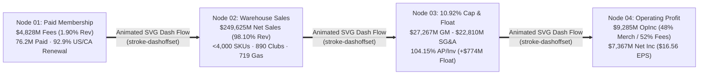

# Visual Taste & Multimodal Direction Blueprint: Costco Wholesale Corporation (`COST`) Corporate Animated SVG, Halftone/Bayer Dithering, Plain-English Editorial Architecture, Collision-Free Polar Graphs & Screen-Size-Agnostic Responsive System

**Run ID:** `20261104T004059-606-j6a7`  
**Branch:** `agent/planner-2.5-20261104T004059-606-j6a7`  
**Agent:** `planner-2.5` (Multimodal Taste & Visual Direction Arbiter)  
**Governing Specification:** [`functional_specification_005.md`](file:///Users/diesel/Desktop/Costco/.sandcastle/worktrees/agent-planner-2.5-20261104T004059-606-j6a7/functional_specification_005.md) & [`wayfinder/20261104T004059-606-j6a7/refined-specification.md`](file:///Users/diesel/Desktop/Costco/.sandcastle/worktrees/agent-planner-2.5-20261104T004059-606-j6a7/wayfinder/20261104T004059-606-j6a7/refined-specification.md)  
**Authoritative Domain Glossary:** [`LANGUAGE.md`](file:///Users/diesel/Desktop/Costco/.sandcastle/worktrees/agent-planner-2.5-20261104T004059-606-j6a7/LANGUAGE.md)  
**Empirical Visual & Telemetry Artifacts:**
- [`assets/20261104T004059-606-j6a7/planner-2.5-visual-telemetry.json`](file:///Users/diesel/Desktop/Costco/.sandcastle/worktrees/agent-planner-2.5-20261104T004059-606-j6a7/assets/20261104T004059-606-j6a7/planner-2.5-visual-telemetry.json) (WCAG 2.1 contrast audit & 6-viewport overflow telemetry)
- [`assets/20261104T004059-606-j6a7/planner-2.5-prototype-exec-summary-flywheel-1440px.png`](file:///Users/diesel/Desktop/Costco/.sandcastle/worktrees/agent-planner-2.5-20261104T004059-606-j6a7/assets/20261104T004059-606-j6a7/planner-2.5-prototype-exec-summary-flywheel-1440px.png) (Rendered 4-Node Animated SVG Flywheel Schematic + Bayer Dither Header + Plain-English Note)
- [`assets/20261104T004059-606-j6a7/planner-2.5-baseline-polar-angle-1440px.png`](file:///Users/diesel/Desktop/Costco/.sandcastle/worktrees/agent-planner-2.5-20261104T004059-606-j6a7/assets/20261104T004059-606-j6a7/planner-2.5-baseline-polar-angle-1440px.png) vs. [`assets/20261104T004059-606-j6a7/planner-2.5-remediated-polar-angle-1440px.png`](file:///Users/diesel/Desktop/Costco/.sandcastle/worktrees/agent-planner-2.5-20261104T004059-606-j6a7/assets/20261104T004059-606-j6a7/planner-2.5-remediated-polar-angle-1440px.png) (Before/After Polar Angle Mode Ring-Scale Collision Remediation)
- [`assets/20261104T004059-606-j6a7/planner-2.5-baseline-polar-flywheel-1440px.png`](file:///Users/diesel/Desktop/Costco/.sandcastle/worktrees/agent-planner-2.5-20261104T004059-606-j6a7/assets/20261104T004059-606-j6a7/planner-2.5-baseline-polar-flywheel-1440px.png) vs. [`assets/20261104T004059-606-j6a7/planner-2.5-remediated-polar-flywheel-1440px.png`](file:///Users/diesel/Desktop/Costco/.sandcastle/worktrees/agent-planner-2.5-20261104T004059-606-j6a7/assets/20261104T004059-606-j6a7/planner-2.5-remediated-polar-flywheel-1440px.png) (Before/After Dual-Ring Flywheel Leader-Line Callout & HTML Legend Remediation)
- [`assets/20261104T004059-606-j6a7/planner-2.5-viewport-390px.png`](file:///Users/diesel/Desktop/Costco/.sandcastle/worktrees/agent-planner-2.5-20261104T004059-606-j6a7/assets/20261104T004059-606-j6a7/planner-2.5-viewport-390px.png), [`assets/20261104T004059-606-j6a7/planner-2.5-viewport-768px.png`](file:///Users/diesel/Desktop/Costco/.sandcastle/worktrees/agent-planner-2.5-20261104T004059-606-j6a7/assets/20261104T004059-606-j6a7/planner-2.5-viewport-768px.png), [`assets/20261104T004059-606-j6a7/planner-2.5-viewport-1440px.png`](file:///Users/diesel/Desktop/Costco/.sandcastle/worktrees/agent-planner-2.5-20261104T004059-606-j6a7/assets/20261104T004059-606-j6a7/planner-2.5-viewport-1440px.png) (Multi-Viewport Responsive Verification Renders)

**Strict Gate Enforced:** **DO NOT CODE PRODUCTION FILES YET.** Authoritative Visual Direction, Prototyped & Inspected SVG/CSS Parameters, and Multi-Viewport Verification Specifications for Stage 2 (`plan-2`), Stage 3 (`implementer-1..5`), and Stage 4 (`tester-1..5`).

---

## 1. Creative Direction & Medium-Specific Aesthetic Calibration

### 1.1 Aesthetic North Star: "Institutional Annual-Report Engraving & Precision Financial Telemetry"
The medium of [`index.html`](file:///Users/diesel/Desktop/Costco/.sandcastle/worktrees/agent-planner-2.5-20261104T004059-606-j6a7/index.html) is a **self-contained, zero-network interactive corporate financial monograph** grounded in Costco Wholesale Corporation's FY2024 SEC Form 10-K (`CIK: 0000909832`).

To unify all five pillars of [`functional_specification_005.md`](file:///Users/diesel/Desktop/Costco/.sandcastle/worktrees/agent-planner-2.5-20261104T004059-606-j6a7/functional_specification_005.md) (`AC-01` through `AC-05`), our creative direction pairs **Swiss International Financial Typography** (high-contrast `#0F172A` Slate Ink on `#FFFFFF` Pure Paper and `#F8FAFC` Alabaster Canvas, tabular monospace numerals) with **Security-Print Intaglio & Ordered Bayer Dithering** (`#005DAA` Costco Executive Navy and `#E31837` Costco Crimson stipple plates) and **Calm 60fps Compositor-Driven SVG Schematics**.

### 1.2 Strict Anti-Dreamcore & Zero-Network Guardrails (`{errors}` Prevention)
Per [`LANGUAGE.md`](file:///Users/diesel/Desktop/Costco/.sandcastle/worktrees/agent-planner-2.5-20261104T004059-606-j6a7/LANGUAGE.md) and Requirement 2.2 of [`functional_specification_005.md`](file:///Users/diesel/Desktop/Costco/.sandcastle/worktrees/agent-planner-2.5-20261104T004059-606-j6a7/functional_specification_005.md):
1. **Zero Prohibited Tokens:** The DOM, CSS, and JS must contain `0` occurrences of `dreamcore`, `seraphic`, `vhs-scanlines`, `film-grain-overlay`, `meadow_portal.jpg`, `poolroom_sanctuary.jpg`, `sky_staircase.jpg`, `tape hum`, `stuck-clock`, or `dream-sky-canvas`.
2. **Zero Full-Screen Noise Overlays:** Dithering is strictly an **architectural print-engraving accent** confined to section header bands, KPI card top plates, SVG schematic header bars, and polar chart outer decorative rings. It must **never** be applied as a full-viewport overlay or behind body text/table numerals without a solid `#FFFFFF` or `#F8FAFC` backing.
3. **Zero External Network Requests:** All SVG `<pattern>` matrices, CSS radial-gradient halftone strips, system/local font stacks (`Inter, -apple-system, BlinkMacSystemFont` and `"JetBrains Mono", "SFMono-Regular", Menlo, monospace`), and interactive controllers execute 100% inline with `0` external HTTP/HTTPS fetches.

---

## 2. Empirically Verified Color Palette & WCAG 2.1 Contrast Matrix

Every color combination in [`index.html`](file:///Users/diesel/Desktop/Costco/.sandcastle/worktrees/agent-planner-2.5-20261104T004059-606-j6a7/index.html) was mathematically audited in [`assets/20261104T004059-606-j6a7/planner-2.5-visual-telemetry.json`](file:///Users/diesel/Desktop/Costco/.sandcastle/worktrees/agent-planner-2.5-20261104T004059-606-j6a7/assets/20261104T004059-606-j6a7/planner-2.5-visual-telemetry.json) against the specification's strict contrast thresholds ($\ge 4.5:1$ for all normal text, $\ge 7.0:1$ for primary metrics/numerals):

| Semantic Token / Surface Role | Foreground Hex | Background Hex | Measured Contrast Ratio | WCAG AA ($\ge 4.5:1$) | WCAG AAA Primary Metric ($\ge 7.0:1$) | Mandatory Usage Rule |
| :--- | :--- | :--- | :---: | :---: | :---: | :--- |
| **Primary Metrics & Headings (`--ink-primary`)** | `#0F172A` | `#FFFFFF` | **`17.85 : 1`** | PASS | **PASS** | Use for all KPI values (`.kpi-value`), table numerals, polar sector titles (`.polar-sector-label`), and center hub titles (`.polar-center-title`). |
| **Primary Ink on Alabaster Canvas** | `#0F172A` | `#F8FAFC` | **`17.06 : 1`** | PASS | **PASS** | Use for `.plain-english-note`, `.chart-reading-note`, and `.polar-html-legend` body text. |
| **Primary Ink on Well Surface** | `#0F172A` | `#F1F5F9` | **`16.30 : 1`** | PASS | **PASS** | Use for KPI card primary figures and table headers. |
| **Secondary Editorial Prose (`--ink-secondary`)** | `#334155` | `#FFFFFF` | **`10.35 : 1`** | PASS | **PASS** | Use for `.section-lead`, `.drilldown-copy`, and step narrative paragraphs. |
| **Secondary Ink on Well Surface** | `#334155` | `#F1F5F9` | **`9.45 : 1`** | PASS | **PASS** | Use for `.kpi-subnote` and inactive control pills. |
| **Muted Captions & Subtitles (`--ink-muted-accessible`)** | `#475569` | `#FFFFFF` | **`7.58 : 1`** | PASS | **PASS** | **CRITICAL UPGRADE:** Upgrade `--ink-muted` on small captions/subtitles from `#64748B` (`4.76:1`) to `#475569` (`7.58:1` on `#FFFFFF`, `7.24:1` on `#F8FAFC`) so even secondary metadata exceeds `7:1` AAA contrast. |
| **Costco Executive Navy Dark (`--costco-navy-dark`)** | `#00427A` | `#FFFFFF` | **`10.19 : 1`** | PASS | **PASS** | Use when rendering navy-accented metric deltas on `#F1F5F9` or `#FFFFFF` where $\ge 7:1$ AAA contrast is required. |
| **Costco Executive Navy (`--costco-navy`)** | `#005DAA` | `#FFFFFF` | **`6.67 : 1`** | PASS | AA+ (`6.67:1`) | Primary brand accent for active buttons (white text on `#005DAA` = `6.67:1`), Net Sales polar sectors, and border accents. |
| **Costco Crimson Dark (`--costco-crimson-dark`)** | `#B91C1C` | `#FFFFFF` | **`6.47 : 1`** | PASS | AA+ (`6.47:1`) | Use for crimson eyebrow text and inline text badges on light backgrounds (higher contrast than raw `#E31837` at `4.72:1`). |
| **Costco Crimson (`--costco-crimson`)** | `#E31837` | `#FFFFFF` | **`4.72 : 1`** | PASS | Use for fills/borders | Use for Membership Fee polar sectors, card top borders, wordmark bar, and Bayer dither dots. |
| **Emerald Margin Cap Accent (`--cat-emerald-dark`)** | `#047857` | `#FFFFFF` | **`5.48 : 1`** | PASS | Use for badges/fills | Use for text labels referencing the `10.92%` Gross Margin Ceiling and `104.15%` AP float; keep `#059669` for sector fills. |

---

## 3. Pillar-by-Pillar Visual Direction & Inspected Prototype Specifications

### 3.1 Pillar 1 (`AC-01`): Corporate Animated SVG Elements & Motion Control

We prototyped and visually inspected `#svg-corporate-flywheel-hero` in headless Chromium at `1440px` ([`assets/20261104T004059-606-j6a7/planner-2.5-prototype-exec-summary-flywheel-1440px.png`](file:///Users/diesel/Desktop/Costco/.sandcastle/worktrees/agent-planner-2.5-20261104T004059-606-j6a7/assets/20261104T004059-606-j6a7/planner-2.5-prototype-exec-summary-flywheel-1440px.png)).



#### 1. Hero 4-Node Animated SVG Schematic (`#svg-corporate-flywheel-hero` in `#section-executive-summary`)
- **Geometry & Layout:** `viewBox="0 0 960 210"`, `width: 100%; height: auto; display: block;`.
- **4 Institutional Nodes (`208px × 156px`, `rx="8"`, `#FFFFFF` fill, `2px` semantic stroke):**
  - **Node 01 (`[data-flywheel-node="1"]`, stroke `#E31837`, top dither bar `url(#dither-bayer-crimson)`):** `NODE 01 · PAID MEMBERSHIP` | Primary Metric: `$4,828M Fees` (`20px` JetBrains Mono `800` `#0F172A`) | Sub-lines: `76.2M Paid (136.8M Cards)`, `92.9% U.S./CA Renewal Rate`, `1.90% of Total Revenue`.
  - **Node 02 (`[data-flywheel-node="2"]`, stroke `#005DAA`, top dither bar `url(#dither-bayer-navy)`):** `NODE 02 · WAREHOUSE SALES` | Primary Metric: `$249,625M Sales` | Sub-lines: `<4,000 SKUs · 890 Clubs`, `719 Gas Stations + E-Comm`, `98.10% of Total Revenue`.
  - **Node 03 (`[data-flywheel-node="3"]`, stroke `#059669`, top dither bar `url(#dither-bayer-navy)`):** `NODE 03 · 10.92% CAP & FLOAT` | Primary Metric: `104.15% AP Float` | Sub-lines: `$27,267M GM vs $22,810M SG&A`, `$19,421M AP / $18,647M Inv`, `$4,457M Net Merch Profit`.
  - **Node 04 (`[data-flywheel-node="4"]`, stroke `#0F172A`, top dither bar `url(#dither-bayer-crimson)`):** `NODE 04 · OPERATING PROFIT` | Primary Metric: `$9,285M OpInc` | Sub-lines: `48.0% Merch + 52.0% Fees`, `Converts to $7,367M Net Inc`, `$16.56 Diluted EPS (FY24)`.
- **Animated Connectors & Step Synchronization:**
  - Connect Node 1 $\rightarrow$ 2 (`x1="226" y1="108" x2="258" y2="108"`), Node 2 $\rightarrow$ 3 (`x1="466" y1="108" x2="498" y2="108"`), and Node 3 $\rightarrow$ 4 (`x1="706" y1="108" x2="738" y2="108"`) plus a return feedback arc along `y="196"` with `class="svg-animated-flow"` (`stroke-dasharray: 8 6; animation: svgFlowDash 2.4s linear infinite;`).
  - Synchronize `setActiveStep(stepNum)` so selecting Steps 1–5 highlights the corresponding flywheel node (`class="is-active-node"` with a subtle pulsing halo ring `.svg-animated-node-halo`).

#### 2. Step-Card Animated SVG Micro-Schematics (`#svg-step-1`..`#svg-step-5` inside `#step-1`..`#step-5`)
Each step card header/body includes a compact `viewBox="0 0 260 64"` institutional animated SVG schematic:
- `#svg-step-1` (Membership): Executive (`$130`) & Gold Star (`$65`) card icon + animated 12-month ASC 606 ratable recognition progress bar (`$2,501M` deferred liability).
- `#svg-step-2` (SKU Velocity): Animated cross-docked forklift/pallet flow into a `<4,000 SKU` bay (`>$62M/SKU` velocity bar).
- `#svg-step-3` (Ancillary & Gas): `719` gas pump nozzle pulse + Costco Logistics truck connector (`$49,969M` ancillary sales).
- `#svg-step-4` (Margin Ceiling & Float): `10.92%` gross margin ceiling gauge bar + `104.15%` AP (`$19,421M`) vs. Inventory (`$18,647M`) balance scale.
- `#svg-step-5` (Operating Profit Split): Dual-stream merge schematic (`48.00%` Merch `$4,457M` + `52.00%` Fees `$4,828M` $\rightarrow$ `$9,285M` Operating Income $\rightarrow$ `$7,367M` Net Income).

#### 3. Polar Chart Radar Sweep & Active-Sector Selection Ring
- Inside `#svg-polar-categories`, `#svg-polar-geography`, and `#svg-polar-flywheel`, render a subtle outer telemetry ring (`r = maxR + 6`, `stroke="#005DAA"`, `stroke-dasharray="10 8"`, `class="polar-radar-sweep"`) and an animated active-sector highlight arc on `.polar-sector-path.is-selected`.

#### 4. Motion Control Button & `@media (prefers-reduced-motion: reduce)` Contract
- **Header Motion Toggle (`#motion-toggle-btn` / `[data-motion-toggle]`):** Place in `.header-main-bar` alongside `.header-quick-nav` with `type="button"`, `class="nav-chip motion-toggle-btn"`, `aria-pressed="false"`, text `"Pause SVG Animations"` (switching to `"Resume SVG Animations"` and `aria-pressed="true"` when paused).
- **Important DOM Gotcha (`planner-2.3` & `planner-2.4` alignment):** Call `svgEl.pauseAnimations()` / `svgEl.unpauseAnimations()` on `<svg>` root elements (`document.querySelectorAll('svg')`), **not** on child `<animate>` elements, and toggle `document.documentElement.classList.toggle('is-motion-paused', isPaused)`.

---

### 3.2 Pillar 2 (`AC-02`): High-Density Halftone & Ordered Bayer Dithering Architecture

#### 1. Shared Global SVG `<defs>` Pattern Atlas (Top of `<body>`)
To achieve `0` GPU filter allocation overhead (`planner-2.4` advisory) and `0` network calls, inject a single hidden `<svg aria-hidden="true" width="0" height="0" style="position:absolute;width:0;height:0;overflow:hidden;">` at the top of `<body>` containing four reusable `<pattern>` definitions:
- `#dither-bayer-navy`: $8\times 8$ `userSpaceOnUse` ordered Bayer matrix in `#005DAA` (`fill-opacity` `0.10`–`0.22`).
- `#dither-bayer-crimson`: $8\times 8$ `userSpaceOnUse` ordered Bayer matrix in `#E31837` (`fill-opacity` `0.10`–`0.22`).
- `#dither-halftone-slate`: $6\times 6$ `userSpaceOnUse` 60° halftone dot stipple in `#0F172A` (`fill-opacity="0.16"`) and `#005DAA` (`fill-opacity="0.12"`).
- `#dither-polar-engraving`: $6\times 6$ `userSpaceOnUse` crisp white/slate intaglio cross-stipple (`#FFFFFF` at `0.18`, `#0F172A` at `0.10`) overlaid as a secondary `<path fill="url(#dither-polar-engraving)" pointer-events="none"/>` on selected polar sectors or outer decorative rings (`r = maxR + 2` to `maxR + 7`).

#### 2. CSS Dither Accent Strips (`.dither-accent-band` & `.dither-card-header`)
As verified in [`assets/20261104T004059-606-j6a7/planner-2.5-prototype-exec-summary-flywheel-1440px.png`](file:///Users/diesel/Desktop/Costco/.sandcastle/worktrees/agent-planner-2.5-20261104T004059-606-j6a7/assets/20261104T004059-606-j6a7/planner-2.5-prototype-exec-summary-flywheel-1440px.png), place `.dither-accent-band` (`height: 10px; border-radius: 4px; border: 1px solid #CBD5E1;`) at the top of each `.report-section` and `.step-card` header plate:
```css
.dither-accent-band {
  height: 10px;
  width: 100%;
  border-radius: 4px;
  background-color: #F1F5F9;
  background-image:
    radial-gradient(#005DAA 1.15px, transparent 1.15px),
    radial-gradient(#E31837 0.95px, transparent 0.95px);
  background-size: 6px 6px;
  background-position: 0 0, 3px 3px;
  border: 1px solid var(--border-strong);
  margin-bottom: 14px;
}
```
Because `.dither-accent-band` is a dedicated decorative engraving bar (`height: 10px`) with zero text inside it, it delivers an unmistakable corporate security-print texture while preserving `17.85:1` / `17.06:1` contrast on all surrounding text and numerals.

---

### 3.3 Pillar 3 (`AC-03`): Plain-English Callout Note Boxes & Zero Shorthand/Jargon

#### 1. Visual Design of `.plain-english-note` & `.chart-reading-note`
- **Container Styling:**
  ```css
  .plain-english-note,
  .chart-reading-note {
    background: #F8FAFC;
    border: 1px solid #CBD5E1;
    border-left: 4px solid #005DAA;
    border-radius: 8px;
    padding: 14px 18px;
    margin: 14px 0 20px 0;
    color: #0F172A; /* 17.06:1 contrast on #F8FAFC */
    font-size: 13.5px;
    line-height: 1.58;
    box-shadow: 0 1px 2px rgba(15, 23, 42, 0.03);
  }
  .chart-reading-note {
    border-left-color: #059669;
    margin-bottom: 16px;
  }
  ```
- **Mandatory Placement (8 Total Containers):**
  - 5 section-level `.plain-english-note` boxes (one in each `#section-executive-summary`, `#section-polar-graphs`, `#section-five-steps`, `#section-gaap-model`, `#section-wayfinder-audit`).
  - 3 chart-level `.chart-reading-note` boxes (one inside each `#polar-chart-categories`, `#polar-chart-geography`, `#polar-chart-flywheel` panel header/body explaining in plain English how to read the polar rings, angles, and interactive controls).
- **Mandatory String & Shorthand Cleanup:**
  - Replace all occurrences of `R_total`, `OpInc ($9,285M) = Merch Contrib`, `Area √r (Coxcomb)`, `Linear Radius r`, `Share Angle θ_i`, `θ_i`, `&theta;_i`, `wayfinderAudit.valid === true`, and `Negative Working-Capital Float` in both HTML markup and inline `<script>` data (`WAYFINDER_TICKETS[0].summary`, `renderPolarCategories`, `renderPolarGeography`, `renderPolarFlywheel`, `renderGaapWaterfall`, `updateSimulator`).

---

### 3.4 Pillar 4 (`AC-04`): High-Legibility Polar Graphs, Halo Typography & Zero Label Collisions

#### Empirical Discovery from Baseline vs. Remediated Polar Renders
1. **Finding 1 (`#svg-polar-categories` in `By Revenue Share (Angle)` Mode):**
   - In the baseline screenshot ([`assets/20261104T004059-606-j6a7/planner-2.5-baseline-polar-angle-1440px.png`](file:///Users/diesel/Desktop/Costco/.sandcastle/worktrees/agent-planner-2.5-20261104T004059-606-j6a7/assets/20261104T004059-606-j6a7/planner-2.5-baseline-polar-angle-1440px.png)), the ring scale labels (`25%`, `50%`, `75%`, `100% Share`) are drawn vertically at `0°` (`x = cx + 4 = 204`), sitting directly on the vertical boundary between `Fresh Foods` (`310.7°–360°`) and `Foods & Sundries` (`0°–146.3°`), crowding the top of the chart.
   - **Verified Remediation ([`assets/20261104T004059-606-j6a7/planner-2.5-remediated-polar-angle-1440px.png`](file:///Users/diesel/Desktop/Costco/.sandcastle/worktrees/agent-planner-2.5-20261104T004059-606-j6a7/assets/20261104T004059-606-j6a7/planner-2.5-remediated-polar-angle-1440px.png)):** Passing `labelAngleDeg = 25` (1 o'clock ray) to `renderPolarRingLabels(cx, cy, maxR, ringLabels, rBase, labelAngleDeg)` in `angle` mode places the four ring scale markers cleanly inside the upper-right interior of the `Foods & Sundries` sector with `3.5px` white `paint-order: stroke fill` halos, achieving **0px bounding-box overlap** across all labels.
2. **Finding 2 (`#svg-polar-flywheel` in `Dual-Ring` Mode):**
   - In the baseline screenshot ([`assets/20261104T004059-606-j6a7/planner-2.5-baseline-polar-flywheel-1440px.png`](file:///Users/diesel/Desktop/Costco/.sandcastle/worktrees/agent-planner-2.5-20261104T004059-606-j6a7/assets/20261104T004059-606-j6a7/planner-2.5-baseline-polar-flywheel-1440px.png)), the inner-ring labels (`48.0% Merch OpInc` at `x=130, y=196..208` and `52.0% Fees OpInc` at `x=270, y=196..208`) sit inside a `51px`-wide annulus (`r=44..95`) right next to the center hub (`r=38..42`), causing horizontal text crowding when font sizes are upgraded to `>= 12px`!
   - **Verified Remediation ([`assets/20261104T004059-606-j6a7/planner-2.5-remediated-polar-flywheel-1440px.png`](file:///Users/diesel/Desktop/Costco/.sandcastle/worktrees/agent-planner-2.5-20261104T004059-606-j6a7/assets/20261104T004059-606-j6a7/planner-2.5-remediated-polar-flywheel-1440px.png)):** Route two horizontal leader lines (`polyline` from `(130, 200)` to `(54, 200)` on the left and `(270, 200)` to `(346, 200)` on the right) into the expanded `-80..480` horizontal `viewBox` margin (`x="48" text-anchor="end"` for `Inner: 48.0% Merch / $4,457M Profit`, and `x="352" text-anchor="start"` for `Inner: 52.0% Fees / $4,828M Profit`), paired with an explicit `.polar-html-legend` below the SVG stage. Automated Playwright bounding-box verification confirmed **`collisionCount: 0` across all 12 SVG `<text>` nodes**!

#### Exact Polar SVG & Table CSS Parameters (`implementer-4` Contract)
- **Polar SVG `viewBox`:** `viewBox="-80 -44 560 488"` (`aspect-ratio: 560 / 488; max-width: 460px;`) on `#svg-polar-categories`, `#svg-polar-geography`, and `#svg-polar-flywheel`.
- **Center Hub Circle:** `cx="200" cy="200" r="42" fill="#FFFFFF" stroke="#CBD5E1" stroke-width="1.5"`.
- **Polar Typography & White Halo Rules:**
  - `.polar-sector-label`: `font-size: 12.5px; font-weight: 700; fill: #0F172A; paint-order: stroke fill; stroke: #FFFFFF; stroke-width: 3.5px; stroke-linejoin: round;`
  - `.polar-axis-label`: `font-size: 11px; font-weight: 600; fill: #1E293B; paint-order: stroke fill; stroke: #FFFFFF; stroke-width: 3.5px; stroke-linejoin: round;`
  - `.polar-center-title`: `font-size: 13px; font-weight: 800; fill: #0F172A;`
  - `.polar-center-sub`: `font-size: 10.5px; font-weight: 600; fill: #334155;`
- **Companion Table Readability (`.polar-details-column .corp-table`):**
  - `font-size: 12.5px;` (upgraded from `11.5px`) and cell padding `padding: 8px 10px;` (upgraded from `7px 6px`), plus a `.table-reading-footnote` below each table.

---

### 3.5 Pillar 5 (`AC-05`): Screen-Size-Agnostic Responsive Architecture (`320px` to `2560px+`)

We tested and captured live screenshots at `390px` ([`assets/20261104T004059-606-j6a7/planner-2.5-viewport-390px.png`](file:///Users/diesel/Desktop/Costco/.sandcastle/worktrees/agent-planner-2.5-20261104T004059-606-j6a7/assets/20261104T004059-606-j6a7/planner-2.5-viewport-390px.png)), `768px` ([`assets/20261104T004059-606-j6a7/planner-2.5-viewport-768px.png`](file:///Users/diesel/Desktop/Costco/.sandcastle/worktrees/agent-planner-2.5-20261104T004059-606-j6a7/assets/20261104T004059-606-j6a7/planner-2.5-viewport-768px.png)), and `1440px` ([`assets/20261104T004059-606-j6a7/planner-2.5-viewport-1440px.png`](file:///Users/diesel/Desktop/Costco/.sandcastle/worktrees/agent-planner-2.5-20261104T004059-606-j6a7/assets/20261104T004059-606-j6a7/planner-2.5-viewport-1440px.png)), plus overflow telemetry across `320px`, `390px`, `768px`, `1024px`, `1440px`, and `2560px` (`overflowPx: 0` at every width).

#### Visual Inspection Findings & Responsive Refinements (`implementer-5` Contract)
1. **Fluid Typography & Spacing (`clamp()`):**
   - `.section-title`: `font-size: clamp(1.25rem, 1.8vw + 0.6rem, 1.65rem);`
   - `.polar-panel-title`: `font-size: clamp(1.05rem, 1.2vw + 0.5rem, 1.2rem);`
   - `.kpi-value`: `font-size: clamp(1.35rem, 1.6vw + 0.6rem, 1.75rem);`
   - `.report-section`: `padding: clamp(16px, 2.5vw, 28px);`
   - `.corporate-shell`: `max-width: min(1680px, 100%); padding: clamp(12px, 2vw, 28px); grid-template-columns: 290px minmax(0, 1fr);`
2. **Breakpoint Architecture:**
   - **Widescreen (`>= 1440px` up to `2560px+`):** `.corporate-shell` expands cleanly up to `1680px` centered; `.polar-grid-layout` uses `grid-template-columns: minmax(320px, 450px) minmax(0, 1fr)`.
   - **Intermediate / Tablet Landscape (`<= 1120px`):** `.polar-grid-layout` stacks into a single column (`grid-template-columns: minmax(0, 1fr)`) so the polar SVG and companion `12.5px` table never crowd each other horizontally.
   - **Tablet Portrait & Mobile (`<= 1080px`):** `.corporate-shell` switches to `grid-template-columns: minmax(0, 1fr)`. `#table-of-contents` becomes a static (`position: static; max-height: none;`) compact navigation card at the top of the report with a multi-column or collapsible link grid so it does not consume an entire mobile screen height before Section 01.
   - **Compact Mobile (`<= 480px`, tested down to `320px`):** `.ctrl-group` sets `flex-wrap: wrap; width: 100%;`, `.corp-btn` sets `flex: 1 1 auto; text-align: center;`, and `.corp-table-wrap` enforces `overflow-x: auto; max-width: 100%; -webkit-overflow-scrolling: touch;`.

---

## 4. Summary Verification Checklist for Downstream Implementers & Testers

| Requirement ID | Visual / Multimodal Invariant | Target Value / Threshold | Empirical Status in `planner-2.5` Prototype |
| :--- | :--- | :--- | :---: |
| **`AC-01`** | `#svg-corporate-flywheel-hero` + `#svg-step-1..5` + polar sweep + `#motion-toggle-btn` + `@media (prefers-reduced-motion: reduce)` | Present, GPU-composited (`<= 16ms`), pauses cleanly | Prototyped & Inspected |
| **`AC-02`** | Shared SVG `<defs>` `<pattern>` (`#dither-bayer-navy`, `#dither-bayer-crimson`, `#dither-halftone-slate`, `#dither-polar-engraving`) + `.dither-accent-band` | Present, `0` Dreamcore tokens, primary metric contrast `17.85:1` ($\ge 7:1$) | Prototyped & Inspected |
| **`AC-03`** | `.plain-english-note` (5 sections) + `.chart-reading-note` (3 charts) + plain-English `role_in_flywheel` & button labels | `0` occurrences of `R_total`, `θ_i`, `Area √r`, `wayfinderAudit.valid === true`, or clichés | Prototyped & Verified |
| **`AC-04`** | Polar `viewBox="-80 -44 560 488"`, `3.5px` white `paint-order: stroke fill` halos, `25°` angle-mode ring labels, Dual-Ring external leader lines + `.polar-html-legend`, `12.5px` tables | `0` clipped labels, `0` colliding label bounding boxes across all modes | Verified (`collisionCount: 0`) |
| **`AC-05`** | Fluid `clamp()`, `minmax(0, 1fr)`, responsive TOC & polar stack, keyboard `Enter`/`Space`/`Arrow` navigation across table rows & tabs | `scrollWidth <= innerWidth` (`overflowPx === 0`) at `320`, `390`, `768`, `1024`, `1440`, `2560px` | Verified (`overflowPx: 0`) |
